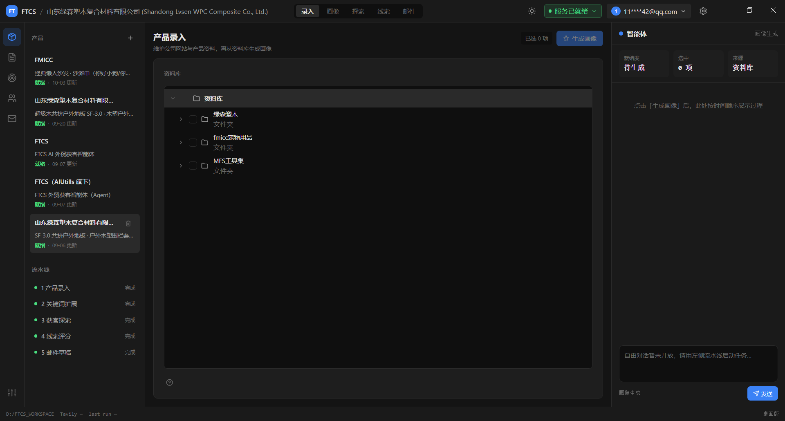
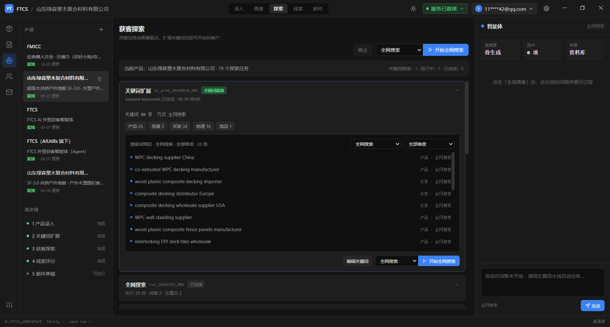
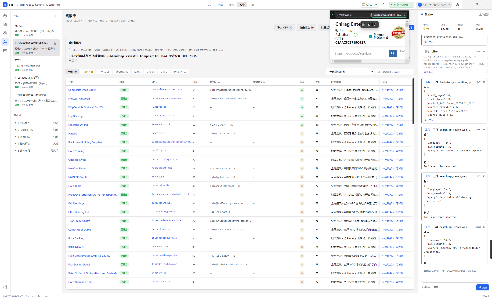

# 外贸获客智能体（FTCS）

FTCS is a Windows desktop agent for foreign-trade teams.
Hand it your product pages and documents.
It builds a product profile, looks through public web pages, and returns scored leads.
Outreach starts as a draft you can edit. You decide when to send.
Business data stays on your computer.

外贸获客（FTCS）是跑在 Windows 上的外贸获客智能体。
把产品官网和说明书交给它。
它生成产品画像，在公开网页里寻找潜在客户，并给出带评分的线索。
开发信先写成可改的草稿，由你确认后再用。
业务数据留在你的电脑上。

## See it in 3 steps

| 1. Add materials | 2. Discover leads | 3. Review the list |
| --- | --- | --- |
|  |  |  |

## 三步看看

| 1. 录入资料 | 2. 探索客户 | 3. 查看线索 |
| --- | --- | --- |
|  |  |  |

Screenshots are from the product UI (same assets as the website).

截图来自产品界面（与官网素材同源）。

## Download

- [Windows Setup](https://github.com/Pedro-MAFS/ftcs/releases/latest) — on the latest release, download the asset whose name contains `Setup`.
- [Windows Portable](https://github.com/Pedro-MAFS/ftcs/releases/latest) — same page; asset name contains `Portable`.

## 下载

- [Windows 安装包（Setup）](https://github.com/Pedro-MAFS/ftcs/releases/latest)：在最新 Release 页下载文件名含 `Setup` 的安装包。
- [Windows 便携版（Portable）](https://github.com/Pedro-MAFS/ftcs/releases/latest)：同一页，下载文件名含 `Portable` 的程序。

## Website

Product site: https://ftcs.ai-utills.com

## 官网

产品站：https://ftcs.ai-utills.com

## License

Licensed under the [Apache License, Version 2.0](./LICENSE).

## 许可

以 [Apache License 2.0](./LICENSE) 授权。

<details>
<summary>开发者 / For developers</summary>

Developer docs below are in Chinese.

## 项目目标

将产品信息转化为可行动的外贸线索，并支持意向邮件的生成与审核发送。

```
产品信息输入 → 产品画像 → 关键词扩展 → 全网探索 → 线索评分去重 → 邮件草稿 → 人工审核 → 发送
```

## 文档导航

实施请**严格按顺序**阅读并执行：

| 序号 | 文档 | 说明 |
|------|------|------|
| 01 | [项目概述](docs/01-项目概述.md) | 愿景、范围、原则、成功标准 |
| 02 | [系统架构](docs/02-系统架构.md) | 分层设计、组件职责、运行模式 |
| 03 | [数据模型](docs/03-数据模型.md) | 产品画像、线索、邮件等 Schema |
| 04 | [实施计划](docs/04-实施计划.md) | **核心执行文档**：分阶段任务与验收标准 |
| 05 | [智能体技能规范](docs/05-智能体技能规范.md) | Skills 定义与调用流程 |
| 06 | [MCP 工具规范](docs/06-MCP工具规范.md) | 工具接口与实现优先级 |
| 07 | [目录结构约定](docs/07-目录结构约定.md) | 仓库目录与文件命名规范 |
| 08 | [产品架构决策：Electron + OpenCode](docs/08-产品架构决策-Electron-OpenCode.md) | Phase 2 桌面产品形态与集成方案 |
| 09 | [Node.js 一键安装方案](docs/09-Node.js一键安装方案.md) | 降低安装摩擦：winget/MSI 安装 24.18.0，探测 ≥22 |
| 10 | [OpenCode 一键安装方案](docs/10-OpenCode一键安装方案.md) | userData 本地前缀安装 opencode-ai；**硬依赖合格 Node** |
| 11 | [官方模型通道对接](docs/11-官方模型通道对接.md) | Desktop ↔ Token 网关对接（消费方） |
| 12 | [官方模型通道用户故事](docs/12-官方模型通道用户故事.md) | 桌面端 G1 用户故事 |
| 15 | [官方搜索通道对接](docs/15-官方搜索通道对接.md) | 桌面端官方搜索（G5） |
| 16 | [官方搜索通道用户故事](docs/16-官方搜索通道用户故事.md) | 桌面端 G5 用户故事 |
| 17 | [需求：业务效率工具](docs/17-需求-业务效率工具.md) | 录入工程树、探索轮次、人员联系画像 |
| 20 | [需求：联系人 Enrichment](docs/20-需求-联系人Enrichment.md) | Hunter BYOK **集成扩展**（非核心；US-C） |

Token 网关已迁至**独立 Git 仓库**维护；本仓仅保留桌面端对接说明（见 docs/11、docs/12）。

## 当前阶段

桌面端已可跑通录入工程树与 Office 抽取、画像、关键词、广撒网 / 社媒发现 / 地图发现、任务编排、线索、开发信草稿。版本以 [最新 Release](https://github.com/Pedro-MAFS/ftcs/releases/latest) 与官网发布日志为准。发信 / 定时探索暂非主线。本期需求见 [docs/17-需求-业务效率工具.md](docs/17-需求-业务效率工具.md)。任务清单见 [docs/04-实施计划.md](docs/04-实施计划.md)。

**标准工作流目录**：[`workspace/`](workspace/) — Skills、MCP、配置、`data/`、`.env` 的**唯一维护位置**。应用壳在 `desktop/`。产品官网在 [`website/`](website/)（Vue3 静态站）。Token 网关已迁出本仓（独立仓库）；桌面端对接见 [`docs/11-官方模型通道对接.md`](docs/11-官方模型通道对接.md)。`.cursor/`、`.opencode/` 为本机 IDE/工具临时目录（**不进 Git**）。

## 技术原则

1. **智能体负责判断，工具负责执行** — 存储、搜索、定时、发送由 MCP/服务完成；网站浏览用 chrome-devtools-mcp
2. **输入分流** — 网站走 chrome-devtools-mcp；普通文件走智能体原生读写；特殊文件后续扩展
3. **数据与流程可移植** — 通过文件约定 + MCP + Skills 跨 IDE 运行
4. **人机协作** — 邮件发送、高价值线索需人工审核
5. **小步迭代** — 每个 Phase 有明确交付物与验收标准

## 仓库状态

- [x] 项目文档体系
- [x] 目录骨架初始化
- [x] 产品信息输入策略确认
- [x] Phase 1.1 产品画像提取（已验收）
- [x] Phase 1.2 关键词扩展（已验收）
- [x] Phase 1.3 获客探索（已验收）
- [x] Phase 1.4 线索评分与去重（已验收）
- [x] Phase 1.5 意向邮件生成（已验收）
- [x] **Phase 1 MVP 闭环（已全部验收）**
- [x] Phase 2.0 Electron + OpenCode 集成（P0）
- [x] Phase 2.1 外贸 Web UI（P0）
- [ ] Phase 2.4 审核与发送 / email-sender
- [ ] Phase 2 scheduler 定时探索

</details>
