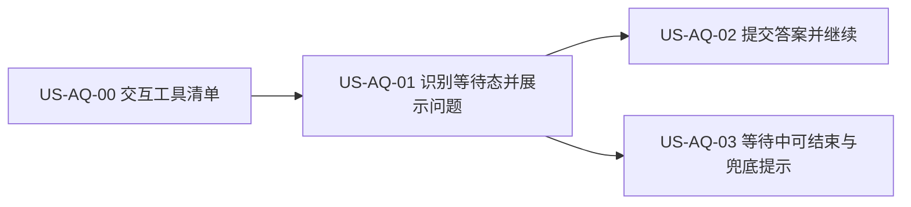

# 31 - 需求：探索时任务等待用户回复

> **文档类型**：本期需求 + 用户故事（**US-AQ**，Await Question）  
> **状态**：**草稿 · 待合入 `dev-0.5.8`**  
> **基线**：桌面端 **v0.5.7+**（`dev-0.5.8`，探索 Agent 运行与时间线已落地）  
> **对齐**：GitHub Issue [#69](https://github.com/Pedro-MAFS/ftcs/issues/69)；Milestone **v0.5.8**  
> **关联**：[25-需求-Agent流式输出.md](25-需求-Agent流式输出.md)、[22-需求-任务完成Windows通知.md](22-需求-任务完成Windows通知.md)

---

## 1. 一句话目标

探索（及其它 Agent 长任务）运行中，若 OpenCode 向用户提问并等待回复，客户端要**认得出来**：在界面显示问题与选项、让用户点选提交后任务继续；用户不想答时能**结束任务**，不再无限转圈卡住。

---

## 2. 背景与动机

### 2.1 用户反馈

用户反馈探索时任务卡住。排查发现：OpenCode 在运行中调用交互工具 `question`，向用户提问后一直等待回复；客户端既没识别、也没有提交入口，任务**既不能继续也不能结束**。

### 2.2 复现样例（Issue #69）

探索 R2 阶段，Agent 调用 `question`，问题大意：「R2 共 200 个合格社媒词，已完成 42 个、写入 5 条线索，海外渠道命中率低，剩余 158 词，你希望如何继续？」，**单选**，三个选项：

1. 继续跑完全部 200 条  
2. 只跑完 70 条高优先词后收尾  
3. 立即收尾并评分  

每个选项带一句说明；另有一个简短标题（如「R2 剩余范围」）。

### 2.3 痛点

| 现象 | 痛点 |
|------|------|
| 界面一直转圈，无任何提示 | 用户不知道任务在等自己，误以为卡死 |
| 没有回答入口 | 任务无法继续，白白占用探索额度与时间 |
| 没有结束出口（或用户不知道能结束） | 只能强关应用 |
| 与「任务完成通知」等机制并存 | 任务未完成也不报错，用户切走后更难发现 |

---

## 3. 已确认产品规则

> 以下取自 Issue #69「目标」与验收草案，及马丰顺口头需求（2026-10-15）。凡 Issue 未写明的细节见 §7 开放问题，**不在此臆定**。

| # | 规则 |
|---|------|
| **AQ1** | **识别等待态**：任务运行中，OpenCode 进入「等待用户回复」时，客户端必须能识别，并让界面进入明确的等待状态。 |
| **AQ2** | **展示问题与选项**：在探索页展示提问内容与选项；支持单选与多选（`multiple`）；自定义输入「如适用」（是否支持见 O3）。 |
| **AQ3** | **提交后继续**：用户选择并提交后，答案回传，任务继续运行。 |
| **AQ4** | **等待态显示**：等待期间界面显示「等待你的回复」类提示，**不得**继续显示为普通运行中的转圈。 |
| **AQ5** | **可结束**：处于等待中的任务，用户可取消 / 结束；不得只能强关应用。 |
| **AQ6** | **不无限卡住**：无法识别的交互，或用户长时间不答时，须有明确提示及可结束任务的出口（具体时长与处理方式见 O4、O5）。 |
| **AQ7** | **交互工具清单**：需梳理 OpenCode 提供的所有会等待用户回复的交互（`question`、权限确认等），形成清单，写明入参 / 出参格式与每类的处理方式（作为文档交付，归详设）。 |
| **AQ8** | **版本**：Issue 尚标「是否纳入 v0.5.8」待澄清；当前已在 0.5.8 里程碑内（项目经理已纳入）。本文基线 `dev-0.5.8`，不合 `main`，不关 #69。 |

---

## 4. 范围与非范围

### 4.1 本期做（In Scope）

1. 识别探索任务进入「等待用户回复」（至少覆盖 `question`；其它交互按 AQ7 清单决定）。  
2. 探索页展示问题与选项，支持单选 / 多选，点选后提交，任务继续。  
3. 等待期间显示「等待你的回复」，且可取消 / 结束任务。  
4. 无法识别或久未回复时的明确提示与结束出口。  
5. 交互工具清单及处理方式文档（AQ7）。

### 4.2 本期不做（Out of Scope）

| 项 | 说明 |
|----|------|
| 从技能提示词层面减少不必要的提问 | Issue 列为「范围外（待澄清）」；是否做见 O6，未确认前不做 |
| 为用户自动代答 / 默认选项 | 未确认；本期由用户亲自作答（O4 如定超时默认处理则另议） |
| 新增与提问无关的任务控制（暂停 / 恢复等） | 非本需求 |
| 合入 `main` / 打 tag / 发版 | AQ8 |

### 4.3 适用页面（待确认）

Issue 只写「探索页」。其它会跑 Agent 的页面（评分、开发信起草等）是否同样处理，见 O1。

---

## 5. 用户故事拆分

| ID | 标题 | 优先级 | 依赖 | 说明 |
|----|------|--------|------|------|
| **US-AQ-00** | OpenCode 交互工具清单 | Must | — | 文档交付：工具名、入参 / 出参、处理方式（AQ7） |
| **US-AQ-01** | 识别等待态并展示问题与选项 | Must | US-AQ-00 | AQ1、AQ2、AQ4 |
| **US-AQ-02** | 点选提交并继续任务 | Must | US-AQ-01 | AQ3 |
| **US-AQ-03** | 等待中可结束；无法识别 / 久未回复的兜底 | Must | US-AQ-01 | AQ5、AQ6 |

建议顺序：AQ-00 → AQ-01 → AQ-02 / AQ-03。

---

### US-AQ-00　OpenCode 交互工具清单

**作为** 项目组，**我想** 有一份 OpenCode 会等待用户回复的交互清单，**以便** 客户端按清单逐类处理，不漏类。

| 项 | 内容 |
|----|------|
| 优先级 | Must |
| 依赖 | — |
| 状态 | **待详设** |

**验收要点**

- 清单列出所有会阻塞等待用户的交互（含 `question`、权限确认等），每项有入参、出参格式与处理方式（AQ7）。  
- 每类交互标明：本期由界面处理 / 自动处理 / 不支持（后者需有 AQ6 兜底）。

**本故事不做**：客户端 UI 实现。

---

### US-AQ-01　识别等待态并展示问题与选项

**作为** 外贸业务员，**我想** 任务在等我回答时界面明确告诉我并显示问题，**以便** 我知道该做什么，而不是以为卡死。

| 项 | 内容 |
|----|------|
| 优先级 | Must |
| 依赖 | US-AQ-00 |
| 状态 | **待详设** |

**验收要点**

- 触发 `question` 时，探索页出现问题标题、问题正文与全部选项（含各选项说明）（AQ1、AQ2）。  
- 单选与多选均能正确展示；自定义输入按 O3 结论处理（AQ2）。  
- 等待期间显示「等待你的回复」，不再是一直转圈（AQ4）。  
- 切走再回到探索页，等待态与问题仍在（页面恢复，见 O2）。

**本故事不做**：提交与继续（归 AQ-02）；结束与兜底（归 AQ-03）。

---

### US-AQ-02　点选提交并继续任务

**作为** 外贸业务员，**我想** 点选答案后任务接着跑，**以便** 不用重开任务。

| 项 | 内容 |
|----|------|
| 优先级 | Must |
| 依赖 | US-AQ-01 |
| 状态 | **待详设** |

**验收要点**

- 选择答案并提交后，答案回传，任务继续运行，界面回到正常运行态（AQ3）。  
- 复现样例中选「立即收尾并评分」后，任务按该选择继续推进（以 Agent 后续行为为准，客户端不替其解读选项含义）。  
- 提交失败有明确提示，问题仍保留，可重试或结束任务（AQ5）。  
- 已回答的提问不能重复提交。

**本故事不做**：减少提问的技能改造（O6）。

---

### US-AQ-03　等待中可结束；无法识别 / 久未回复的兜底

**作为** 外贸业务员，**我想** 随时能结束处于等待中的任务，**以便** 不会被无限卡住。

| 项 | 内容 |
|----|------|
| 优先级 | Must |
| 依赖 | US-AQ-01 |
| 状态 | **待详设** |

**验收要点**

- 等待中的任务可取消 / 结束，结束后界面回到非运行态，探索额度 / 已落库线索的处理与现网「中止」一致（AQ5，O7）。  
- 遇到无法识别的交互，界面给出明确提示（说明任务在等待、客户端暂不能代答）及结束出口，而非无限转圈（AQ6）。  
- 用户长时间不答时的提示与处理按 O4 结论落地（AQ6）。

**本故事不做**：自动代答。

---

## 6. 验收清单（需求级）

- [ ] 有 OpenCode 交互工具清单及各类处理方式文档。（AQ-00）  
- [ ] 触发 `question`，探索页出现问题与选项（单选 / 多选），点选提交后任务继续。（AQ-01、AQ-02）  
- [ ] 等待期间界面显示「等待你的回复」，不再一直转圈。（AQ-01）  
- [ ] 等待中的任务可取消 / 结束。（AQ-03）  
- [ ] 无法识别的交互与久未回复有明确提示及结束出口。（AQ-03）  
- [ ] 变更落在 `dev-0.5.8`；#69 不因本文关闭。

---

## 7. 风险与开放问题

> Issue 未写明、本文**不替用户决定**的事项。

| # | 项 | 说明 / 倾向 |
|---|-----|-------------|
| O1 | **适用页面范围** | 仅探索页，还是评分、开发信起草等所有 Agent 任务统一处理？倾向统一（同一机制），待马丰顺确认 |
| O2 | **切走 / 重启后的等待态** | 切换页面、最小化、关闭应用再打开，是否仍显示待答问题？重启后会话是否还能续答？ |
| O3 | **自定义输入** | Issue 写「如适用」。`question` 是否允许用户输入选项以外的文字？需随 AQ-00 清单确认 OpenCode 行为后定 |
| O4 | **久不回复的时限与处理** | 多久算「长时间」？到时只提示，还是自动结束任务？是否允许自动选默认项？Issue 未给时长 |
| O5 | **用户可见提示文案** | 等待态、无法识别、久未回复的具体文案（口径：用户视角，不出现 OpenCode / `question` 等内部词，见 #66） |
| O6 | **是否同时从技能提示词减少提问** | Issue 列「范围外（待澄清）」；样例中提问源自 R2 技能的自行决策 |
| O7 | **结束等待任务的后果** | 结束后已写入线索保留？是否提示「已保存 N 条」？是否需要像样例选项 3 那样引导「先评分收尾」？ |
| O8 | **等待期间通知** | 窗口不在前台时，是否也弹 Windows 通知提醒「任务在等你回复」（与 [22](22-需求-任务完成Windows通知.md) 的关系） |
| O9 | **定时 / 编排任务中出现提问** | 无人值守的编排（含定时）遇到提问怎么办：等待、跳过还是失败？ |
| O10 | **权限确认类交互** | 现网对权限请求已自动放行；本期是否仍保持不打扰用户（倾向保持），由 AQ-00 清单确认 |

---

## 8. 修订记录

| 日期 | 说明 |
|------|------|
| 2026-10-15 | 初稿：对齐 #69；规则 AQ1～AQ8；US-AQ-00～03；开放问题 O1～O10；基线 `dev-0.5.8` |

---

## 9. 下一步

1. 马丰顺确认本文及 O1、O3、O4 等开放问题后，再合入 **`dev-0.5.8`**（本 PR 先不合；Related #69，不 Closes）。  
2. 合入后交接 @FTCS 详细设计：先出交互工具清单（US-AQ-00），再按 AQ-01～03 写详设。  
3. 详设确认后再交 @FTCS 开发；开工前按开发流程征得同意。  
4. **#69 发版前不关闭**；不触发打 tag / 发版；**不**同步 `main`。
