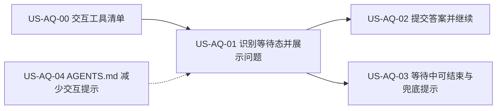

# 31 - 需求：探索时任务等待用户回复

> **文档类型**：本期需求 + 用户故事（**US-AQ**，Await Question）  
> **状态**：**已合入 `dev-0.5.8` · 本版修订（马丰顺 2026-10-18 决策）**  
> **基线**：桌面端 **v0.5.7+**（`dev-0.5.8`，探索 Agent 运行与时间线已落地）  
> **对齐**：GitHub Issue [#69](https://github.com/Pedro-MAFS/ftcs/issues/69)；Milestone **v0.5.8**  
> **关联**：[25-需求-Agent流式输出.md](25-需求-Agent流式输出.md)、[22-需求-任务完成Windows通知.md](22-需求-任务完成Windows通知.md)  
> **OpenCode 事件参考**：`docs/reference/opencode-events/`（`@opencode-ai/sdk`）；桌面现网订阅见 `desktop/electron/opencode/agent-runner.ts`

---

## 1. 一句话目标

探索（及其它 Agent 长任务）运行中，若 OpenCode 向用户提问并等待回复，客户端要**认得出来**：在界面显示问题与选项、让用户点选提交后任务继续；用户不想答时能**结束任务**，不再无限转圈卡住。同时在 `workspace/AGENTS.md` 引导 Agent **少问、可不问就不问**，但**不禁止**必要提问。

---

## 2. 背景与动机

### 2.1 用户反馈

用户反馈探索时任务卡住。排查发现：OpenCode 在运行中调用交互工具 `question`，向用户提问后一直等待回复；客户端既没识别、也没有提交入口，任务**既不能继续也不能结束**。

### 2.2 复现样例（Issue #69）

探索 R2 阶段，Agent 调用 `question`，问题大意：「R2 共 200 个合格社媒词，已完成 42 个、写入 5 条线索，海外渠道命中率低，剩余 158 词，你希望如何继续？」，**单选**，三个选项：

1. 继续跑完全部 200 条  
2. 只跑完 70 条高优先词后收尾  
3. 立即收尾并评分  

每个选项带一句说明；另有一个简短标题（如「R2 剩余范围」）。

### 2.3 痛点

| 现象 | 痛点 |
|------|------|
| 界面一直转圈，无任何提示 | 用户不知道任务在等自己，误以为卡死 |
| 没有回答入口 | 任务无法继续，白白占用探索额度与时间 |
| 没有结束出口（或用户不知道能结束） | 只能强关应用 |
| 与「任务完成通知」等机制并存 | 任务未完成也不报错，用户切走后更难发现 |

---

## 3. 已确认产品规则

> 取自 Issue #69「目标」与验收草案，及马丰顺口头需求（2026-10-15 / **2026-10-18**）。未写明的细节仍见 §7，**不在此臆定**。

| # | 规则 |
|---|------|
| **AQ1** | **识别等待态**：任务运行中，OpenCode 进入「等待用户回复」时，客户端必须能识别，并让界面进入明确的等待状态。 |
| **AQ2** | **展示问题与选项**：在探索页（及 O1 确认的其它页）展示提问内容与选项；支持单选与多选（`multiple`）；`custom === true` 时提供自定义文字输入（见 AQ2a）。 |
| **AQ2a** | **自定义输入（SDK 已具备）**：OpenCode `QuestionInfo` / `QuestionV2Info` 含可选字段 `custom?: boolean`。`custom === true` 时界面须提供选项外的文字输入；`custom` 为 false / 缺省时仅展示选项。 |
| **AQ3** | **提交后继续**：用户选择并提交后，答案回传（`question.reply` / `question.v2` 对应 API），任务继续运行。 |
| **AQ4** | **等待态显示**：等待期间界面显示「等待你的回复」类提示，**不得**继续显示为普通运行中的转圈。 |
| **AQ5** | **可结束**：处于等待中的任务，用户可取消 / 结束；不得只能强关应用。结束等待中的提问可用 `question.reject`（或等价）+ 现网 `session.abort`，具体组合归详设。 |
| **AQ6** | **不无限卡住**：无法识别的交互，或用户长时间不答时，须有明确提示及可结束任务的出口（具体时长与处理方式见 O4）。 |
| **AQ7** | **交互工具必须全覆盖识别与渲染**：须梳理 OpenCode 提供的、会阻塞等待用户的交互类型（见 §5 US-AQ-00 清单），形成可交付清单；**客户端必须识别清单内每一类**，并在页面上**渲染可供用户操作的控件**（问答类须可选题 / 可提交；权限类是否改为弹窗人机确认见 O10，但识别与清单条目不可缺）。 |
| **AQ8** | **版本**：已纳入 Milestone **v0.5.8**；基线 `dev-0.5.8`，不合 `main`，发版前不关 #69。 |
| **AQ9** | **减少交互、不禁止提问**：在 OpenCode 会话实际加载的 **`workspace/AGENTS.md`**（仓库根 `AGENTS.md` 是开发约定，不替代本文件）中增加提示：尽量减少向用户提问、能自行决策就不问；**不得**写成完全禁止提问。实现时若改 `workspace/AGENTS.md`，须按根 `AGENTS.md` 约定同步升高 `WORKSPACE_TEMPLATE_VERSION`。 |

---

## 4. 范围与非范围

### 4.1 本期做（In Scope）

1. 识别任务进入「等待用户回复」，覆盖 US-AQ-00 清单中全部类型（至少含 `question` / `question.v2`；权限类按 O10）。  
2. 探索页（及 O1 确认的页面）展示问题与选项，支持单选 / 多选 / `custom` 文字，点选后提交，任务继续。  
3. 等待期间显示「等待你的回复」，且可取消 / 结束任务。  
4. 无法识别或久未回复时的明确提示与结束出口。  
5. 交互工具清单及处理方式文档（AQ7 / US-AQ-00）。  
6. 在 `workspace/AGENTS.md` 增加「少问、可不问就不问、必要时仍可问」提示（AQ9）。

### 4.2 本期不做（Out of Scope）

| 项 | 说明 |
|----|------|
| 为用户自动代答 / 默认选项 | 未确认；本期由用户亲自作答（O4 如定超时默认处理则另议） |
| 新增与提问无关的任务控制（暂停 / 恢复等） | 非本需求 |
| 合入 `main` / 打 tag / 发版 | AQ8 |
| 站内信 Inbox（`desktop/src/composables/useInbox.ts`） | 那是网关站内信，**不是** OpenCode `question`；勿混用 |

### 4.3 适用页面（待确认）

Issue 只写「探索页」。其它会跑 Agent 的页面（评分、开发信起草等）是否同样处理，见 **O1**。

---

## 5. 用户故事拆分

| ID | 标题 | 优先级 | 依赖 | 说明 |
|----|------|--------|------|------|
| **US-AQ-00** | OpenCode 交互工具清单 | Must | — | 文档交付：工具/事件名、入参 / 出参、现网行为、本期处理方式（AQ7） |
| **US-AQ-01** | 识别等待态并展示问题与选项 | Must | US-AQ-00 | AQ1、AQ2、AQ2a、AQ4 |
| **US-AQ-02** | 点选提交并继续任务 | Must | US-AQ-01 | AQ3 |
| **US-AQ-03** | 等待中可结束；无法识别 / 久未回复的兜底 | Must | US-AQ-01 | AQ5、AQ6 |
| **US-AQ-04** | `workspace/AGENTS.md` 减少交互提示 | Must | — | AQ9；与 UI 故事可并行 |

建议顺序：AQ-00 → AQ-01 → AQ-02 / AQ-03；AQ-04 可并行。

---

### US-AQ-00　OpenCode 交互工具清单

**作为** 项目组，**我想** 有一份 OpenCode 会等待用户回复的交互清单，**以便** 客户端按清单逐类识别并渲染操作控件，不漏类。

| 项 | 内容 |
|----|------|
| 优先级 | Must |
| 依赖 | — |
| 状态 | **待详设**（下列为需求侧基于仓库代码 + `@opencode-ai/sdk` + `docs/reference/opencode-events/` 的**调研基线**，详设须核对版本后定稿） |

#### 调研基线：会阻塞等待用户的交互

| 类型 | 事件（Legacy / 同名 V2） | SDK 入参要点 | 答复 / 出参 | 客户端 API（SDK） | 现网 `agent-runner.ts` | 本期处理（需求） |
|------|--------------------------|--------------|-------------|-------------------|------------------------|------------------|
| **问答 `question`** | `question.asked` → `question.replied` / `question.rejected` | `id`, `sessionID`, `questions[]`（每项：`question`, `header`, `options[{label,description}]`, `multiple?`, `custom?`）, `tool?` | `answers: Array<string[]>`（每题一串所选 label / 自定义文案）；拒绝仅 `requestID` | `client.question.list` / `.reply({ requestID, answers })` / `.reject({ requestID })` | **未处理**（正是 #69 卡死根因） | **必须识别 + 渲染可操作 UI + 提交/拒绝** |
| **问答 `question.v2`** | `question.v2.asked` → `.replied` / `.rejected` | 与上同构：`QuestionV2Info` 字段同 `QuestionInfo` | 同构 `QuestionV2Answer` | 会话侧另有 `questionV2Reply` 等（详设对照所用 SDK 客户端） | **未处理** | **同上，与 v1 同等对待，禁止只认一种** |
| **权限 `permission`** | `permission.asked` → `permission.replied` | `id`, `sessionID`, `permission`, `patterns[]`, `metadata`, `always[]`, `tool?` | `reply: once / always / reject` | `client.permission.reply({ requestID, reply })`（旧 `respond` 已弃用） | 收到 asked 后 **自动 `reply: 'always'`** | **必须列入清单并识别**；是否改为界面确认见 **O10** |
| **权限 `permission.v2`** | `permission.v2.asked` → `.replied` | `id`, `sessionID`, `action`, `resources[]`, `save?`, `metadata?`, `source?` | `PermissionV2Reply`: `once / always / reject` | 同上 permission 客户端 | 同上自动 `always` | **同上；与 v1 同等列入** |

#### 非「等待用户作答」、本期不按 AQ 交互 UI 处理（仅备案）

| 类型 | 说明 |
|------|------|
| `session.status`（`idle` / `busy` / `retry`） | 运行态，不是提问；可用于辅助判断，**不能替代** `question.*.asked` |
| `tui.*`（`prompt.append` / `command.execute` / `toast.show` / `session.select`） | 面向 TUI 的控制事件；桌面 Electron 客户端不按用户问答渲染 |
| `pty.*` | 交互终端会话生命周期；非业务选择题 |
| 站内信 Inbox | 网关产品消息，与 OpenCode 协议无关 |

#### 验收要点

- 详设文档正式收录上表（可增删经核实后的类型），每项有入参、出参、处理方式（AQ7）。  
- 每类标明：界面处理 / 自动处理（须写清条件）/ 不支持（后者须走 AQ6 兜底）。  
- **禁止**只覆盖 `question` 而漏掉 `question.v2` 或权限类条目。

**本故事不做**：客户端 UI 实现（归 AQ-01～03）；AGENTS.md 文案（归 AQ-04）。

---

### US-AQ-01　识别等待态并展示问题与选项

**作为** 外贸业务员，**我想** 任务在等我回答时界面明确告诉我并显示问题，**以便** 我知道该做什么，而不是以为卡死。

| 项 | 内容 |
|----|------|
| 优先级 | Must |
| 依赖 | US-AQ-00 |
| 状态 | **待详设** |

**验收要点**

- 触发 `question` / `question.v2` 时，探索页（及 O1 范围）出现问题标题（`header`）、问题正文（`question`）与全部选项（`label` + `description`）（AQ1、AQ2）。  
- 单选与多选（`multiple`）均能正确展示；`custom === true` 时提供文字输入（AQ2a）。  
- 等待期间显示「等待你的回复」，不再是一直转圈（AQ4）。  
- 切走再回到探索页，等待态与问题是否仍在，见 **O2**。

**本故事不做**：提交与继续（归 AQ-02）；结束与兜底（归 AQ-03）。

---

### US-AQ-02　点选提交并继续任务

**作为** 外贸业务员，**我想** 点选答案后任务接着跑，**以便** 不用重开任务。

| 项 | 内容 |
|----|------|
| 优先级 | Must |
| 依赖 | US-AQ-01 |
| 状态 | **待详设** |

**验收要点**

- 选择答案并提交后，经 `question.reply`（或 v2 等价）回传，任务继续运行，界面回到正常运行态（AQ3）。  
- 复现样例中选「立即收尾并评分」后，任务按该选择继续推进（以 Agent 后续行为为准，客户端不替其解读选项含义）。  
- 提交失败有明确提示，问题仍保留，可重试或结束任务（AQ5）。  
- 已回答的提问不能重复提交。

**本故事不做**：减少提问的 AGENTS 改造（归 AQ-04）。

---

### US-AQ-03　等待中可结束；无法识别 / 久未回复的兜底

**作为** 外贸业务员，**我想** 随时能结束处于等待中的任务，**以便** 不会被无限卡住。

| 项 | 内容 |
|----|------|
| 优先级 | Must |
| 依赖 | US-AQ-01 |
| 状态 | **待详设** |

**验收要点**

- 等待中的任务可取消 / 结束，结束后界面回到非运行态，探索额度 / 已落库线索的处理与现网「中止」一致（AQ5，**O7**）。  
- 遇到无法识别的交互，界面给出明确提示（说明任务在等待、客户端暂不能代答）及结束出口，而非无限转圈（AQ6）。  
- 用户长时间不答时的提示与处理按 **O4** 结论落地（AQ6）。

**本故事不做**：自动代答。

---

### US-AQ-04　`workspace/AGENTS.md` 减少交互提示

**作为** 产品负责人，**我想** Agent 默认少打断用户，**以便** 长任务少卡在「等回复」；同时保留必要时提问的能力。

| 项 | 内容 |
|----|------|
| 优先级 | Must |
| 依赖 | — |
| 状态 | **待详设 / 待开发落盘** |

**验收要点**

- `workspace/AGENTS.md` 增加简短、可执行的提示：减少不必要提问；能根据已有上下文与 Skill 自行决策则不问；**需要用户拍板时仍可使用 `question`**（AQ9）。  
- **不得**出现「禁止提问 / 不得调用 question」一类绝对禁令。  
- 同次改动升高 `WORKSPACE_TEMPLATE_VERSION`（根 `AGENTS.md` 约定）。  
- 文案口径面向 Agent，不要求出现在用户可见 UI（用户可见文案见 **O5**）。

**本故事不做**：改各 Skill 业务流程正文（若某 Skill 强制逐步追问，另开需求）；UI 渲染。

---

## 6. 验收清单（需求级）

- [ ] 有 OpenCode 交互工具清单及各类处理方式文档，覆盖 question / question.v2 / permission / permission.v2。（AQ-00）  
- [ ] 触发 `question`（及 v2），探索页出现问题与选项（单选 / 多选 / custom），点选提交后任务继续。（AQ-01、AQ-02）  
- [ ] 等待期间界面显示「等待你的回复」，不再一直转圈。（AQ-01）  
- [ ] 等待中的任务可取消 / 结束。（AQ-03）  
- [ ] 无法识别的交互与久未回复有明确提示及结束出口。（AQ-03）  
- [ ] `workspace/AGENTS.md` 已含「少问、不禁问」提示，并已升工作区同步版本。（AQ-04）  
- [ ] 变更落在 `dev-0.5.8`；#69 不因本文关闭。

---

## 7. 风险与开放问题（须马丰顺拍板）

> 下列 **未决**；已拍板项见 §7.1。

| # | 项 | 说明 / 倾向 |
|---|-----|-------------|
| **O1** | **适用页面范围** | 仅探索页，还是评分、开发信起草、画像生成等所有 Agent 任务统一处理？倾向统一（同一机制） |
| **O2** | **切走 / 重启后的等待态** | 切换页面、最小化、关闭应用再打开，是否仍显示待答问题？重启后会话是否还能续答？ |
| **O4** | **久不回复的时限与处理** | 多久算「长时间」？到时只提示，还是自动结束任务？是否允许自动选默认项？Issue 未给时长 |
| **O5** | **用户可见提示文案** | 等待态、无法识别、久未回复的具体文案（口径：用户视角，不出现 OpenCode / `question` 等内部词，见 #66） |
| **O7** | **结束等待任务的后果** | 结束后已写入线索保留？是否提示「已保存 N 条」？是否需要像样例选项 3 那样引导「先评分收尾」？ |
| **O8** | **等待期间通知** | 窗口不在前台时，是否也弹 Windows 通知提醒「任务在等你回复」（与 [22](22-需求-任务完成Windows通知.md) 的关系） |
| **O9** | **定时 / 编排任务中出现提问** | 无人值守的编排（含定时）遇到提问怎么办：等待、跳过还是失败？ |
| **O10** | **权限确认：保持自动批准还是改为人机确认** | 现网对 `permission.*.asked` 已 `reply: always`。AQ7 要求列入清单并识别；**是否改为界面渲染确认控件**，请马丰顺决定。倾向：本版可继续自动批准以免打断探索，但须在清单中写明「自动 always」；若改人机确认则 US-AQ-01 范围扩大 |

### 7.1 已关闭 / 已锁定（相对初稿）

| # | 原项 | 结论 |
|---|------|------|
| ~~O3~~ | 自定义输入是否适用 | **已锁定 AQ2a**：跟 OpenCode `custom` 字段；`true` 则提供文字输入 |
| ~~O6~~ | 是否从技能/提示词减少提问 | **已锁定 AQ9 / US-AQ-04**：做，改 `workspace/AGENTS.md`；减少但不禁止 |
| — | 是否纳入 v0.5.8 | **已锁定 AQ8**：在里程碑内 |

---

## 8. 修订记录

| 日期 | 说明 |
|------|------|
| 2026-10-15 | 初稿：对齐 #69；规则 AQ1～AQ8；US-AQ-00～03；开放问题 O1～O10；基线 `dev-0.5.8` |
| 2026-10-18 | #70 已合入后修订：马丰顺确认 AQ9（`workspace/AGENTS.md` 少问不禁问）、AQ7 强化（清单内类型必须识别并渲染可操作控件）；US-AQ-00 写入 SDK/代码调研基线；新增 US-AQ-04；关闭 O3/O6；O1/O2/O4/O5/O7～O10 仍待拍板 |

---

## 9. 下一步

1. 马丰顺确认本修订及 **O1、O2、O4、O10** 等优先开放问题后，详设按 US-AQ-00～04 出方案（PR Related #69，先不合亦可按项目经理节奏）。  
2. 交接 @FTCS 详细设计：以 §5 US-AQ-00 调研基线核对当前 `@opencode-ai/sdk` 版本，定正式清单与 UI/调用链。  
3. 详设确认后再交 @FTCS 开发；开工前按开发流程征得同意。  
4. **#69 发版前不关闭**；不触发打 tag / 发版；**不**同步 `main`。
