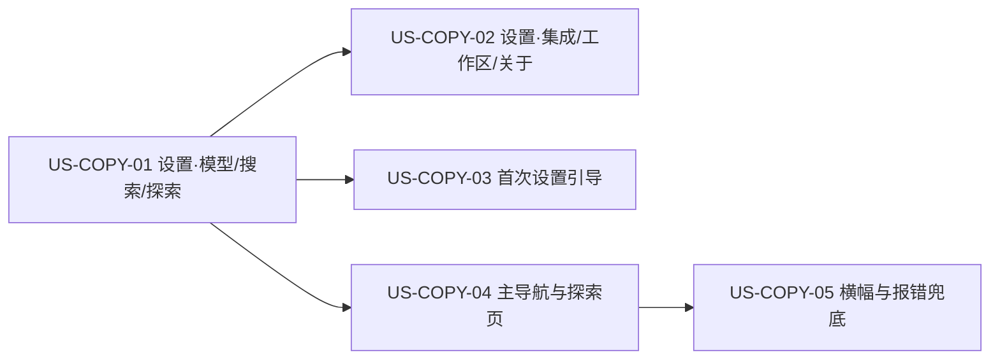

# 32 - 需求：界面文案精简

> **文档类型**：本期需求 + 用户故事（**US-COPY**，Copy / 界面文案）  
> **状态**：**草稿 · 待合入 `dev-0.5.8`**  
> **基线**：桌面端 **v0.5.7+**（`dev-0.5.8`；设置、引导、探索、资料库等界面已落地）  
> **对齐**：GitHub Issue [#66](https://github.com/Pedro-MAFS/ftcs/issues/66)；Milestone **v0.5.8**  
> **关联**：[30-需求-Places官方通道按用户下发APIKey.md](30-需求-Places官方通道按用户下发APIKey.md)；Places 官方区块三行文案由 [PR #67](https://github.com/Pedro-MAFS/ftcs/pull/67) 落实（Issue 初稿曾写 #64，以 #67 为准）

---

## 1. 一句话目标

把客户端（`desktop/`）用户可见文案改成**站在用户角度、合规角度**的短说明：去掉内部术语与实现路径，去掉有合规风险的表述，让用户看得懂要做什么、要满足什么条件、会花多少钱、当前状态如何——**只改文案，不改功能与接口行为**。

---

## 2. 背景与动机

| 现象 | 痛点 |
|------|------|
| 界面大量出现 R1/R2/R3、OpenCode、MCP、Token 网关、`.env` 路径等 | 用户看不懂，像内部调试面板 |
| 单块说明过长、重复、偶有自相矛盾 | 用户抓不住重点，设置成本高 |
| 点名 Clash / TUN / `127.0.0.1:7890` 等代理工具与翻墙手段 | **合规高风险**，易被理解为引导规避网络限制 |
| 「不会上传」「合法合规」「免费额度约 N 次」等说法 | 可能与实现不符，或替第三方转述条款，形成不准确承诺 |
| Places 官方 Key 区块说明冗长 | 马丰顺已定只留三行：网络要求、费用、开通状态 |

Issue #66 已对照 `dev-0.5.8` 梳理约 35 处清单。本文将其固化为可验收的需求与用户故事，供详设与开发按页改写。

---

## 3. 原则（与 #66 一致）

1. **用户视角**：只讲用户关心的——要做什么、要满足什么条件、会花多少钱、当前状态。单块说明一般不超过 3 行。  
2. **不暴露内部术语与路径**：轮次代号、运行时组件名、文件路径、技能 / 工具接口名、环境变量名、状态码枚举、US-xx 编号等，不出现在面向用户的界面上（诊断信息区除外）。  
3. **合规视角**：  
   - 不点名代理工具或翻墙手段；网络要求用中性表述。  
   - 隐私与数据存放说法必须真实、可验证；否则删掉或不写。  
   - 费用说明写明收费方，不写扣费频率（除非产品已明确承诺且可兑现）。  
   - 第三方服务条款只放链接，不替对方转述或承诺（如「合法合规」「免费每月约 N 次」）。

---

## 4. 已确认产品规则

| # | 规则 |
|---|------|
| **COPY1** | **只改文案**：本期只改 `desktop/` 用户可见文案（含引导、横幅、Toast、报错兜底文案）。不改功能、交互流程、计费逻辑、接口行为。 |
| **COPY2** | **术语映射**：界面统一用「全网搜索 / 社媒发现 / 地图发现」指代原 R1 / R2 / R3；按钮如「开始地图发现」。禁止在用户可见处出现 R1/R2/R3。 |
| **COPY3** | **禁用内部词**（诊断信息区除外）：OpenCode、MCP、Token 网关、`workspace/.env`、`opencode.json`、`data/library/`、`discover-*`、`keywords_save`、`hunter_*`、US-xx、技能名 / 工具名暴露给用户等。 |
| **COPY4** | **禁用代理相关词**：Clash、TUN、VPN、翻墙、`127.0.0.1:7890`、SOCKS5 示例等。网络要求统一为中性表述，例如「需要能访问 Google 的网络」或「需可访问相关服务的网络环境」。 |
| **COPY5** | **Places 官方 Key 区块**（设置 · 探索 + 引导第 2 步）：**只留三行**——① 网络要求；② 费用：「使用费用计入官方额度。」（**不写**扣费频率，如「按日」）；③ 开通状态。欠费、吊销提示保留。实现与定稿文案由 **PR #67** 负责；本需求与之对齐，不重复改功能。 |
| **COPY6** | **费用表述**：写明收费方——官方余额 / Tavily / Google / Hunter。不转述第三方免费额度或条款正文；官网链接可附。 |
| **COPY7** | **隐私与本机存放**：任何「只保存在本机」「不会上传」「不保存在这台电脑上」须经开发对照实现核实后再写；核实不了则删掉或不写。应补隐私政策链接（若产品已有）。 |
| **COPY8** | **Google 出站代理区块**：删除工具名与端口示例；保留「跟随系统 / 直连 / 自定义」等中性网络设置；必要时整块折进「高级」。 |
| **COPY9** | **报错兜底**：用户可见处不直接透出后端内部报错原文；统一为「操作失败，请重试」类文案，详情放进可复制的诊断信息。 |
| **COPY10** | **版本**：纳入 **v0.5.8**；需求 PR 基线 **`dev-0.5.8`**。不因此关闭 #66；不合 `main`（发版时整支 `dev` 再合）。 |

### 4.1 术语映射表（用户可见）

| 内部 / 旧说法 | 用户可见说法 |
|---------------|--------------|
| R1 | 全网搜索 |
| R2 | 社媒发现 |
| R3 | 地图发现 |
| OpenCode（面向用户的导航 / 提示） | 运行状态 / 智能体服务 / 应用（按语境） |
| MCP / MCP 服务 | 诊断信息内可保留技术名；主界面用「服务」或收进诊断 |
| Token 网关 | 官方通道 / 官方余额（按语境） |
| `workspace/.env`、`opencode.json`、`data/library/` 等路径 | 不写路径；改「本机」「资料与设置的文件夹」等 |
| `discover-leads-r2`、`keywords_save` 等接口名 | 「正在准备…」「根据画像自动生成搜索关键词」等 |
| `hunter_*` 状态码 | 只显示中文含义 |
| 「保存后重启 OpenCode 使 MCP 生效」 | 「保存后自动生效」；做不到则「保存后重启应用生效」 |

### 4.2 禁用词清单（用户可见界面）

- 轮次 / 内部：R1、R2、R3、OpenCode、MCP、Token 网关、US-xx  
- 路径 / 实现：`.env`、`opencode.json`、`data/`、`discover-*`、`keywords_save`、`hunter_*`  
- 代理 / 规避：Clash、TUN、VPN、翻墙、`127.0.0.1:7890`、SOCKS5（作示例时）  
- 未核实承诺：无法证明的「不会上传」「合法合规」；替第三方写的「免费每月约 N 次」  
- 费用频率：官方 Places 费用行不写「按日」等扣费频率（COPY5）

**例外**：可折叠 / 可复制的「诊断信息」区可为排障保留技术细节；普通设置说明、引导、主流程、Toast、横幅不适用此例外。

---

## 5. 范围与非范围

### 5.1 本期做（In Scope）

1. 按下方改造清单，精简并改写 `desktop/` 用户可见文案（设置各页、首次引导三步、主导航页、横幅 / Toast / 报错兜底）。  
2. 落实术语映射（COPY2）与禁用词（COPY3、COPY4）。  
3. 与 PR #67 对齐 Places 官方区块三行文案（COPY5）；本需求侧验收「界面呈现符合三行规则」。  
4. 隐私相关句子经开发核实后再写（COPY7）；费用与第三方说明符合 COPY6。  
5. 相关 `docs/` / 详设中若仍引用旧界面长文案，由详设另开小 PR 同步（本需求文档指出应对齐，不包办详设改稿）。

### 5.2 本期不做（Out of Scope）

| 项 | 说明 |
|----|------|
| 功能、交互流程、计费逻辑、接口行为改动 | COPY1 |
| Places Key 下发 / 取用 / 状态机实现 | 由 #21 / PR #67 等负责；本文只对齐文案 |
| 英文 / i18n 体系搭建 | #66 明确不做 |
| 官网（`website/`）文案 | #66 明确不做 |
| 合入 `main` / 打 tag / 发版 | COPY10 |
| 未核实的隐私承诺硬写进界面 | COPY7；对不上就标出，不硬写 |

### 5.3 与 PR #67 / #64 的关系

- Issue #66 初稿写「Places Key 区块由 PR #64 精简」。  
- 后续定稿与费用措辞（「使用费用计入官方额度。」、不写按日）落在 **PR #67**。  
- 本需求验收 Places 三行时，以 #67 合入后的界面为准；若 #67 已合，本需求其余条目仍须按清单改完。

---

## 6. 按页面分组的改造清单

> 完整原文摘录见 [#66](https://github.com/Pedro-MAFS/ftcs/issues/66)。下表给出位置、问题类型与建议改法，文档自洽可验收；实现时以 Issue 清单为明细索引。

### 6.1 设置 · 模型与提供商

| 位置 | 问题类型 | 建议改法（验收口径） |
|------|----------|----------------------|
| 官方通道说明 | 内部术语、啰嗦 | 「使用官方模型，费用从账户余额扣除，无需自备 Key。」 |
| 余额 | 内部术语、预告未上线功能 | 只显示余额；未上线功能不预告 |
| 视觉开关 | 内部术语 | 「允许识别图片（需所选模型支持图片）」 |
| 保存提示 | 实现细节 | 「保存后自动生效」 |

### 6.2 设置 · 搜索服务

| 位置 | 问题类型 | 建议改法 |
|------|----------|----------|
| 自定义通道 Tavily | 第三方额度转述 | 「费用由 Tavily 按其价格收取」，附官网链接，不写具体免费额度 |

### 6.3 设置 · 探索

| 位置 | 问题类型 | 建议改法 |
|------|----------|----------|
| 档位 summary | 内部术语、啰嗦 | 「关键词更多、结果更多、耗时与费用更高」；名称用全网搜索 / 社媒 / 地图 |
| 档位说明 | 啰嗦、易矛盾 | 「改档后重新扩展关键词即可生效。」 |
| R2 社媒站点 | 内部术语、啰嗦 | 标题「社媒站点」；「勾选的站点会用于生成社媒关键词」 |
| **Places 官方 Key 区块** | 啰嗦、实现细节、合规 | **只留三行**（COPY5）；欠费 / 吊销提示保留；与 #67 对齐 |
| 自备 Key 说明 | 内部术语 | 「仅地图发现需要。费用由 Google 按其价格收取」，附 Google 链接 |
| 「当前 R3 使用…」状态行 | 内部术语 | 删掉；三行里的状态已说明 |
| 重启 / MCP 提示 | 内部术语 | 「保存后自动生效」或「保存后重启应用生效」 |
| **Google 出站代理** | **合规高风险** | 删工具名与端口示例；中性网络设置；可进「高级」（COPY8） |
| 缺 Key 提示 | 内部术语 | 去掉「R3」，改「仅地图发现需要」 |

### 6.4 设置 · 集成（Hunter）

| 位置 | 问题类型 | 建议改法 |
|------|----------|----------|
| 多 Key 说明 | 啰嗦、合规措辞 | 「可填多个 Key，自动轮换；费用由 Hunter 收取」；「合法持有」改为链到 Hunter 条款 |
| 线索详情邮箱状态 | 原始枚举值 | 只显示中文 |

### 6.5 设置 · 工作区 / 运行时 / 关于与隐私

| 位置 | 问题类型 | 建议改法 |
|------|----------|----------|
| 工作区说明 | 内部路径 | 「存放你的资料与设置的文件夹，切换后应用会自动重启」 |
| 切换成功提示 | 实现细节 | 「工作区已切换」 |
| 「OpenCode 运行时」导航与状态栏 | 内部术语 | 改「运行状态」/「智能体服务」；MCP 列表收进「诊断信息」；「服务未就绪，请稍后或重启应用」 |
| MCP 重连提示 | 内部术语 | 「暂不支持重新连接，请重启应用」 |
| **关于与隐私** | 路径、隐私需核实 | 核实后再写「Key 和设置只保存在本机…」；补隐私政策链接；对不上不硬写（COPY7） |
| 关于页字段 | 内部信息 | 只留版本号；架构 / 模板等放进诊断信息 |
| 环境检测说明 | 啰嗦 | 「检查运行所需组件并引导完成设置」 |

### 6.6 首次设置引导（3 步）

| 位置 | 问题类型 | 建议改法 |
|------|----------|----------|
| 步骤 1 subtitle / 安装按钮 | 啰嗦、内部术语 | 「安装以下组件后即可使用。」按钮「一键安装」，不写版本号如 `OpenCode 1.18.4` |
| 步骤 2 Key 说明 | 路径、内部术语、隐私 | 「Key 只保存在本机。」（须核实）「地图发现可选。」 |
| 步骤 2 标题与 Places 区块 | 内部术语 | 去掉轮次代号；Places 按三行规则，与 #67 同步 |
| 引导相关固定文案（如 keywords_save、R1 探索） | 内部接口名 | 「根据画像自动生成搜索关键词」/「开始找客户」 |

### 6.7 主导航页面

| 位置 | 问题类型 | 建议改法 |
|------|----------|----------|
| 探索页轮次标签与按钮 | 内部术语 | 统一「全网搜索 / 社媒发现 / 地图发现」；「开始地图发现」 |
| 探索进行中提示 | 内部接口名 | 「正在准备…」 |
| 空词提示 | 内部术语 | 去轮次代号 |
| 资料库操作说明 | 路径、啰嗦 | 删路径；操作说明放悬停或「?」 |
| 工作区状态卡 | 内部 ID | 显示名称；「槽」改「收件人」 |
| 计划编辑占位符 | 内部术语 | 「例如：仅全网搜索」 |

### 6.8 横幅 / 报错

| 位置 | 问题类型 | 建议改法 |
|------|----------|----------|
| 全局透出后端原文（如「无法读取 R2 站点」「…接口不可用」） | 内部报错 | 「操作失败，请重试」；详情进诊断信息（COPY9） |
| 更新横幅失败 | 原始错误 | 「检查更新失败，请重试或前往官网下载」 |

---

## 7. 用户故事拆分

| ID | 标题 | 优先级 | 依赖 | 说明 |
|----|------|--------|------|------|
| **US-COPY-01** | 设置页：模型、搜索、探索文案（含 Places 三行与代理合规） | Must | 与 #67 对齐 Places 三行 | COPY2～COPY6、COPY8；§6.1～6.3 |
| **US-COPY-02** | 设置页：集成、工作区、运行状态、关于与隐私 | Must | US-COPY-01 术语口径 | COPY3、COPY6、COPY7；§6.4～6.5 |
| **US-COPY-03** | 首次设置引导三步文案 | Must | US-COPY-01（Places / 术语一致） | §6.6 |
| **US-COPY-04** | 主导航与探索页文案 | Must | US-COPY-01 术语映射 | COPY2；§6.7 |
| **US-COPY-05** | 横幅、Toast、报错兜底 | Must | US-COPY-04 术语口径 | COPY9；§6.8 |

建议顺序：COPY-01（先落术语与合规高风险）→ COPY-02 / COPY-03 / COPY-04 → COPY-05。可同迭代，验收可分故事勾选。

---

### US-COPY-01　设置页：模型、搜索、探索文案

**作为** 外贸业务员，**我想** 在设置里用短、清楚、不含内部术语的说明配置模型、搜索和探索，**以便** 知道网络与费用条件，而不被代理工具名或轮次代号困扰。

| 项 | 内容 |
|----|------|
| 优先级 | Must |
| 依赖 | Places 官方三行与 PR #67 定稿对齐；现网设置页 |
| 状态 | **待详设** |

**验收要点**

- 模型 / 搜索 / 探索相关用户可见文案符合 §6.1～6.3 建议口径；无 COPY3 / COPY4 禁用词（诊断区除外）。  
- 档位与站点说明使用「全网搜索 / 社媒发现 / 地图发现」，无 R1/R2/R3（COPY2）。  
- Places 官方 Key 区块（设置 · 探索）仅三行：网络要求、费用「使用费用计入官方额度。」、开通状态；欠费 / 吊销提示仍在；无「按日」等扣费频率（COPY5）。  
- Google 出站代理无 Clash / TUN / 本地端口示例；中性网络设置（COPY8）。  
- Tavily / Google 费用表述符合 COPY6，不转述免费额度。  
- 单块说明一般不超过 3 行。  
- **不改**通道切换、Key 读写、代理实际生效等功能行为（COPY1）。

**本故事不做**：Hunter / 工作区 / 关于（归 COPY-02）；引导页（归 COPY-03）；探索主页面标签（归 COPY-04）。

---

### US-COPY-02　设置页：集成、工作区、运行状态、关于与隐私

**作为** 外贸业务员，**我想** 在集成与关于页看到准确、可验证的说明，**以便** 配置 Hunter、工作区，并了解 Key 存放方式，而不看到路径和未核实承诺。

| 项 | 内容 |
|----|------|
| 优先级 | Must |
| 依赖 | US-COPY-01 术语口径 |
| 状态 | **待详设** |

**验收要点**

- §6.4～6.5 清单项改完；无 COPY3 禁用词（诊断区除外）。  
- Hunter：「可填多个 Key，自动轮换；费用由 Hunter 收取」；条款用链接，不用「合法持有」类替对方背书（COPY6）。  
- 工作区 / 运行状态文案无 OpenCode / MCP 主界面暴露；MCP 细节进诊断信息。  
- 关于与隐私：隐私 / 本机存放句经开发核实后才写；对不上则删除或改为中性句，并在开放问题中关闭（COPY7）。  
- 关于页主视图只留版本号等用户需要的信息。  
- **不改** Hunter 轮换逻辑、工作区切换行为（COPY1）。

**本故事不做**：引导与探索主流程文案。

---

### US-COPY-03　首次设置引导三步文案

**作为** 首次打开客户端的用户，**我想** 三步引导又短又懂，**以便** 装好组件并配好 Key，而不被版本号、路径和轮次代号干扰。

| 项 | 内容 |
|----|------|
| 优先级 | Must |
| 依赖 | US-COPY-01（Places 三行与术语一致） |
| 状态 | **待详设** |

**验收要点**

- §6.6 清单项改完；步骤 1 不写组件版本号作按钮文案。  
- 步骤 2 无 R1/R2/R3；Places 区块与设置页同一三行规则（COPY5）。  
- Key 本机存放表述须核实（COPY7）；地图发现标明可选。  
- 引导内固定文案无 `keywords_save` 等接口名。  
- **不改**引导步骤流程与安装逻辑（COPY1）。

**本故事不做**：设置页其它分区（已由 COPY-01/02 覆盖）。

---

### US-COPY-04　主导航与探索页文案

**作为** 外贸业务员，**我想** 在探索和资料库里看到统一的业务名称，**以便** 知道在跑全网搜索、社媒发现还是地图发现，而不是 R1/R2/R3。

| 项 | 内容 |
|----|------|
| 优先级 | Must |
| 依赖 | US-COPY-01 术语映射 |
| 状态 | **待详设** |

**验收要点**

- §6.7 清单项改完；探索页标签、按钮、空词提示、进行中提示均无映射后名称（COPY2）。  
- 无 `discover-*` 等接口名出现在用户可见提示。  
- 资料库不展示 `data/library/` 路径；工作区状态卡显示名称，「槽」改为「收件人」。  
- 计划占位符示例用「仅全网搜索」。  
- **不改**探索调度、词表、落库行为（COPY1）。

**本故事不做**：报错兜底（归 COPY-05）。

---

### US-COPY-05　横幅、Toast、报错兜底

**作为** 外贸业务员，**我想** 出错时看到清楚的下一步提示，**以便** 知道重试或去官网，而不是看见内部接口名或原始异常。

| 项 | 内容 |
|----|------|
| 优先级 | Must |
| 依赖 | US-COPY-04 术语口径 |
| 状态 | **待详设** |

**验收要点**

- §6.8 清单项改完；用户可见 Toast / 横幅 / 兜底无 R2、接口名等内部原文（COPY9）。  
- 更新检查失败文案为「检查更新失败，请重试或前往官网下载」，不展示原始错误串。  
- 技术详情仅出现在可复制诊断信息中。  
- **不改**更新检查与报错上报的实际逻辑（COPY1）。

**本故事不做**：设置与引导正文（已由前述故事覆盖）。

---

## 8. 验收清单（需求级）

- [ ] 界面（含引导、横幅、Toast、报错兜底）不出现：R1/R2/R3、OpenCode、MCP、Token 网关、`.env`、`opencode.json`、`data/`、`discover-*`、`keywords_save`、`hunter_*`、US-xx（诊断信息区除外）。（COPY2、COPY3）  
- [ ] 界面不出现 Clash、TUN、VPN、翻墙、`127.0.0.1:7890` 等；网络要求为中性表述。（COPY4、COPY8）  
- [ ] Places Key 区块（设置页 + 引导第 2 步）只有网络要求、费用「使用费用计入官方额度。」、开通状态三行；欠费 / 吊销提示保留；无扣费频率。（COPY5；与 #67 对齐）  
- [ ] 每条隐私或数据存放表述已经开发确认与实现一致；对不上的已删除；隐私政策链接已补（若有）。（COPY7）  
- [ ] 费用表述写明收费方（官方余额 / Tavily / Google / Hunter），不转述第三方免费额度或条款正文。（COPY6）  
- [ ] 单块说明一般不超过 3 行。  
- [ ] §6 各分组清单项均已改写或标明「已由 #67 覆盖」。  
- [ ] 功能与接口行为与改前一致（COPY1）。  
- [ ] 变更落在 `dev-0.5.8`；#66 不因本文关闭。

---

## 9. 风险与开放问题

| # | 项 | 说明 / 倾向 |
|---|-----|-------------|
| O1 | **隐私「不上传 / 只保存在本机」** | 须开发对照实现核实（官方通道遥测、更新检查、日志上报等）。对不上则删，不硬写（COPY7） |
| O2 | **官方 Places「不保存在这台电脑上」** | 与「每次使用时重新获取」相关；以 #21 / #67 实现为准，文案不得与实现矛盾 |
| O3 | **「保存后自动生效」是否普遍成立** | 若某配置仍必须重启应用，用「保存后重启应用生效」，不写 OpenCode / MCP |
| O4 | **诊断信息区信息架构** | MCP 列表、架构、模板等收进何处的交互细节交详设；需求只要求主界面不暴露 |
| O5 | **代理「高级」折叠** | 出站代理整块是否默认折叠进「高级」交详设；合规底线是删除工具名与端口示例 |
| O6 | **docs / 详设旧长文案** | 如 US-PK-C-01 等若仍有旧说明，由详细设计另开 PR 对齐；本需求不包办 |
| O7 | **#67 与本需求的合并顺序** | 倾向先合 #67（三行定稿），再合本需求文档，开发按清单改其余文案；由项目经理定 |

---

## 10. 修订记录

| 日期 | 说明 |
|------|------|
| 2026-10-18 | 初稿：对齐 #66；原则与规则 COPY1～COPY10；术语映射与禁用词；按页改造清单；US-COPY-01～05；Places 三行费用定为「使用费用计入官方额度。」（不写按日），实现对齐 PR #67；基线 `dev-0.5.8` |

---

## 11. 下一步

1. 马丰顺 / 项目经理确认本文及 O1、O7 后，再合入 **`dev-0.5.8`**（本 PR 先不合；Related #66，不 Closes）。  
2. 合入后交接 @FTCS 详细设计：按 US-COPY-01～05 写详设（含 O3～O5 交互细节）；同步清理详设中的旧长文案（O6）。  
3. 详设确认后再交 @FTCS 开发；开工前按开发流程征得同意；隐私句由开发核实（O1）。  
4. **#66 发版前不关闭**；不触发打 tag / 发版；**不**同步 `main`。
