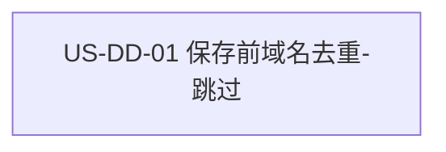

# 33 - 需求：探索线索按域名去重（跳过）

> **文档类型**：本期需求 + 用户故事（**US-DD**，Domain Dedupe）  
> **状态**：**草稿 · 待合入 `dev-0.5.8` · 项目经理 2026-10-19 已锁死 O1～O5**  
> **基线**：桌面端 **v0.5.7+**（`dev-0.5.8`；探索经 MCP `lead_append_raw` 落 raw，评分去重写入 `scored.json`）  
> **对齐**：GitHub Issue [#68](https://github.com/Pedro-MAFS/ftcs/issues/68)；Milestone **v0.5.8**  
> **关联**：[29-需求-目标公司深度画像.md](29-需求-目标公司深度画像.md)、[design/US-CI-01-探索落库随写画像与破冰.md](design/US-CI-01-探索落库随写画像与破冰.md)（同域名再次命中覆盖画像；**本需求在「域名已在 scored」时改为跳过，覆盖该设计的再次命中覆盖**）

---

## 1. 一句话目标

探索阶段保存线索之前，按**域名**对照该产品已有线索；域名已在库中则**跳过**（保留旧线索，不写入本条），新域名仍照常落库。

---

## 2. 背景与动机

### 2.1 用户问题

探索阶段通过 MCP 保存线索时，可能把**已经在线索库里的公司**又写进去一份。Issue #68 要求保存前与已有 `scored.json`（或当前线索库等价数据）按域名比较。策略原为「跳过或覆盖，待确认」。

马丰顺 2026-10-19 锁定：**同域名已存在 → 跳过（保留旧线索）**。不覆盖、不询问、不合并字段。旧画像、破冰等全部保留。本条待保存线索不写入。

### 2.2 现网落库路径（对照 `dev-0.5.8` 代码）

| 环节 | 现网 |
|------|------|
| 探索保存入口 | MCP `lead-store.lead_append_raw`（`workspace/mcp-servers/lead-store/src/index.ts`）→ `appendRawLeadFromTool` / `appendRawLead`（`lead-storage.ts`）。追加一行到 `data/leads/{product_id}/raw/{round}.jsonl`。**写入前不读 `scored.json`，不按域名拒绝。** |
| 同域名再次命中 | 技能 `discover-leads` / `discover-leads-r2` / `discover-leads-r3`，以及桌面探索提示词（`desktop/electron/opencode/agent-runner.ts`）约定：先 `lead_list_raw`，域名已在 **raw** 则不要 `lead_append_raw`，改为 `lead_set_company_intelligence` **覆盖**六段画像与破冰。详设 US-CI-01（CI6）同样要求覆盖，且包含用户改过的破冰。 |
| 用户看到的线索库 | `data/leads/{product_id}/scored.json`（`getScoredLeadsPath`，`paths.ts`）。工具 `leads_get_scored` / `loadScoredLeads` 读取。线索页 `listLeadsSnapshot` 对同一 id **优先展示 scored 行**。每条 scored 线索有 `dedupe_key`。 |
| 评分时的域名去重 | `leads_score_and_dedupe` → `scoreAndDedupeLeads` / `dedupeRawLeadsDetailed`：在 **raw** 内按 `getDedupeKey` 合并，同域名只留一条进 `scored.json`，其余进 `discarded.json`（`reason: duplicate_domain`）。这是评分阶段的行为，**不是**探索保存前的拦截。 |
| 域名规范化 | `normalizeDomain`（`workspace/mcp-servers/lead-store/src/lead-id.ts`）：`new URL(url).hostname` 转小写，并去掉**一个**前缀 `www.`。`getDedupeKey`（`lead-scorer.ts`）用 `normalizeDomain(company.website ?? source.url)`，解析失败时回退公司名，再回退 `lead.id`。`dedupe_key` 按此生成。 |

以现网线索持久化文件为准：探索保存前要对照的库是该产品的 **`data/leads/{product_id}/scored.json`**。没有这份文件，或 `leads` 为空，视为尚无已有域名。

### 2.3 痛点

| 现象 | 痛点 |
|------|------|
| `lead_append_raw` 不对照 `scored.json` | 模型或调用方一旦再保存，已评分线索会被再写一条 raw |
| 技能按 raw 去重，且同域名改为覆盖画像 | 与「保留旧线索、不改旧字段」不一致；用户改过的破冰、已有画像会被探索再次命中换掉 |
| 评分去重发生在探索之后 | 用户在评分前、或评分后再次探索时，仍可能看到重复或被覆盖的旧线索 |

---

## 3. 已确认产品规则

> 取自 Issue #68，马丰顺 2026-10-19 锁定的跳过策略，及项目经理同日锁死的 O1～O5（见 §7）。

| # | 规则 |
|---|------|
| **DD1** | **触发点**：探索阶段「保存线索」路径，在落库之前。现网对到 MCP `lead_append_raw`（新域名追加）以及同一次探索里用于同域名的 `lead_set_company_intelligence`（覆盖）。具体工具名可由详设核对；需求锁的是**保存前**。R1 / R2 / R3 同一规则。只改提示词、仍允许工具把命中域名写进去，不算完成。 |
| **DD2** | **对照源**：同一 `product_id` 下，本地已有线索的**域名集合**。优先且现网路径为 `data/leads/{product_id}/scored.json` 的 `leads[].dedupe_key`（以现网线索持久化文件为准）。文件不存在或没有线索 = 空集合。不跨产品比较。不把 `discarded.json` 单独当「已存在」。只在 raw、尚未进入 `scored.json` 的同域名，**不作为本故事失败条件**（O4 已确认）。 |
| **DD3** | **策略 = 跳过**：待保存线索的规范化域名已在 DD2 集合中 → **不写入**本条（不追加 raw、不新生成 `lead_*` id），并且**不修改**该旧线索的任何字段（公司、联系人、`people`、分数、tier、生命周期 `status`、六段画像、破冰、`dedupe_key` 等保持原样）。不覆盖、不询问、不合并字段。跳过**可静默完成**：允许本地日志，或探索结束说明里一句带过；不做逐条弹窗，也不做保存前确认框（O3 已确认）。 |
| **DD4** | **新域名照常落库**：规范化域名不在 DD2 集合中 → 仍按现网探索保存（`lead_append_raw`，画像校验失败则整行不写，该行为保持）。解析不出域名（`normalizeDomain` 得到 null：无网址，或现网函数无法解析主机名）→ **不按公司名跳过**，视为新线索照常落库。公司名 / `lead.id` 回退只属于评分去重的 `getDedupeKey`，不作为本期「跳过」条件。 |
| **DD5** | **本期不做**：覆盖旧线索、保存前询问用户选跳过还是覆盖、字段级合并（例如只补邮箱、只换破冰）。US-CI-01 / 技能里「同域名已在库则 `lead_set_company_intelligence` 覆盖画像与破冰」在**域名已属于 DD2** 时废止，改为 DD3。 |
| **DD6** | **版本**：纳入 **v0.5.8**。需求 PR 基线 **`dev-0.5.8`**，不合 `main`。关联写法为 Related #68，**发版前不关** Issue #68。 |

### 3.1 域名比较（最小约定）

比较键必须与 `scored.json` 里已经写下的 `dedupe_key` **用同一套规范化**，否则 `www` 与不带 `www` 会对不齐。

现网可复用函数是 `normalizeDomain`，本期沿用（O1、O2 已确认），不另造规则：

| 约定 | 现网 `normalizeDomain` 行为 | 本期 |
|------|------------------------------|------|
| 小写 | `hostname.toLowerCase()` | 必须 |
| 去 scheme | 走 `new URL`，主机名不含 `http://` / `https://` | 必须 |
| 去端口 | `URL.hostname` 不含端口（含非 80/443） | 必须，与现网一致 |
| 剥 `www.` | 仅去掉**一个**前缀 `www.`（`www.Example.com` → `example.com`） | **已确认**：沿用现网，剥离（O1）。详设写验收样例，至少含 `https://www.Example.com/path` 与 `http://example.com` 视为同一域名 |
| 子域名 / 多级后缀 | **不**把 `shop.example.com` 收成 `example.com`，无公共后缀表 | **已确认**：不算同一域名（O2）。不引入公共后缀表 |
| 无 scheme 的裸域名 | `new URL("example.com")` 抛错，函数返回 null | 按 DD4：不因此跳过 |

待保存线索的取域顺序与 `getDedupeKey` 的域名分支一致：`company.website`，缺省再用 `source.url`。只比较这一结果与 `dedupe_key`。不要在需求外增加「注册域 / eTLD+1」规则。

---

## 4. 范围与非范围

### 4.1 本期做（In Scope）

1. 探索保存线索前，能读出该产品 `scored.json` 的已有域名集合（文件缺失按空集）。  
2. 域名已存在：跳过本条，旧记录任何字段不变（DD3）。  
3. 新域名：仍可落库（DD4）。  
4. 探索技能与桌面探索提示词中，凡「域名已在 scored → 覆盖画像」的指令，改为跳过，避免模型继续调用覆盖工具。工具层仍须在保存前拦住（DD1）。  
5. 比较键复用 `normalizeDomain`，与 `dedupe_key` 对齐（§3.1）。

### 4.2 本期不做（Out of Scope）

| 项 | 说明 |
|----|------|
| 覆盖 / 询问用户 / 字段级合并 | DD5 |
| 改评分去重算法 | `leads_score_and_dedupe` 仍在 raw 内按完整度留一条、其余进 `discarded.json`；本期不改这条规则 |
| 同一次探索里、尚未进入 `scored.json` 的两条新线索互相同域名 | **已确认（O5）**：保存前不互斥，仍交给后续评分去重；本期保存前只对照**已有 scored**。实现若在同一次运行内顺手去重，不得改成覆盖已在 scored 的旧记录 |
| 线索页人工编辑、破冰改稿 | `saveRawLead` / `saveLeadIcebreak` 按 id 改已有行，不是探索「保存新线索」 |
| 非探索路径主动刷新画像 | 本期只约束探索阶段保存线索。不新增「生成 / 刷新画像」按钮 |
| 跨 `product_id` 去重、按公司名去重 | DD2、DD4 |
| 合入 `main` / 打 tag / 发版 / 关闭 #68 | DD6 |

### 4.3 与 US-CI-01 的衔接

US-CI-01 要求：同域名再次被探索命中且仍是目标客户时，调用 `lead_set_company_intelligence`，整份覆盖六段和破冰（含用户改过的破冰）。

本需求（2026-10-19 晚于该详设的产品锁定）改为：域名已在 **`scored.json`** → 连这条覆盖也不做。详设须改探索保存路径、`discover-leads*` 与 `agent-runner.ts` 中对应句子，使验收不再要求「再次命中换掉旧破冰」。只在 raw、尚未进入 scored 的同域名，**已确认**不作为 US-DD-01 的失败条件（O4）；现网对该情况的覆盖可保持，不得因此削弱 DD3。

---

## 5. 用户故事拆分

| ID | 标题 | 优先级 | 依赖 | 说明 |
|----|------|--------|------|------|
| **US-DD-01** | 探索保存前按域名去重并跳过 | Must | 现网 `lead_append_raw`、`scored.json` / `dedupe_key`、`normalizeDomain` | 读已有域名 + 命中跳过 + 新域名仍落库 |

单故事即可验收。读域名集合不单独拆故事：没有「跳过 / 放行」的结果，读集合本身不可验。

---

### US-DD-01　探索保存前按域名去重并跳过

**作为** 外贸业务员，**我想** 再次探索时系统不要把已经在线索库里的公司又存一条或改掉原来的画像和破冰，**以便** 我保留已经整理过的线索，同时新公司仍能入库。

| 项 | 内容 |
|----|------|
| 优先级 | Must |
| 依赖 | `data/leads/{product_id}/scored.json`；探索保存入口 `lead_append_raw`（及现网同域名覆盖入口 `lead_set_company_intelligence`） |
| 状态 | **待详设** |

**验收要点**

- 保存前能读到该产品已有域名集合；无 `scored.json` 或 `leads` 为空时集合为空，不因此保存失败（DD2）。  
- 待保存域名与集合中某条 `dedupe_key` 在 §3.1 约定下相同：不出现新的 raw 行、不出现新的 `lead_*` id；该旧线索在 `scored.json` 上的字段与保存前一致，画像与破冰不被换成新内容（DD3、DD5）。  
- 探索流程即使仍试图 `lead_append_raw` 或 `lead_set_company_intelligence`，命中域名也不得写入、不得改旧记录（DD1）。  
- 集合中没有的新域名，`lead_append_raw` 仍可成功，raw 中多出这一条（DD4）。  
- 解析不出域名的待保存线索不被公司名误跳过，仍按现网规则尝试落库（DD4）。  
- 比较与现网 `normalizeDomain` 一致：大小写、剥离单个 `www.` 前缀、scheme、端口不造成同一主机被当成新域名。`https://www.Example.com/path` 与 `http://example.com` 视为同一域名（O1、§3.1）。  
- `shop.example.com` 与 `example.com` **不算**同一域名（O2）。  
- 命中后可静默跳过：无「跳过还是覆盖」的选择，无逐条弹窗，无保存前确认框；允许日志或探索结束一句说明（O3、DD5）。  
- 同一次探索中，两条都不在 `scored.json` 的同域名，保存前不必互相跳过（O5）。  
- 不合并字段（DD5）。  
- 评分去重 `leads_score_and_dedupe` 的保留 / 淘汰规则无回归。  
- 另一 `product_id` 下的同域名线索不影响本产品（DD2）。

**本故事不做**：覆盖与字段合并；询问弹窗；改评分去重；线索页手改；关闭 #68。

---

## 6. 验收清单（需求级）

- [ ] 探索保存前读取该产品 `scored.json` 域名集合；文件不存在按空集，新线索仍可落库。  
- [ ] 已存在域名：不写入新线索，旧记录字段（含画像、破冰）保持不变。  
- [ ] 命中后不会因 `lead_append_raw` 或 `lead_set_company_intelligence` 改掉旧线索。  
- [ ] 新域名仍可经现网探索保存落库。  
- [ ] 无合法域名时不按公司名跳过。  
- [ ] 域名比较与 `normalizeDomain` / `dedupe_key` 对齐：小写、去 scheme、去端口，并剥离单个 `www.`（O1）。`https://www.Example.com/path` 与 `http://example.com` 视为同一域名。  
- [ ] 子域名不算同域：`shop.example.com` 与 `example.com` 可同时落库（O2）。  
- [ ] 无「覆盖 / 询问 / 合并字段」；跳过可静默，无强制弹窗；允许日志或结束一句说明（O3）。  
- [ ] 只在 raw、尚未进入 scored 的同域名，不作为本故事失败（O4）。  
- [ ] 同一次探索里两条都不在 scored 的同域名，保存前不互斥（O5）。  
- [ ] 评分去重行为未改；不跨产品去重。  
- [ ] 变更落在 `dev-0.5.8`；#68 不因本文关闭。

---

## 7. 已确认细则

> **O1～O5 已由项目经理锁死（2026-10-19）**。下表为结论；规则正文见 §3、§3.1。产品侧无未决项。详设按本表写验收样例与实现，不再重开这五项。

| # | 项 | 结论 |
|---|-----|------|
| **O1** | **剥 `www.`** | **已确认**：沿用现网 `normalizeDomain`，剥离单个前缀 `www.`，以便对上已有 `dedupe_key`。验收样例至少含 `https://www.Example.com/path` 与 `http://example.com`，二者视为同一域名。 |
| **O2** | **子域名是否算同一域名** | **已确认：不算**（`shop.example.com` ≠ `example.com`），与现网函数一致。不引入公共后缀表。若要按注册域合并，另开需求。 |
| **O3** | **跳过时要不要告诉用户** | **已确认：可静默跳过。** 允许写本地日志，或在探索结束说明里用一句话带过已跳过的条数。不做逐条强制弹窗，也不做保存前确认框。文案若出现在界面，避免 MCP / `scored.json` 等内部词（归详设）。 |
| **O4** | **只在 raw、尚未进入 scored 的同域名** | **已确认**：不作为 US-DD-01 失败条件。验收只要求对照 `scored.json`。评分去重仍处理 raw 内重复。现网技能对该情况的画像覆盖可保持，**不得**因此削弱 DD3（已在 scored 的必须跳过）。 |
| **O5** | **一次探索里多条待保存、域名相同且都不在 scored** | **已确认**：保存前不互斥。后写入的仍可由 `leads_score_and_dedupe` 按域名淘汰。若实现顺手在同一次运行内去重，不得改成覆盖已在 scored 的旧记录。 |

---

## 8. 修订记录

| 日期 | 说明 |
|------|------|
| 2026-10-19 | 初稿：对齐 #68。策略锁定为**跳过**（保留旧线索，不覆盖、不询问、不合并）。规则 DD1～DD6；US-DD-01；对照现网 `lead_append_raw`、`scored.json`、`normalizeDomain`。基线 `dev-0.5.8`。US-CI-01 对「已在 scored 的同域名」的覆盖要求由本需求取代。 |
| 2026-10-19 | 项目经理锁死 O1～O5：剥 `www.`（沿用 `normalizeDomain`）；子域名不算同域；可静默跳过（允许日志/结束一句说明，无弹窗）；只在 raw、尚未进 scored 的同域不作为本故事失败；同次探索两条都不在 scored 的同域，保存前不互斥。 |

---

## 9. 下一步

1. 马丰顺确认本文后，再合入 **`dev-0.5.8`**（本 PR 先不合；Related #68，不 Closes）。  
2. 合入后交接 @FTCS 详细设计：按 US-DD-01 与 §7 已锁细则写详设（O1 验收样例按「剥离 `www.`」编写；保存入口如何拒绝命中域名；技能与 `agent-runner.ts` 提示词同步改为跳过）。  
3. 详设确认后再交 @FTCS 开发；开工前按开发流程征得同意。  
4. **#68 发版前不关闭**；本需求不触发打 tag / 发版；**不**同步 `main`（发版时整支 `dev` 再合）。
