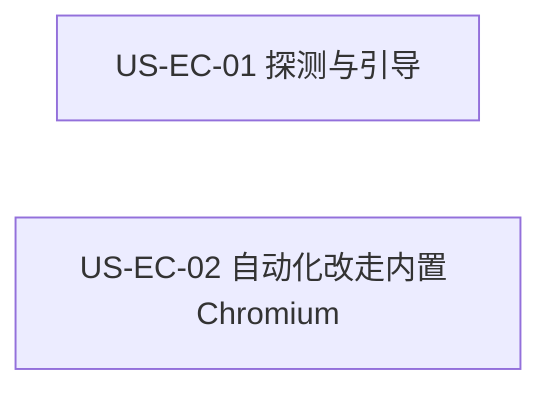

# 34 - 需求：Electron 自带 Chromium 替代系统 Chrome

> **文档类型**：本期需求 + 用户故事（**US-EC**，Electron Chromium）  
> **状态**：**草案 / 待合入 v0.5.9**  
> **基线**：桌面端 **v0.5.8+**（`dev-0.5.9`）  
> **对齐**：GitHub Issue [#78](https://github.com/Pedro-MAFS/ftcs/issues/78)；Milestone **v0.5.9**  
> **关联**：[19-需求-简化运行环境安装.md](19-需求-简化运行环境安装.md)（Node / OpenCode 私有运行时；**Chrome 一键安装不在其范围**）；已关闭的 [#54](https://github.com/Pedro-MAFS/ftcs/issues/54)（引导内一键安装系统 Chrome）由本需求取代

---

## 1. 一句话目标

Windows 上不再要求用户另装系统 Google Chrome；画像抓站与探索打开网页，以及环境探测 / 引导，改为使用 **Electron 自带 Chromium**（或等价、随应用打包的 Chromium）。

---

## 2. 背景与动机

### 2.1 产品结论

马丰顺 2026-10-19：不再依赖本机系统 Google Chrome，改用 Electron 自带 Chromium（或等价随应用打包的 Chromium）。此前规划的「引导内一键安装系统 Chrome」（#54）已关闭。本需求取代那条路线，纳入 **v0.5.9**，测分支 **`dev-0.5.9`**。

[docs/19](19-需求-简化运行环境安装.md) 只覆盖 Node / OpenCode 私有运行时，并写明 Chrome 一键安装不在范围。本需求**不**把 Chrome 方案写进 docs/19 正文。docs/19 仅保留指向本文 / #78 的交叉引用。Node、OpenCode、OfficeCLI 的私有一键安装路径保持 docs/19 的规则。

### 2.2 现网路径（对照 `dev-0.5.9` 代码）

仓库内**没有** Playwright 调用。浏览器自动化入口是 OpenCode 的 MCP `chrome-devtools`。[docs/08](08-产品架构决策-Electron-OpenCode.md) 风险表里的「Playwright MCP」是当时的备选，未落地。下表只记现网事实；「Electron 自带」落到哪一层，见 §7，本文不拍板。

| 环节 | 现网 |
|------|------|
| 环境探测 | `desktop/electron/onboarding/env-probe.ts` 的 `probeChrome()`。Windows 依次查 `Program Files` / `Program Files (x86)` / `%LOCALAPPDATA%\Google\Chrome\Application\chrome.exe`、注册表 `App Paths\chrome.exe`、PATH 上的 `chrome`。命中则 `id: 'chrome'`、`label: 'Google Chrome'`、`status: 'ok'`。未命中则 `missing`，文案为「未检测到 Google Chrome。画像抓站与探索打开网页需要本机 Chrome。」，`installUrl` 为 `https://www.google.com/chrome/`。该项**不是** `optional`。`probeEnvironment()` 的 `ok` 要求所有非 optional 项（Node、OpenCode、Chrome）都是 `ok`。 |
| 引导环境步 | `OnboardingOverlay.vue` 阶段「环境监测」列出 `probe.items`。Chrome 未就绪且带 `installUrl` 时，按钮文案是「打开 Chrome 下载」。环境步仍可点「继续（仍有缺失）」离开；变绿与否看 `probe.ok`。设置页没有第二套依赖清单，通过「打开环境与配置引导」回到同一步。 |
| 业务前检查 | `desktop/electron/preflight/agent-preflight.ts` 的 `needsChrome()`：画像 `extract-profile`、探索 R1 / R2 / R3 要求 MCP `chrome-devtools` 状态为 `connected`。未连接时预检失败，说明为「服务未就绪，请稍后或重启应用」。评分、起草、联系人补全不查这项。 |
| 自动化怎么拉起 | 工作区模板 `workspace/config/opencode/opencode.json` 的 MCP `chrome-devtools`：`npx -y chrome-devtools-mcp@1.6.0 --isolated`。命令行**没有**浏览器可执行文件路径，也**没有**指向 Electron。运行时 `rewriteMcpWorkspaceEnv`（`desktop/electron/opencode/runtime.ts`）只改 MCP 环境变量，不改这条启动命令。 |
| 谁在用这个 MCP | 技能 `extract-product-profile`、`discover-leads`、`discover-leads-r2`、`discover-leads-r3`，以及 `desktop/electron/opencode/agent-runner.ts` 里对应提示：有网站则用 chrome-devtools 打开页面。R2 仍禁止打开社媒真页；R3 仍禁止打开 Google 地图真页。 |
| Electron 自身 | `desktop/package.json` 依赖 `electron` ^34，界面跑在 Electron 里。`build.extraResources` 只打入工作区模板和图标，**没有**另附一份独立的 Chrome / Chromium 可执行文件。现网自动化不附着到主窗口。 |
| 仍写成硬前置的说明 | `desktop/README.md` 前置条件写「Google Chrome（Electron 内置浏览器不能替代）」。官网 `website/content/docs/install.md`、`faq.md`、`getting-started.md` 同样要求安装本机 Chrome。`desktop/src/config/links.ts` 有 `PRODUCT_LINKS.chrome`，引导按钮实际走的是探测结果里的 `installUrl`。 |
| 系统默认浏览器 | 登录、充值、帮助外链使用系统去打开（如设置页 `openProductLink`）。这是默认浏览器，不是环境探测里的 Chrome 项。 |

### 2.3 痛点

| 现象 | 痛点 |
|------|------|
| 探测只认本机 `chrome.exe` | 未装系统 Chrome 的机器上，浏览器项为 `missing`，`probe.ok` 为 false，并引导去下载 Google Chrome |
| 自动化入口另找系统 Chrome | `chrome-devtools-mcp` 未配置随应用提供的浏览器；预检只看 MCP 是否连上，连上与否仍受本机 Chrome 影响 |
| #54 的一键安装系统 Chrome | 已关闭。继续做会把产品留在「必须装系统浏览器」上，与 2026-10-19 的路线相反 |
| docs/19 明确不做 Chrome 一键装 | 若把本需求写进 docs/19 正文，会把 Node/OpenCode 私有运行时和浏览器方案缠在一起 |

---

## 3. 已确认产品规则

> 取自 Issue #78 与马丰顺 2026-10-19 锁定的路线。形态与衔接见 §7，不在本表里补决定。

| # | 规则 |
|---|------|
| **EC1** | **去掉系统 Chrome 硬依赖**。未安装系统 Google Chrome，不得再作为环境探测失败或「需要浏览器的既有业务跑不起来」的原因。这里的既有业务指现网已经要开网页的路径：有网站时的画像抓站，以及 R1 / R2 / R3 探索打开公司官网。R2 不打开社媒真页、R3 不打开地图真页，维持原红线。 |
| **EC2** | **浏览器改为随应用提供**。使用 Electron 自带 Chromium，或等价、随应用打包的 Chromium。用户不必另装系统 Chrome。具体是主进程 / BrowserWindow、安装包内的 Chromium，还是为自动化单独拉起的内置 Chromium 进程，由详设在 §7 里选定。 |
| **EC3** | **探测与引导改口径**。环境探测与引导环境步（设置页复用同一步）的标签、说明、就绪判定改为**内置浏览器就绪态**。不再把「去安装系统 Chrome」或 `https://www.google.com/chrome/` 当作该项的去向。失败必须有明确错误，并说明如何重试；不得把失败显示成就绪，也不得没有任何说明。 |
| **EC4** | **自动化通道对齐**。现网入口是 MCP `chrome-devtools`（`chrome-devtools-mcp@1.6.0 --isolated`）以及 `runAgentPreflight` 对画像与 R1 / R2 / R3 的检查。这些路径改为使用 EC2 的浏览器。仓库内无 Playwright；若详设保留该 MCP 或改用别的入口，**模块名由详设定**。产品锁定的是：不依赖系统 Chrome。 |
| **EC5** | **不做一键安装系统 Chrome**。#54 已关闭，本需求取代该路线。不新增下载、静默安装或引导安装系统 Google Chrome 的步骤。 |
| **EC6** | **不代管系统浏览器个人数据**。不读写、不迁移系统 Chrome 的扩展、多 Profile、书签。不修改系统默认浏览器。登录、充值、帮助等外链仍按现网交给系统打开，不纳入本需求。 |
| **EC7** | **不动 Node / OpenCode / OfficeCLI 私有安装**。不把 Node 或 OpenCode 打进主安装包。探测项、一键准备、`userData` 私有目录与 prefs 仍按 docs/19。本需求不得使这些路径回退到 winget / MSI / npm。 |
| **EC8** | **版本与平台**。纳入 **v0.5.9**。需求 PR 基线 **`dev-0.5.9`**，不合 `main`。关联写法为 Related #78，**不关** Issue #78。平台以 **Windows** 为主，与现网产品一致。 |

---

## 4. 范围与非范围

### 4.1 本期做（In Scope）

1. 环境探测不再把「本机已装系统 Chrome」当作浏览器项合格条件（EC1、EC3）。  
2. 引导环境步与设置里打开的同一引导，文案与探测项改为内置浏览器就绪态；去掉「打开 Chrome 下载」这类去向（EC3）。  
3. 画像抓站与 R1 / R2 / R3 打开公司官网的自动化，改走随应用提供的 Chromium（EC2、EC4）。  
4. 内置浏览器启动失败或探测失败时，有明确错误与可重试说明（EC3、EC4）。  
5. 与现网 `env-probe`、引导环境步、`chrome-devtools` 这条自动化入口对齐。新模块名由详设写下，不在本文起名。

### 4.2 本期不做（Out of Scope）

| 项 | 说明 |
|----|------|
| 一键安装系统 Chrome | EC5；#54 已关闭 |
| 代管扩展、多 Profile、系统默认浏览器 | EC6 |
| 把登录 / 充值 / 帮助外链改成应用内窗口 | 现网走系统打开；EC6 |
| 把 Node / OpenCode 打进主安装包 | EC7；仍属 docs/19 |
| 改 R2 不打开社媒真页、R3 不打开地图真页 | EC1 只换浏览器，不改这两条红线 |
| 在 docs/19 正文扩写本方案 | 仅交叉引用 |
| 合入 `main` / 打 tag / 发版 / 关闭 #78 | EC8 |

官网安装页、FAQ、`desktop/README.md` 仍写着「必须安装 Google Chrome，Electron 内置不能替代」。验收草案没有把这些页面单列为必改项。详设若改到这些句子，口径须与 EC1 一致，不得再把系统 Chrome 写成硬前置。

---

## 5. 用户故事拆分

| ID | 标题 | 优先级 | 依赖 | 说明 |
|----|------|--------|------|------|
| **US-EC-01** | 探测与引导去掉系统 Chrome 依赖 | Must | 现网 `probeChrome`、引导环境步 | 浏览器项与文案改为内置浏览器就绪态 |
| **US-EC-02** | 画像与探索的浏览器自动化改走内置 Chromium | Must | 现网 `chrome-devtools` MCP、`runAgentPreflight` | 未装系统 Chrome 时，需要开网页的既有路径仍能跑 |

两条都留。`probeChrome()` 只检查本机 `chrome.exe` 是否存在，不启动浏览器，也不调用 MCP。画像和探索是否打得开网页，走的是另一条：OpenCode 拉起 `chrome-devtools`，预检只看该 MCP 是否 `connected`。只改引导，自动化仍会去找系统 Chrome；只改自动化，引导仍会显示「未检测到 Google Chrome」。两条可以分别验收，详设可以并行。合在一起会让文案改动必须等到整段探索跑通才能收。

---

### US-EC-01　探测与引导去掉系统 Chrome 依赖

**作为** 外贸业务员，**我想** 在没装 Google Chrome 的电脑上完成环境检测和首次引导，**以便** 不用先去装系统浏览器才能看到环境就绪。

| 项 | 内容 |
|----|------|
| 优先级 | Must |
| 依赖 | `probeEnvironment()` / `probeChrome()`；`OnboardingOverlay.vue` 环境步；设置页「打开环境与配置引导」 |
| 状态 | **待详设** |

**验收要点**

- 未安装系统 Chrome 时，浏览器探测项不再因为找不到 `chrome.exe`、注册表 App Paths 或 PATH 上的 `chrome` 而记为 `missing`（EC1、EC3）。  
- 该项的标签与说明表示内置浏览器的就绪或失败，不再出现「请安装 Google Chrome」或「打开 Chrome 下载」，也不再把 `https://www.google.com/chrome/` 当作去向（EC3）。  
- 设置页打开的引导与首次引导是同一份结果，不保留另一套系统 Chrome 文案。  
- 内置浏览器探测失败时：状态不是 `ok`，界面有明确错误，并说明可以重试（重新检测或详设写明的其它重试）。不得静默当成就绪（EC3）。  
- Node、OpenCode、OfficeCLI 的探测状态、一键安装按钮和私有安装结果与改动前一致（EC7）。  
- 本故事不要求画像或探索已经能打开网页。那是 US-EC-02。

**本故事不做**：拉起自动化浏览器；安装系统 Chrome；关闭 #78。

---

### US-EC-02　画像与探索的浏览器自动化改走内置 Chromium

**作为** 外贸业务员，**我想** 生成画像和探索客户时用应用自带的浏览器打开网页，**以便** 电脑上没有 Google Chrome 也能走完这些步骤。

| 项 | 内容 |
|----|------|
| 优先级 | Must |
| 依赖 | MCP `chrome-devtools` 的现网启动方式；`runAgentPreflight` 的 `needsChrome`；技能 `extract-product-profile`、`discover-leads`、`discover-leads-r2`、`discover-leads-r3` |
| 状态 | **待详设** |

**验收要点**

- 未安装系统 Chrome 的 Windows 上，有网站的画像抓站，以及 R1 / R2 / R3 打开公司官网，仍能完成现网已有的业务路径（EC1、EC2、EC4）。  
- 上述路径使用的是随应用提供的 Chromium，不启动、不附着用户已安装的系统 Chrome，也不读取其扩展或 Profile（EC2、EC6）。  
- 浏览器或对应 MCP 未就绪时，预检或启动失败给出明确错误，并说明可重试；不得在未就绪时继续抓站，也不得把未连接报成已连接（EC3、EC4）。  
- R2 仍不打开社媒真页；R3 仍不打开 Google 地图真页。  
- Node / OpenCode / OfficeCLI 一键私有安装仍可用（EC7）。  
- 本故事不要求引导文案已经改完。那是 US-EC-01。两条都完成后，才同时满足 §6 的第 1、2 条。

**本故事不做**：一键安装系统 Chrome；改系统默认浏览器；替 docs/19 把 Node/OpenCode 打进安装包；关闭 #78。

---

## 6. 验收清单（需求级）

- [ ] 未安装系统 Chrome 的 Windows 干净环境可以通过环境探测，并完成需要浏览器的既有业务路径（有网站的画像、R1 / R2 / R3 打开公司官网）。  
- [ ] 引导与设置不再要求安装系统 Chrome；探测项与文案改为内置浏览器就绪态。  
- [ ] 内置浏览器启动或探测失败时，有明确错误和可重试说明，不静默失败，也不把失败显示为就绪。  
- [ ] Node / OpenCode / OfficeCLI 私有一键安装路径无回归。  
- [ ] 没有新增「一键安装系统 Chrome」，也不代管扩展、多 Profile 或系统默认浏览器。  
- [ ] 变更落在 `dev-0.5.9`；#78 不因本文关闭。

---

## 7. 开放项

> 下列三项来自 #78「待澄清 / 详设」。**本文不拍板**。详设必须写明选择和验收样例后再开发。

| # | 项 | 现状（供详设对照，不是结论） |
|---|-----|------------------------------|
| **O1** | 「Electron 自带」具体指什么 | 候选仍是：主进程 / BrowserWindow、随安装包带上的 Chromium，或为自动化单独拉起的内置 Chromium 进程。现网 Electron 只承担界面；安装包 `extraResources` 没有独立 Chromium 可执行文件；自动化不附着主窗口。 |
| **O2** | 与 OpenCode / MCP 浏览器工具如何衔接 | 现网是 `npx chrome-devtools-mcp@1.6.0 --isolated`，预检看 `chrome-devtools` 是否 `connected`。仓库无 Playwright。详设决定继续用该 MCP、改其启动参数，或更换入口，并写明模块名。 |
| **O3** | 安装包体积与更新策略 | Electron 界面已经带一份 Chromium。若 O1 还要再打包一份浏览器，体积和后续升级方式会变。本文不决定是否加包、也不改更新通道。 |

---

## 8. 修订记录

| 日期 | 说明 |
|------|------|
| 2026-10-21 | 初稿：对齐 #78。路线锁定为 Electron 自带 Chromium（或等价随应用打包的 Chromium），取代已关闭的 #54。规则 EC1～EC8；US-EC-01、US-EC-02。对照现网 `probeChrome`、引导环境步、`chrome-devtools-mcp`。基线 `dev-0.5.9`。开放项 O1～O3 不拍板。 |

---

## 9. 下一步

1. 本文合入 **`dev-0.5.9`**（本 PR：Related #78，不 Closes）。  
2. 合入后交接详细设计：按 US-EC-01、US-EC-02 写详设，并先关闭 §7 的 O1～O3（形态、与 MCP 的衔接、体积与更新）。模块名在详设里确定。  
3. 详设确认后再交开发。  
4. **不关闭 #78**；本需求不触发打 tag / 发版；**不合 `main`**。
