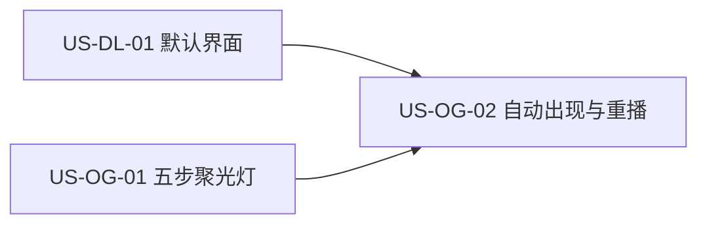

# 35 - 需求：业务流程引导 · 分步聚光灯蒙层

> **文档类型**：本期需求 + 用户故事（**US-OG**，Onboarding Guide / 业务流程引导）  
> **状态**：**待详设**  
> **基线**：桌面端 **`dev-0.6.0`**  
> **对齐**：GitHub Issue [#8](https://github.com/Pedro-MAFS/ftcs/issues/8)；Milestone **v0.6.0**  
> **关联**：[36-需求-按流水线阶段打开默认界面.md](36-需求-按流水线阶段打开默认界面.md)（[#104](https://github.com/Pedro-MAFS/ftcs/issues/104)，先落默认界面，再叠本蒙层）；支持计划 `onboarding-guide`（<https://ftcs.ai-utills.com/plan>）  
> **前缀**：仓库现有用户故事与 `docs/design/` 中无 **US-OG**，本文采用该前缀。详设文件不在本需求 PR 中新建。

---

## 1. 一句话目标

首次进入业务界面时，用**分步聚光灯蒙层**把主线五步（录入 → 画像 → 探索 → 线索 → 开发信）指给用户；跳过或走完后不再自动出现，需要时从设置重播。

---

## 2. 背景与动机

### 2.1 产品结论

马丰顺 / 项目组 2026-10-28 锁定：业务流程引导升级为现代**分步聚光灯蒙层**（spotlight：挖空或高亮当前目标控件，配步骤气泡），覆盖主线五步。纳入 **v0.6.0**，测分支 **`dev-0.6.0`**。

与 [#104](https://github.com/Pedro-MAFS/ftcs/issues/104) 的顺序已锁定：先落到按流水线判定的默认界面，再把蒙层叠上去。默认界面规则见 [docs/36](36-需求-按流水线阶段打开默认界面.md)，本文不另定落地页。

### 2.2 现网路径（对照 `dev-0.6.0`）

| 环节 | 现网 |
|------|------|
| 首次自动弹出 | `useOnboarding`：`completed` 与 `skipped` 都为 false 时打开 `OnboardingOverlay`。这是盖住界面的设置向导，不是点在业务控件上的聚光灯。 |
| 向导三步 | 环境监测 → 模型通道 → **业务引导**。业务引导是向导卡片里的步骤清单（`TOUR_STEPS`，共 7 步：产品录入、画像生成、关键字扩展、开始找客户、评分与去重、生成邮件、邮件审核）。点一行可跳到对应路由，再点「打开××页」。 |
| 结束方式 | 业务步底部是「结束引导」。前两步是「稍后配置」。`skipAll()` 把 `skipped` 写成 true，整个向导（含业务引导）下次不再自动开。`completeAll()` 把 `completed` 写成 true。 |
| 设置重播 | 设置 → 关于与隐私 →「首次引导」有两个按钮：「打开环境与配置引导」（`reopenOnboarding('env')`）和「打开业务引导」（`reopenOnboarding('tour')`）。后者重新打开同一份向导清单。 |
| 主线页面 | 顶栏与模块条五页：录入 `input`、画像 `profile`、探索 `explore`、线索 `leads`、邮件 `email`（产品称开发信）。左侧流水线五步与这五页不是一一对应，见 docs/36。 |
| 进入后的页面 | 路由 `/` 固定重定向到线索。与进度无关。此行为由 docs/36 改，本文只规定蒙层叠在其结果之上。 |

### 2.3 痛点

| 现象 | 痛点 |
|------|------|
| 业务引导是向导里的清单 | 用户看不到「现在该点屏幕上的哪一个」；新手仍不清楚下一步 |
| 清单为 7 步，且与主线五页交错 | 关键字扩展、评分、审核单独成行，和用户要走的五页主线不一致 |
| 跳过环境向导会连业务引导一起记住 | 「稍后配置」写入的 `skipped` 同时关掉业务引导的自动出现，两件事绑在同一个标志上 |
| 蒙层若抢在默认页之前 | 高亮会落在错误页面上，与 #104 冲突 |

---

## 3. 已确认产品规则

> 取自 Issue #8，马丰顺 / 项目组 2026-10-28 锁定的口径。锚在哪个具体按钮上、气泡文案、挖空的像素，由详设写，不在本表里补决定。

| # | 规则 |
|---|------|
| **OG1** | **形态是分步聚光灯蒙层**。遮罩盖住其余界面，当前这一步的目标控件被挖空或高亮，旁边有步骤气泡。每一步只讲当前这一处。不做居中的步骤清单，也不做只在空列表上加一句「下一步去哪」的文案条。 |
| **OG2** | **主线五步全覆盖**，顺序固定：录入 → 画像 → 探索 → 线索 → 开发信。对应现网路由 `input`、`profile`、`explore`、`leads`、`email`。关键字扩展写在画像这一步的说明里，评分写在线索这一步里，不另成步。步数是五，不沿用 `TOUR_STEPS` 的七步。 |
| **OG3** | **每一步都指向该页上的真实控件**。进入该步时若当前不在对应页面，先打开那一页，再挖空。不得停在一块没有目标的遮罩上。具体锚点由详设列出；锚点依赖尚未产生的数据时，详设改锚到该页上始终存在的控件，并在验收样例里写明。 |
| **OG4** | **控件是「下一步」和「跳过全部」**。气泡上提供这两个动作。「下一步」进入下一步；第五步上的推进表示走完（按钮文字用「下一步」或「完成」由详设定，记忆效果相同）。「跳过全部」立刻结束本次引导。 |
| **OG5** | **何时自动出现**。尚未跳过全部、也尚未走完时，用户能看到业务界面之后自动从第一步出现。本次若环境与配置向导仍全屏挡住业务页，等该向导结束或用户离开它、且 [docs/36](36-需求-按流水线阶段打开默认界面.md) 的默认页已经落下，再显示第一步。不得把聚光灯画在环境向导上面。 |
| **OG6** | **与 #104 的顺序**。自动出现时：先落到默认界面，再叠第一步蒙层。默认页不是录入时，仍然从录入这一步开始（先落页，再为第一步打开录入并高亮），不从默认页所在的阶段插步。 |
| **OG7** | **跳过或走完后不再自动出**。只有「跳过全部」和走完第五步会写入这份记忆。点遮罩、按 Esc、关闭主窗口，都不算跳过。尚未跳过且尚未走完就离开的，下次进入仍自动出。环境向导的「稍后配置」不写入这份记忆，也不再借用现网那一个 `skipped` 把业务引导一起关掉。 |
| **OG8** | **设置里可以重播**。入口在设置中，现网位置是关于与隐私里的「打开业务引导」。重播从第一步（录入）再走五步，控件与走完 / 跳过的记忆和自动出现时相同。重播不先重做一次 #104 的落地（用户已经在这次运行里，且人在设置）。重播本身不是自动出现。走完或跳过之后，下次冷启动仍然不自动出。 |
| **OG9** | **只叠加引导层**。不改录入、画像、探索、线索、开发信各页的业务动作、校验和数据。环境探测、模型通道向导、Node / OpenCode / OfficeCLI 安装保持现网。 |
| **OG10** | **版本与关联**。纳入 **v0.6.0**。需求 PR 基线 **`dev-0.6.0`**，发版前不合 `main`。关联写法为 Related #8、Related #104，**不关** Issue #8。 |

---

## 4. 范围与非范围

### 4.1 本期做（In Scope）

1. 分步聚光灯蒙层：挖空或高亮当前控件，并显示步骤气泡（OG1、OG3）。  
2. 主线五步的顺序、所在页面，以及「下一步 / 跳过全部」（OG2、OG4）。  
3. 首次（及尚未完成时的再次进入）自动出现，且发生在默认界面落下之后（OG5、OG6）。  
4. 跳过全部或走完后不再自动出现；未完成离开则下次仍自动出（OG7）。  
5. 设置中重播，重播仍覆盖五步（OG8）。  
6. 业务引导的完成记忆与环境向导的跳过 / 完成分开（OG7、OG9）。

### 4.2 本期不做（Out of Scope）

| 项 | 说明 |
|----|------|
| 教程视频 | Issue #8 范围外 |
| 与业务无关的通用 tips 系统 | Issue #8 范围外；不是随时冒出的提示框架 |
| 官网 / 社媒上的曝光或引导 | Issue #8 范围外 |
| 改环境监测、模型通道向导的步骤与安装流程 | OG9 |
| 改各业务页的核心操作 | OG9；只叠加引导层 |
| 按流水线改默认界面 | 属于 docs/36 / #104；本文只消费其结果 |
| 记住上次打开的页面 | 属于 docs/36 的非范围 |
| 合入 `main` / 打 tag / 发版 / 关闭 #8 | OG10 |

---

## 5. 用户故事拆分

| ID | 标题 | 优先级 | 依赖 | 说明 |
|----|------|--------|------|------|
| **US-OG-01** | 五步聚光灯蒙层 | Must | 现网五页路由；顶栏 / 模块条已能打开对应页 | 挖空、气泡、下一步、跳过全部；五步走完主线 |
| **US-OG-02** | 自动出现、完成记忆与设置重播 | Must | US-OG-01；[US-DL-01](36-需求-按流水线阶段打开默认界面.md)（仅自动出现时的先后顺序） | 先默认页再蒙层；跳过或走完后不再自动出；设置可重播 |

两条都留。蒙层可以在指定页面上单独验收；自动出现还必须等默认页落下。合在一起会让「高亮是否对准控件」等到整段冷启动规则做完才能看。

---

### US-OG-01　五步聚光灯蒙层

**作为** 第一次用 FTCS 的外贸业务员，**我想** 在真实页面上看到当前该点哪里、点完再到哪一页，**以便** 不用对着一份清单猜测下一步。

| 项 | 内容 |
|----|------|
| 优先级 | Must |
| 依赖 | 路由 `input` / `profile` / `explore` / `leads` / `email` 可打开；现网业务页上的主操作控件仍在 |
| 状态 | **待详设** |

**验收要点**

- 引导呈现为遮罩 + 当前控件挖空或高亮 + 步骤气泡，不是向导中央的七步清单，也不是只改空列表文案（OG1）。  
- 顺序为录入、画像、探索、线索、开发信五步，页面分别是 `input`、`profile`、`explore`、`leads`、`email`。没有独立的「关键字扩展」步和「评分」步（OG2）。  
- 每一步的气泡都能指出该页上的一个真实控件；人在别的页时，这一步会先打开对应页再挖空（OG3）。  
- 每一步都能用「下一步」进入下一步；第五步的推进会结束引导。每一步都有「跳过全部」，点击后本次蒙层关闭（OG4）。走完与跳过如何被记住，见 US-OG-02。  
- 蒙层出现期间，被挡住的区域不误触发业务动作。被挖空的控件是否允许顺手点下去，由详设二选一写死，并给出验收样例。  
- 录入、画像、探索、线索、开发信的原有按钮和保存结果与蒙层出现前一致（OG9）。  
- 本故事不要求冷启动自动弹出。那是 US-OG-02。

**本故事不做**：教程视频；通用 tips；改环境向导；关闭 #8。

---

### US-OG-02　自动出现、完成记忆与设置重播

**作为** 外贸业务员，**我想** 第一次进到业务界面时自动看到引导，看完或跳过之后不再被挡住，需要时再从设置里重看，**以便** 新手被带着走一遍、老用户不被反复打断。

| 项 | 内容 |
|----|------|
| 优先级 | Must |
| 依赖 | US-OG-01；自动出现的先后依赖 US-DL-01 已经选好默认页；设置页现有「打开业务引导」 |
| 状态 | **待详设** |

**验收要点**

- 尚未跳过全部、也尚未走完时：环境向导没有挡住业务页之后，先出现 docs/36 规定的默认界面，再出现第一步聚光灯（OG5、OG6）。新用户无进度时，默认页是录入，第一步也在录入。  
- 默认页不是录入时，仍然先完成落地，再从录入开始高亮，不从中间步开始（OG6）。  
- 「跳过全部」或走完第五步之后，结束进程再进入，蒙层不自动出现（OG7）。  
- 蒙层显示中关闭应用（既没跳过也没走完），下次进入仍自动从第一步出现（OG7）。  
- 在环境向导点「稍后配置」或走完环境监测 / 模型通道，不会单独把业务聚光灯记成已跳过（OG7）。环境向导本身仍可按现网不再自动弹出。  
- 设置中的业务引导入口可以在已走完或已跳过之后再次打开五步。重播从录入开始，不先改一次默认页。重播结束后，下次冷启动仍不自动出现（OG8）。  
- 点遮罩、按 Esc 不会写入「不再自动出」（OG7）。若详设保留这些按键，它们最多关掉本次显示，且下次进入仍自动出；详设须写明选了哪一种。  
- 本故事不要求挖空样式。那是 US-OG-01。两条都完成后，才同时满足 §6。

**本故事不做**：把重播做成另一次冷启动落地；用环境向导的 `skipped` 代替业务引导记忆；关闭 #8。

---

## 6. 验收清单（需求级）

- [ ] 新用户首次能看到业务界面时：先落在 docs/36 的默认页上，再出现第一步聚光灯；无进度时该页是录入。  
- [ ] 五步依次高亮录入、画像、探索、线索、开发信页面上的真实控件，「下一步」可以推进。  
- [ ] 「跳过全部」关闭本次蒙层，之后进入不再自动出现。走完第五步同样不再自动出现。  
- [ ] 没走完也没跳过就退出，下次进入仍自动从第一步出现。  
- [ ] 环境向导的「稍后配置」不会单独取消业务聚光灯的自动出现。  
- [ ] 设置里可以重播；重播仍是五步，从录入开始；重播结束或再次跳过之后，冷启动不自动出现。  
- [ ] 各业务页原有操作仍可用；引导只是叠加层。  
- [ ] 没有教程视频、通用 tips 系统或官网 / 社媒引导。  
- [ ] 变更落在 `dev-0.6.0`；#8 不因本文关闭。

---

## 7. 开放项

> 下表来自实现时必须写清、但 Issue #8 没有锁定的点。**本文不拍板**。详设写明选择和验收样例后再开发。

| # | 项 | 现状（供详设对照，不是结论） |
|---|-----|------------------------------|
| **O1** | 五步各自挖空哪一个控件，气泡写什么 | 页面已锁定（OG2）。现网 `TOUR_STEPS` 的七段说明只作对照，不作为新文案。设置入口现有文案是「打开业务引导」，可否改字由详设定，入口必须仍在设置里。 |
| **O2** | 挖空控件能否直接点击；Esc / 点遮罩的本次行为 | OG4、OG7 已锁定：能结束并记住的只有「跳过全部」和走完。Esc 与点遮罩不得写成跳过。是否吞掉本次点击，详设二选一。 |
| **O3** | 记忆存在哪 | 须与环境向导的 `completed` / `skipped` 分开（OG7）。可以是新的字段或单独状态。本文不指定键名。跟随应用，不按产品各记一份。 |
| **O4** | 与环境向导的交接瞬间 | OG5 要求业务页已经可见、默认页已经落下。向导关闭动画与蒙层出现之间是否空一帧，由详设定，不得两层同时盖住业务页。 |

---

## 8. 修订记录

| 日期 | 说明 |
|------|------|
| 2026-10-28 | 初稿：对齐 #8。形态锁定为分步聚光灯蒙层；五步录入 → 画像 → 探索 → 线索 → 开发信；控件为下一步 / 跳过全部；先 #104 默认页再叠蒙层。规则 OG1～OG10；US-OG-01、US-OG-02。对照现网 `OnboardingOverlay` 业务清单与 `TOUR_STEPS`。基线 `dev-0.6.0`。开放项 O1～O4 不拍板。 |

---

## 9. 下一步

1. 本文与 docs/36、docs/37 一起合入 **`dev-0.6.0`**（本 PR：Related #8 #104 #105，不 Closes）。  
2. 合入后交接详细设计：按 US-OG-01、US-OG-02 写详设。O1～O4 须写明选择和验收样例后再开发。详设文件由详设角色另开，不在本需求 PR 中新增 `docs/design/`。  
3. 详设确认后再交开发。US-OG-02 的自动出现验收依赖 docs/36 的默认页。  
4. **不关闭 #8**；本需求不触发打 tag / 发版；**不合 `main`**。
