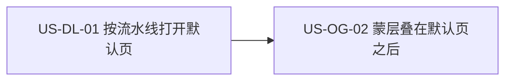

# 36 - 需求：按流水线阶段打开默认界面

> **文档类型**：本期需求 + 用户故事（**US-DL**，Default Landing / 默认界面）  
> **状态**：**待详设**  
> **基线**：桌面端 **`dev-0.6.0`**  
> **对齐**：GitHub Issue [#104](https://github.com/Pedro-MAFS/ftcs/issues/104)；Milestone **v0.6.0**（Issue 正文写「规划中 / 暂不挂里程碑」，仓库里程碑已挂 **v0.6.0**，本文以里程碑为准）  
> **关联**：[35-需求-业务流程引导聚光灯蒙层.md](35-需求-业务流程引导聚光灯蒙层.md)（[#8](https://github.com/Pedro-MAFS/ftcs/issues/8)：本需求先落页，聚光灯再出现）  
> **前缀**：仓库现有用户故事与 `docs/design/` 中无 **US-DL**，本文采用该前缀。详设文件不在本需求 PR 中新建。

---

## 1. 一句话目标

进入系统时，按**当前产品左侧流水线已经走到的阶段**打开对应的默认界面：没有进度打开录入，产品录入完成打开画像，关键词扩展完成打开探索，再往后打开线索。

---

## 2. 背景与动机

### 2.1 产品结论

马丰顺 2026-10-27：新用户和已有进度的用户进入系统时，都应按左侧流水线所处阶段打开默认主界面，避免落在和当前进度无关的页面上。

锁定的对应关系：

| 流水线状态 | 默认打开 |
|------------|----------|
| 没有任何进度 | 录入 |
| 产品录入完成 | 画像 |
| 关键词扩展完成 | 探索 |
| 其他（更后阶段） | 线索 |

Issue 原文写「关键词拓展」。界面和代码用「关键词扩展」，本文以下用界面用词，指的是同一阶段。

与 [#8](https://github.com/Pedro-MAFS/ftcs/issues/8) 的顺序：先打开上表中的页面，再允许业务聚光灯出现。蒙层规则见 [docs/35](35-需求-业务流程引导聚光灯蒙层.md)。

### 2.2 现网路径（对照 `dev-0.6.0`）

| 环节 | 现网 |
|------|------|
| 冷启动落页 | `desktop/src/router/index.ts` 把 `/` **固定**重定向到 `leads`。主窗口 `loadFile` 加载 `index.html`，没有按进度选择页面。因此无论有没有产品，进入后都在线索。 |
| 左侧流水线 | `derivePipelineSteps`（`desktop/src/composables/pipeline-steps.ts`）。完成态看磁盘产物；「执行中」只看当前 Agent 任务。没有当前产品时用 `pendingPipelineSteps()`，五步都是待执行。 |
| 五步与页面 | `PIPELINE_TO_SECTION`：产品录入 → 录入 `input`；关键词扩展 → 画像 `profile`；获客探索 → 探索 `explore`；线索评分 → 线索 `leads`；邮件草稿 → 线索 `leads`（起草入口在线索页，审阅在顶栏「邮件」）。 |
| 产品录入的完成显示 | 已经有当前产品、且此刻不在生成画像时，左侧「1 产品录入」的状态是**完成**。它不看 `profile.status === 'ready'`。`ready` 只决定「2 关键词扩展」能不能显示「可执行」。 |
| 其后各步的完成 | 关键词扩展：当前产品存在关键词扩展结果。获客探索：至少一条已完成的探索 run。线索评分：`scored` 条数大于 0。邮件草稿：草稿数大于 0。 |
| 当前产品 | 进入后若还没有选中产品，`refreshProducts()` 选中列表第一项，再按该项刷新流水线。侧栏点另一产品只换 `activeProductId`，**不**改路由。 |
| 手动去别的页 | 左侧流水线点击、模块条、顶栏五页切换，都是 `router.push` 到固定目标。没有「上次停留页面」的配置项。 |

### 2.3 痛点

| 现象 | 痛点 |
|------|------|
| 任何人进入都在线索 | 还没有产品的新用户面对空线索表，看不到录入 |
| 只做完录入的用户也在线索 | 下一步应在画像上生成或确认，落地页与左侧进度不一致 |
| 关键词已经扩展完仍进线索 | 下一步应在探索，落地页跳过了这一阶段 |
| 若另做「记住上次 Tab」 | 与「按流水线阶段」是两条规则，本期明确不引入 |

---

## 3. 已确认产品规则

> 取自 Issue #104 的四行表，以及「与左侧流水线判定一致」。下表把四行落到现网完成态上，避免再做一套进度。

| # | 规则 |
|---|------|
| **DL1** | **只在进入系统时选一次默认页**。指本次进程里主界面第一次出现。选完之后，同一次运行中的聚焦、托盘唤起、来回切页，都不再套用本表。退出后再次启动，重新选一次。 |
| **DL2** | **用当前产品的左侧流水线完成态**。产品选择沿用现网：已有选中则用选中项，否则用列表第一项。没有产品、流水线五步都是待执行，视为没有任何进度。不跨产品取「最远进度」。 |
| **DL3** | **没有任何进度 → 录入**（`input`）。 |
| **DL4** | **产品录入已完成，且关键词扩展未完成 → 画像**（`profile`）。「产品录入已完成」与左侧「1 产品录入」显示完成是同一判定：已有当前产品，且该步不是执行中。不另用 `profile.status === 'ready'` 当落地条件，否则侧栏已显示完成时仍会打开录入。 |
| **DL5** | **关键词扩展已完成，且更后阶段都未完成 → 探索**（`explore`）。更后阶段指获客探索、线索评分、邮件草稿。三步都还不是完成，才停在探索。 |
| **DL6** | **更后阶段任一已完成 → 线索**（`leads`）。获客探索已完成，或已有已评分线索，或已有邮件草稿，三者居其一即打开线索。不打开开发信 / 邮件页。 |
| **DL7** | **归类顺序**。进入时读取当时已经算好的完成态，从后往前：先看 DL6，再 DL5，再 DL4，否则 DL3。「执行中」不算完成，也不单独把默认页升级到下一步。冷启动时 Agent 尚未在跑，完成态就是磁盘上的结果。 |
| **DL8** | **手动导航保持现网**。左侧流水线、模块条、顶栏页面、页内原有跳转，点下去仍去原来的目标。切换产品、删除产品后的选中变化，都不触发本表。不新增、不读取「上次打开的 Tab」。 |
| **DL9** | **先于业务聚光灯**。本需求把默认页打开之后，[#8](https://github.com/Pedro-MAFS/ftcs/issues/8) 才叠蒙层。本需求不绘制蒙层，也不因为蒙层要从录入开始，就把已有进度的用户的默认页改成录入。 |
| **DL10** | **版本与关联**。纳入 **v0.6.0**。需求 PR 基线 **`dev-0.6.0`**，发版前不合 `main`。关联写法为 Related #104、Related #8，**不关** Issue #104。 |

### 3.1 四行表与左侧完成态

| 从后往前命中的完成态 | 用户看到的默认界面 | 规则 |
|----------------------|--------------------|------|
| 获客探索、线索评分、邮件草稿至少一项为完成 | 线索 | DL6 |
| 否则，关键词扩展为完成 | 探索 | DL5 |
| 否则，产品录入为完成 | 画像 | DL4 |
| 否则（无产品，或五步均无完成） | 录入 | DL3 |

举例：只有空白产品、左侧已经把「产品录入」显示为完成、关键词扩展仍是待就绪或可执行 → 画像。关键词扩展结果已在磁盘上、探索尚未完成、也还没有评分和草稿 → 探索。探索 run 已完成，或线索里已有评分，或已有开发信草稿 → 线索。

---

## 4. 范围与非范围

### 4.1 本期做（In Scope）

1. 进程内主界面第一次出现时，按 §3.1 打开录入、画像、探索或线索（DL1～DL7）。  
2. 判定与左侧流水线完成态使用同一套信号（DL2、DL4、DL7）。  
3. 替换「不论进度一律进入线索」的冷启动落页（现网 `/` → `leads`）。  
4. 为 docs/35 提供已经落定的默认页（DL9）。

### 4.2 本期不做（Out of Scope）

| 项 | 说明 |
|----|------|
| 记住上次打开的页面 / 会话恢复 | DL8；Issue #104 范围外 |
| 改手动点击后的跳转目标 | DL8；含流水线、模块条、顶栏、切换产品 |
| 改各页里面的业务逻辑、空态和按钮 | Issue #104 范围外 |
| 有更后进度时改去开发信页 | DL6 锁定为线索 |
| 绘制业务流程聚光灯 | docs/35 / #8 |
| 因聚光灯要从录入讲起而改写本表 | DL9 |
| 合入 `main` / 打 tag / 发版 / 关闭 #104 | DL10 |

---

## 5. 用户故事拆分

| ID | 标题 | 优先级 | 依赖 | 说明 |
|----|------|--------|------|------|
| **US-DL-01** | 进入系统时按流水线阶段打开默认界面 | Must | 现网 `derivePipelineSteps` / `pendingPipelineSteps`；路由 `/` 现固定到 `leads` | 四行表；不改手动导航；不记上次页面 |

一条即可。四行是同一判定的四个结果，分开验收会把同一次进入拆成互斥实现。聚光灯是否出现不在本故事里。

---

### US-DL-01　进入系统时按流水线阶段打开默认界面

**作为** 外贸业务员，**我想** 打开软件时直接看到和当前进度匹配的那一页，**以便** 不用从线索空表再去找录入、画像或探索。

| 项 | 内容 |
|----|------|
| 优先级 | Must |
| 依赖 | `derivePipelineSteps`、`pendingPipelineSteps`、当前产品的磁盘产物（画像、关键词扩展、探索 run、`scored`、邮件草稿）；现网路由名 `input` / `profile` / `explore` / `leads` |
| 状态 | **待详设** |

**验收要点**

- 无产品、左侧五步均为待执行：进入后在录入（DL2、DL3）。  
- 已有当前产品，左侧「产品录入」为完成，「关键词扩展」不是完成，且探索 / 评分 / 草稿都未完成：进入后在画像（DL4）。不要求画像状态已经是 `ready`。  
- 关键词扩展已完成，探索、评分、草稿都未完成：进入后在探索（DL5）。  
- 探索已完成，或已有已评分线索，或已有邮件草稿：进入后在线索，不在邮件页（DL6）。三者同时存在时仍是线索。  
- 归类与进入瞬间左侧流水线的完成显示一致；不另写一套「录入是否完成」的条件（DL4、DL7）。  
- 同一次运行中，用户再点录入、画像、探索、线索、邮件、设置或另一产品，页面只跟那次点击走，不会被本表拉回（DL1、DL8）。  
- 完全退出后再次启动，按当时的流水线重新选择，不沿用上次停留的页面（DL1、DL8）。  
- 没有新增「恢复上次 Tab」的设置项（DL8）。  
- 本故事不弹出聚光灯。默认页落下之后的蒙层是 US-OG-02。

**本故事不做**：改流水线点击目标；把邮件草稿完成改成打开邮件页；关闭 #104。

---

## 6. 验收清单（需求级）

- [ ] 没有任何流水线进度时进入，默认在录入。  
- [ ] 仅产品录入完成（关键词扩展未完成）时进入，默认在画像。  
- [ ] 关键词扩展已完成、探索和更后步骤都未完成时进入，默认在探索。  
- [ ] 探索已完成，或已有评分线索，或已有邮件草稿时进入，默认在线索。  
- [ ] 上述归类与左侧流水线完成态一致，包含「有产品则产品录入显示完成」这一现网事实。  
- [ ] 进入之后的手动切换、切换产品，行为与现网相同，不被默认页规则拦截。  
- [ ] 不记录、不恢复上次打开的页面。再次启动仍按流水线重选。  
- [ ] 默认页落定后才轮到 docs/35 的聚光灯；本需求本身不画蒙层。  
- [ ] 变更落在 `dev-0.6.0`；#104 不因本文关闭。

---

## 7. 开放项

> Issue #104 的四行表已由 DL3～DL6 落到现网完成态。下表仍须详设写明，**本文不拍板**。

| # | 项 | 现状（供详设对照，不是结论） |
|---|-----|------------------------------|
| **O1** | 主界面「第一次出现」的代码时机 | 须满足 DL1：每个进程只自动选一次，且在用户手动点页之前。现网是路由 `/` 重定向到 `leads`，发生时流水线可能尚未刷新完。详设写明等当前产品的流水线完成态就绪后再跳转，等待期间不得先停在错误业务页让用户当默认结果。 |
| **O2** | 产品列表尚未返回时的闪屏 | 无产品应去录入，有产品再按表选。详设避免先闪到线索再跳走。具体用占位还是延后首次跳转，本文不定。 |
| **O3** | 恢复未退出的进程 | 托盘与开机自启见既有启动需求。DL1 要求同一次进程不重复套用。若实现上「再次显示窗口」会重建路由，详设须仍然遵守 DL1，不得把用户从已经手动打开的页面拽走。 |

---

## 8. 修订记录

| 日期 | 说明 |
|------|------|
| 2026-10-28 | 初稿：对齐 #104。四行表落到左侧流水线完成态：无进度 → 录入，产品录入完成 → 画像，关键词扩展完成 → 探索，更后 → 线索。规则 DL1～DL10；US-DL-01。对照现网 `/` → `leads` 与 `derivePipelineSteps`。基线 `dev-0.6.0`，里程碑 v0.6.0。开放项 O1～O3 不拍板。 |

---

## 9. 下一步

1. 本文与 docs/35、docs/37 一起合入 **`dev-0.6.0`**（本 PR：Related #8 #104 #105，不 Closes）。  
2. 合入后交接详细设计：按 US-DL-01 写详设。O1～O3 须写明选择和验收样例后再开发。详设文件由详设角色另开，不在本需求 PR 中新增 `docs/design/`。  
3. 详设确认后再交开发。docs/35 的 US-OG-02 依赖本故事的默认页。  
4. **不关闭 #104**；本需求不触发打 tag / 发版；**不合 `main`**。
