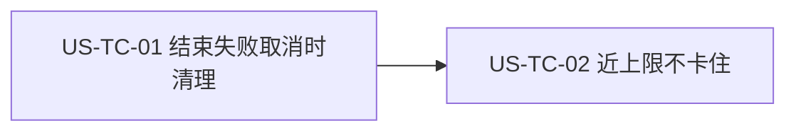

# 37 - 需求：任务结束后清理内置浏览器标签

> **文档类型**：本期需求 + 用户故事（**US-TC**，Tab Cleanup / 标签清理）  
> **状态**：**待详设**  
> **基线**：桌面端 **`dev-0.6.0`**（内置浏览器多标签已在 v0.5.10 交付）  
> **对齐**：GitHub Issue [#105](https://github.com/Pedro-MAFS/ftcs/issues/105)；Milestone **v0.6.0**（Issue 正文写「规划中 / 暂不挂里程碑」，仓库里程碑已挂 **v0.6.0**，本文以里程碑为准）  
> **关联**：[34-需求-Electron自带Chromium替代系统Chrome.md](34-需求-Electron自带Chromium替代系统Chrome.md)（[#78](https://github.com/Pedro-MAFS/ftcs/issues/78)，浏览窗三态）；[#103](https://github.com/Pedro-MAFS/ftcs/issues/103)（切出再回变透明白，**本需求不修**）  
> **前缀**：仓库现有用户故事与 `docs/design/` 中无 **US-TC**，本文采用该前缀。详设文件不在本需求 PR 中新建。

---

## 1. 一句话目标

会打开网页的任务在结束、失败或取消时，把内置浏览器里堆积的标签清到约定基线；标签快到上限时先清理或停止再开，避免流程卡住。

---

## 2. 背景与动机

### 2.1 产品结论

马丰顺 2026-10-27：任务执行完后要清理内置浏览器已经打开的标签，避免越积越多。

马丰顺 2026-10-28 补充：一个任务若打开过多标签，可能触达**内置浏览器的标签上限**，流程会**卡住**。近上限时要清理，或阻止继续开新标签。

清理的具体策略（关掉全部、留下一个空白页，或只关这次任务打开的）由详设选定，见 §7。产品锁定的是触发时机、清完后的数量必须可控，以及不得把任务卡死在开标签上。

### 2.2 现网路径（对照 `dev-0.6.0`）

| 环节 | 现网 |
|------|------|
| 浏览窗 | `desktop/electron/browser-runtime/` 的专用窗。三态（收起 / 缩略 / 放大）、标题栏入口和「关闭 ≡ 收起」以 [docs/34](34-需求-Electron自带Chromium替代系统Chrome.md) **EC9** 为准。v0.5.10 起同一扇窗可以有多枚标签；放大后标题栏可切换或关掉标签，缩略只显示当前页。 |
| 谁在开标签 | 画像抓站（有网站时）和探索打开公司官网会新开一页，后一家网站不再复用前一家并把流程堵住。`openBrowserTab` 追加 `WebContentsView`。代码里**没有**写死的标签上限常数。 |
| 关掉一页 | `closeBrowserTab`：找不到该页，或只剩最后一页时，返回 false，不关掉最后一页。放大标题栏上的关掉走同一路径。 |
| 任务生命周期 | Agent 任务结束走 `done`（成功或失败）。用户取消走现网中止（`abortCurrent` / 会话 abort）；[docs/22](22-需求-任务完成Windows通知.md) 把这一动作称为中止。编排一键跑通是多步串行，某步失败或中止会停掉后续步骤。 |
| 任务结束后的标签 | 上述开页路径在任务结束、失败、取消时**没有**统一关掉任务期间打开的标签。下一轮任务在原有标签之上继续追加。 |
| #103 | 浏览窗切出再回到前台时可能变成透明白。与标签数量是同一扇窗上的另一个问题。本需求不把它列进验收。 |

### 2.3 痛点

| 现象 | 痛点 |
|------|------|
| 探索连续打开多家官网 | 任务结束后标签仍留在内置浏览器里，下一轮更长 |
| 单次任务开得太多 | 可能顶到内置浏览器还能承受的标签数，后续开页失败，用户看到的是流程卡住 |
| 失败或取消同样留下标签 | 只在「成功结束」时清理会把异常路径漏掉 |
| 若为此做一套标签管理器 | 超出「任务后把数量收回来」的范围，也容易碰 EC9 的窗体操作 |

---

## 3. 已确认产品规则

> 取自 Issue #105 与 2026-10-28 的补充。关哪些页、上限数字是多少，见 §7，不在本表里补决定。

| # | 规则 |
|---|------|
| **TC1** | **任务正常结束要清理**。会打开内置浏览器标签的任务一旦成功结束，就清理本次任务留下的标签，使窗内标签数回到详设写明的基线。现网会开标签的任务主要是：有网站时的画像抓站，以及探索 R1 / R2 / R3 打开公司官网。 |
| **TC2** | **失败和取消也要清理**。任务失败，或用户取消（现网中止路径），与成功结束使用同一次清理。不得只在成功时清理。 |
| **TC3** | **清完后的数量是约定基线**。基线是少量稳定页（Issue 草案举例：0～1 个空白或默认页），具体是关全部、留一个空白页，还是只关任务期间打开的页，由详设在 §7 选一种并给出验收样例。清完后不得仍留着该任务打开的一长串业务页。 |
| **TC4** | **近上限要挡住卡住**。单任务或连续开页，在触达内置浏览器标签上限之前就要处理：清理一批，或拒绝再开新标签并让任务按可理解的结果结束。不得开到上限后停在无响应。现网没有写死上限数字，阈值由详设测量后写明。 |
| **TC5** | **不开标签的任务保持原样**。评分、开发信起草、联系人补全等现网不靠内置浏览器开页的任务，结束时若没有可清理的任务标签，不改变浏览窗里已有的页，也不因此弹出或收起浏览窗。 |
| **TC6** | **不改浏览窗三态**。收起、缩略、放大、标题栏「打开浏览窗 / 浏览中」、缩略蒙层只有收起和放大、放大标题栏是还原与收起、关闭 ≡ 收起，均保持 docs/34 EC9。清理标签不是关闭浏览窗，也不断开后续业务还要用的调试会话，除非详设证明不拆会话就无法把标签数降到基线，并在详设里单独写明。 |
| **TC7** | **不做标签管理器**。不新增标签列表、批量选择、固定标签等界面。放大态里已有的切换和关掉单页保持现网。不把「一键清标签」列为本期必须功能；若详设要一个最小入口，它只能触发与 TC1 相同的清理，不能长成另一套管理 UI。 |
| **TC8** | **任务外看页的能力还在**。用户在没有任务时用「打开浏览窗」查看页面，这一能力保持。清理会不会关掉这些页，由 TC3 的策略界定：详设必须写清边界，并有一条验收是「没有任务在跑时，不因为别的原因把用户正在看的页清掉」。 |
| **TC9** | **不顺手修 #103**。切出再回的透明白仍由 #103 处理。本需求的清理和近上限防护不得把该问题写成已修复，也不得为了清标签去改那条显隐路径。 |
| **TC10** | **版本与关联**。纳入 **v0.6.0**。需求 PR 基线 **`dev-0.6.0`**，发版前不合 `main`。关联写法为 Related #105、Related #78、Related #103，**不关** Issue #105，也不关 #78 / #103。 |

### 3.1 触发

| 事件 | 是否清理 |
|------|----------|
| 会开标签的任务成功结束 | 是 |
| 该任务失败 | 是 |
| 用户取消 / 现网中止 | 是 |
| 开页过程中已经接近标签上限 | 是（或改为阻止再开，见 TC4；两种都要让流程离开「卡住」） |
| 不开标签的任务结束 | 无任务标签则不改现有页（TC5） |
| 没有任务、用户只是自己打开浏览窗 | 不清理（TC8） |

编排方案里含有会开标签的步骤时，那些步骤的结束、失败、取消必须满足上表。是每一步结束就清，还是整段方案结束才清，见 §7 O2。不论选哪种，都不得把中间步骤打开的标签留到超过上限。

---

## 4. 范围与非范围

### 4.1 本期做（In Scope）

1. 会开标签的任务在成功、失败、取消时清理标签，并回到详设约定的基线（TC1～TC3）。  
2. 接近标签上限时清理或停止再开，任务不因此卡住（TC4）。  
3. 与现网任务结束 / 失败 / 中止对齐触发点（TC2、§3.1）。  
4. 写清任务外已打开页面的清理边界（TC8）。

### 4.2 本期不做（Out of Scope）

| 项 | 说明 |
|----|------|
| 改浏览窗三态、标题栏入口、缩略蒙层、放大标题栏的还原 / 收起 | TC6；docs/34 EC9；#78 |
| 标签管理界面（列表、多选、固定、拖拽排序） | TC7 |
| 把「一键清标签」做成必须交付 | TC7；最多是详设可选的最小入口 |
| 修复浏览窗切出再回变透明白 | TC9；#103 |
| 改 R2 不打开社媒真页、R3 不打开地图真页 | 仍按 docs/34 |
| 改系统浏览器里的标签 | 只处理内置浏览器 |
| 合入 `main` / 打 tag / 发版 / 关闭 #105 | TC10 |

---

## 5. 用户故事拆分

| ID | 标题 | 优先级 | 依赖 | 说明 |
|----|------|--------|------|------|
| **US-TC-01** | 任务结束、失败、取消时清理标签 | Must | 现网多标签浏览窗；画像抓站与 R1 / R2 / R3 开页；Agent `done` 与中止 | 清到基线；三态不变 |
| **US-TC-02** | 接近标签上限时不让流程卡住 | Must | US-TC-01 的清理能力；现网 `openBrowserTab` 无上限常数 | 近上限清理或拒绝再开 |

两条都留。结束时清理可以用「开了数页、远低于上限」的任务验收。近上限要单独造多页场景，不宜和普通结束绑成一次才算过。

---

### US-TC-01　任务结束、失败、取消时清理标签

**作为** 外贸业务员，**我想** 一轮找客户结束或中途失败、取消之后，内置浏览器不再留着几十个网页，**以便** 下一轮还能正常打开，窗口也不会被旧页面占满。

| 项 | 内容 |
|----|------|
| 优先级 | Must |
| 依赖 | `browser-runtime` 多标签；会开页的画像与探索任务；任务成功、失败、用户中止的现网事件 |
| 状态 | **待详设** |

**验收要点**

- 跑完一轮会打开多个标签的探索（或有网站的画像）后，内置浏览器标签数回到详设写明的基线，该任务打开的业务页不再成串留下（TC1、TC3）。  
- 同一类任务失败时，标签数同样回到该基线（TC2）。  
- 用户取消 / 中止时，标签数同样回到该基线（TC2）。  
- 评分、起草等不开网页的任务结束之后，清理前用户在浏览窗里看的页还在；浏览窗不因此被打开或收起（TC5、TC6）。  
- 没有任何任务时，不清理用户通过「打开浏览窗」正在看的页（TC8）。若详设选择「结束时关全部」，须同时说明这些页只可能出现在任务期间，并增加对应验收。  
- 清理之后，浏览窗仍符合 EC9：可以收起、再打开、缩略与放大；关闭仍等于收起。放大态原有的切换和关掉单页仍可用（TC6、TC7）。  
- 本故事不要求把标签开到上限。那是 US-TC-02。

**本故事不做**：标签管理器；修复 #103；关闭 #105。

---

### US-TC-02　接近标签上限时不让流程卡住

**作为** 外贸业务员，**我想** 一次任务即使要打开很多公司网页，也不会因为标签开满而停住，**以便** 探索能结束并给出结果，而不是卡在浏览器上。

| 项 | 内容 |
|----|------|
| 优先级 | Must |
| 依赖 | US-TC-01；`openBrowserTab` / 探索连续新开一页的现网行为 |
| 状态 | **待详设** |

**验收要点**

- 详设给出标签上限或「接近上限」的阈值，并说明依据（实测或引擎限制）。验收按该阈值执行，不在需求里先写一个数字（TC4）。  
- 连续开页到达该阈值之前，要么清掉一批使开页可以继续，要么拒绝新的开页并让任务以明确结果结束（失败说明或跳过剩余开页，由详设选一种）。界面不长期停在无响应（TC4）。  
- 这次防护使用的清理与 US-TC-01 的基线兼容：任务最终结束、失败或取消时，标签数仍回到 TC3 的基线。  
- 防护不改 EC9 的三态和标题栏控件（TC6）。  
- 本故事不把 #103 的透明白列为通过条件（TC9）。

**本故事不做**：为了提高上限去重写浏览窗；新增标签管理 UI；关闭 #105。

---

## 6. 验收清单（需求级）

- [ ] 会开多个标签的任务成功结束后，内置浏览器回到约定基线，不残留该任务的一长串页面。  
- [ ] 该任务失败或用户取消时，同样回到基线。  
- [ ] 连续开页不会因为触达标签上限而卡住；近上限时有清理或拦截，并有可理解的结果。  
- [ ] 不开网页的任务，以及没有任务时用户自己打开的浏览，不被误清；边界与详设所选策略一致。  
- [ ] 浏览窗三态、标题栏入口、缩略蒙层和放大标题栏操作与 docs/34 EC9 一致。  
- [ ] 没有新的标签管理界面。  
- [ ] #103 的透明白不在本需求中宣称修复。  
- [ ] 变更落在 `dev-0.6.0`；#105 不因本文关闭。

---

## 7. 开放项

> 下表是 Issue #105 明确交给详设的策略。**本文不拍板**。选定后须带验收样例再开发。

| # | 项 | 现状（供详设对照，不是结论） |
|---|-----|------------------------------|
| **O1** | 清理策略 | 三选一，或详设证明的等价做法：关掉全部标签；只留一个空白页；只关这次任务期间打开的标签、留下任务开始前已有的页。现网 `closeBrowserTab` 在只剩一页时不会关，若基线是 0，详设须另写如何处理最后一页。TC8 要求无论选哪一种，都要能验收「没在跑任务时不误清用户正在看的页」。 |
| **O2** | 编排方案的清理时刻 | 单步任务的结束 / 失败 / 取消已由 TC1、TC2 锁定。一键跑通含画像或探索时，每步结束就清，或整段结束 / 失败 / 取消才清，由详设定。中间步骤的标签数仍须满足 TC4。 |
| **O3** | 上限阈值与「接近」 | 仓库没有标签上限常数。详设给出数字或判定式、测量方式和到达阈值时的用户可见结果。 |
| **O4** | 清理时浏览窗的可见状态 | TC6 要求不把清理定义成关闭窗体。清页时若窗处于缩略或放大，是保持当前态还是收起，由详设定，且不得改 EC9 的控件含义。 |

---

## 8. 修订记录

| 日期 | 说明 |
|------|------|
| 2026-10-28 | 初稿：对齐 #105。任务结束、失败、取消时清理内置浏览器标签；近上限清理或阻止再开，避免卡住。策略三选一留给详设。规则 TC1～TC10；US-TC-01、US-TC-02。对照现网多标签 `openBrowserTab` 与 docs/34 EC9。基线 `dev-0.6.0`，里程碑 v0.6.0。不修 #103。开放项 O1～O4 不拍板。 |

---

## 9. 下一步

1. 本文与 docs/35、docs/36 一起合入 **`dev-0.6.0`**（本 PR：Related #8 #104 #105，不 Closes）。  
2. 合入后交接详细设计：按 US-TC-01、US-TC-02 写详设。O1～O4 须写明选择和验收样例后再开发。详设文件由详设角色另开，不在本需求 PR 中新增 `docs/design/`。  
3. 详设确认后再交开发。  
4. **不关闭 #105**；不关闭 #78、#103；本需求不触发打 tag / 发版；**不合 `main`**。
