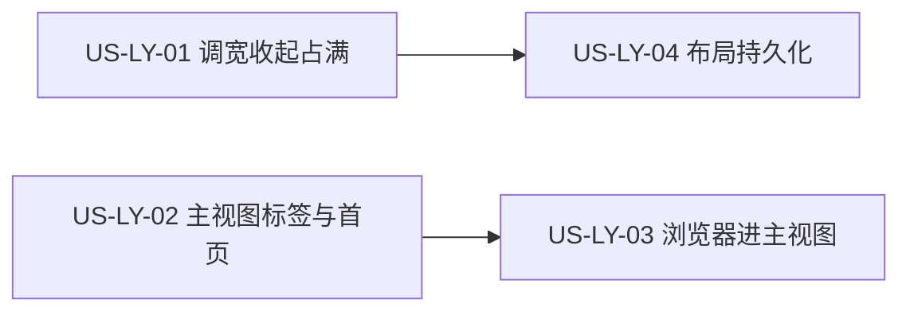

# 39 - 需求：主视图多标签与布局可调

> **文档类型**：本期需求 + 用户故事（**US-LY**，Layout / 主视图布局与标签）  
> **状态**：**待马丰顺实现**（验收已写明，供自测；组内详设与开发等他落地，或他明确要协助时再补）  
> **基线**：桌面端 **`dev-0.6.1`**  
> **对齐**：GitHub Issue [#119](https://github.com/Pedro-MAFS/ftcs/issues/119)；Milestone **v0.6.1**；界面稿 [`docs/design/main-view-tabs.pen`](design/main-view-tabs.pen)（提交 `e058923`，`docs(design): 补充主视图多标签的界面稿`）  
> **关联**：[37-需求-任务后清理内置浏览器标签.md](37-需求-任务后清理内置浏览器标签.md)（[#105](https://github.com/Pedro-MAFS/ftcs/issues/105)，页标签上限 **10** / 回收线 **5**）；[34-需求-Electron自带Chromium替代系统Chrome.md](34-需求-Electron自带Chromium替代系统Chrome.md) **EC9**（旧悬浮浏览窗三态）；[#118](https://github.com/Pedro-MAFS/ftcs/issues/118)（自由对话，等 #119 完成后再启）  
> **前缀**：仓库现有用户故事与 `docs/design/` 中无 **US-LY**。详设文件不在本需求 PR 中新建，本文也不改已有详设。

---

## 1. 一句话目标

左流水线、中主区域、右智能体可以拖宽、收起和按稿占满；中间主区域改成多标签，导航放进「首页」，内置浏览器作为主视图里的标签打开。

---

## 2. 背景与动机

### 2.1 产品结论

马丰顺 2026-10-30 锁定布局交互：收起 / 展开用点击，不把拖到最小当成收起；拖拽到最小宽度即止；只有主区域和智能体能占满，流水线没有占满；宽度按可用区域的百分比记忆，收起和占满也记忆，没有「恢复默认布局」。

马丰顺 2026-10-31 更正左右：现网是**左侧流水线、右侧智能体**。此前「左智能体 / 右流水线」是表述错误。本文与界面稿都按现网左右写。

马丰顺 2026-11-01：界面稿 `main-view-tabs.pen` 五屏是唯一视觉依据。中间主区域改为多标签，导航放进「首页」；浏览器从首页打开后占主视图一个标签。**Issue #119 的实现由马丰顺本人完成。** 组内详设、开发等他落地，或他明确要协助时再跟。#118 等 #119 完成后再启。

同日对需求说明书的硬性要求，写入本文规则与用户故事，不留到口头：

1. 用户故事至少拆开布局（US-LY-01）、主区域标签化（US-LY-02）、内置浏览器进主视图（US-LY-03）；布局持久化单列为 US-LY-04。首页和图标轨放在 US-LY-02，不再拆碎。
2. US-LY-02 与 US-LY-03 的标签容器和状态模型必须**同一套选型一并考虑**。详设不得先只做业务页标签，再为浏览器多页另起一套互不兼容的模型。本文不指定具体框架。
3. 新模式仍须满足 [docs/37](37-需求-任务后清理内置浏览器标签.md) 的上限 **10**、回收线 **5**，以及任务结束 / 失败 / 取消时的清理。本文不重做 #105，也不另写这两个数。

### 2.2 现网路径（对照 `dev-0.6.1`）

| 环节 | 现网 |
|------|------|
| 三栏 | `WorkspaceLayout.vue` 从左到右是 `ActivityRail`（图标轨）、`Sidebar`（产品列表 + 流水线）、主区域 `RouterView`、`AgentPanel`。智能体在主区域右侧，宽 `--agent-width: 340px`。没有拖拽分隔，没有收起，没有占满。 |
| 顶栏中间 | `TitleBar.vue` 的流水线芯片：录入、画像、探索、线索、邮件。点击用路由切到对应页。 |
| 图标轨 | 同上五个入口，底部另有设置。顶栏右侧也有设置。 |
| 主区域 | 同一时刻一条路由、一页内容。没有标签条，没有加号，没有「首页」。 |
| 内置浏览器 | 顶栏「打开浏览窗 / 浏览中」唤起专用窗。三态（收起 / 缩略 / 放大）、「关闭 ≡ 收起」、缩略 PiP 蒙层，以 [docs/34](34-需求-Electron自带Chromium替代系统Chrome.md) **EC9** 为准。浏览器不占主区域里的一页。 |
| 页标签护栏 | [docs/37](37-需求-任务后清理内置浏览器标签.md) 与详设 US-TC：`BUILTIN_TAB_CAP = 10`，`BUILTIN_TAB_RECLAIM_AT = 5`。会开网页的任务在结束、失败、取消时清理；近上限不得卡死。本文不改这两个数，也不改该详设。 |
| 冷启动落页 | [docs/36](36-需求-按流水线阶段打开默认界面.md)：没有进度打开录入，产品录入完成打开画像，关键词扩展完成打开探索，更后阶段打开线索。 |
| 智能体栏 | 标题「智能体」、当前技能名、「复制会话」、状态卡、时间线、底部输入。输入框占位仍是自由对话暂未开放。复制会话的规则在 [docs/38](38-需求-复制当前智能体会话.md)，本文不改。 |

### 2.3 痛点

| 现象 | 痛点 |
|------|------|
| 三栏宽度固定 | 看线索或看智能体时，让不出空间 |
| 顶栏芯片与图标轨各有一套入口 | 主区域一次只能铺一页，开过的录入、线索、网页不能并排留着再切回来 |
| 浏览器是主窗口外的悬浮窗 | 和主视图里的业务页不是同一套切换；界面稿已改成主视图标签 |
| 若标签化时只考虑业务页 | 任务连续开网页仍要遵守 10 / 5。后补的浏览器多页模型容易和先做好的标签条冲突，或把护栏做丢 |

### 2.4 界面稿五屏（验收画面）

稿文件：[`docs/design/main-view-tabs.pen`](design/main-view-tabs.pen)，提交 `e058923`。五屏文案如下。示例公司、示例线索表不是要写入产品的新数据；验收看结构、入口文案、控件位置和布局行为。

| 屏 | 稿面 | 文案要点 |
|----|------|----------|
| 01 | 点加号打开首页 | 标题：「导航放进首页，顶栏中间不再放入口」。点加号新开「首页」。首页只放会在主视图打开的入口：录入、画像、探索、线索、邮件、浏览器。设置仍从顶栏进。 |
| 02 | 浏览器标签 | 标题：「从首页打开浏览器，它占主视图的一个标签」。顶栏不再放流水线芯片。地址栏在标签内容区。切回线索库时，左侧图标轨一起回到线索。 |
| 03 | 两侧收起 | 标题：「收起的是流水线和智能体，图标轨还在」。产品栏收起后，产品用标题第一个字做圆形头像：华茂精密是「华」，北辰机电是「北」。当前产品用蓝色圈标出。 |
| 04 | 主视图占满 | 标题：「占满只藏三栏，顶栏和线索页还是现在这样」。隐藏图标轨、流水线、智能体。标签条和线索库页面保持现有结构。右上角退出后回到进入前的宽度。 |
| 05 | 智能体占满 | 标题：「智能体铺满，面板内容仍是现在的结构」。顶栏保留。流水线和主视图隐藏。智能体仍是技能名、复制会话、三张状态卡、时间线和底部输入。退出后标签回到原位。 |

五屏都有顶栏和底栏状态条。顶栏左侧是品牌与当前产品名；右侧是运行状态、主题、登录、设置。顶栏中间没有流水线芯片，也没有「打开浏览窗 / 浏览中」。

稿中控件位置：

| 控件 | 位置 |
|------|------|
| 标签与关闭 | 标签条上每一枚都有关闭。01 屏同时有「首页」「线索库」「获客探索」「acme.com」。 |
| 加号 | 标签条末尾。点它新开「首页」。 |
| 主视图占满 | 标签条右侧。占满后同一位置改为「退出占满」。 |
| 流水线收起 | 产品栏标题行。收起后整栏变窄：展开入口 + 字头像，流水线步骤不再铺开。 |
| 智能体收起、占满 | 智能体标题行，位于技能名和「复制会话」旁。占满后该处改为「退出占满」。收起后只留窄栏上的展开入口。 |
| 分隔条 | 流水线与主视图之间、主视图与智能体之间。主视图占满、智能体占满时不画分隔条。 |
| 地址栏 | 浏览器标签的内容区顶部：后退、前进、刷新、地址。稿中标签文案是 `acme.com`，地址栏是完整 URL。 |

首页六张入口（两列）：

| 入口 | 副文案 |
|------|--------|
| 录入 | 公司与产品资料 |
| 画像 | 确认后再去探索 |
| 探索 | 扩展关键词并找客户 |
| 线索 | 原始与已评分线索 |
| 邮件 | 审阅开发信草稿 |
| 浏览器 | 打开客户网站 |

图标轨顺序与现网一致：录入、画像、探索、线索、邮件，底部设置。稿的前三屏都有这列；04、05 屏身体区不再画它。01 屏停在「首页」、02 屏停在 `acme.com` 时，图标轨没有业务项高亮。03 屏停在「线索库」时，「线索」高亮。当前产品头像描边为蓝色，其他产品没有这圈。

---

## 3. 已确认产品规则

> 取自 Issue #119、2026-10-30 至 2026-11-01 的口径，以及 §2.4 五屏。最小宽度的像素、关标签后的空态、同一页能否开两枚、EC9 如何迁移，见 §7，不在本表里补成实现方案。上限 10 与回收线 5 不在本表重写，沿用 docs/37。

| # | 规则 |
|---|------|
| **LY1** | **三栏位置不变，不新增板块。** 从左到右仍是流水线、主区域、智能体。图标轨在流水线左侧。不提供自定义排列顺序。 |
| **LY2** | **拖拽调宽，到最小即止。** 流水线与主视图之间、主视图与智能体之间可以拖。拖到最小宽度停止。不把「拖到最小」做成自动收起，收起只走点击（LY3）。最小宽度的像素由详设定。占满态不拖。 |
| **LY3** | **收起和展开用点击。主区域不能单独收起。** 左侧流水线（含产品列表）和右侧智能体各自可以收起、再展开。收起左侧时，产品用标题**第一个字**做成圆形头像，当前产品用蓝色圈标出；流水线步骤列表不在收起态铺开。收起智能体时只留展开入口。两侧都收起时，图标轨仍在。主区域没有单独的收起控件。 |
| **LY4** | **只有主区域和智能体能占满。流水线没有占满。** 主视图占满：隐藏图标轨、流水线和智能体；顶栏、标签条、当前页、状态条仍在；「退出占满」后回到进入前的宽度。智能体占满：顶栏和状态条保留；流水线、图标轨和主视图（含标签条）隐藏；面板仍是技能名、「复制会话」、状态卡、时间线、底部输入；「退出占满」后标签回到原位。占满是点击进入，不是把某一栏拖到头。 |
| **LY5** | **主区域标签化，导航进首页。** 标签条可以同时留下多页，可以切换，每一枚都可以关闭。点加号新开一个「首页」标签。首页只放会在主视图打开的入口：录入、画像、探索、线索、邮件、浏览器，名称和副文案以 §2.4 为准。设置不进首页。顶栏中间不再放这些入口，也不再放流水线芯片。顶栏右侧保留设置。 |
| **LY6** | **图标轨与当前页联动。** 图标轨保留录入、画像、探索、线索、邮件；底部设置图标按稿保留。业务页（如线索库）处于当前标签时，图标轨对应项高亮。当前标签是首页或浏览器页时，图标轨不高亮某个业务项。从浏览器标签切回线索库时，图标轨回到线索。图标轨上没有「浏览器」图标，浏览器从首页进入。 |
| **LY7** | **内置浏览器进入主视图标签。** 从首页打开浏览器后，它占主视图的一个标签，地址栏在该标签内容区。再打开别的页面时，再挂标签，而不是只在悬浮窗里换页。标签上展示稿那种站点名量级的短标题，地址栏展示完整 URL。 |
| **LY8** | **浏览器的验收画面以五屏为准。** 用户打开浏览器时，看到的是主视图标签和内容区里的地址栏。五屏没有缩略浮动窗、PiP 蒙层，也没有顶栏「打开浏览窗 / 浏览中」。[docs/34](34-需求-Electron自带Chromium替代系统Chrome.md) **EC9** 仍是旧悬浮窗的定义，本文不改那篇正文，也不把 EC9 三态列为 #119 的通过画面。旧悬浮行为如何迁移由详设定，见 §7 O5。 |
| **LY9** | **新模式兼容 docs/37，且不重做 #105。** 内置浏览器打开的网页页数仍受上限 **10**（`BUILTIN_TAB_CAP`）和回收线 **5**（`BUILTIN_TAB_RECLAIM_AT`）约束。任务结束、失败、取消时的清理，以及近上限不得卡死开页，语义以 docs/37 的 TC1～TC4、US-TC-01、US-TC-02 为准，本文不另定数字、不另定清理策略。默认：业务标签（首页、录入、画像、探索、线索、邮件，以及设置若占一枚标签）**不**占用这两个常数。任务清理打在网页上，不把无关的业务标签清掉。详设必须写清计数、清理、拦截各作用在哪一层；只有证明必须合并计数时才可以合并，且合并后仍须满足 10 / 5、不得卡死，并仍不得误关无关业务页。 |
| **LY10** | **记住布局，没有「恢复默认」。** 记忆宽度百分比、收起、占满。下次打开保持，包括上次停在占满。退出占满用的是进入占满之前的百分比，不把占满写成新的 100% 宽度。不提供「恢复默认布局」。不要求记住并恢复上次打开过哪些标签；冷启动落哪一页仍按 docs/36 的阶段对应，如何放进标签条见 §7 O9。 |
| **LY11** | **业务页标签与浏览器多页同一次选型。** US-LY-02 和 US-LY-03 的标签容器、状态模型必须放在同一次选型里考虑。详设在同一章节同时覆盖「业务页标签」和「浏览器内多 WebContents / 多页标签」，给出备选和取舍标准。禁止先落地只含业务页的模型，再为多页浏览推翻或平行再做一套。本文不指定 UI 框架、组件库或 Electron 视图 API。 |
| **LY12** | **实现归属与版本。** 纳入 **v0.6.1**。需求 PR 基线 **`dev-0.6.1`**，发版前不合 `main`。关联写法为 Related #119，**不关** Issue #119。**实现由马丰顺本人完成。** 组内不先行另开 #119 的详设或 `desktop/` 实现；他落地之后，或他明确要协助时，再按本文验收与 §7 补详设。#118 等 #119 完成后再启。本 PR 只改 `docs/39`，不改 `desktop/`，不改 `docs/design/`。 |

### 3.1 占满与收起时仍可见的部分

| 状态 | 仍可见 | 隐藏 |
|------|--------|------|
| 两侧收起 | 顶栏、图标轨、窄产品头像栏、主视图标签与页面、窄智能体展开条、两侧分隔条、状态条 | 流水线步骤列表、智能体面板正文 |
| 主视图占满 | 顶栏、标签条、当前页、状态条、「退出占满」 | 图标轨、流水线、智能体、分隔条 |
| 智能体占满 | 顶栏、智能体面板全文、状态条、「退出占满」 | 图标轨、流水线、主视图（含标签条）、分隔条 |

---

## 4. 范围与非范围

### 4.1 本期做（In Scope）

1. 三栏拖拽调宽，最小宽度处停止，拖拽不自动收起（LY2）。  
2. 流水线、智能体点击收起和展开；产品字头像与当前产品蓝圈；主区域不能单独收起；两侧收起后图标轨仍在（LY3）。  
3. 主视图占满、智能体占满，以及退出后恢复进入前的布局（LY4）。  
4. 主视图标签条：加号开「首页」，多标签切换和关闭；首页六入口；顶栏中间不再放导航和流水线芯片（LY5）。  
5. 图标轨与业务标签联动（LY6）。  
6. 内置浏览器作为主视图标签，地址栏在内容区；不同页面挂多枚标签（LY7、LY8）。  
7. 在新形态下仍满足 docs/37 的 10 / 5 与任务后清理，且不误伤业务标签（LY9）。  
8. 宽度百分比、收起、占满的持久化（LY10）。

### 4.2 本期不做（Out of Scope）

| 项 | 说明 |
|----|------|
| 组内先行交付 #119 的详设或 `desktop/` 实现 | LY12。等马丰顺落地，或他明确要协助 |
| #118 自由对话，以及改掉智能体输入框里「暂未开放」的占位 | 等 #119 完成后再启。稿中该占位句仍在 |
| 改「复制会话」的规则 | 仍按 docs/38。占满后的智能体只要求这个入口还在 |
| 新增板块，或让用户自定三栏顺序 | LY1 |
| 流水线占满、主区域单独收起、「恢复默认布局」 | LY3、LY4、LY10 |
| 拖到最小宽度自动收起 | LY2 |
| 重做 #105，或改写 10 和 5 | LY9。只要求新模式兼容 |
| 改 docs/34、docs/37 正文，或把 EC9 悬浮三态继续当成浏览器主路径的验收画面 | LY8、LY9 |
| 记住上次的标签列表，并在重启后原样恢复 | LY10。布局要记，标签清单不要求记 |
| 标签拖拽排序、固定标签、批量关闭等管理器 | 稿只要求切换、关闭和加号 |
| 合入 `main` / 打 tag / 发版 / 关闭 #119 | LY12 |

---

## 5. 用户故事拆分

箭头是验收顺序，不是「先做完业务标签再另选一套浏览器模型」。LY11 要求 US-LY-02 与 US-LY-03 的容器和状态在同一次选型里一起定。

| ID | 标题 | 优先级 | 依赖 | 说明 |
|----|------|--------|------|------|
| **US-LY-01** | 三栏拖拽、收起与占满 | Must | 现网三栏 | 主区域不能单独收起；仅主区域与智能体可占满 |
| **US-LY-02** | 主视图标签、首页与图标轨 | Must | 现网图标轨与五个业务页；与 US-LY-03 同一次选型（LY11） | 加号开首页；顶栏中间让出 |
| **US-LY-03** | 内置浏览器变为多枚主视图标签 | Must | US-LY-02 的标签条；docs/37 的 10 / 5 与清理；LY11 | 地址栏在内容区；不削弱护栏 |
| **US-LY-04** | 记住宽度、收起和占满 | Must | US-LY-01 | 无「恢复默认」；不记标签清单 |

四条都留。调宽可以用还没有多标签的对照来理解，但交付时主区域已经是标签条，占满要藏的是稿里的那几栏。浏览器故事单独验收，避免只测首页卡片、不测多页和 10 / 5。持久化用重启验收，不和当次拖拽绑成同一步。

---

### US-LY-01　三栏拖拽、收起与占满

**作为** 外贸业务员，**我想** 把流水线、主区域、智能体拖宽或收起，也能让主区域或智能体占满，**以便** 看线索或看对话时不被另外两栏挤住。

| 项 | 内容 |
|----|------|
| 优先级 | Must |
| 依赖 | 现网左流水线、右智能体的三栏 |
| 状态 | **待马丰顺实现** |

**验收要点**

- 三栏左右不变：图标轨、流水线在左，主区域在中，智能体在右（LY1）。  
- 两根分隔条可以拖。拖到最小宽度停止，松手后不会变成收起（LY2）。最小像素见 §7 O1，详设写明之前，自测只要求「有最小宽度、到头即停」。  
- 流水线可以点击收起再展开。收起后看见产品字头像：标题第一个字，当前产品有蓝色圈，其他产品没有；流水线五步不在该窄栏里铺开（LY3、§2.4）。  
- 智能体可以点击收起再展开。收起后只留展开入口，面板正文不留在画面上（LY3）。  
- 两侧同时收起时，图标轨仍在，主区域仍在（LY3）。主区域没有单独的收起控件。  
- 主视图占满后：图标轨、流水线、智能体不可见；顶栏、标签条、当前页、状态条还在；可以「退出占满」，宽度回到进入前（LY4、§3.1）。  
- 智能体占满后：顶栏和状态条还在；流水线、图标轨、主视图（含标签条）不可见；面板仍能看到技能名、「复制会话」、状态卡、时间线、底部输入；「退出占满」后标签回到原位（LY4、§3.1）。  
- 流水线没有占满入口。  
- 控件落点与 §2.4 的表一致：主视图的占满 / 退出在标签条右侧；智能体的收起 / 占满 / 退出在标题行；流水线的收起在产品栏标题行。

**本故事不做**：恢复默认布局；拖拽自动收起；改智能体内部能力；关闭 #119。

---

### US-LY-02　主视图标签、首页与图标轨

**作为** 外贸业务员，**我想** 在主区域用标签留下录入、线索和首页，并从首页进入这些页，**以便** 不用在顶栏中间的芯片之间来回跳，也看得到自己开过哪些页。

| 项 | 内容 |
|----|------|
| 优先级 | Must |
| 依赖 | 现网录入、画像、探索、线索、邮件；图标轨；LY11 与 US-LY-03 同一次选型 |
| 状态 | **待马丰顺实现** |

**验收要点**

- 主区域有标签条。点加号出现一个「首页」标签（LY5）。  
- 首页有且仅有六张入口：录入、画像、探索、线索、邮件、浏览器。副文案与 §2.4 一致。首页上没有设置。  
- 顶栏中间没有录入 / 画像 / 探索 / 线索 / 邮件芯片，也没有别的流水线芯片。顶栏右侧仍能进设置（LY5）。  
- 已打开的多枚标签可以切换。每一枚都有关闭（LY5）。关掉之后激活哪一枚、最后一枚关掉后看什么，见 §7 O2。  
- 从首页或图标轨进入录入、画像、探索、线索、邮件时，主视图显示对应页。稿中同一业务名只出现一枚；再点一次是聚焦还是再开一枚，见 §7 O3。自测对照稿：不要在未说明的情况下出现两枚「线索库」。  
- 当前标签是线索库（以及画像、探索、邮件、录入）时，图标轨对应项高亮。当前标签是首页时，图标轨没有业务项高亮（LY6、§2.4）。  
- 图标轨在流水线收起后仍可点，顺序仍是录入、画像、探索、线索、邮件，底部仍有设置（LY6）。图标轨上没有浏览器图标。  
- 标签容器必须与 US-LY-03 的浏览器多页同一次选型（LY11）。本故事的通过条件是首页、业务标签和图标轨；浏览器多页的通过条件在 US-LY-03。选型上不得先定一套只含业务页、事后再推翻的模型。  
- 设置页是否占一枚标签，见 §7 O8。冷启动先打开哪一页，仍遵守 docs/36，见 §7 O9。

**本故事不做**：把设置做成首页卡片；在顶栏中间恢复导航；标签排序和固定；关闭 #119。

---

### US-LY-03　内置浏览器变为多枚主视图标签

**作为** 外贸业务员，**我想** 从首页打开客户网站时，页面就留在主视图的标签上，**以便** 和线索、探索一样切换，而不是去找一块悬浮小窗。

| 项 | 内容 |
|----|------|
| 优先级 | Must |
| 依赖 | US-LY-02；现网内置浏览器开页；docs/37 的 US-TC-01、US-TC-02；LY11 |
| 状态 | **待马丰顺实现** |

**验收要点**

- 从首页「浏览器」打开页面后，主视图出现该页的标签，地址栏在标签内容区，含后退、前进、刷新和地址（LY7、§2.4）。  
- 再打开另一个页面时，标签条上再增加一枚，而不是只替换悬浮窗里的当前页（LY7）。  
- 切回「线索库」时，图标轨高亮「线索」。停在浏览器标签上时，图标轨不高亮某个业务项（LY6，02 屏）。  
- 验收画面与五屏一致：没有把「找到缩略浮动窗 / 顶栏浏览中」当作打开浏览器的通过条件（LY8）。EC9 如何迁移见 §7 O5。  
- 网页页数仍受 `BUILTIN_TAB_CAP = 10`、`BUILTIN_TAB_RECLAIM_AT = 5` 约束。到达回收线或上限时的清理或拒绝，以及任务成功、失败、取消后的清理，按 docs/37 US-TC-01、US-TC-02 验收，流程不得停在无响应（LY9）。  
- 默认不把首页、线索库等业务标签算进 10。任务清理不得关掉与这次开页无关的业务标签（LY9）。计数作用在哪一层由详设写清；要合并计数必须按 LY9 证明。  
- 标签标题与地址栏的分工以稿为准：标签是短标题（示例 `acme.com`），地址栏是完整 URL。同一站点多条路径如何区分，见 §7 O4。  
- 选型与 US-LY-02 在同一章节完成，覆盖业务页标签和多 WebContents / 多页（LY11）。

**本故事不做**：重写 docs/37 的策略三选一；把 10 或 5 改成别的数；修复与标签数量无关的 #103；关闭 #105 或 #119。

---

### US-LY-04　记住宽度、收起和占满

**作为** 外贸业务员，**我想** 下次打开时三栏还是上次的宽窄和收起、占满，**以便** 不用每次重新拖。

| 项 | 内容 |
|----|------|
| 优先级 | Must |
| 依赖 | US-LY-01 的宽度、收起、占满 |
| 状态 | **待马丰顺实现** |

**验收要点**

- 拖过的宽度按可用区域的百分比记住。完全退出再打开，比例仍在（LY10）。百分比相对哪一块区域计算，见 §7 O1。  
- 收起流水线或智能体后退出再打开，对应栏仍是收起。展开后再退出，则是展开（LY10）。  
- 停在主视图占满或智能体占满时退出再打开，仍是该占满，而不是被折算成一份新的百分比（LY10）。  
- 在占满里点「退出占满」，回到进入占满之前的宽度和收起，不是一份被占满覆盖掉的 100%（LY10、LY4）。  
- 界面上没有「恢复默认布局」。  
- 本故事不要求重启后恢复关闭前的标签清单。业务冷启动页仍按 docs/36（LY10、§7 O9）。

**本故事不做**：恢复默认；持久化标签列表；关闭 #119。

---

## 6. 验收清单（需求级）

- [ ] 分隔条可拖，有最小宽度，拖到头不会自动收起。  
- [ ] 流水线、智能体可收起再展开。收起产品栏后是字头像，当前产品有蓝圈。两侧收起后图标轨仍在。主区域不能单独收起。  
- [ ] 主视图占满会藏起图标轨、流水线和智能体，标签条和页面还在，退出后宽度回来。  
- [ ] 智能体占满时顶栏还在，图标轨、流水线和主视图藏起，面板结构仍在，退出后标签回到原位。流水线不能占满。  
- [ ] 加号可以打开「首页」。首页能看到录入、画像、探索、线索、邮件、浏览器。设置仍从顶栏进。顶栏中间没有这些入口，也没有流水线芯片。  
- [ ] 多枚标签可以切换和关闭。切到线索库时图标轨是线索；停在首页或浏览器标签时，图标轨没有业务项高亮。  
- [ ] 从首页打开浏览器后，主视图有浏览器标签，地址栏在内容区。再开别的页面会再挂标签。验收不依赖旧悬浮三态。  
- [ ] 网页页数仍按上限 10、回收线 5 验收，任务结束 / 失败 / 取消会清理，开页不会卡死。业务标签默认不占用这条护栏，清理也不误关它们。  
- [ ] 重启后宽度比例、收起、占满还在。没有「恢复默认布局」。  
- [ ] 观感与 `main-view-tabs.pen` 五屏一致。  
- [ ] 变更落在 `dev-0.6.1`；#119 不因本文关闭。实现按 LY12 由马丰顺本人完成。

---

## 7. 开放项

> 下表交给日后的详设。**LY9 的默认计数和 LY11 的「同一次选型」已经是需求，不是可选项。** 本文不指定框架，也不替详设挑选 Electron API。详设写明选择和验收样例之后再改实现；在那之前，自测以五屏和本文件已锁定的规则为准。

| # | 项 | 现状（供详设对照，不是第二套验收画面） |
|---|-----|----------------------------------------|
| **O1** | 最小宽度像素，以及宽度百分比的分母 | 行为已锁定：到最小即止；记百分比；退出占满回到进入前的百分比。像素值和「百分比相对整窗、身体区，还是去掉收起栏之后的剩余」由详设写明。 |
| **O2** | 关闭标签后的激活与空态 | 稿上每枚标签都有关闭，加号会新开首页。关掉当前枚后选中邻枚还是别的规则、关掉最后一枚时主区域看什么，由详设给样例。 |
| **O3** | 同一业务页能否同时存在两枚 | 五屏里首页、线索库、获客探索、某一个网站各一枚。再从首页或图标轨进入已打开的页时，聚焦已有标签还是再开一枚，由详设写明。未写明前，自测按一页一枚对照稿。 |
| **O4** | 同一站点多条路径时的标签标题 | 稿中标签是 `acme.com`，地址栏是完整 URL。多条路径要在标签条上分成多枚。短标题如何区分，由详设写，且仍是主视图标签，不是悬浮窗里的多页。 |
| **O5** | EC9 悬浮三态如何迁移 | 产品验收以五屏为准（LY8）。详设决定旧悬浮窗、顶栏「打开浏览窗 / 浏览中」、「关闭 ≡ 收起」以及 CDP 会话是收进主视图标签、留作内部状态，还是从用户主路径拿掉。不得再要求测试者按 EC9 找到悬浮窗才算打开了浏览器。本文不改 docs/34 正文。 |
| **O6** | 10 / 5 作用在哪一层 | **默认已锁定（LY9）**：内置浏览器打开的网页页数受 10 / 5 约束；业务标签不占用 `BUILTIN_TAB_CAP`，任务清理不关无关业务页。详设写清计数、回收、拒绝再开、任务结束清理各自的对象。若主张业务标签与网页合并计数，必须在选型章节里证明，并证明合并后 US-TC-01、US-TC-02 仍能通过，且不会误关业务页。数字仍是 10 和 5。 |
| **O7** | 标签容器与状态模型 | **必须同一次选型（LY11）。** 同一章节覆盖：业务页标签（首页与五个业务页的打开、切换、关闭）；浏览器内多 WebContents / 多页标签（用户从首页打开，以及任务自动开页）。写出备选、取舍、状态放在哪、谁持有 WebContents、两层是一张列表还是嵌套。禁止分两次各选一套互不兼容的模型。不在本文指定框架或 API。 |
| **O8** | 设置页占不占一枚标签 | 首页六入口不含设置。顶栏设置保留，图标轨底部设置按稿保留。设置打开后是替换当前内容、独占一枚标签，还是沿用现网路由但不进标签条，由详设写。不得把设置塞进首页。 |
| **O9** | 冷启动标签与 docs/36 | docs/36 的阶段对应（无进度→录入，录入完成→画像，关键词扩展完成→探索，其后→线索）不改。这些页在标签条上如何出现、要不要额外先摆一个首页，由详设写。本文不要求每次冷启动都先打开首页。 |
| **O10** | 非中文或空产品名的头像字 | 中文产品名取标题第一个字，当前产品蓝圈，已由 03 屏锁定。拉丁名、空名、符号开头时取哪一个字，由详设写，并给一条样例。 |

---

## 8. 修订记录

| 日期 | 说明 |
|------|------|
| 2026-11-01 | 初稿：对齐 #119 与 `main-view-tabs.pen`（`e058923`）五屏。三栏可拖宽、收起、占满；主视图多标签，加号开首页；浏览器进入主视图标签。规则 LY1～LY12；US-LY-01～US-LY-04。与 docs/37 的 10 / 5 和任务后清理兼容，默认业务标签不占 `BUILTIN_TAB_CAP`。详设须在同一章节选型业务页标签与浏览器多页。EC9 悬浮三态不再作为本期验收画面，迁移见 O5。实现由马丰顺本人完成。基线 `dev-0.6.1`。不关 #119。 |

---

## 9. 下一步

1. 本文以 Draft PR 合入 **`dev-0.6.1`**（Related #119，不 Closes）。  
2. **实现由马丰顺本人完成。** 组内不因为本文去开详设或 `desktop/` 的实现 PR。他落地之后，或他明确说要协助时，再按 US-LY-01～US-LY-04 补详设。详设文件不在本需求 PR 中新增。  
3. 补详设时：O7 与 LY11 的选型章节必须同时写业务页标签和浏览器多 WebContents；O6 与 LY9 写清 10 / 5 作用层，默认不合并计数；O5 写清 EC9 迁移，验收画面仍以五屏为准。O1～O4、O8～O10 写明选择和样例。  
4. **不关闭 #119**；不关闭 #105、#78；**不启 #118**，直到 #119 完成。本需求不触发打 tag / 发版；**不合 `main`**。
