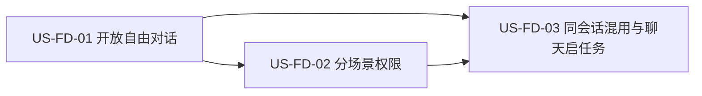

# 40 - 需求：智能体自由对话与权限边界

> **文档类型**：本期需求 + 用户故事（**US-FD**，Free Dialogue / 自由对话）  
> **状态**：**删除与启任务口径已锁定，实现跟改中**（2026-11-04：物理删除 `ftcs-task`；砍掉 `start-from-chat`，本期不交付、不验收。各步骤技能缺必填时自己出提问卡；不区分触发来源。接线交详设 #140。见修订记录）  
> **基线**：桌面端 **`dev-0.6.1`**  
> **对齐**：GitHub Issue [#118](https://github.com/Pedro-MAFS/ftcs/issues/118)；Milestone **v0.6.1**（Issue 正文仍写「规划中 / 暂不挂里程碑」，仓库里程碑已挂 **v0.6.1**，本文以该里程碑与本期版本为准）  
> **关联**：[38-需求-复制当前智能体会话.md](38-需求-复制当前智能体会话.md)（[#117](https://github.com/Pedro-MAFS/ftcs/issues/117)，复制规则本文不改）；[39-需求-主视图多标签与布局可调.md](39-需求-主视图多标签与布局可调.md) 曾写自由对话等 #119 完成后再启。本文只定义需求，不改那一句，也不在本 PR 改 `desktop/`。  
> **前缀**：在 `docs/` 与 `docs/design/` 检索 **US-FD**、**US-AG**，均无占用（已有 **US-C** 联系人、**US-COPY** 文案、**US-CS** 复制会话、**US-LY** 布局、**US-TC** 标签清理等，均不占用）。本文选用 **US-FD**。详设文件不在本需求 PR 中新建。

---

## 1. 一句话目标

智能体栏可以聊任意话题；任务自己跑的时候只自动放行内置 MCP，权限外的操作直接拒绝且不打扰用户；任务结束后的同一会话续聊里，内置 MCP 仍自动放行，其余可询问的权限才交给用户授权。

---

## 2. 背景与动机

### 2.1 产品结论

马丰顺 2026-10-30：开放智能体自由对话。开放后不再限制聊天内容。工作区的修改必须只能使用产品提供的 MCP，读取不限。纳入 **v0.6.1**，基线 **`dev-0.6.1`**。

马丰顺 2026-11-01 群内锁定（项目经理已复述，放行写本文）：

1. **分场景，不采用「其余一律弹授权」。**  
   - **智能体任务执行期间**：内置 MCP 进入 OpenCode allowlist，自动放行。任何非 allowlist、若放在自由对话里本需用户授权的请求，**自动拒绝**（或保证权限外操作绝不执行）。**不得弹授权，不得等待用户**，避免任务卡住。  
   - **任务结束后、同一会话续聊（自由对话）**：内置 MCP 仍自动放行。**非 allowlist 才需要用户授权。**  
2. **工作区外本机路径**的读和写始终硬拒绝，任务执行中同样拒绝，不能靠授权放行。  
3. **自由聊与获客可在同一会话混用。** 任务后可以闲聊，也可以从聊天拉起获客任务。2026-11-01 曾考虑新增 **FTCS 任务 MCP**（`ftcs-task`），让模型调工具启任务，且该 MCP 不进 allowlist、启任务前单独授权。**2026-11-03 马丰顺 / 项目经理改口，以本次为准：** 弃用「自由聊里靠 `ftcs-task` MCP、让模型调工具启任务」。实测模型会优先读 SKILL 自己拼参数，不调工具。改由技能引导启任务。必填参数（如产品 ID、阶段等）由模型用**提问卡**让用户选或确认。用户完成必填选择（选定产品等）**即视为授权启任务**，不再单独弹一张启任务授权卡。提问卡复用现网提问 / 点选机制，不另造授权卡。`ftcs-task` **不作聊天启任务入口**。这次选择发生在任务进入「执行中自动跑工具」之前，不把任务执行中改成弹窗等待。**2026-11-04 马丰顺就删除改口，以此为准：** 本期实现须**物理删除** `ftcs-task`（MCP 包、`opencode.json` 登记，以及把该工具当聊天启任务入口的相关死代码）。产品验收仍不依赖该 MCP。删除由实现完成；本需求补丁不改 `desktop/`。**同日再锁，砍掉专用启动技能：** 不保留 `start-from-chat`，也不把「聊天启任务」单独做成一条技能。本期不交付、不验收该技能；技能文件物理删除或从登记里去掉由实现完成。各步骤技能（录入、画像、探索等现网步骤技能）缺必填参数时自己出提问卡（`question.asked` / US-AQ）。选完即视为授权并启动对应步骤，不另弹启任务授权卡。技能正文不区分「自由对话 vs 页面点击」，不得写「自由对话改走 start-from-chat / 只在 run* 会话执行」。模型看不到点击来源。按钮入口由桌面保证参数齐再调；聊天路径靠提问卡补齐。桌面认提问卡题头后走既有 `run*`（或现网等价启动路径）。具体接线交详设 #140。上文 2026-11-03「改由技能引导」不包含另做一条从聊天启动的专用技能。

Issue #118 原文的目标仍然有效：取消「仅限获客话题」；工作区**写入 / 修改**只能走产品提供的 MCP；工作区**读取**不限（限于工作区内）。原文 Out 里「不放宽 MCP 工具本身的权限边界」「不改变获客主流程既有行为」仍然有效。原文「不新增 MCP」在 2026-11-01 曾改口为「本期 In 含 FTCS 任务 MCP」。**2026-11-03 再改口：聊天启任务不把该 MCP 当入口，产品验收不依赖它。** **2026-11-04 再改口并锁定：本期实现须物理删除 `ftcs-task`。** 删除范围是 MCP 包、`opencode.json` 登记，以及把该工具当聊天启任务入口的相关死代码。这是实现要做的，不是本需求补丁去改 `desktop/`。不再写「#133 先留、是否删除交详设」。本期不交付、不验收 `start-from-chat`（及同类「从聊天启动」专用技能）。各步骤技能缺必填时自己出提问卡；选完即启动对应步骤。不区分触发来源。按钮入口由桌面保证参数齐。提问卡题头与 `run*` 的具体接线交详设 #140，本需求只锁产品规则，不沿用 #137 里的 `start-from-chat` 与触发源守卫。物理删除 `ftcs-task` 仍以本段为准。本文不锁各步骤技能的文件名和字段名。

OpenCode 怎样把现网「全部允许」收成上述模型，交详设调研后写死。本文只写产品约束和验收，不指定配置键名或权限 API。

### 2.2 现网路径（对照 `dev-0.6.1`）

| 环节 | 现网 |
|------|------|
| 智能体栏 | `WorkspaceLayout.vue` 中 `AgentPanel` 在主区域右侧。底部输入框占位为「自由对话暂未开放，请用左侧流水线启动任务…」（`AgentPanel.vue`）。 |
| 发送 | `onSend` 只把 `composerHint` 设为「当前暂不支持在对话区自由发送指令，请通过左侧按钮启动对应任务。」不产生新的用户消息，也不向会话下发内容。任务运行中（`generating`）输入框与「发送」禁用，另有「中止」。 |
| 话题从哪来 | 现网没有一条「非获客就拒答」的分类器。用户发不出自由消息，只能从流水线启动获客任务。Issue 所说「仅限获客话题」，指的是这条发送拦截加上任务本身都围绕获客。 |
| 权限配置 | 权限相关现网配置主要在 `workspace/config/opencode/opencode.json`。编写本文时，技能权限是 `permission.skill` 下对 `*` 的 `allow`，并登记内置 MCP：`lead-store`、`search-api`、`places-api`、`hunter-api`、`chrome-devtools`。群内所说的「全部允许」，配置面以该文件为准。这是现状对照，不是要锁定的目标键名，也不把这五份名字写成永久 allowlist。 |
| 运行时一并放行 | `desktop/electron/opencode/agent-runner.ts` 在当前任务会话上，对 `permission.asked` 与 `permission.v2.asked` 以 `always` 自动回复。因此任务执行中的权限请求今天不会停下来问用户。收敛时须把这一现状一并纳入，但本文不指定替换成哪一个调用。 |
| 从聊天启任务 | `dev-0.6.1` 已合入 #133：自由聊里经 `ftcs-task` MCP、用户点授权后启动获客步骤。2026-11-03 起该触发路径**不作产品入口**。2026-11-04 起本期实现须物理删除该 MCP 包、`opencode.json` 登记，以及把该工具当聊天启任务入口的相关死代码。这行记录合入时的现网；验收不依赖该 MCP。删除由实现 PR 完成，本需求补丁不改 `desktop/`。 |
| 会话 | 设计说明写明每次流水线任务新建 session。时间线在进程内存中，新任务开始时 `resetTimelineView()` 会清空。复制当前栏内已有条目的规则在 [docs/38](38-需求-复制当前智能体会话.md)，本文不改。 |

### 2.3 痛点

| 现象 | 痛点 |
|------|------|
| 发送被整段拒绝 | 用户不能问获客以外的问题，也不能在任务做完后接着聊 |
| 配置与运行时都是全部允许 | 一旦开放自由对话，若不收敛，续聊里的权限外操作会和任务一样被自动同意 |
| 若任务执行中改为弹授权 | 获客任务会停住等用户，和「任务自己跑完」冲突 |
| 若续聊也自动拒绝 | 用户无法在对话里对权限外操作作决定，也无法在聊天里选完必填后启动任务 |
| 靠模型自觉调 `ftcs-task` 启任务 | 实测模型会优先读 SKILL 自己拼参数，不调工具，聊天启任务落空 |
| 启任务前再单独弹一张授权卡 | 用户已经在提问卡里选定产品等必填，再授权一次是重复确认 |
| 工作区外路径若可授权 | 自由对话会碰到本机其他目录 |

---

## 3. 已确认产品规则

> 取自 Issue #118 的目标，以及马丰顺 2026-11-01 的分场景锁定。2026-11-03 只改聊天启任务路径（FD10，以及 FD5 里「进入执行前须先有一张启任务授权卡」的表述）。2026-11-04 锁定物理删除 `ftcs-task`，砍掉 `start-from-chat`，各步骤技能缺必填自己出提问卡，且不区分触发来源（FD10、§7 O3）。其余分场景锁定保持。下表覆盖「非 allowlist 一律要用户授权」的笼统写法。任务执行中不弹授权；只有自由对话（含任务后的同一会话续聊）才对可询问的非 allowlist 授权。配置键与 API 不在本表锁定。

| # | 规则 |
|---|------|
| **FD1** | **取消「仅限获客话题」。** 用户可在智能体栏发送任意话题，并得到针对该话题的正常回复。不得拒答，不得强行拉回获客。 |
| **FD2** | **去掉现网自由发送拦截。** 发送要进入当前会话并得到回复，不得再只弹出「暂不支持自由发送」就结束。占位不得再表示自由对话未开放。新占位文案和发送接线由详设定，见 §7。 |
| **FD3** | **任务执行期间：allowlist 自动放行，其余自动拒绝，不弹窗。** 智能体任务正在执行、自动跑工具的那一段：内置 MCP 进入 allowlist，自动放行。任何非 allowlist、若放在自由对话里本需用户授权的请求，自动拒绝，或用别的机制保证权限外操作绝不执行。不得弹出授权，不得等待用户，任务不得因此停住。 |
| **FD4** | **自由对话：allowlist 仍自动放行，非 allowlist 才授权。** 任务结束后的同一会话续聊，以及当前没有任务在执行时的自由发送，使用这一套，不单开第三套交互。内置 MCP 仍自动放行。非 allowlist，且不属于 FD6、FD7 硬边界的请求，才需要用户授权；未经同意不执行，同意后可以继续。此阶段不得改成自动拒绝，也不得改成自动放行。 |
| **FD5** | **两段交互必须能对比，禁止写成全程同一种。** 不得从任务开始到续聊全程都弹授权。不得两段都自动拒绝，也不得两段都自动放行。任务中的自动拒绝，不能吃掉 FD10 在进入执行之前的提问卡：必填还没选完时，用户须能选完再启动；选完即视为授权，不另出一张启任务授权卡。续聊中的授权，不能漏进任务执行中变成等待。 |
| **FD6** | **工作区外本机路径始终硬拒绝。** 读和写都拒绝，任务执行中同样拒绝，续聊中也拒绝。不进入授权，不能靠点同意放行。不因 FD3 / FD4 的差别而放宽。 |
| **FD7** | **工作区内读不限，写只能走提供的 MCP。** 工作区内读取不受「只能走 MCP」约束。工作区内写入和修改只能经产品提供的 MCP；其他直接改文件的途径拒绝或不可用。用户授权不能把非 MCP 写入变成允许。任务执行中与自由对话都遵守。提示词约束不能代替本条。 |
| **FD8** | **不放宽 MCP 工具自身的权限边界。** 某个内置 MCP 今天不能做的事，不因自由对话或 allowlist 自动放行而扩大。 |
| **FD9** | **同一会话可混用。** 自由聊与获客可以在同一条对话里交错。任务结束后可以在该会话闲聊，不强迫另开一段。也可以从这条对话拉起获客任务。不要求把闲聊隔离成另一个会话。 |
| **FD10** | **聊天启任务由各步骤技能出提问卡，不走 `ftcs-task`，也不另做 `start-from-chat`。** 弃用「自由聊里靠 `ftcs-task` MCP、让模型调工具启任务」。**不保留** `start-from-chat`，也不把「聊天启任务」单独做成一条技能。本期不交付、不验收该技能；技能文件物理删除或从登记里去掉由实现完成，本需求补丁不改 `desktop/`。各步骤技能（录入、画像、探索等现网步骤技能）缺必填参数时自己出提问卡（`question.asked` / US-AQ）。用户完成必填选择即视为授权并启动对应步骤，不再单独弹出启任务授权卡。拒绝或取消必填选择则不启动。**不区分触发来源。** 模型看不到点击来源。技能正文不得写「自由对话 vs 页面点击」守卫，不得写「自由对话改走 start-from-chat / 只在 run* 会话执行」。按钮入口由桌面保证参数齐再调；聊天路径靠提问卡补齐。桌面认提问卡题头后走既有 `run*`（或现网等价启动路径）。具体接线交详设 #140，本需求只锁产品规则，不沿用 #137 的专用启动技能。`ftcs-task` MCP 不作聊天启任务入口，该触发路径作废。**本期实现须物理删除**该 MCP 包、`opencode.json` 登记，以及把该工具当聊天启任务入口的相关死代码（见 §7）。产品侧验收不依赖该 MCP，也不把「调用过该工具」或「存在 `start-from-chat`」写成通过条件。任务一旦进入执行，执行期间的非 allowlist 仍按 FD3 自动拒绝、不弹窗。不得把启任务的提问卡放进执行中变成等待。删除由实现 PR 完成，本需求补丁不改 `desktop/`。 |
| **FD11** | **获客主流程既有行为不回归。** 从既有入口走录入 → 画像 → 探索 → 线索 → 开发信，对外可见的步骤和结果保持。任务执行过程中不新增授权弹窗，也不停下来等用户。本需求不另做一套业务。 |
| **FD12** | **复制会话规则不改。** 仍以 [docs/38](38-需求-复制当前智能体会话.md) 与 #117 为准。自由对话进入时间线之后，复制带走的仍是栏内已有条目。 |
| **FD13** | **现网「全部允许」收敛到 FD3～FD7 与 FD10。** 包括 §2.2 的配置面，以及任务运行时把权限请求一并自动同意的现状。怎样收敛由详设调研后写死。本文不指定配置键名，不指定权限 API。allowlist 的成员只锁定「内置 MCP」；清单以哪份配置为准，见 §7，不把 §2.2 抄到的服务名写成永久清单。 |
| **FD14** | **版本与关联。** 纳入 **v0.6.1**。需求 PR 基线 **`dev-0.6.1`**。关联写法为 Related #118，**不关** Issue #118。本需求文档（含本补丁）不改 `desktop/`，不改 `docs/design/`。物理删除 `ftcs-task` 由实现 PR 完成。 |

场景对照（与 FD3～FD7、FD10 同一口径）：

| 场景 | 内置 MCP（allowlist） | 非 allowlist，且不是下面两列的硬边界 | 工作区外本机路径 | 工作区内不经产品 MCP 的写入 / 修改 | 聊天启任务（步骤技能提问卡） |
|------|----------------------|--------------------------------------|------------------|--------------------------------------|---------------------|
| **任务执行期间** | 自动放行 | 自动拒绝，或保证绝不执行。不弹授权，不等待，不把任务停住 | 硬拒绝 | 拒绝或不可用 | 不在执行中用提问卡或授权卡再启一轮。不弹窗、不等待，不启动第二个任务。执行中的非 allowlist 仍自动拒绝 |
| **自由对话**（含任务结束后的同一会话续聊，以及当前没有任务在执行时的发送） | 自动放行 | 需要用户授权。拒绝则不执行；同意则可以继续 | 硬拒绝，同意也无效 | 拒绝或不可用。同意不能改成写成功 | 各步骤技能缺必填时自己出提问卡。选完必填即启动对应步骤，无单独授权卡。拒绝或取消选择则不启动。不保留 `start-from-chat`，本期不交付、不验收。不区分触发来源；不得写「自由对话 vs 页面点击」或「改走 start-from-chat / 只在 run* 会话执行」。按钮入口由桌面保证参数齐。不依赖 `ftcs-task` MCP。本期实现须物理删除该包、`opencode.json` 登记与入口死代码 |

---

## 4. 范围与非范围

### 4.1 本期做（In Scope）

1. 开放自由对话：取消仅获客话题的限制，发送任意话题并得到正常回复（FD1、FD2）。  
2. 权限按场景分开：任务执行中内置 MCP 自动放行，非 allowlist 自动拒绝且不弹窗、不等待；自由对话中内置 MCP 仍自动放行，可询问的非 allowlist 才要用户授权（FD3、FD4、FD5）。  
3. 工作区外本机路径读写始终硬拒绝（FD6）。  
4. 工作区内读取不限；写入和修改只能经产品提供的 MCP（FD7）。不放宽各 MCP 自身边界（FD8）。  
5. 同一会话可在任务后闲聊，也可从聊天启动获客任务（FD9）。  
6. 聊天启任务：不保留 `start-from-chat`（及同类专用技能），本期不交付、不验收。各步骤技能缺必填时自己出提问卡（`question.asked` / US-AQ）；选完即视为授权并启动对应步骤，无单独授权卡。不区分触发来源。按钮入口由桌面保证参数齐再调；聊天路径靠提问卡补齐。桌面认题头后走既有 `run*`（或现网等价路径）。接线交详设 #140（FD10）。`ftcs-task` MCP 不作入口，产品验收不依赖它。本期实现须物理删除该 MCP 包、`opencode.json` 登记，以及把该工具当聊天启任务入口的相关死代码（FD10）。本需求文档 PR 仍不改 `desktop/`。  
7. 获客主流程与复制会话的既有行为保持可回归（FD11、FD12）。

### 4.2 本期不做（Out of Scope）

| 项 | 说明 |
|----|------|
| 任务执行期间对非 allowlist 弹授权或等待用户 | FD3、FD5。这样会把任务卡住。禁止写成全程都弹授权 |
| 自由对话里把可询问的非 allowlist 自动拒绝，或自动放行 | FD4、FD5。续聊才授权。禁止两段都自动拒绝，或两段都自动放行 |
| 用「其余一律要用户授权」覆盖任务执行中 | 该笼统写法作废。任务执行中是自动拒绝（或保证不执行），不是询问 |
| 工作区外本机路径改为可授权、可读写 | FD6。任务中也硬拒绝 |
| 授权后允许不经产品 MCP 改工作区文件 | FD7。同意不能改道 |
| 放宽某个 MCP 工具自身的权限边界 | FD8；Issue #118 范围外 |
| 改变获客主流程既有对外行为，或在执行中新增授权等待 | FD11 |
| 仍依赖模型自觉调用 `ftcs-task` MCP，并把它当作唯一的聊天启任务路径 | FD10。该触发路径作废。产品验收不依赖此 MCP |
| 另造一套启任务授权卡（应使用提问卡），或未选完必填就启动 | FD10。复用现网提问 / 点选。选完必填即授权并启动；拒绝或取消则不启动 |
| 本期交付或验收 `start-from-chat`，或把「聊天启任务」单独做成一条专用技能 | FD10。本期不交付、不验收。各步骤技能缺必填时自己出提问卡 |
| 在步骤技能里区分「自由对话 vs 页面点击」，或写「自由对话改走 start-from-chat / 本技能只在桌面 run* 已建好的任务会话里执行」 | FD10。模型看不到点击来源。缺必填由该步骤技能自己出提问卡。按钮入口由桌面保证参数齐 |
| 在任务执行中途用提问卡或授权卡启动任务并等待 | FD10。选择发生在进入执行之前。进入执行后按 FD3，不弹窗、不等待 |
| 指定 OpenCode 配置键名、权限 API，或把 §2.2 的服务名锁定为永久 allowlist | FD13；§7 |
| 为自由对话另开会话，或禁止任务后在同一条对话里闲聊 | FD9 |
| 改复制会话的入口、正文、超限和元信息 | FD12；[docs/38](38-需求-复制当前智能体会话.md) |
| 要求任务执行中途仍可在输入框插话 | 现网 `generating` 时输入框与发送禁用。本文不把「执行中可发送」写成已开放 |
| 沿用 2026-11-01「本期必须交付 FTCS 任务 MCP 才能从聊天启任务」，或把调用 `ftcs-task` 写成验收通过条件 | 2026-11-03 起不把该 MCP 当入口。产品验收不依赖它，不得把调用它写成通过条件。2026-11-04 起本期实现须物理删除该包、`opencode.json` 登记与入口死代码，见 §7。聊天启任务改由各步骤技能的提问卡，不另做 `start-from-chat`。本需求补丁仍不改 `desktop/`，删除由实现侧完成 |
| 在本需求 PR 关闭 #118、修改 `desktop/`、写或改 `docs/design/`、合入 `main` | FD14。物理删除由实现 PR 完成，不在本需求补丁里改代码或改详设 |

---

## 5. 用户故事拆分

| ID | 标题 | 优先级 | 依赖 | 说明 |
|----|------|--------|------|------|
| **US-FD-01** | 开放自由对话 | Must | 现网 `AgentPanel` 发送拦截 | 任意话题可发、可答；不再拒发，不再强行拉回获客 |
| **US-FD-02** | 任务中自动拒，续聊才授权 | Must | 现网任务执行与内置 MCP；续聊段依赖 US-FD-01 | 两段对比可测。执行中不弹窗；续聊中可询问项才授权 |
| **US-FD-03** | 同会话混用，并从聊天启动任务 | Must | US-FD-01；启任务的提问卡须与 US-FD-02 的「执行中不弹窗」区分开 | 各步骤技能缺必填自己出提问卡；选完即启动。不交付 `start-from-chat`。不区分触发来源。不依赖 `ftcs-task` MCP。本期实现须物理删除该 MCP |

三条都留。US-FD-02 用流水线已经启动的任务验收「执行中」，用任务结束后的发送验收「续聊」，不依赖聊天启任务路径才算通过。US-FD-03 只验收混用，以及由步骤技能在缺必填时出提问卡、用户选完后启动对应步骤，不把执行中的拒绝样例再绑成一次才算过。不验收 `start-from-chat`。产品验收不依赖 `ftcs-task` MCP，也不把调用它写成通过条件。本期实现另须物理删除该 MCP 包、登记与入口死代码。

---

### US-FD-01　开放自由对话

**作为** 使用智能体栏的人，**我想** 对任意话题发消息并得到针对该话题的回复，**以便** 不被限制成只能围绕获客说话。

| 项 | 内容 |
|----|------|
| 优先级 | Must |
| 依赖 | 现网 `AgentPanel` 的占位与 `onSend` 拦截 |
| 状态 | **待详设** |

**验收要点**

- 在没有获客任务、或上一轮任务已经结束时，发送一个与获客无关的问题。时间线上出现这次用户消息，并得到针对该问题的回复（FD1、FD2）。  
- 结果不是只有现网那句「当前暂不支持在对话区自由发送指令，请通过左侧按钮启动对应任务。」（FD2）。  
- 回复不拒答，不把话题强行拉回获客、画像或线索（FD1）。  
- 输入框占位不再表示「自由对话暂未开放」。新句子由详设定；验收只要求不再误导为未开放（FD2）。  
- 本故事不要求出现授权框，也不要求启动任务。那是 US-FD-02、US-FD-03。

**本故事不做**：规定权限弹窗；规定聊天启任务的技能正文或提问文案；关闭 #118。

---

### US-FD-02　任务中自动拒，续聊才授权

**作为** 让获客任务自己跑完的人，**我想** 任务执行时不要被授权框打断，并只在任务后的自由对话里决定那些权限外操作，**以便** 任务不卡住，续聊也不再全部自动同意。

| 项 | 内容 |
|----|------|
| 优先级 | Must |
| 依赖 | 现网由流水线启动的任务；内置 MCP；US-FD-01 的续聊发送 |
| 状态 | **待详设** |

**验收要点**

任务执行期间（用既有入口启动一轮会调用内置 MCP 的任务）：

- 内置 MCP 的操作自动进行，不出现授权界面（FD3）。  
- 对一次「若发生在自由对话里本可询问用户」的非 allowlist 请求：不出现授权界面，界面不进入等待用户，该权限外操作没有执行，任务不因此停住（FD3、FD5）。自动拒绝还是别的「保证绝不执行」，由详设选定，验收不绑定某一种 API。  
- 读写工作区之外的本机路径：被拒绝，不弹授权，同意类操作不存在，读写都没有发生（FD6）。  
- 不经产品提供的 MCP 直接修改工作区内文件：被拒绝或不可用，文件不被改掉（FD7）。

任务已经结束、同一会话继续发送（自由对话）：

- 内置 MCP 仍自动进行，不因为「任务已经结束」就改成每次都要授权（FD4）。  
- 与上一节同类的、不属于硬边界的非 allowlist 请求：这次必须经用户授权。拒绝则不执行；同意则该次可以继续（FD4）。  
- 工作区外本机路径仍然硬拒绝。即使用户愿意同意，也不放行（FD6）。  
- 读取工作区内已有文件，不因「没有走 MCP」被拒绝（FD7）。  
- 不经产品 MCP 直接修改工作区内文件：仍然拒绝或不可用，不能靠同意写成成功（FD7）。

对比（任一条不满足即本故事失败）：

- 任务执行中弹出授权，或停住等用户。  
- 自由对话里，可询问的非 allowlist 不经授权就执行，或直接自动拒绝、不给授权机会。  
- 从任务执行到续聊全程都弹授权，或全程都自动拒绝，或全程都自动放行。

**本故事不做**：从聊天启动任务（US-FD-03）；把非内置 MCP 写进 allowlist 来躲过拒绝；指定配置键名；关闭 #118。

---

### US-FD-03　同会话混用，并从聊天启动任务

**作为** 已经在这段对话里的人，**我想** 做完任务接着闲聊，或在聊天里选完必填后启动获客任务，**以便** 不用换一条会话才能混用。

| 项 | 内容 |
|----|------|
| 优先级 | Must |
| 依赖 | US-FD-01；启任务的提问卡须与 US-FD-02 的「执行中不弹窗」区分开 |
| 状态 | **删除与启任务口径已锁定，实现跟改中** |

**验收要点**

- 一轮任务结束后，不另开一条对话，就能在同一条时间线里继续闲聊；在下一次任务尚未开始前，上文还在（FD9）。现网新任务开始时会清空时间线。从聊天启动的那一次会不会清空，交详设 #140，不在本故事里先定。闲聊本身的通过条件取「任务已结束、下一次任务还没开始」。  
- 从聊天启动获客任务不靠 `start-from-chat`，也不把调用 `ftcs-task` MCP 当作入口或通过条件。本期不交付、不验收 `start-from-chat`（及同类「从聊天启动」专用技能）。产品验收不依赖该 MCP（FD10）。  
- 本期实现须物理删除 `ftcs-task`：MCP 包、`opencode.json` 中的登记，以及把该工具当聊天启任务入口的相关死代码。聊天启任务改为各步骤技能在缺必填时自己出提问卡。本需求补丁不改 `desktop/`，删除由实现 PR 完成（FD10）。  
- 各步骤技能（录入、画像、探索等）缺必填参数时自己出提问卡（`question.asked` / US-AQ），不另造启任务授权卡。选完即视为授权并启动对应步骤。题头如何对上 `run*`（或现网等价路径）交详设 #140，本需求只锁这条产品规则（FD10）。  
- 技能正文不区分「自由对话 vs 页面点击」。模型看不到点击来源。步骤技能里不得出现「自由对话改走 start-from-chat」或「本技能只在桌面 run* 已建好的任务会话里执行」。按钮入口由桌面保证参数齐再调；聊天路径靠提问卡补齐（FD10）。  
- 用户拒绝或取消必填选择（例如不选产品）：对应步骤不启动。能看出没有启动；选择前已经在的闲聊还在。具体文案由详设 #140 定。  
- 用户完成必填选择（选定产品等）：即视为授权，对应步骤启动。没有单独的启任务授权卡。进入执行之后，权限按 US-FD-02 的任务执行期间验收：内置 MCP 自动放行，非 allowlist 不弹窗、不等待（FD3、FD10）。  
- 启动失败时，能看出没有按「已成功启动并在执行」继续；已有对话不被当成任务已经跑完。具体文案由详设 #140 定。  
- 从既有流水线入口走主流程，对外步骤和结果不回归，执行中不新增授权等待（FD11）。  
- 复制当前会话仍按 docs/38，不因本故事改入口或正文规则（FD12）。

**本故事不做**：把调用 `ftcs-task` MCP 写成聊天启任务的通过条件；把 `start-from-chat` 写成要交付或要验收的技能；另造启任务授权卡；在任务执行中途用提问卡或授权框启动另一个任务；在步骤技能里区分自由对话与页面点击，或写「改走 start-from-chat / 只在 run* 会话执行」；规定各步骤技能的文件名、提问文案或参数字段名；在本需求 PR 里改 `desktop/` 或 `docs/design/`；关闭 #118。

---

## 6. 验收清单（需求级）

- [ ] 非获客问题可以正常对话，不被拒答，也不被强行拉回获客。发送不再只停留在「暂不支持自由发送」。  
- [ ] **任务执行期间**：内置 MCP 自动放行。非 allowlist、本需用户授权的请求自动拒绝或绝不执行；不弹授权，不等待用户，任务不因此停住。  
- [ ] **任务结束后的同一会话续聊**：内置 MCP 仍自动放行。可询问的非 allowlist 才要用户授权；未授权不执行。不得改成自动拒绝或自动放行。  
- [ ] 上述两段不是同一种交互。全程都弹授权，视为失败。  
- [ ] 访问工作区外本机路径被拒绝。任务执行中同样拒绝，续聊中也不能靠授权放行。  
- [ ] 工作区内读取不受「仅 MCP」限制。工作区内写和改只能经产品提供的 MCP；其他写法被拒绝或不可用，授权不能改道。  
- [ ] 同一会话可以在任务后闲聊，也可以从聊天启动步骤：由该步骤技能在缺必填时自己出提问卡，选完即启动对应步骤，无单独授权卡。拒绝或取消选择则不启动。不依赖 `ftcs-task` MCP，也不把调用它写成通过条件。不交付、不验收 `start-from-chat`。进入执行后仍按任务执行期间的权限。  
- [ ] 技能正文不区分自由对话与页面点击。按钮入口由桌面保证参数齐。聊天路径靠提问卡补齐。步骤技能不含「自由对话改走 start-from-chat / 只在桌面 run* 已建好的任务会话里执行」。  
- [ ] 本期实现物理删除 `ftcs-task`：MCP 包、`opencode.json` 登记，以及把该工具当聊天启任务入口的相关死代码。删除由实现 PR 完成；本需求补丁不改 `desktop/`。  
- [ ] 获客主流程从既有入口启动的既有行为不回归，执行中没有新的授权等待。复制会话仍按 docs/38。  
- [ ] 变更落在 `dev-0.6.1` 的需求文档；#118 不因本文关闭。

---

## 7. 交详设选型与未决

> 本节其余项仍是要详设写死的选型，不是已经锁定的实现。不得把未锁定的候选写成规则表里的新决定。O3 里「物理删除 `ftcs-task`」「不交付 `start-from-chat`」「各步骤技能缺必填自己出提问卡」和「不区分触发来源」已由 2026-11-04 锁定。题头与 `run*` 的接线交详设 #140，不是再把专用启动技能交回去二选一。

| # | 项 | 须写明什么 |
|---|-----|------------|
| **O1** | OpenCode allowlist 与权限机制 | 怎样从 §2.2 的「技能通配允许 + 内置 MCP 登记」，以及运行时对权限请求一并自动同意，收敛到 FD3 与 FD4。任务执行中：自动放行只覆盖内置 MCP；非 allowlist 不弹窗、不等待，并保证权限外操作不执行。自由对话：同一类非 allowlist 改为询问用户。须给出两段各一条可手测的样例。不在需求里指定配置键名或权限 API；详设可以选定具体机制，但必须同时满足这两段，不能只改一段。 |
| **O2** | 内置 MCP 清单以何为准 | 配置源是 `workspace/config/opencode/opencode.json` 的登记，还是另有清单。§2.2 的五个服务名只是编写时的现状。聊天启任务不靠把某个 MCP 放进 allowlist。已合入的 `ftcs-task` 须从登记里物理删除，见 O3。产品验收不依赖它，也不把它算作 allowlist 成员。详设写明增删内置 MCP 时 allowlist 如何跟着变。 |
| **O3** | 聊天启任务（步骤技能提问卡）；不交付 `start-from-chat`；`ftcs-task` 物理删除已锁定 | **删除已锁定，不再二选一。** 详设 #137（`1296e0d4`）当时在「物理删除」与「留着不用」中选了「留着不用」，并写了 `start-from-chat`。2026-11-04 马丰顺改口后，以本需求为准：本期实现须**物理删除** `ftcs-task` MCP 包、`opencode.json` 登记，以及把该工具当聊天启任务入口的相关死代码。产品验收仍不依赖该 MCP，不得把调用它写成通过条件。**不交付 `start-from-chat`。** 不保留该技能，也不把「聊天启任务」单独做成一条技能。本期不交付、不验收；文件物理删除或从登记去掉由实现完成。各步骤技能（录入、画像、探索等）缺必填时自己出提问卡（`question.asked` / US-AQ）。选完即视为授权并启动对应步骤；拒绝或取消则不启动。不另造启任务授权卡。必填至少覆盖产品、阶段一类，字段名本文不锁。**不区分触发来源：** 技能正文不得写「自由对话 vs 页面点击」，不得写「自由对话改走 start-from-chat / 只在 run* 会话执行」。模型看不到点击来源。按钮入口由桌面保证参数齐再调；聊天路径靠提问卡补齐。桌面认提问卡题头后走既有 `run*`（或现网等价启动路径）。题头怎么认、失败时用户看见什么、从聊天启动后时间线是否清空，交详设 #140，本需求只锁上述产品规则。#137 里的 `start-from-chat` 和触发源守卫，实现不照做。详设 #140 改 US-FD-03，不在本需求 PR 改 `docs/design/`。本文不锁各步骤技能的文件名。本需求补丁不改 `desktop/`，删除由实现 PR 完成。 |
| **O4** | 输入框占位与发送路径 | 对照 §2.2 的占位与 `onSend` 只写 `composerHint`、不产生用户消息。写明开放后占位改成什么、消息如何进入当前会话、如何得到回复。现网 `generating` 时禁用输入：本文不要求执行中插话。若详设要改这条禁用，仍不得在执行中弹出非 allowlist 授权。 |
| **O5** | 与 #117、获客主流程的回归 | 复制会话仍按 docs/38：自由对话进入时间线后，复制的是栏内已有条目，不另定格式。主流程从既有入口跑录入 → 画像 → 探索 → 线索 → 开发信，对外结果不变，执行中不出现新的授权等待。若核对后发现主流程在执行中会发出非 allowlist 请求，而今天这些请求被自动同意：须写明自动拒绝后主流程是否仍能走完。不能改成弹窗把任务停住，也不能把非内置 MCP 静默追加进 allowlist。做不到两全时，停在该分叉上写明冲突，交产品，不单方面改口。 |
| **O6** | 自由对话里哪些非 allowlist 可以询问 | 列出会弹出授权的种类，以及用户同意、拒绝时各发生什么。工作区外路径、工作区内非 MCP 写入不属于可询问项（FD6、FD7）。启任务的必填选择用提问卡，不算进这张授权清单，也不另造授权卡（FD10）。本文不预列 API 名称。 |

Issue #118 里已关闭的待澄清，不再退回未决：工作区外路径是硬拒绝，不是「详设再决定限不限制」；自由对话与获客不隔离会话；「只能用 MCP 修改」必须在权限层落实，不能只靠提示词。仍交给详设的是 O1 的机制，不是要不要守 FD7。聊天启任务不走 `ftcs-task`、选完必填即授权，已由 2026-11-03 锁定，不再退回「是否仍用该 MCP 当入口」。物理删除 `ftcs-task` 已由 2026-11-04 锁定，不再退回「留着不用」。同日再锁：不交付 `start-from-chat`；各步骤技能缺必填自己出提问卡；不区分触发来源。不再退回「另做一条从聊天启动的专用技能」或「让模型判断聊天还是按钮」。题头与 `run*` 的接线交详设 #140。实现按本补丁删除 `ftcs-task`，且不照做 #137 的专用启动技能和触发源守卫。

---

## 8. 修订记录

| 日期 | 说明 |
|------|------|
| 2026-11-01 | 初稿：对齐 #118 与马丰顺同日分场景锁定。取消仅获客话题；任务执行中内置 MCP 自动放行，非 allowlist 自动拒绝且不弹窗、不等待；任务后同一会话续聊（自由对话）中内置 MCP 仍自动放行，非 allowlist 才授权。工作区外路径始终硬拒绝。工作区内读不限，写只能走提供的 MCP。同一会话可闲聊，也可经 FTCS 任务 MCP（不进 allowlist，进入执行前授权）从聊天启动任务。原文「不新增 MCP」改口为本期 In。规则 FD1～FD14；US-FD-01～US-FD-03。现网对照 `AgentPanel` 发送拦截，以及 `workspace/config/opencode/opencode.json` 的技能通配允许与内置 MCP 登记。不指定配置键名。基线 `dev-0.6.1`。不关 #118。 |
| 2026-11-03 | 改口（马丰顺 / 项目经理）：弃用自由聊里靠 `ftcs-task` MCP、让模型调工具启任务。改由 SKILL 引导启任务；必填参数用提问卡让用户选或确认，选完即视为授权，取消单独的启任务授权卡。提问卡复用现网提问 / 点选（`question.asked` / US-AQ），接线交详设。`ftcs-task` 不作聊天启任务入口；当日写「#133 先留不回滚，拆除或留存见 O3」，产品验收不依赖该 MCP。更新 FD5、FD10、场景对照、US-FD-03、§2.1、§4、§6、§7 O2 / O3。FD1～FD4、FD6～FD9、FD11～FD14 中任务中自动拒、续聊授权、工作区外硬拒、同会话混用保持。不关 #118。不改 `desktop/`，不改 `docs/design/`。其中「先留 / 拆除或留存」已由下一行改为锁定物理删除。当日「SKILL 引导」后收成各步骤技能自己出提问卡，不另做 `start-from-chat`，见 2026-11-04 末行。 |
| 2026-11-04 | 改口（马丰顺）：O3 不再二选一，锁定本期实现**物理删除** `ftcs-task`（MCP 包、`opencode.json` 登记，以及把该工具当聊天启任务入口的相关死代码）。详设 #137（`1296e0d4`）当时选「留着不用」；技能与提问卡接线仍按该详设，实现按详设加上本补丁的删除口径。详设另开补丁改 US-FD-03。产品验收仍不依赖该 MCP，不得把调用它写成通过条件。FD10 其余不变。更新文首状态、§2.1、§2.2、FD10、FD14、场景对照、§4、US-FD-03、§6、§7 O2 / O3、§9。不关 #118。本需求补丁不改 `desktop/`，不改 `docs/design/`。其中「技能接线仍完全按 #137」已由下一行收窄：触发源守卫不再沿用。 |
| 2026-11-04 | 再锁（马丰顺 / 项目经理）：技能文案不区分「聊天触发 vs 页面点击」。模型收到的都是文本，无法知道触发源。缺必填参数时用提问卡询问。页面/按钮入口由桌面保证必填已齐，不依赖模型区分触发方式。禁止在步骤技能里写「自由对话改走 start-from-chat / 本技能只在桌面 run* 已建好的任务会话里执行」这类守卫。详设 #137 中的同类守卫不再沿用，详设另开补丁。更新 FD10、§2.1、场景对照、§4、US-FD-03、§6、§7 O3、§9。不关 #118。不改 `desktop/`，不改 `docs/design/`。本行尚未砍掉专用技能本身；下一行改为本期不交付、不验收 `start-from-chat`。 |
| 2026-11-04 | 再锁（马丰顺）：砍掉 `start-from-chat`。不保留该技能，也不把「聊天启任务」单独做成一条技能。本期不交付、不验收；文件物理删除或从登记去掉由实现跟。各步骤技能（录入、画像、探索等）缺必填时自己出提问卡（`question.asked` / US-AQ），选完即视为授权并启动对应步骤，不另弹启任务授权卡。不区分触发来源：不得写「自由对话 vs 页面点击」，不得写「自由对话改走 start-from-chat / 只在 run* 会话执行」。按钮入口由桌面保证参数齐再调；聊天路径靠提问卡补齐。桌面认题头后走既有 `run*`（或现网等价路径）。具体接线交详设 #140。仍保留物理删除 `ftcs-task`、选完必填即启动。更新文首、§2.1、FD10、场景对照、§4、US-FD-03、§6、§7 O3、§9。不关 #118。不改 `desktop/`，不改 `docs/design/`。 |

---

## 9. 下一步

1. 本文合入 **`dev-0.6.1`**（本 PR：Related #118，不 Closes）。  
2. 详设 #137 当时选「留着不用」，并写了 `start-from-chat` 与触发源守卫。2026-11-04 起以本文为准：物理删除 `ftcs-task`；不交付、不验收 `start-from-chat`；各步骤技能缺必填自己出提问卡；不区分触发来源。提问卡题头与 `run*` 的接线交详设 #140，不在本需求 PR 中修改 `docs/design/`。O1、O2、O4～O6 仍交详设写选择和验收样例。  
3. 开发在实现侧跟改：按 FD10，不交付 `start-from-chat`；步骤技能缺必填出提问卡，选完即启动对应步骤；按钮入口由桌面保证参数齐。并物理删除 `ftcs-task` 的 MCP 包、`opencode.json` 登记与入口死代码。不得把任务执行中做成弹授权，也不得把自由对话里的可询问项做成自动拒绝或自动放行。不得把调用 `ftcs-task` 或存在 `start-from-chat` 写成通过条件。不得在步骤技能里区分自由对话与页面点击。  
4. **不关闭 #118**；本需求不触发打 tag / 发版；**不合 `main`**。

## 11. Issue #141：聊天启动画像与中文对照（2026-11-04）

本节新增 US-FD-04 / US-FD-05，不修改 US-FD-03 的六步骤验收清单，不关闭 #118。

| 规则 | 产品口径 |
| --- | --- |
| CP1 | 画像由 `extract-product-profile` 收齐资料选择，经桌面 bootstrap 调用 `runExtractProfile`。选择实际来源后创建新产品，不覆盖旧画像；与资料库生成按钮一致。 |
| CP2 | 中文对照由 `translate-outreach-email` 收齐产品、线索与必要收件槽，经 `runTranslateOutreachEmail` 执行。公司槽默认 `company`；指定个人须明确对应槽。 |
| CP3 | 提问选择即授权，取消不启动；不得在原对话自行准备参数后跑完业务。状态卡、完成事件和页面刷新复用正式任务。 |
| CP4 | 技能不区分触发来源；按必填完整性提问。画像须有已准备的 inputs 清单，翻译须有目标槽外文正文。 |
| CP5 | 执行后继续遵守 FD3～FD7，非 allowlist 自动拒绝、工作区外硬拒。 |

### US-FD-04：聊天启动产品画像（Must）

作为业务员，我希望说「跑绿森塑木的产品画像」后选择已有资料，启动正式画像任务。

验收：点名公司后列真实资料供选择；支持网站书签、文件和混选；新产品 ID 与 inputs 由桌面生成。无资料提示先录入，取消不创建产品、不启动任务。越界路径、失效资料不可启动；预检失败留在原会话。成功有画像任务状态卡和既有完成刷新。单有 productId 不能启动。

### US-FD-05：聊天启动开发信中文对照（Must）

作为业务员，我希望选择产品和线索后生成已有开发信的中文审阅稿；需要个人稿时可以选择收件人。

验收：公司稿默认 company；个人稿准确定位槽。无草稿、外文主题/正文为空、产品不匹配均不启动、不改稿。取消不启动。正式任务仅更新中文对照，外文稿保持原样，完成后复用邮件刷新。

录入资料准备、补联系人、单封重写仍不从聊天正式启动。详设见 [US-FD-04/05](design/US-FD-04-05-画像与中文对照聊天启动.md)。
