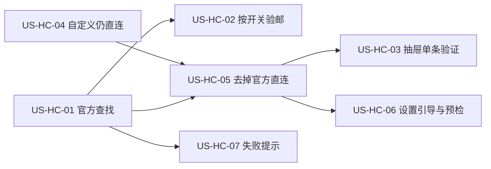

# 42 - 需求：官方通道网关代调 Hunter（客户端）

> **文档类型**：本期需求 + 用户故事（客户端分册；**US-HC**）  
> **状态**：需求已锁定口径，待详设；**不在本文件所在 PR 改 `desktop/` 实现**  
> **基线**：桌面端 **`dev-0.6.3`**；纳入 **v0.6.3**  
> **对齐**：GitHub Issue [#156](https://github.com/Pedro-MAFS/ftcs/issues/156)；Milestone **v0.6.3**  
> **分册**：本文只写客户端对接与用户侧行为。网关内部计费、价目、表结构、上游库管理写在 **网关侧 Hunter 代调需求**（token-gateway 仓的 `token-gateway/docs/`）。该分册尚未在本仓落地，本文只点名，不链向本仓不存在的文件，也不在本 PR 新建 `token-gateway/`。  
> **分册边界对照**：[15-官方搜索通道对接.md](15-官方搜索通道对接.md)（客户端只写对接与用户侧行为）  
> **刻意不对齐**：[#21](https://github.com/Pedro-MAFS/ftcs/issues/21) / [30-需求-Places官方通道按用户下发APIKey.md](30-需求-Places官方通道按用户下发APIKey.md)（下发 Key、客户端直连上游）  
> **既有补全能力**：[20-需求-联系人Enrichment.md](20-需求-联系人Enrichment.md)（US-C-01～C-04 已交付）；决策原文 [research/US-C-决策-Hunter-MVP.md](research/US-C-决策-Hunter-MVP.md)（2026-09-08）。本文不改写这两份旧文。  
> **前缀**：`docs/` 与 `docs/design/` 中 **US-C-00～US-C-08** 已用于联系人 Enrichment（含仍延后的 US-C-05～C-08）。本文用新前缀 **US-HC**（Hunter Channel / 官方通道代调 Hunter），避免与已有故事 ID 冲突。详设文件不在本需求 PR 中新建。

---

## 1. 一句话目标

官方通道用户做「补全联系人」时，无需自备或自配 Hunter API Key：查找联系人，以及按产品开关验证邮箱，都由 Token 网关代调 Hunter API，客户端不直连 `api.hunter.io`，用量计入官方通道计费。自定义通道仍由用户自备 Hunter Key，直连 `api.hunter.io`，不走网关、不扣官方余额。

---

## 2. 背景与动机

### 2.1 产品结论（2026-11-16）

马丰顺于 2026-11-16 锁定（[#156](https://github.com/Pedro-MAFS/ftcs/issues/156)，v0.6.3）：

- 官方通道改为 Token 网关代调 Hunter。用户不必再为官方通道申请或粘贴 Hunter Key。
- 自定义通道保持现网 BYOK。
- 官方通道上的 Hunter 用量走官方通道计费。单价与扣费细则不在本文写死。
- 法务与合同本期搁置，不作为开工或发版的前置条件。
- 需求分两册：客户端（本文）与网关侧 Hunter 代调需求。接法对齐官方搜索通道，不对齐 Places 的「下发 Key、客户端直连」。

这是对 2026-09-08 US-C 决策「**官方代调不做**」的推翻。该决策写明：用户自备 Key，桌面 / MCP 直连 `api.hunter.io`；在法务 / 合同完成前不经网关转售 Hunter。同期 [20-需求-联系人Enrichment.md](20-需求-联系人Enrichment.md) 把「官方网关代付 Hunter credit」列为当时不做。官网 [website/content/docs/hunter-api-key.md](../website/content/docs/hunter-api-key.md) 至今仍写：官方通道用户的模型与搜索走官方，**Hunter 须自备 Key（FTCS 不代调）**，且请求由本机直连 `api.hunter.io`。

自本日起，官方通道以本文与 #156 为准。自定义通道的自备 Key、直连与「只配置本人或团队合法持有的 Key」仍然有效。本文不改写 `docs/20`、US-C 决策原文和官网帮助；官网句子留到发版前同步（见 HC11、§4.1）。

### 2.2 与两条既有通道的关系

| 对照 | 已落地的用户侧行为 | 本期 Hunter |
|------|-------------------|-------------|
| 官方搜索（[docs/15](15-官方搜索通道对接.md)） | 官方通道复用官方凭证，由 Token 网关代调；自定义通道自备 Key 并直连上游；官方用量走官方通道计费；桌面不写价目与账本 | **对齐这一分册边界与通道分工** |
| Places 官方 Key（[docs/30](30-需求-Places官方通道按用户下发APIKey.md)，#21） | 官方通道按用户下发 Key，客户端直连 Google | **Hunter 不采用这套接法** |

### 2.3 现网用户侧（对照已交付的 US-C-03 / US-C-04）

| 环节 | 现网 |
|------|------|
| 设置 | **设置 → 集成 → Hunter · 补全联系人**：可填多个自备 Key、测试连接、勾选「补全联系人时验证邮箱」。说明为费用由 Hunter 收取，并链到 Hunter 服务条款与注册页。 |
| 线索页 | 「补全联系人」在未配置 Hunter Key 时不可用，并引导去设置配置 Key。已配置后按该开关决定本次补全是否验邮。 |
| 抽屉 | 单条联系人可再点「验证」。未配置 Key 时提示先到 **设置 → 集成** 配置。该验证由主进程直调 Hunter，不另起一轮补全任务。 |
| 出站 | 补全与验邮都由本机直连 `api.hunter.io`。官方通道同样要求自备 Key。 |
| 主路径 | 未配置 Key 时，画像、探索、评分与开发信仍可用。补全是可选扩展。 |
| 引导 | 首次设置引导不收集 Hunter Key。须改口的表面在设置、线索页、抽屉、补全预检，以及发版前的官网帮助。 |

### 2.4 痛点

| 现象 | 痛点 |
|------|------|
| 官方通道已经免配模型与搜索的上游 Key | 补全联系人仍要求另去 Hunter 申请 Key，和官方搜索的免配体验不一致 |
| 官网与设置都写「FTCS 不代调」 | 用户会认为官方通道也必须自备 Hunter Key |
| 若只把官方通道的 Key 输入留在界面上不用 | 官方直连路径还在，容易在失败时被当成回退，也和「确定不要就删掉」冲突 |

---

## 3. 已锁定产品规则

> 取自 2026-11-16 马丰顺口述与 #156。下表不再把「官方不代调」当作现行规则。价目、网关路径与字段不在本表补决定。

| # | 规则 |
|---|------|
| **HC1** | **官方通道由 Token 网关代调。** 用户无需自备、自配 Hunter API Key。客户端不直连 `api.hunter.io`。鉴权复用该用户已经开通的官方通道凭证与网关地址，与官方搜索同一类官方凭证。客户端不接收、不保存、不拼装上游 Hunter Key。 |
| **HC2** | **自定义通道仍为 BYOK。** 用户自备 Hunter Key，直连 `api.hunter.io`，不走网关，不扣官方余额。多 Key、轮换、测试连接与「费用由 Hunter 收取」保持现网能力。 |
| **HC3** | **删掉的只是官方通道上的「自备 Key + 直连 Hunter」。** 自定义通道的自备 Key 保留。官方通道这条路径确定不要，就物理删除，包含失败后改走本机 Key 直连的回退。不留一段编译着但官方通道不再调用的兼容分支。两条通道可以继续共用补全技能与 `people[]` 写回；分叉只在凭证来源和请求去向。本机里已经为自定义通道保存的 Key 保留，切回自定义后仍可编辑、仍可直连。切到官方通道时不得把这些 Key 当作当次调用的上游凭证。 |
| **HC4** | **官方通道的 Hunter 用量走官方通道计费。** 用户侧感知为扣官方余额。单价、加价、账本、表结构与上游 Hunter 账号的库管理写在网关侧 Hunter 代调需求。本文不写死单价，桌面不展示上游 Hunter 成本明细，也不另做一套 Hunter 账本。 |
| **HC5** | **法务与合同本期搁置。** 不作为开工或发版的前置阻塞。自定义通道仍只让用户配置本人或团队合法持有的 Key，并保留现网的 Hunter 服务条款说明。官方通道不在本文新写合规段落。 |
| **HC6** | **本文是客户端分册。** 网关侧 Hunter 代调需求另写到 token-gateway 仓。本文只跨引该分册名称。不把网关实现、单测、价目公式写进本文，也不在本 PR 新建 `token-gateway/`，不把一份尚未落仓的网关文档说成已经存在于本仓。 |
| **HC7** | **不对齐 Places。** 官方通道不为 Hunter 按用户下发上游 Key，也不改为客户端持 Key 直连 `api.hunter.io`。 |
| **HC8** | **覆盖现有补全联系人能力。** 包括查找联系人，以及按产品开关验证邮箱。抽屉里已有的单条「验证」走同一条通道规则：官方通道代调，自定义通道直连。`people[]` 的字段、排序、写回和开发信选人语义保持 [docs/20](20-需求-联系人Enrichment.md) 已交付行为。本期只换官方通道的传输与凭证。 |
| **HC9** | **主路径仍不依赖补全。** 未做补全联系人时，画像、探索、评分与开发信照常可用。官方通道不把补全变成必做步骤。 |
| **HC10** | **「补全联系人时验证邮箱」仍是产品开关，两条通道都保留。** 默认开启与现网一致。官方通道开启时，验邮经网关代调并计入官方通道计费。自定义通道开启时，验邮直连 Hunter，消耗用户自己的 Hunter 额度。关闭时两条通道都只查找、不验邮。 |
| **HC11** | **版本与文档流程。** 纳入 **v0.6.3**。需求 PR 基线 **`dev-0.6.3`**。PR 与 commit 只标注 **Related #156**。发版前 #156 保持打开。本需求 PR 不改 `desktop/`，不改 `website/` 用户帮助。发版前须按本文同步官网文档（§4.1）。 |
| **HC12** | **消费方契约对齐官方搜索通道，具体路径与字段由网关侧 Hunter 代调需求锁定。** 本文不写方法、路径、请求字段、响应字段或错误体。客户端只依赖：官方凭证 + 网关地址、代调后仍能完成现有查找与验邮、失败时能区分「官方凭证不可用」和「官方余额不足」这两类用户可理解的结果。 |
| **HC13** | **官方通道不展示、不依赖用户的 Hunter 账号额度与多 Key 轮换。** 余量感知沿用现有官方通道余额，不在本文重做余额组件。自定义通道继续展示各 Key 的 Hunter 侧状态（现网 US-C-03）。 |

---

## 4. 范围与非范围

### 4.1 本期做（In Scope）

1. 官方通道在未配置自备 Hunter Key 时，仍可查找联系人并写回；请求经 Token 网关代调，客户端不直连 `api.hunter.io`（HC1、HC8）。  
2. 官方通道遵守「补全联系人时验证邮箱」开关；开启时验邮也走代调。抽屉单条验证在官方通道同样走代调（HC8、HC10）。  
3. 自定义通道继续自备 Key、直连、不扣官方余额；未配置时的引导与现网一致（HC2）。  
4. 物理删除官方通道的自备 Key 直连路径，官方通道失败时不回退到该路径（HC3）。  
5. 设置页、线索页空态与按钮、补全预检、抽屉「验证」的可用条件与文案随通道切换。官方通道不再引导用户必须先申请并粘贴 Hunter Key（HC1、HC13）。  
6. 官方通道失败时，余额不足与官方凭证不可用要能被用户看懂，并沿用现有官方通道的余额 / 开通提示，不新做账本（HC4、HC12）。  
7. **发版前须同步官网文档**（本需求 PR 不改这些文件）。至少包括仍把补全写成「与通道无关、一律自备 Key / 本机直连 / FTCS 不代调」的页面：  
   - `website/content/docs/hunter-api-key.md`  
   - `website/content/docs/faq.md`（「补全联系人需要 Hunter API Key 吗？」）  
   - `website/content/docs/workflow.md`（线索页未配置 Key 则按钮不可用；文末「须自备 Hunter API Key，与模型 / 搜索通道独立」）  
   - `website/content/docs/getting-started.md`、`website/content/docs/install.md` 里把补全只写成「先配置 Hunter Key」的句子  
   同步后的口径：官方通道无需自备 Key，由官方代调，费用计入官方通道；自定义通道仍自备 Key、直连、费用在用户自己的 Hunter 账号。主路径不依赖补全这句保留。

### 4.2 本期不做（Out of Scope）

| 项 | 说明 |
|----|------|
| 网关内部计费、价目、结算、表结构、上游 Hunter Key 与库管理 | 网关侧 Hunter 代调需求；本文不写死单价 |
| 在本仓新建 `token-gateway/` 或补写一份网关文档 | HC6 |
| 法务 / 合同文本，以及把它当成开工或发版门槛 | HC5 |
| 按用户下发 Hunter Key，或官方通道改为客户端直连 `api.hunter.io` | HC7 |
| 删掉自定义通道的自备 Key、多 Key、测试连接或直连 | HC2、HC3 |
| 改 `people[]` 结构、排序、写回、开发信选人 | HC8；开发信见 [21-需求-开发信重构.md](21-需求-开发信重构.md) |
| 把补全放进画像 / 探索 / 开发信的必经预检 | HC9 |
| 新做 builtin 补邮箱（US-C-05），或把 docs/20 中仍未交付的批量 / 编排故事（US-C-06～08）当作本期新能力来设计 | 现网若已经能发起的同一次补全（含编排里已挂上的「补全联系人」），只跟随 HC1～HC3 换通道，不另定产品范围 |
| 邮件发送 / 跟进（#146）与系统内发信（#13） | 与 #156 无关 |
| 本需求 PR 修改 `desktop/` 或 `website/` | HC11。实现与官网同步另接 |
| 官方通道展示 Hunter 套餐名、账号余量，或用多把用户 Key 做轮换 | HC13 |
| 关闭 #156、合入 `main`、打 tag | HC11 |

---

## 5. 官方通道与自定义通道

### 5.1 行为对照

| 模型通道 | 设置里的 Hunter Key | 验邮开关 | 实际调用 | 费用 |
|----------|---------------------|----------|----------|------|
| **官方通道** | 不提供会用于直连的自备 Key 入口。说明表达「使用官方通道，无需自备 Hunter Key」。已保存在本机的自定义通道 Key 不参与本次调用 | 保留。开则代调验邮，关则只查找 | 客户端 → Token 网关代调 → Hunter。**不**直连 `api.hunter.io` | 官方通道计费（单价见网关需求，本文不写） |
| **自定义通道** | 可编辑。用户自备 Key，可多个，可测试连接。未配置时沿用现网预检与引导 | 保留。开则直连验邮，关则只查找 | 直连 `https://api.hunter.io` | 用户自己的 Hunter 额度。不扣官方余额 |

说明：

- 官方通道「复用官方凭证」指复用已写入的官方通道凭证和网关地址，与官方搜索相同。不是把一把 Hunter 官网 Key 填进输入框，也不是向客户端下发上游 Key。  
- 从官方切回自定义：恢复自备 Key 的编辑与直连。本机没有保存过 Key 时，沿用现网「请到设置 → 集成配置 Hunter API Key」的引导。  
- 从自定义切到官方：当次查找与验邮立即改为代调。不清除已保存的自备 Key，也不在代调失败时用它们直连。  
- 无官网域名等业务拦截（docs/20 的 C1）两条通道相同，与 Key 无关。

### 5.2 调用关系（消费方）

```
官方通道:
  设置: 模型通道=官方 → 复用已开通的官方凭证与网关地址
  查找联系人 / 验邮 → 客户端把请求发给 Token 网关
                    → 网关持有上游 Hunter 访问能力并代调
                    → 用量计入官方通道计费
  路径与字段: 对齐官方搜索通道，具体由网关侧 Hunter 代调需求锁定
  客户端不直连 api.hunter.io，不使用用户自备 Hunter Key

自定义通道:
  设置: 用户填写自备 Hunter Key（现网，可多个）
  查找联系人 / 验邮 → 直连 https://api.hunter.io
  不经网关，不扣官方余额
```

技能侧仍然是现有的查找与可选验邮，再写回联系人。本文不改工具入参字段，不新造网关 URL。

---

## 6. 与网关分册的职责分界

| 在本文（客户端） | 不在本文（网关侧 Hunter 代调需求） |
|------------------|--------------------------------------|
| 官方 / 自定义通道下用户看见什么、按钮何时可点 | 网关按次或按量的价目、结算、表结构 |
| 官方通道去掉自备 Key 直连；自定义通道保留 BYOK | 上游 Hunter Key 的保管、轮换与库管理 |
| 客户端只拿官方凭证访问网关，不持有上游 Hunter Key | 网关如何映射 Hunter 的查找与验邮 |
| 设置、空态、预检、抽屉验证的文案与可用条件 | 网关实现与单测 |
| 用户能看懂余额不足与官方凭证不可用 | 错误体字段、内部错误码对照表 |
| 发版前须同步的官网页面清单 | 管理端与上游账号开通流程 |

交叉引用只使用名称 **「网关侧 Hunter 代调需求」**。仓库位置是 token-gateway 仓的 `token-gateway/docs/`。在该文件实际写入之前，本文不提供本仓相对链接。

客户端实现顺序：网关侧把消费方契约锁定到可联调之后，再改桌面。契约未锁定时，桌面不自行假定路径与字段（HC12）。

桌面搜索对接的维护方式仍是两册分开：[docs/15](15-官方搜索通道对接.md) 不收录价目，网关文档不收录桌面按钮文案。Hunter 同样如此。

---

## 7. 用户故事拆分



| ID | 标题 | 优先级 | 依赖 | 说明 |
|----|------|--------|------|------|
| **US-HC-01** | 官方通道免配 Key 查找联系人 | Must | 已开通的官方通道；现网补全写回；网关契约可联调 | 无自备 Key 也能查找并写回；请求走代调 |
| **US-HC-02** | 官方通道按开关验证邮箱 | Must | US-HC-01 | 开关开则代调验邮，关则不验 |
| **US-HC-03** | 抽屉单条验证跟随通道 | Must | US-HC-05 | 官方代调，自定义仍直连；不另起补全任务 |
| **US-HC-04** | 自定义通道仍自备 Key 直连 | Must | 现网 US-C-03 / US-C-04 | 回归：不走网关、不扣官方余额 |
| **US-HC-05** | 去掉官方通道的自备 Key 直连 | Must | US-HC-01，US-HC-04 | 物理删除该路径，失败不回退 |
| **US-HC-06** | 设置、引导与预检随通道切换 | Must | US-HC-05 | 官方不再引导去申请 Hunter Key |
| **US-HC-07** | 官方通道失败时给出可理解提示 | Should | US-HC-01；网关对「余额不足 / 凭证不可用」的用户侧区分 | 沿用官方通道已有的余额与开通提示 |

US-HC-04 可与 US-HC-01 并行验收，用来守住自定义通道。US-HC-02 在验邮开关关闭时不阻塞 US-HC-01。US-HC-03 单独验收，避免只改补全任务、抽屉仍直连。

---

### US-HC-01　官方通道免配 Key 查找联系人

**作为** 已开通官方通道、没有 Hunter 账号的用户，**我想** 不填写 Hunter API Key 就能为已评分线索查找联系人，**以便** 和官方搜索一样，不必再去上游注册一把 Key。

| 项 | 内容 |
|----|------|
| 优先级 | Must |
| 依赖 | 官方通道凭证可用；现网「补全联系人」写回 `people[]`；网关侧契约已可联调（路径由该分册锁定） |
| 状态 | **待详设** |

**验收要点**

- 官方通道、本机未配置 Hunter Key、验邮开关关闭时，线索页「补全联系人」可执行（还须满足现网已有的业务条件，例如线索已评分且能解析官网域名）。  
- 完成后联系人写回方式与现网查找结果一致（HC8）。无结果时的诚实空态与现网一致。  
- 该次查找的出站目的地是 Token 网关的代调，而不是 `api.hunter.io`。客户端不附带用户 Hunter Key。  
- 用量计入官方通道。界面不出现单价，也不把费用说成记在用户的 Hunter 账单上。  
- 画像、探索、评分、开发信在用户不做补全时仍可走完（HC9）。

**本故事不做**：打开验邮开关后的验证（US-HC-02）；抽屉单条验证（US-HC-03）；自定义通道（US-HC-04）；写死网关路径。

---

### US-HC-02　官方通道按开关验证邮箱

**作为** 官方通道用户，**我想** 用现有的「补全联系人时验证邮箱」开关决定这次查找要不要验邮，**以便** 官方代调之后仍然能按产品设置少做或做足验证。

| 项 | 内容 |
|----|------|
| 优先级 | Must |
| 依赖 | US-HC-01 的代调查找 |
| 状态 | **待详设** |

**验收要点**

- 官方通道下该开关仍在设置中，默认状态与现网一致（HC10）。  
- 开关开启时，同一次补全里的验邮经网关代调，结果写回现有的验邮状态；该用量计入官方通道。  
- 开关关闭时，同一次补全只查找，不发起验邮。  
- 验邮请求不直连 `api.hunter.io`，不使用用户自备 Hunter Key。  
- 自定义通道下这个开关的直连行为由 US-HC-04 验收，本故事不改它。

**本故事不做**：抽屉上对单条联系人再点「验证」（US-HC-03）；修改验邮状态枚举。

---

### US-HC-03　抽屉单条验证跟随通道

**作为** 已经写回联系人的用户，**我想** 在抽屉里对单条邮箱再验证一次时，走我当前这条通道，**以便** 官方通道不会在这个按钮上又变回直连 Hunter。

| 项 | 内容 |
|----|------|
| 优先级 | Must |
| 依赖 | US-HC-05（官方直连路径已不存在）；现网抽屉单条验证不另起补全任务 |
| 状态 | **待详设** |

**验收要点**

- 官方通道下，抽屉「验证」可用条件改为官方通道凭证可用，而不是本机已有 Hunter Key。点击后再验这一条，经网关代调，写回现网同一套验邮状态。  
- 该次请求不直连 `api.hunter.io`。  
- 自定义通道下，仍须已配置自备 Key 才能点「验证」，并直连 Hunter；未配置时的提示与现网一致。  
- 单条验证仍不启动一轮「补全联系人」任务。

**本故事不做**：新的批量验邮产品；改徽章文案规则。

---

### US-HC-04　自定义通道仍自备 Key 直连

**作为** 使用自定义通道、已经有 Hunter Key 的用户，**我想** 继续用自己的 Key 补全和验邮，**以便** 费用仍在我的 Hunter 账号上，而不被改成扣官方余额。

| 项 | 内容 |
|----|------|
| 优先级 | Must |
| 依赖 | 现网设置多 Key、测试连接、补全与抽屉验证 |
| 状态 | **待详设** |

**验收要点**

- 自定义通道下 Key 可编辑，可配置多个，可测试连接。未配置时，线索页按钮不可用，引导仍指向 **设置 → 集成** 配置 Hunter Key。  
- 查找、按开关验邮、抽屉单条验证都直连 `api.hunter.io`。  
- 这些调用不经过 Token 网关，不扣官方余额。  
- 主路径在未配置 Key 时仍可用。

**本故事不做**：删除自定义通道的自备 Key 能力；把自定义通道改成代调。

---

### US-HC-05　去掉官方通道的自备 Key 直连

**作为** 在两条通道之间切换的用户，**我想** 官方通道下完全不存在「用我保存的 Hunter Key 直连」这条路，**以便** 代调失败时不会悄悄改扣我的 Hunter 额度。

| 项 | 内容 |
|----|------|
| 优先级 | Must |
| 依赖 | US-HC-01 的代调查找；US-HC-04 的自定义直连仍然存在 |
| 状态 | **待详设** |

**验收要点**

- 官方通道下的查找与验邮不读取、不注入用户 Hunter Key。  
- 代调失败、余额不足或官方凭证不可用时，不回退到本机 Key 直连 `api.hunter.io`。用户要改用自备 Key，须把模型通道切到自定义。  
- 仓库里不保留一条仅供官方通道使用、但运行时不再走到的「自备 Key + 直连」兼容分支。自定义通道的直连实现保留。  
- 切到官方通道不清除已保存的自备 Key。切回自定义后，这些 Key 恢复可编辑，并按 US-HC-04 直连。  
- 官方通道的保存动作不会把自备 Key 写成当次 Hunter 调用的上游凭证。

**本故事不做**：删除 `hunter-api` 在自定义通道上的直连；下发一把官方 Hunter Key 给客户端（HC7）。

---

### US-HC-06　设置、引导与预检随通道切换

**作为** 官方通道用户，**我想** 在设置和线索页看到「不必自备 Hunter Key」，**以便** 不会被旧文案带到 Hunter 注册页才能点补全。

| 项 | 内容 |
|----|------|
| 优先级 | Must |
| 依赖 | US-HC-05 的通道分叉 |
| 状态 | **待详设** |

**验收要点**

- 官方通道的 Hunter 区块不提供可提交、并用于直连的 Key 输入，也不提供「用自备 Key 测试直连 Hunter」。区块说明能读出：无需自备 Hunter Key，费用从官方通道余额扣除。具体句子由详设给定，本文不写死措辞，也不写单价。  
- 「补全联系人时验证邮箱」在官方通道仍然可见、可保存（HC10）。  
- 官方通道且凭证可用时，补全预检不再因为「未配置 Hunter Key」失败。预检改为要求官方通道凭证可用，原则与官方搜索不再要求自备搜索 Key 相同。  
- 官方通道未开通或凭证不可用时，引导去登录 / 开通或检查官方通道，不引导去 Hunter 申请 Key。  
- 自定义通道的 Key 输入、测试连接、未配置引导与 US-HC-04 一致。  
- 首次设置引导继续不收集 Hunter Key。若该引导在官方通道步骤里提到补全，须与 HC1 一致，不得要求粘贴 Hunter Key。

**本故事不做**：重做官方余额组件；在本故事里改官网 Markdown（发版前同步见 §4.1 与 §8）。

---

### US-HC-07　官方通道失败时给出可理解提示

**作为** 官方通道用户，**我想** 在余额不够或官方凭证失效时看到和官方模型 / 搜索同一类提示，**以便** 知道该去充值还是去检查官方通道，而不是去改 Hunter Key。

| 项 | 内容 |
|----|------|
| 优先级 | Should |
| 依赖 | US-HC-01；网关侧对这两类失败给出可区分的结果（字段由网关需求锁定） |
| 状态 | **待详设** |

**验收要点**

- 官方余额不足时，提示指向现有官方通道的余额 / 充值入口，不提示「去 Hunter 充值」。  
- 官方凭证不可用时，提示指向登录、开通或检查官方通道，不提示更换 Hunter Key。  
- 两类提示都不得伴随一次直连 `api.hunter.io` 的重试（HC3）。  
- 自定义通道的 Key 无效、额度用尽，仍按现网指向用户自己的 Hunter Key / Hunter 额度。  
- 网关尚未锁定错误体时，本故事不发明状态码。详设只消费网关分册写明的区分方式。

**本故事不做**：桌面自建扣费账本；展示上游 Hunter 的 HTTP 细节给最终用户。

---

## 8. 验收清单（需求级）

- [ ] 官方通道用户未配置自备 Hunter Key 时，可以完成查找联系人并写回；在验邮开关开启时可以完成验邮。请求经官方网关代调，客户端不直连 `api.hunter.io`，用量计入官方通道计费。  
- [ ] 官方通道不再引导用户必须先申请并粘贴 Hunter Key。设置页没有一条仍会直连的自备 Key 路径。  
- [ ] 抽屉单条验证在官方通道走代调，在自定义通道走直连。  
- [ ] 自定义通道用户仍须自配 Hunter Key，直连 Hunter，不走网关、不扣官方余额。未配置时的引导与现网一致。  
- [ ] 官方通道代调失败时，不回退到本机自备 Key。已保存的自定义通道 Key 在切回自定义后仍可用。  
- [ ] 余额不足与官方凭证不可用的提示可被用户理解，并沿用官方通道已有入口。本文不出现写死的单价。  
- [ ] 未做补全时，画像、探索、评分与开发信仍可用。  
- [ ] 客户端需求（本文）与网关侧 Hunter 代调需求职责分开。网关路径与字段只出现在网关分册。  
- [ ] 发版前已按 §4.1 同步官网帮助。本需求 PR 本身不包含 `website/` 或 `desktop/` 的改动。  
- [ ] 变更基线为 `dev-0.6.3`。关联只写 Related #156，发版前 #156 保持打开。

---

## 9. 本文不锁定

> 下列各项不影响 §3 的产品口径。在对应分册或详设写明之前，不把某一做法写成已经拍板。

| # | 项 | 交给谁 |
|---|----|--------|
| **O1** | 代调的方法、路径、请求字段、响应字段、错误体 | 网关侧 Hunter 代调需求。客户端对齐官方搜索通道的消费方式，不在桌面详设里先造一套 |
| **O2** | 官方通道 Hunter 区块的控件布局与说明原句 | 桌面详设。验收只锁定 §7 US-HC-06 的行为：没有可直连的 Key 入口，验邮开关还在，能读出「无需自备 Key、费用走官方通道」 |
| **O3** | 现网查找缓存命中之后，官方通道是否仍向网关发起一次计费请求 | 桌面详设对照现网缓存，并与网关分册一起定。无论是否命中缓存，官方通道都不得改回直连 `api.hunter.io` |
| **O4** | 官方通道是否另做一次「代调是否可用」的测试按钮 | 桌面详设。若做，测的是官方通道，测的不是用户粘贴的 Hunter Key |

---

## 10. 修订记录

| 日期 | 说明 |
|------|------|
| 2026-11-16 | 初稿（客户端分册）。马丰顺 / #156 / v0.6.3：推翻 2026-09-08 US-C「官方不代调」。官方通道由 Token 网关代调 Hunter，用户无需自备 Key，客户端不直连 `api.hunter.io`，用量走官方通道计费，单价不写死。自定义通道仍 BYOK 直连。只物理删除官方通道的自备 Key 直连路径，失败不回退。不对齐 Places 下发 Key。覆盖现有查找联系人与按开关验邮，以及抽屉单条验证。法务搁置，不阻塞开工与发版。网关分册另写，本文只点名「网关侧 Hunter 代调需求」。故事 US-HC-01～US-HC-07。发版前须同步官网帮助，本 PR 不改 `desktop/` 与 `website/`。基线 `dev-0.6.3`，关联 Related #156。 |

---

## 11. 下一步

1. 本文合入 **`dev-0.6.3`**。关联写法为 Related #156。发版前 #156 保持打开。  
2. 网关仓库另写 **网关侧 Hunter 代调需求**（价目、上游库、路径与字段）。不在本 PR 创建该目录。  
3. 网关契约可联调后，再按 US-HC-01～US-HC-07 写桌面详设并改 `desktop/`。详设不在本需求 PR 中新增 `docs/design/`。  
4. 发版前按 §4.1 同步官网用户帮助。该同步不在本需求 PR 中修改 `website/`。
