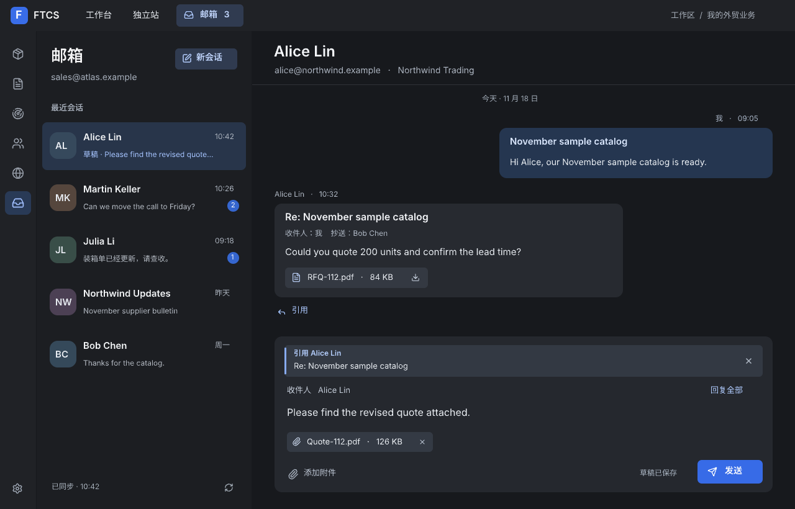

# 43 · 工作区邮箱与即时通讯式会话

目标版本 **0.6.4**，需求稿，2026-11-18。关联 [GitHub Issue #146](https://github.com/Pedro-MAFS/ftcs/issues/146)。

## 产品目标

用户在一个工作区连接一个邮箱，像使用即时通讯工具一样，找到一个人、查看往来、直接写信或引用某条消息回复。「邮箱」是与「独立站」同级的顶级入口。即使工作区没有产品画像、线索或开发信，用户也可以完整使用邮箱。

邮件审核页是发起通信的一个入口。供应商、客户、陌生发件人和订阅通知地址都遵循同一套联系人规则。0.6.4 的发送操作由用户主动触发。AI 代拟回复、自动发送、规则跟进和群发均在本期范围之外。

## 邮箱界面示意

图中正在引用 Alice 的询价并附上报价单。收件人默认为 Alice；点「回复全部」可以带上原邮件的其他收件人。点引用条右侧的 × 即可回到新邮件模式。[可编辑的 pen.dev 设计稿](design/工作区邮箱.pen)

## US-MAIL-01 · 首次连接并选择同步起点

用户在工作区连接自己的邮箱，使用邮箱账号和授权码，通过 IMAP 收信、SMTP 发信。支持提供上述协议和认证方式的服务商，不设品牌白名单。本期不接入 OAuth。

**验收条件**

- 首次连接表单默认选择「同步最近 30 天的邮件往来」，用户可改为「仅同步今后的邮件」。已知服务商的收发配置自动预填，用户可修改。IMAP 收信验证和 SMTP 发信认证都通过后开始同步，无需发送测试邮件。
- 选择最近 30 天时，该时段内已有的收发邮件进入相应会话；选择仅同步今后时，以首次连接成功时间为起点。两种选择都接续同步起点之后的新邮件。
- 后续启动 FTCS、切换产品或首次给某个联系人发信，都沿用该工作区邮箱的同步进度。
- 一个工作区同时托管一个账号。取消托管 A 后停止收发和同步、移除授权码、保留本地历史。首次连接 B 时独立选择同步范围，邮箱页只展示 B 的会话、附件、草稿和未读数。
- 在 A 给 Alice 留下带附件的草稿，切换至 B 后不可见；重新验证并连接 A 后能恢复这份草稿，并从 A 自己的同步进度继续。删除 A 的本地数据需单独确认，仅影响 A 在本机保存的邮箱数据。

账号切换、同步和发送记录的数据归属见[工作区邮箱数据模型设计](design/工作区邮箱数据模型设计.md)。

## US-MAIL-02 · 在邮箱里找到联系人和往来

邮箱左侧展示按最近往来排列的联系人，显示姓名（如有）、邮箱、最近一条消息摘要及未读数。可查看已有的公司资料。选择联系人后，右侧按时间展示双方往来，包括从审核页、邮箱页或其他客户端发出的邮件。

**验收条件**

- 同步范围内有直接收发往来的每个邮箱地址都能出现在列表。新地址发来第一封邮件，即使没有关联线索，也自动出现会话。
- 同公司的 Alice 和 Bob 各有会话。同一个 Alice 邮箱涉及多个产品时，邮件归入同一条时间线；切换产品不改变当前会话。
- Alice 来信并抄送 Bob 时，这封来信展示在 Alice 的会话。展开消息可以查看实际收件人和抄送人。
- 点击「新会话」可输入任意收件邮箱。已有地址打开原会话；新地址可直接写信，第一封发送成功后进入联系人列表。

## US-MAIL-03 · 写新邮件、引用回复和保留草稿

| 用户动作 | 预期行为 |
| --- | --- |
| 直接在联系人会话里写信 | 发送一封新邮件给当前联系人。默认取正文第一行作为主题，发送前可修改。 |
| 在某条消息上点「引用」 | 输入框显示原邮件主题和摘要，回复沿用其主题，邮件回复关系指向所选消息。即使此后已有其他邮件，也能回复早先那一条。 |
| 取消引用 | 保留已写正文，恢复新邮件的主题与收件规则。发送成功后，下次输入也默认写新邮件。 |
| 引用多人来信 | 默认只回复发件人。用户可显式选择「回复全部」，发送前能看到实际收件人及抄送人。 |
| 收发附件 | 来信中的附件可保存。写信时可选择本机文件，查看文件名、大小并在发送前移除。引用原邮件时默认不附带原附件。 |

**验收条件**

- 分别在 Alice 会话直接写信、引用旧询价、对多人邮件选择「回复全部」；发出的三封邮件分别体现正确的主题、收件范围和引用关系。
- 给 Alice 写到一半，切到 Bob 或重启 FTCS，再回到 Alice，能恢复本地草稿的正文、主题、引用对象、收件人（含回复全部的选择）及待发附件。列表显示「草稿」，各会话的草稿互不覆盖。
- 发送成功后清除这份草稿。明确失败时保留供修改重试；结果未知时保留原文并标记「发送结果待确认」。两种异常下的操作见 US-MAIL-05。

## US-MAIL-04 · 跨客户端同步、已读与提醒

FTCS 自动增量同步收件箱和服务器上的已发送副本。用户关闭 FTCS 后，可继续用手机或网页邮箱收发，下次打开 FTCS 时从已有进度补齐。仅保存在其他设备本机的邮件无法通过 IMAP 同步。

**验收条件**

- 关闭 FTCS，在手机上回复 Alice 的询价。再次打开 FTCS 后，Alice 的时间线出现一条自己发出的消息。能通过邮件回复标识匹配原询价时显示引用；缺少可匹配标识时按普通消息展示。
- 重启、重复刷新或读到 FTCS 自己发信的服务器副本时，同一封邮件只显示一次。
- 首次导入沿用服务器的已读状态。手机读过一封，FTCS 同步后扣减对应未读数；用户在 FTCS 会话里看到未读来信后，同步已读状态回邮箱。
- 邮箱标签展示未读总数，联系人旁展示该会话的未读数。当前会话的新消息直接进入时间线；在其他页面工作时收到来信，更新计数并保持当前页面。
- 桌面新邮件通知可关闭。开启后，FTCS 在后台运行时收到新来信可发出通知，点击进入对应会话。首次导入历史邮件只更新计数，不弹通知。

## US-MAIL-05 · 从审核页发出开发信并核对结果

保留现有「通过」操作，仅保存当前收件人的已审核草稿。同时提供「通过并发送」，已通过的草稿提供「发送」。用户确认的是页面当前显示的收件人、主题和正文，实际发件邮箱为当前工作区连接的邮箱。

审核页与邮箱页使用一致的发送结果语义。

| 发送结果 | 用户看到什么 | 会话与后续操作 |
| --- | --- | --- |
| SMTP 明确接受 | 已发送 | 记录发出消息，新地址进入列表，已有会话追加一条；审核页提供「查看往来」。该状态只代表发件服务器已接受。 |
| 明确失败 | 发送失败 | 保留可修改的内容，允许用户重试。若此前与该地址没有往来，此次失败不会把它加入联系人列表。 |
| 无法判定服务器是否接受 | 发送结果待确认 | 保留原文和待确认状态，不显示已送达，也不自动重发。 |

**验收条件**

- 只点「通过」，草稿变为已审核且没有发信；点「通过并发送」，一次操作即可审核并发送；已审核的草稿也可单独发送。
- 从两个产品分别给 Alice 的同一地址成功发信，点击「查看往来」都进入同一会话；两封开发信分别保留各自的来源，方便回看。
- 模拟明确拒收和提交后连接中断，页面分别呈现「发送失败」和「发送结果待确认」。重新打开 FTCS 不会自动重发这两封邮件。
