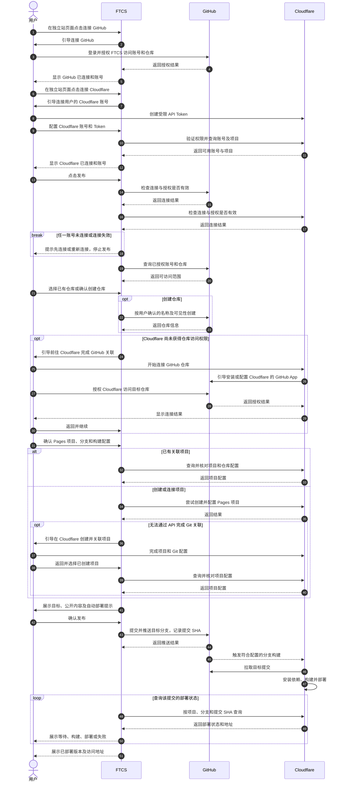
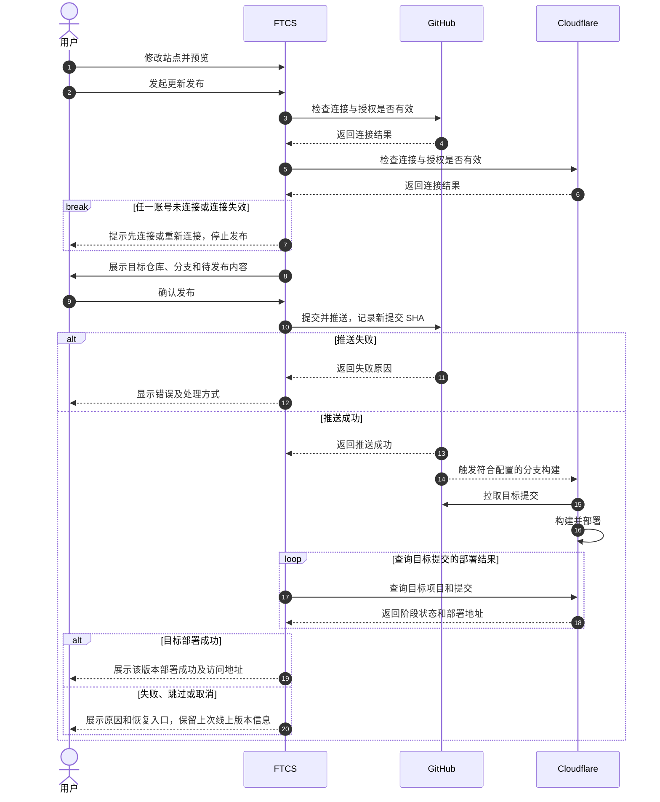

# TV-SITE-02 GitHub 与 Cloudflare 首次发布方案研究

状态：**技术方案研究通过**。本研究依据 GitHub、Cloudflare 和 Vercel 的公开文档，确定首期集成方向；未使用真实账号调用接口，也未验证 Cloudflare 首次 Git 关联的全部自动化能力。本文对应[独立站需求拆分与交付顺序](./独立站-需求拆分与交付顺序.md)中的 TV-SITE-02。

## 1. 目标和结论

每个用户使用自己的 GitHub 和 Cloudflare 账号。FTCS 负责管理本地站点、引导完成授权、选择或创建仓库、提交推送、配置发布目标并展示部署状态；Cloudflare 负责从 GitHub 拉取代码、构建和发布。首期以 **Cloudflare Pages + GitHub Git 集成**作为推荐方向；用户站点是满足 `npm run dev` 和 `npm run build` 的纯前端 Node 项目，框架、页面结构及构建产物目录由项目决定。

先走通个人账号和单个全局站点；组织账号、私有仓库、权限审批与异常恢复纳入设计，具体首期支持范围由后续用户故事核对。本研究是基于文档的可行性结论，不等于接口联调或生产验收完成。

## 2. 参考产品与官方能力

- [Vercel 的 Git 项目导入流程](https://vercel.com/docs/git)让用户连接 Git 账号、选择仓库，再配置项目名称、根目录、构建设置和环境变量；[Vercel 的 GitHub 集成](https://vercel.com/docs/git/vercel-for-github)基于仓库推送创建部署，区分生产分支和预览分支。FTCS 可参考其连接、选仓、配置和跟踪的交互思路，但不假设其产品权限与 Cloudflare 完全相同。
- [Cloudflare Pages Git 集成](https://developers.cloudflare.com/pages/configuration/git-integration/)支持连接 GitHub 仓库，匹配分支推送后自动构建部署；[首次 Git 集成指南](https://developers.cloudflare.com/pages/get-started/git-integration/)要求用户在 Cloudflare 页面完成 Git 账号安装或授权。Git 集成项目不能直接改为 Direct Upload 项目，正式实现前应让用户知道发布方式的约束。
- [GitHub App 安装](https://docs.github.com/en/apps/using-github-apps/installing-a-github-app-from-a-third-party)允许用户选择个人或组织账号及仓库授权范围；组织可能需要管理员审批。安装 App 与授权用户身份是不同操作。Cloudflare 自己的 GitHub 集成和 FTCS 对 GitHub 的访问是两份独立授权。
- [Pages 项目创建 API](https://developers.cloudflare.com/api/resources/pages/subresources/projects/methods/create/)声明支持生产分支、构建设置及 GitHub source 等字段；[部署列表 API](https://developers.cloudflare.com/api/resources/pages/subresources/projects/subresources/deployments/methods/list/)声明提供提交 SHA、分支、环境、阶段状态、跳过原因及部署 URL。API 文档说明字段存在，不能单凭此认定首次安装、Git 绑定及首次构建可以全部自动完成。

## 3. 推荐用户流程

1. **独立站页面入口**：页面分别提供“连接 GitHub”和“连接 Cloudflare”按钮，用户点击后进入对应授权流程；连接顺序不作强制。连接成功后，各按钮变为对应的连接状态标签，显示平台和已连接账号；连接中、连接失败或授权失效也应明确显示。状态标签提供查看连接信息、重新连接/切换账号和断开连接的入口。
2. **连接 GitHub**：用户通过浏览器登录并授权 FTCS 所需范围。FTCS 展示已授权个人或组织账号以及可用仓库；无权限、组织审批、授权失效时明确提示。新建仓库时确认目标及可见性；已有仓库必须检查远程状态与分支，避免覆盖用户内容。
3. **准备 Cloudflare**：用户连接自己的 Cloudflare 账号。若 Cloudflare 尚不能访问目标仓库，FTCS 引导用户在 Cloudflare/GitHub 官方页面安装并授权 **Cloudflare Workers & Pages** 集成，再回到 FTCS 继续；不能把 FTCS 的 GitHub 授权当成 Cloudflare 的授权。[Cloudflare GitHub 集成](https://developers.cloudflare.com/pages/configuration/git-integration/github-integration/)。
4. **发布前校验与配置目标**：用户点击“发布”后，先分别校验 GitHub 和 Cloudflare 的连接状态及凭据是否有效。任一未连接或失效时，提示先连接或重新连接，并指向对应入口；本次不继续推送或部署。两者均连接后，再检查目标仓库权限、Cloudflare 对仓库的授权以及项目配置；账号已连接不等于这些条件已经满足。用户选择或创建自己的 Pages 项目，并确认仓库、生产分支、构建命令、项目根目录与构建产物目录。默认可建议 `npm run build`，但产物目录不能强制假定为 `dist`。能否在首次 Git 授权后由 API 创建并完整关联项目待联调；如不支持，则引导用户在 Cloudflare 创建和连接，再由 FTCS 识别已配置项目。
5. **发布**：用户确认要发布的内容后，FTCS 记录本次提交完整 SHA 并推送到指定分支。Cloudflare 按项目配置触发构建；FTCS 分别展示推送结果和该提交的 Cloudflare 部署过程。推送前必须提示：启用 Git 自动部署时，推送到生产分支可能立即上线。
6. **查看和后续更新**：展示目标版本的构建中、部署中、成功、失败、跳过等状态及访问地址。用户继续编辑后，再次检查目标与待发布内容并发起推送；已发布版本和本地未发布修改要能区分。

### 3.1 首次发布时序图

这是预期的产品流程，不表示当前 FTCS 已具备这些功能；图中先连接 GitHub 再连接 Cloudflare 仅为示例，用户可按任意顺序连接。GitHub 的 FTCS 授权与 Cloudflare 访问仓库的授权相互独立。Pages 项目是否能够全部由 API 创建并连接 Git 仓库尚待联调；图中的“引导用户完成”是明确保留的备选路径。

FTCS 使用 API 创建项目的分支仅是候选实现，不代表该功能已被实测支持。如果项目创建后 Cloudflare 已自动触发首次部署，FTCS 应按实际提交和部署状态跟踪，避免再无意触发一轮；如果推送发生在项目连接之前，则需要根据实际部署规则识别是否已构建，必要时由用户明确触发。

### 3.2 后续更新时序图

图中“部署成功”表示目标提交对应的部署成功；生产地址是否已指向该版本及实际访问是否正常，应分别核对，不能以推送成功或旧页面可访问代替。

## 4. 授权和凭据方案

### 4.1 GitHub

推荐优先研究 **FTCS 自有 GitHub App + 用户授权**：请求完成仓库读取、代码推送以及必要时创建仓库所需的最小权限，让用户在 GitHub 页面选择账号和授权仓库。GitHub App 用户令牌的有效权限取决于用户权限与 App 安装授权范围的交集。[GitHub App 用户令牌](https://docs.github.com/en/apps/creating-github-apps/authenticating-with-a-github-app/generating-a-user-access-token-for-a-github-app)。

桌面端的授权方式可以研究 GitHub 支持的设备授权流程，或适用于桌面应用的浏览器回调流程；不能假设所有流程都不需要安全保存客户端密钥，也不能将 GitHub App 私钥打进桌面端。若方案需要 App 私钥或客户端密钥，需由可信后端持有，或选择适合纯桌面的授权方式。是否引入 FTCS 服务端仍待产品/技术详设，不以此研究预定架构。

GitHub 仓库创建接口有明确的 token 类型和权限要求，不能假定选择单个已有仓库的授权自动赋予创建仓库能力；个人仓库和组织仓库分别处理。[GitHub 创建个人仓库 API](https://docs.github.com/en/rest/repos/repos#create-a-repository-for-the-authenticated-user)、[GitHub App 权限表](https://docs.github.com/en/rest/authentication/permissions-required-for-github-apps)。

### 4.2 Cloudflare

首期可提供**用户创建受限 Cloudflare API Token 并在桌面端配置**的方案：依据操作申请 Pages Read/Write 等必要权限和目标账号范围；不要求全局 API Key。首次授予 Cloudflare 访问 GitHub 仓库仍由用户在官方页面完成。Pages 官方 REST 指南说明了 API Token 和项目/部署接口的使用方式。[Pages REST API](https://developers.cloudflare.com/pages/configuration/api/)。

此方案是可落地的候选方向，不等于已确认用户体验最佳或所有字段都能通过该 token 操作。Cloudflare 是否允许 FTCS 自有 OAuth 客户端、具体注册方式与授权范围，以及项目关联 API 对 Git 安装的前置条件，需要开发前进一步核对；不应冒用或打包其他产品的客户端身份。

两个平台的 token 均需使用操作系统提供的凭据存储，日志、Git remote URL、配置文件和提交内容中不出现明文 token。超期、撤销与账号切换须支持重新连接；具体权限粒度和存储实现进入详设。

## 5. 发布状态与版本关联

一次发布至少记录：工作区站点、GitHub 仓库、目标分支、完整 commit SHA、Cloudflare account/project、环境及 deployment ID。建议状态分为：待发布、本地准备、推送中、等待 Cloudflare、构建中、部署中、成功、失败、跳过或取消。

- Git 推送成功只表示 GitHub 已接收提交；Cloudflare 可能因权限、配置或构建错误失败，也可能跳过或取消。
- 按账号、项目、环境、分支和完整 SHA 查找部署，再以 deployment ID 区分同一提交的重试；处理查询延迟、分页、重复推送和并发部署。
- **某次部署成功**、**当前生产地址指向该版本**和**用户实际可访问**是不同事实。页面不能仅因为旧地址返回 HTTP 200，就显示新版本已上线；生产别名切换与状态字段的具体判定需要联调。
- 对仓库不可见、组织审批、权限失效、非快进推送、构建失败和部署跳过提供明确错误与恢复入口；保留本地修改和上一个已上线版本的信息。

## 6. 研究结论及后续开发核对项

基于官方文档和成熟产品流程，GitHub 授权/选仓、Cloudflare Git 集成、用户指定构建配置、按部署状态跟踪版本，构成可行的首期方案方向。用户必须参与的登录授权由官方页面完成，其余尽可能由 FTCS 编排；具体边界以服务商实际授权及接口行为为准。

用户已确认本研究通过；研究阶段无需用户手工完成完整建站发布，也不以测试站点上线为本文的通过条件。以下属于后续设计或开发联调的**未实证项**，不能当作已验证的事实：

1. FTCS 的 GitHub App/桌面授权是否需要自有服务端；新建个人或组织仓库的最小授权组合。
2. Cloudflare 是否支持适合 FTCS 的官方 OAuth 客户端；若使用用户 API Token，最低权限和账号选择体验。
3. Cloudflare GitHub App 已安装后，Pages 项目能否完全通过公开 API 创建、关联指定仓库并触发首次部署；不支持时采用官方页面引导和项目选择。
4. API 返回的实际部署 SHA、状态、生产别名及重试行为，和多次推送/并发时的匹配策略。
5. 组织管理员审批、私有仓库、授权撤销、非快进推送、构建失败和网络中断的真实响应与恢复方式。
6. 真实账号费用、配额、产品限制以及 Windows 客户端兼容性，以用户实际账号及实施时官方信息为准。

这些联调和验收在 US-SITE-05～08 的实现中完成。自有域名与 DNS 验证仍归 TV-SITE-03。
