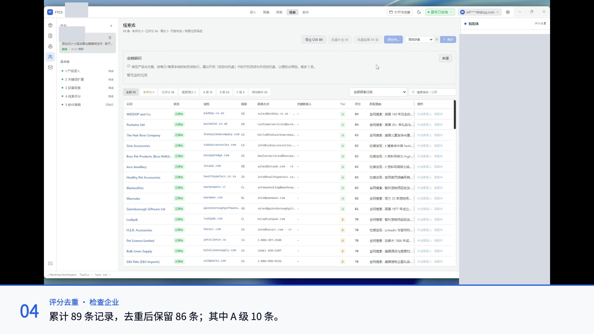
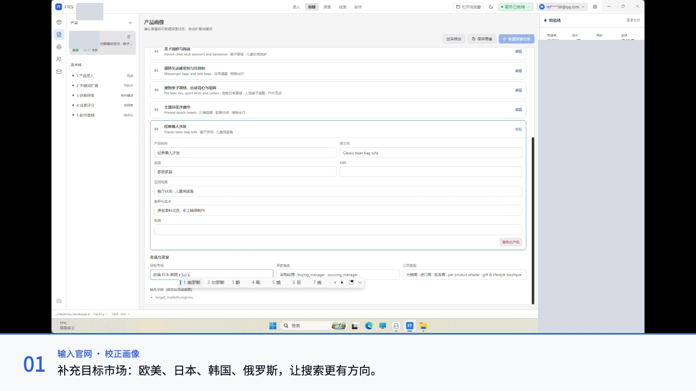
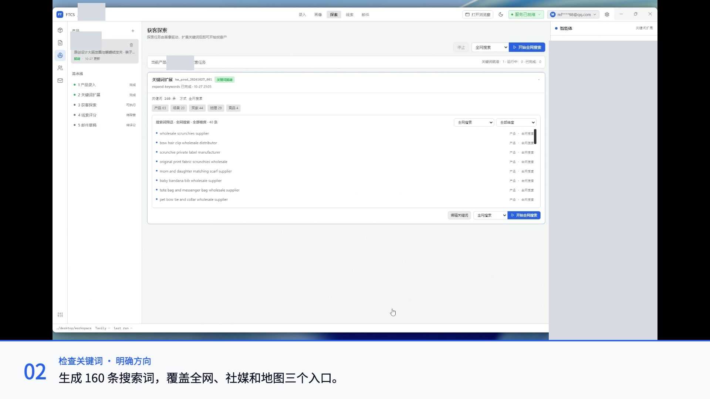
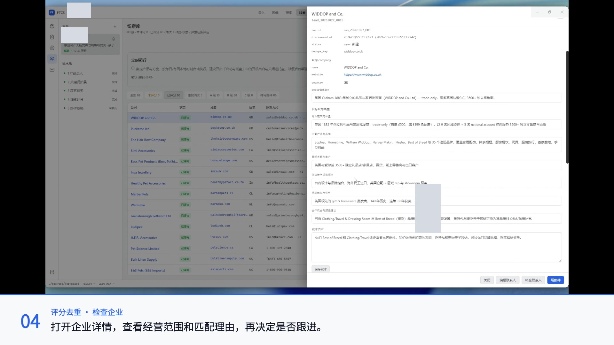
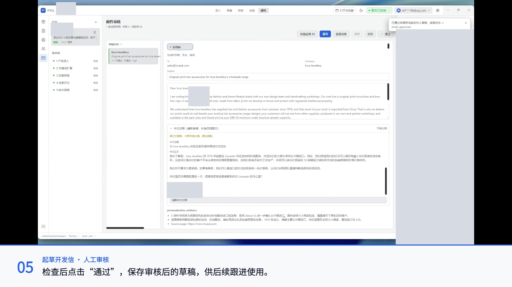

# 使用案例：某企业如何从产品官网走到海外客户开发信草稿

把产品网址交给 FTCS，接下来能得到什么？这组操作录屏展示了某宠物配饰与生活方式用品企业的一次获客工作流：生成产品画像、补充目标市场、探索海外企业、评分去重，最后选择一家企业起草并审核开发信。

**录屏结束时，累计线索库有 89 条记录；评分去重后保留 86 条，其中 A 级 10 条、B 级 68 条、C 级 8 条。演示随后完成了 1 家企业的开发信草稿与人工审核。**

> 本文根据项目维护者提供的操作录屏整理。数字是本次界面中的结果快照，评分代表系统匹配判断；素材没有展示收件人回复、询盘或成交。应企业要求，公开材料已隐藏品牌名称、官网地址及相关识别信息。

## 先看 2 分 14 秒中文讲解演示

[播放或下载中文讲解版（MP4）](assets/workflow-anonymized-134s.mp4) · [配音文字稿](narration.md)

视频先说明任务，再按五个阶段展示操作。中文配音与录屏下方的文字解释每一步的目的与结果，章节说明承接下一步，片尾汇总本次结果。配音使用 ChatCut 官方音色「云舟」，句间留有观看操作的停顿，无背景音乐；已剪去大部分等待时间。**视频时长不代表实际任务耗时。**

| 时间 | 看什么 |
| --- | --- |
| 00:00 | 说明任务与五步流程 |
| 00:06 | 输入官网、检查画像、补充目标市场 |
| 00:30 | 从画像转到关键词，检查搜索方向 |
| 00:50 | 从搜索方向转到全网、社媒与地图发现 |
| 01:18 | 从候选企业转到评分去重与详情核验 |
| 01:38 | 从选定企业转到草稿、中文对照与人工审核 |
| 02:06 | 汇总累计线索和草稿审核结果 |

## 要解决的任务

录屏中的产品资料包含原创印花发圈与发夹、亲子围脖、背包与托特包、宠物领结与项圈、沙滩巾等品类。适合寻找的对象既包括宠物用品渠道，也包括礼品、配饰及生活方式用品的批发商、进口商和零售商。

这次操作要把产品介绍转化为三个可继续使用的结果：

1. 能检查、能修改的产品与买家画像。
2. 带公司官网、匹配理由和评分的潜在客户清单。
3. 针对某一家企业撰写、由人审核的开发信草稿。

## 1. 输入官网，先校正产品画像

操作者输入企业官网地址，FTCS 浏览页面并生成结构化画像。画面中可见产品名称、应用场景、差异化卖点、目标买家等信息。

生成后，操作者逐项展开产品检查，并在目标市场中补充“欧美、日本、韩国、俄罗斯”。这一步把使用者的业务判断补进了后续搜索依据。

本案例只展示了官网输入；没有把文件导入、产品 PDF 解析等其他能力计入本次操作结果。

## 2. 把产品信息展开成可编辑的搜索方向

关键词扩展完成时，界面显示 **160 条搜索词**：全网搜索 40 条、社媒发现 100 条、地图发现 20 条。操作者随后打开编辑窗口，检查不同渠道的词条。

录屏里的例子包括：

- `pet bow tie and collar wholesale supplier`：从宠物领结、项圈及批发场景切入。
- `pet and owner matching accessories`：从人宠搭配场景切入。
- `pet accessories distributor Germany`：结合品类、渠道角色与国家。
- `Zoohandlung München`：结合当地语言与城市寻找门店。

160 条是生成的搜索词数量，不表示本次录屏完整执行了全部词条。实际执行范围以每次探索任务为准。

## 3. 从三类入口发现企业，汇入线索库

录屏分别展示了全网搜索、社媒发现和地图发现。结果汇入同一个产品的线索库，可以按探索任务筛选，再查看公司域名、国家、联系方式和匹配理由。

三种入口提供了不同的查找路径。后续仍需检查企业实际经营什么、是否属于目标渠道，以及记录中的联系方式是否适合使用。

## 4. 去重与评分后，选择值得进一步检查的企业

评分完成时，录屏同时展示了以下统计：

| 指标 | 界面结果 | 口径 |
| --- | ---: | --- |
| 累计线索记录 | 89 条 | 评分时线索库的总记录数 |
| 重复淘汰 | 3 条 | 被标记为重复的记录 |
| 已评分、保留记录 | 86 条 | 89 − 3 |
| A 级 | 10 条 | 系统给出的优先跟进分组 |
| B 级 | 68 条 | 系统给出的匹配分组 |
| C 级 | 8 条 | 系统给出的匹配分组 |

**这组数字描述累计线索库。** 原素材是分段录屏，包含多个探索任务；不能将各段末尾的任务结果直接相加，解释成 89 条单轮新增客户。A/B/C 也不等于对方已经表达采购意向。

操作者随后打开企业详情，检查目标公司画像和破冰话术。以下是录屏中的代表性条目，匹配理由来自当时的系统记录，并非本文额外完成的企业尽调：

| 企业 | 系统评分 | 录屏中的匹配方向 |
| --- | ---: | --- |
| WIDDOP and Co. | 84 / A | 礼品批发渠道，与宠物、旅行及配饰相关产品线存在切入点 |
| Puckator Ltd | 84 / A | 礼品及配饰批发渠道，可进一步检查定制和产品系列的适配情况 |
| Inca Jewellery | 82 / A | 发饰及配饰批发业务，与原创印花发圈、蝴蝶结发夹的产品方向相近 |

## 5. 为 Inca Jewellery 起草开发信，再人工审核

演示选择 **Inca Jewellery**，生成了一封公司向英文草稿。邮件主题是：

> Original-print hair accessories for Inca Jewellery’s wholesale range

正文围绕原创印花发饰与对方批发品类之间的关系展开，并提出寄送样品和价格表的下一步。邮件页还展示了个性化依据，便于审核时追查这些表述的来源。

操作者生成中文对照、检查内容，最后点击“通过”。界面提示已通过并保存草稿，线索状态变为 `email_approved`。

审核时仍要确认公司背景引用是否准确、卖方是否确实具备邮件承诺的供货与寄样能力，以及修改后的中文对照是否需要刷新。录屏最后显示的是**草稿审核通过**，没有展示邮件发送或收件人反馈。

## 这个案例说明了什么

FTCS 把产品资料、搜索方向、企业记录和开发信草稿串在同一个工作流里。用户可以在产品画像、关键词、目标企业详情和邮件草稿几个节点介入检查，而不必从零分别整理这些材料。

这组素材能够证明操作链路和界面结果；没有提供逐条人工核验结论、统一费用账单或完整任务计时，因此本文不计算有效客户率、获客成本或节省工时。

## 用自己的产品复现

1. 从 [最新 Release](https://github.com/Pedro-MAFS/ftcs/releases/latest) 下载 FTCS，按应用引导完成服务和通道配置。
2. 输入自己的产品官网或资料，检查画像中的产品、买家类型与目标市场。
3. 新建探索任务，检查搜索词，选择合适的发现渠道。
4. 对结果评分去重，打开候选企业详情，核验官网和业务匹配情况。
5. 选择合适企业生成开发信，检查引用与承诺，审核保存后再安排后续跟进。

建议首次使用先聚焦一个品类、一个市场和一种买家类型，方便比较搜索结果与实际需求。

[返回项目首页](../../../README.md) · [官网使用指南](https://ftcs.ai-utills.com/docs/getting-started) · [素材与数据口径](evidence.md)
