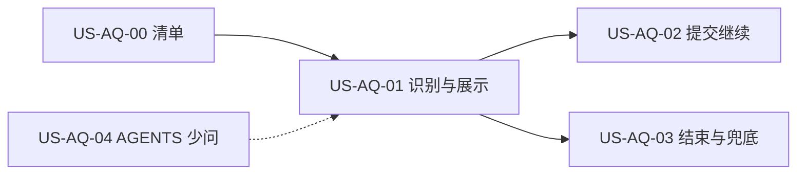

# US-AQ-00 OpenCode 交互工具清单

> **用户故事**：[../31-需求-探索等待用户回复.md](../31-需求-探索等待用户回复.md) · US-AQ-00 · Issue [#69](https://github.com/Pedro-MAFS/ftcs/issues/69)  
> **状态**：**待评审**（本文件只定设计；业务代码尚未按本文改动）  
> **范围**：把会阻塞等待用户的 OpenCode 交互收成一张正式清单。每项写清入参、出参、现网行为、本期处理  
> **依赖**：`docs/31` AQ7、AQ10；`@opencode-ai/sdk@1.18.1`；`docs/reference/opencode-events/`；现网 `desktop/electron/opencode/agent-runner.ts` 的 `startEventBridge`  
> **不做**：提问卡片、提交、结束、超时、通知、`workspace/AGENTS.md`（分别归 [US-AQ-01](US-AQ-01-识别等待态并展示问题.md)、[US-AQ-02](US-AQ-02-点选提交并继续任务.md)、[US-AQ-03](US-AQ-03-等待中可结束与兜底.md)、[US-AQ-04](US-AQ-04-AGENTS减少交互提示.md)）  
> **文档位置**：`docs/design/`

本文是 AQ7 要求的那份清单。开发按本节表格识别，不按技能正文猜工具名。核对日期 2026-10-18，SDK 为桌面 `package.json` 锁定的 `@opencode-ai/sdk@1.18.1`。

---

## 0. 相对现网

| 现网 | **本期（US-AQ-00 起，落地在 AQ-01～03）** |
|------|------------------------------------------|
| `AgentRunController.startEventBridge` 使用 `client.event.subscribe()`。这条流是 Legacy 信封：事件有 `type` + `properties`。客户端类型来自 `@opencode-ai/sdk/v2` 的 `OpencodeClient`，但 **没有** 订阅 `client.v2.event.subscribe()`（那条流的载荷键是 `data`） | 仍只订这一条 Legacy 流。`question.asked` 与 `question.v2.asked` 都是这条流的 `Event` 成员，在同一个 `switch` 里各加一案 |
| `permission.asked` 与 `permission.v2.asked` 已处理：`sessionID` 匹配后 `client.permission.reply({ requestID: event.properties.id, reply: 'always' })`，失败吞掉 | **不改。** 清单标明「已识别、自动 always」。不改走 `client.v2.session.permission.reply` |
| `question.asked`、`question.v2.asked` 落在 `default`，直接 `return`。会话停在提问工具上，`waitForSessionIdle` 不返回，界面一直是运行中 | 两条都进入待答槽。只挂 v1、不挂 v2 时，运行时若只发 v2，任务仍会假死 |
| 问答回复 API 桌面未调用 | v1 用 `client.question.*`；v2 用 `client.v2.session.question.*`。两套 URL 不同，不能混用 |
| `question.list` / 会话级 question list 未在启动时调用 | 本期仍不调用。切页、重启不恢复待答（AQ11） |

现网权限分支在 `startEventBridge` 内（约 `agent-runner.ts` 的 `permission.asked` / `permission.v2.asked`）。保持原样，本期只在旁边加问答：

```ts
case 'permission.asked':
case 'permission.v2.asked':
  if (event.properties.sessionID !== sessionId) return
  void client.permission
    .reply({ requestID: event.properties.id, reply: 'always' })
    .catch(() => undefined)
  return
```

`startEventBridge` 的调用点覆盖全部 Agent 长任务，清单不按页面拆协议：`runExpandKeywords`、`runScoreAndDedupe`、`runDraftOutreachEmail`、`runDraftOutreachEmailSlot`、`runTranslateOutreachEmail`、`enrichLeadContacts`、`runDiscoverLeads`（全网搜索 / 社媒发现 / 地图发现）、`runExtractProfile`。

---

## 1. 与相邻故事的分工



| 模块 | 本期 |
|------|------|
| **US-AQ-00** | 四类交互 + 非等待备案。写清哪一类渲染、哪一类自动 always、哪一类不进等待 UI |
| **US-AQ-01** | 把问答两类推进待答槽并展示；权限不展示 |
| **US-AQ-02** | 按本清单的 API 提交 `reply` |
| **US-AQ-03** | 按本清单的 API `reject`，并排定与 `session.abort` 的顺序；超时按 AQ6a |
| **US-AQ-04** | 只改工作区约定，不改本清单 |

---

## 2. 已确认选型

| 项 | 决定 |
|----|------|
| **清单范围** | 只收「会阻塞、等用户一句话或一次授权」的四类。不多收 `session.status`、`tui.*`、`pty.*` |
| **事件流** | 继续现网 `client.event.subscribe()`。禁止为了 v2 再开一条 `/api/event` 订阅，否则要同时改现有 `properties` 读取 |
| **v1 / v2 问答** | 同等 Must。运行时可能只发其中一套（权限分册已写明两套协议可能只发一套，问答同样对待） |
| **权限** | 已识别、自动 `reply: 'always'`。不做人机确认弹窗（AQ10） |
| **问答请求 id** | `*.asked` 的 `properties.id` 就是后续 reply / reject 的 `requestID`。asked 载荷里没有名为 `requestID` 的字段 |
| **无 default** | `QuestionOption` / `QuestionV2Option` 只有 `label`、`description`。自动续跑规则不在本故事展开，见 US-AQ-03 |
| **不支持的等待** | 四类之外的事件保持 `default` 忽略，**不**当成未知等待。未知等待只指问答事件到了、但载荷渲染不了，归 US-AQ-03 |

---

## 3. 正式清单（四类）

字段来自 SDK `QuestionInfo`、`QuestionV2Info`、`PermissionRequest`、`permission.v2.asked` 的 `properties`。`custom`、`multiple` 都是可选布尔。

| 类型 | 事件（同一条 Legacy 流） | 入参（`properties`） | 答复 / 出参 | 客户端 API（`@opencode-ai/sdk@1.18.1`） | 现网 | 本期处理 |
|------|--------------------------|----------------------|-------------|----------------------------------------|------|----------|
| **问答 `question`** | `question.asked` → `question.replied` / `question.rejected` | `id`, `sessionID`, `questions[]`, `tool?`。每题 `QuestionInfo`：`question`, `header`, `options[{label, description}]`, `multiple?`, `custom?` | 提交 `answers: string[][]`（每题一个 `string[]`，元素为所选 `label` 或自定义文本）。拒绝只带 `requestID`。`question.replied` 回带 `sessionID`, `requestID`, `answers`；`question.rejected` 回带 `sessionID`, `requestID` | `client.question.reply({ requestID, answers })` → `POST /question/{requestID}/reply`，成功 200 `boolean`。`client.question.reject({ requestID })` → `POST /question/{requestID}/reject`，成功 200 `boolean`。另有 `client.question.list()`，**本期不用于恢复待答** | **未处理** | **必须识别 + 渲染 + 提交 / 拒绝**。久不回复归 US-AQ-03 |
| **问答 `question.v2`** | `question.v2.asked` → `question.v2.replied` / `question.v2.rejected` | 与上同构。`questions[]` 元素为 `QuestionV2Info`（字段同 `QuestionInfo`）。`tool?` 为 `QuestionV2Tool` | 同构：`QuestionV2Answer = string[]`，`QuestionV2Reply = { answers: QuestionV2Answer[] }` | **不是** `client.question.*`。`client.v2.session.question.reply({ sessionID, requestID, questionV2Reply: { answers } })` → `POST /api/session/{sessionID}/question/{requestID}/reply`，成功 204。`.reject({ sessionID, requestID })` → 同路径 `/reject`，成功 204。`client.v2.session.question.list({ sessionID })` **本期不用于恢复** | **未处理** | **与 v1 同等。禁止只认 v1** |
| **权限 `permission`** | `permission.asked` → `permission.replied` | `id`, `sessionID`, `permission`, `patterns[]`, `metadata`, `always[]`, `tool?` | `reply: 'once' \| 'always' \| 'reject'` | `client.permission.reply({ requestID, reply })`。旧 `respond` 已弃用，现网未使用 | 收到 asked 后 **自动 `reply: 'always'`** | **已识别、自动 always**。不渲染确认弹窗 |
| **权限 `permission.v2`** | `permission.v2.asked` → `permission.v2.replied` | `id`, `sessionID`, `action`, `resources[]`, `save?`, `metadata?`, `source?` | `PermissionV2Reply`: `'once' \| 'always' \| 'reject'` | 现网对这条事件 **仍调用上一行的** `client.permission.reply({ requestID, reply: 'always' })`，没有改走 `client.v2.session.permission.reply` | 同上，自动 `always` | **已识别、自动 always**。与 v1 写在同一张表里。本期不改调用 |

处理方式只允许这三档：

| 档 | 谁 |
|----|----|
| 界面处理 | `question`、`question.v2` |
| 自动处理 | `permission`、`permission.v2`。条件：事件 `sessionID` 等于当前任务会话；动作固定 `reply: 'always'`；失败吞掉，与现网一致 |
| 不支持（走未知兜底，而不是忽略） | 上表两类问答事件到了，但载荷不能按 US-AQ-01 渲染。见 US-AQ-03。四类之外的事件不属于本档 |

---

## 4. 非等待备案（不按 AQ 交互 UI 处理）

这些会在同一条事件流里出现。保持 `default` 忽略，不进入待答槽，也不算「未知等待」。

| 类型 | 说明 |
|------|------|
| `session.status`（`idle` / `busy` / `retry`）、`session.idle` | 运行态。`waitForSessionIdle` 用它判断任务是否结束。提问挂起时会话通常不进 `idle`，所以现网会一直等。**不能**用 idle 代替 `question.*.asked` |
| `tui.prompt.append` / `tui.command.execute` / `tui.toast.show` / `tui.session.select` | 面向 TUI 的控制事件。Electron 不按用户问答渲染 |
| `pty.created` / `pty.updated` / `pty.exited` / `pty.deleted` | 交互终端生命周期，不是业务选择题 |
| 站内信 Inbox（`desktop/src/composables/useInbox.ts`） | 网关产品消息，与 OpenCode 协议无关。禁止把 Inbox 当成 `question` |

---

## 5. 同一条提问的两侧怎么记账

运行时通常只发 v1 或只发 v2。两侧都要能单独成立。若同一会话短时间两侧都到了，按下面记账，避免答了一侧、另一侧仍挂着：

1. 一个会话同时只有一个待答槽。
2. 槽里可以同时记下 `v1RequestId` 与 `v2RequestId`（哪侧没到就空着）。
3. 后到的那侧若与先到的展示字段一致（题数相同，且每题 `header`、`question`、`multiple`、`custom`、`options.label` 按序相同），只补上另一侧的 id。不另画一张卡片，不重置 10 分钟计时，不第二次弹通知。
4. 后到的内容不一致：先对槽内已有各侧 `reject`（失败只打日志），再装入新提问并重新计时。避免旧题继续挂起。
5. 提交、拒绝时，对槽里每一个非空 id 各调 **该侧自己的** API，答案相同。v2 必须包一层 `questionV2Reply: { answers }`。

展示字段与按钮归 US-AQ-01～03。本故事把「两侧都要结算」定死，防止实现时只回复先看到的那条。

---

## 6. 文件清单

本故事的交付就是这份清单。**不改业务代码。** 下面是后续故事预期会动、本 PR 不动的文件，避免评审时把清单故事理解成要改运行时：

| 路径 | 谁改 | 本 PR |
|------|------|--------|
| `desktop/electron/opencode/agent-runner.ts` | AQ-01～03，在权限分支旁加问答 | 不改 |
| `desktop/electron/opencode/awaiting-reply.ts`（新） | AQ-02 组答案；AQ-03 超时决策与常量 | 不改 |
| `desktop/src/components/layout/AgentPanel.vue` 及提问卡片 | AQ-01～03 | 不改 |
| `workspace/AGENTS.md`、`desktop/electron/config/workspace-init.ts` | 仅 AQ-04 | 不改 |

---

## 7. 验收对照

待开发核对。本文不表示已经实现。

- [ ] 评审稿中的四类表与 §3 一致：`question`、`question.v2`、`permission`、`permission.v2` 都在，没有只写 v1。
- [ ] 每类都有入参、出参、API、现网、本期处理。权限两行的处理都是「已识别、自动 always」。
- [ ] v2 问答的调用写成 `client.v2.session.question.reply` / `.reject`，并且 body 使用 `questionV2Reply`。没有写成再调一遍 `client.question.reply`。
- [ ] 问答事件写明挂在现有 `client.event.subscribe()` 上，同时识别 `question.asked` 与 `question.v2.asked`。
- [ ] §4 四条备案没有被做成提问卡片。
- [ ] 没有出现权限确认弹窗的设计。

---

## 8. 不做什么

- 不改 `startEventBridge` 的权限分支和 `reply: 'always'`。
- 不订阅第二套事件流。
- 不在启动时 `question.list` 恢复未答问题。
- 不把 Inbox、TUI、PTY、`session.status` 收进等待 UI。
- 不在本文件规定 10 分钟数值、通知文案、结束时的 abort 顺序（见 AQ-01～03）。

---

## 9. 风险

| 风险 | 处理 |
|------|------|
| 只实现 v1 | 服务端只发 `question.v2.asked` 时任务继续假死。验收必须有一条只发 v2 的用例 |
| 用 v1 的 URL 去答 v2 的 id | 404 或答错请求，会话仍挂起。两侧 API 按 §3 分开 |
| 把 `permission.v2` 改成会话级 permission API | 偏离现网自动 always。本期明确不改 |
| 两侧各到一次、内容相同，却画两张卡或重置计时 | 按 §5 并槽 |

---

## 10. 修订记录

| 日期 | 说明 |
|------|------|
| 2026-10-18 | 初稿。对照 `docs/31` PR #75 的调研基线，用 SDK 1.18.1 与 `agent-runner.ts` 定稿。v2 问答 API 改为 `client.v2.session.question.*`；权限 v2 维持现网 `client.permission.reply` |
