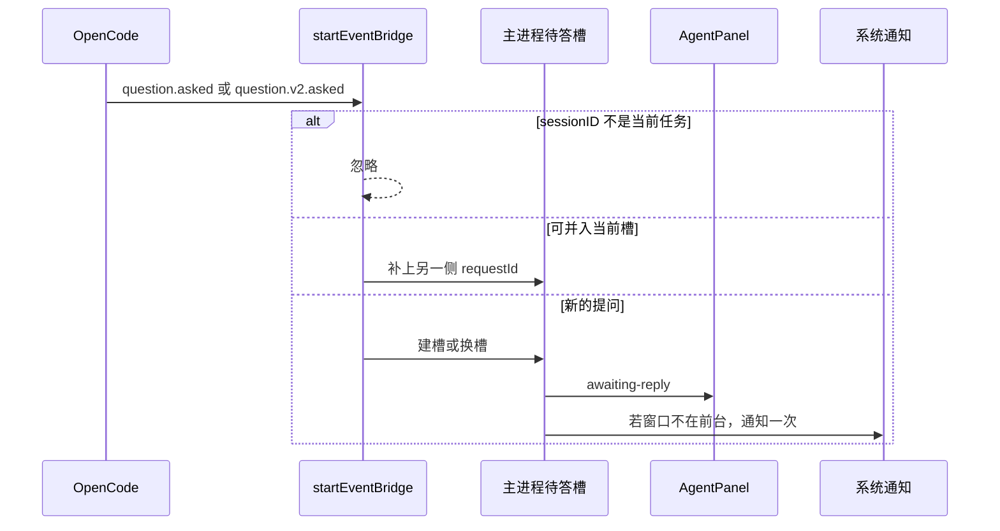

# US-AQ-01 识别等待态并展示问题

> **用户故事**：[../31-需求-探索等待用户回复.md](../31-需求-探索等待用户回复.md) · US-AQ-01 · Issue [#69](https://github.com/Pedro-MAFS/ftcs/issues/69)  
> **状态**：**待评审**（本文件只定设计；业务代码尚未按本文改动）  
> **范围**：认出 `question` / `question.v2`，在所有 Agent 页面用同一块面板展示问题；文案「任务在等你回复」；窗口不在前台时发系统通知；待答不落盘  
> **依赖**：[US-AQ-00](US-AQ-00-OpenCode交互工具清单.md)；现网 `AgentPanel`、`useWorkspace.agentTimeline`、`showTaskDoneNotification`（[docs/22](../22-需求-任务完成Windows通知.md)、[US-N-01](US-N-01-任务完成通知服务与设置.md)）  
> **不做**：把答案交回 OpenCode（[US-AQ-02](US-AQ-02-点选提交并继续任务.md)）；结束任务、未知兜底、10 分钟自动处理（[US-AQ-03](US-AQ-03-等待中可结束与兜底.md)）；`AGENTS.md`（[US-AQ-04](US-AQ-04-AGENTS减少交互提示.md)）  
> **文档位置**：`docs/design/`

用户在任意会跑 Agent 的页面，都能从右侧智能体面板看出任务停下来是在等自己，而不是坏了。

---

## 0. 相对现网

对照 `dev-0.5.8`（2026-10-18 读码）。

| 现网 | **本期（US-AQ-01）** |
|------|----------------------|
| 问答事件被 `startEventBridge` 的 `default` 丢掉。`agentStatus` 停在 `running`，`generating === true`，面板脉冲一直转，状态句是「运行中」 | 问答事件进入主进程待答槽，并向渲染进程推一份展示副本。脉冲停止运行中动画，状态句改为「任务在等你回复」 |
| 智能体面板 `AgentPanel` 放在 `WorkspaceLayout`，探索、评分、开发信、画像、补全联系人、翻译对照切页都不卸载 | **就用这一块面板。** 不在每个业务页各做一张提问卡 |
| `agentTimeline`、`agentStatus` 是 `useWorkspace` 的模块级 `ref`，只活在进程里，没有 `localStorage` | 待答展示同样只放进程内 `ref`。切页时面板还在，问题还在；重启进程即丢。不调用 `question.list` 恢复 |
| 工具卡片标题是 `工具 · ${part.tool}`。提问工具名会把 `question` 显示出来 | 工具名是提问工具时，标题改为「等待回复」，默认不把原始 JSON 当预览 |
| 系统通知只有任务结束：`emitAgentEvent` 在 `type: 'done'` 时调用 `showTaskDoneNotification`。编排进行中 `isWorkflowNotifySuppressed()` 为 true，单步完成通知被跳过 | 等待通知复用同一套标题、点击聚焦、设置开关和「未聚焦才弹」判定。**不**走编排抑制闸门 |
| 权限 asked 已自动 `always`，界面无弹窗 | 继续无弹窗。权限事件不进入待答槽 |

主进程是事实来源：计时和稍后的 reply / reject 都在 `AgentRunController`。渲染进程的 `awaitingUserReply` 只负责画。假设里「状态挂在运行态旁边」成立，但是挂两份：主进程槽 + 渲染进程副本，都不写磁盘。

---

## 1. 与相邻故事的分工

| 模块 | 本期 |
|------|------|
| **US-AQ-01** | 识别、待答槽、面板卡片、文案、通知、不持久化。卡片上可以画出「提交」「结束任务」，按下之后的行为分别归 AQ-02、AQ-03 |
| **US-AQ-02** | 校验选项并 `reply`。成功后清槽，界面回到运行中 |
| **US-AQ-03** | 结束顺序、无法渲染时的兜底文案、10 分钟 |
| **权限** | 不展示 |

---

## 2. 已确认选型

| 项 | 决定 |
|----|------|
| **适用页面** | 全部会跑 Agent 的页面（O1）。机制只有一套：八个 `startEventBridge` 调用点共用，面板在布局层 |
| **占用** | 等待期间 `agentStatus` **仍是** `running`，`generating` 仍为 true。各页「任务进行中」的禁用保持有效，不能再开第二个任务 |
| **不像运行中** | 只改智能体面板：脉冲不加 `.on` 动画；输入区状态句不显示「运行中」，改为「任务在等你回复」。不改各 `pushState` 里的业务词（例如「探索中」），也不改探索任务列表里落盘状态「运行中」 |
| **文案** | 用户可见统一「任务在等你回复」（O5）。本故事新增界面不出现 OpenCode、`question`、`question.v2`、`requestID`、session、MCP |
| **卡片位置** | 时间线与输入区之间，不跟时间线滚动。多题在卡片内滚动 |
| **单选 / 多选 / 自定义** | `multiple === true` 用复选框，否则单选。`custom` 缺省或 `true` 时，选项中出现「输入自己的答案」，样式与其它选项一致。仅 `custom === false` 时不渲染这项（AQ2a） |
| **空选项** | 某题 `options` 为空且 `custom === false`（显式不可自填），或整包载荷不合法：不画一张无法回答的空卡。整次请求标为不可渲染，界面归 AQ-03 的未知兜底。`options` 为空但 `custom` 缺省或 `true` 时，仍可凭「输入自己的答案」作答，不算空卡。本故事仍必须把事件收进槽，禁止落回 `default` |
| **通知** | 见 §6。正文只有「任务在等你回复」 |
| **持久化** | 不做（AQ11） |

---

## 3. 流程



1. 仍在 `handleEvent` 里按 `event.type` 分支。`question.asked` 记为协议 `v1`，`question.v2.asked` 记为 `v2`。`properties.sessionID` 必须等于这次 `startEventBridge` 的 `sessionId`，否则忽略。
2. `properties.id` 记入该侧的 requestId。并槽规则见 US-AQ-00 §5。
3. 展示用的题目取先进入槽的那份。可渲染时推给渲染进程；不可渲染时也推，形态见 US-AQ-03，本故事不把它丢弃。
4. 推送使用现有 `agent:event` 通道，新增一种载荷（§5）。不新开 WebSocket。
5. 收到与槽内 id 匹配的 `question.replied` 或 `question.rejected` 时，若两侧都已结束，清槽并推 `pending: null`。这是提交成功或拒绝之后的回声，避免界面多停一会儿。清槽的主动作在 AQ-02 / AQ-03。
6. 每次 `run*` 的 `finally` 里 `stopEvents()` 必须清槽、卸通知。任务已经结束时，迟到的超时不能再去 reply。

`session.status` 仍只做现网的重试提示。不用它来判断「是不是在等用户」。

---

## 4. 怎样算能渲染

题目数组非空，且每一题同时满足：

- `header`、`question` 都是去空白后非空的字符串
- `options` 是数组；每一项都有字符串 `label`、`description`（可以是空字符串）
- 该题要么至少有一个去空白后非空的 `label`，要么 `custom !== false`（缺省或 `true`，可自填）

任一题不满足：整次 `renderable = false`。不展示半张卡。

展示时：

| 字段 | 界面 |
|------|------|
| `header` | 该题短标题 |
| `question` | 题干 |
| `options[].label` | 选项主文案 |
| `options[].description` | 选项下方说明。空则不占一行 |
| `multiple === true` | 复选框，可多选 |
| 其它 | 单选，同一题互斥 |
| `custom` 缺省或 `true` | 「输入自己的答案」，样式与其它选项一致。仅 `custom === false` 时不出现 |

一组 `questions` 按数组顺序全部画出，一次提交对应整组（提交归 AQ-02）。Issue #69 的样例是一题、三选、每项带说明、另有短标题：短标题用 `header`，三行用 `label` + `description`。客户端不解释选项含义。

时间线上的工具卡片：`part.tool` 去空白、忽略大小写后等于 `question`，或以 `question.` 开头时，标题用「等待回复」「等待回复 · 完成」「等待回复 · 失败」，**不**拼接工具名。这种卡片默认折叠；折叠预览用「等待你的选择」，不用 input JSON。其它工具卡片的标题格式不改。

---

## 5. 状态与事件

主进程槽（进程内，挂在 `AgentRunController`，与 `this.running` 并存）：

| 字段 | 含义 |
|------|------|
| `sessionId` | 当前任务会话 |
| `v1RequestId` / `v2RequestId` | 已看到的那一侧；没有则为空 |
| `questions` | 展示副本 |
| `renderable` | §4 |
| `notified` | 这条槽是否已经成功弹出过系统通知 |
| `timer` / `inFlight` / `deadlineFired` | 归 AQ-03 / AQ-02，本故事只预留，建槽时计时器由 AQ-03 启动 |

渲染进程 `useWorkspace`：

```ts
awaitingUserReply: {
  questions: Array<{
    header: string
    question: string
    multiple: boolean
    custom: boolean
    options: Array<{ label: string; description: string }>
  }>
  renderable: boolean
} | null
```

不把协议名和 requestId 放进界面状态。`custom` 在推给界面前折成布尔：缺省与 `true` 都是 `true`，仅显式 `false` 为 `false`。面板按这个布尔决定是否画出「输入自己的答案」。提交时由主进程拿槽里的 id，渲染进程只把用户选的下标和自定义文本送回去（AQ-02）。

`AgentEventPayload` 增加：

```ts
| {
    type: 'awaiting-reply'
    pending: /* 与 awaitingUserReply 相同 */ null
  }
```

`handleAgentEvent`：`awaiting-reply` 写入 `awaitingUserReply`；`done` 时把它置 `null`。不写入 `localStorage`、工作区文件或 `ftcs-prefs.json`。

面板：

- `awaitingUserReply !== null`：标题脉冲使用静止样式（新增类，不用 `.on` 的无限动画）；输入区状态为「任务在等你回复」。
- 否则且 `agentStatus === 'running'`：保持现网「运行中」和 `.on`。
- `renderable === true`：渲染 §4 的卡片。
- `renderable === false`：卡片外壳仍在，正文与按钮归 AQ-03，避免本故事先画一个空转圈。

切页：`setAgentContext` 今天不会清 `agentTimeline`。同样不清 `awaitingUserReply`。布局不卸载，所以同一进程里换到评分、开发信、画像，卡片还在。这是顺带展示，不是额外持久化。

重启：进程退出，槽和 ref 都没了。启动时禁止调用 `client.question.list` 或 `client.v2.session.question.list`。

---

## 6. 后台通知

对照 docs/22 的 N1、N4、N5，以及现网 `desktop/electron/notify/task-done-notify.ts`。

| 项 | 决定 |
|----|------|
| **何时弹** | 槽建立时试一次。若当时主窗口在前台且未最小化，不弹，但保持「武装」。之后主窗口 `blur` 或 `minimize`，且这条槽还在、还没成功弹过，再试一次 |
| **同一条槽** | 成功 `Notification.show` 之后不再弹。并槽补 id 不算新槽 |
| **正文** | 固定「任务在等你回复」。不要附问题原文，避免把客户信息带进系统通知 |
| **标题** | 沿用 `TASK_DONE_NOTIFY_TITLE`（`FTCS·外贸获客智能体`） |
| **点击** | 沿用 `focusMainWindowFromNotification`。不路由到业务页（N4） |
| **开关** | 沿用 `taskDoneNotificationEnabled`。用户关掉「任务完成通知」后，这条也不弹。不另做开关 |
| **未聚焦** | 复用 `shouldShowTaskDoneNotification` 的窗口条件：无窗口、未支持、已销毁 → 不弹；窗口已聚焦且未最小化 → 不弹 |
| **编排抑制** | **不看** `isWorkflowNotifySuppressed()`。调用判定时 `suppressed` 固定按 false。N2 只抑制「步骤完成」通知；等人回复时正好需要提醒 |
| **失败** | 与现网一样吞掉，不进入任务错误，不改槽 |

建议落在通知模块的三个函数：`armAwaitingReplyNotification`、`disarmAwaitingReplyNotification`、`onMainWindowBackgrounded`。`main.ts` 在主窗口上挂 `blur` 与 `minimize`，转给 `onMainWindowBackgrounded`。清槽时 `disarm`。

任务最终 `done` 时，现网完成通知照旧。等待通知不代替它。

---

## 7. 文件清单

预期开发会动。**本 PR 不改这些文件。**

| 路径 | 改动 |
|------|------|
| `desktop/electron/opencode/agent-runner.ts` | 两个 asked 分支；建槽；推 `awaiting-reply`；提问工具的时间线标题 |
| `desktop/electron/notify/task-done-notify.ts` | 等待通知的武装 / 展示 |
| `desktop/electron/notify/task-done-notify-logic.ts` | 若要把「忽略编排抑制」的判定做成纯函数，放这里，便于单测 |
| `desktop/electron/notify/task-done-notify.test.ts` | 前台不弹、未聚焦弹、抑制闸门为 true 时等待通知仍可弹、开关关闭不弹 |
| `desktop/electron/main.ts` | 主窗口 `blur` / `minimize` 转给通知模块 |
| `desktop/electron/ipc/types.ts` | `AgentEventPayload` 增加 `awaiting-reply` |
| `desktop/src/types/electron.d.ts` | 同步载荷类型 |
| `desktop/src/composables/useWorkspace.ts` | `awaitingUserReply`；`done` 时清空 |
| `desktop/src/components/layout/AgentAwaitingReplyCard.vue`（新） | 卡片。提交与结束的处理函数先留空或只禁用，行为由 AQ-02、AQ-03 接上 |
| `desktop/src/components/layout/AgentPanel.vue` | 嵌入卡片；状态句；脉冲 |
| `desktop/src/styles/main.css` | 等待脉冲、卡片布局 |

不改各业务视图（`ExploreView.vue`、`LeadsView.vue`、`EmailView.vue`、`InputView.vue` 等）来复制卡片。

---

## 8. 验收对照

待开发核对。不要把本文件的存在当成功能已完成。

- [ ] 只发 `question.asked`：当前会话进入等待。面板状态句为「任务在等你回复」，脉冲不再做运行中动画。时间线不再是唯一反馈。
- [ ] 只发 `question.v2.asked`：同上。只监听 v1 的实现判失败。
- [ ] 探索、评分、开发信起草、画像生成、补全联系人、翻译对照各跑到提问时，都是右侧同一块面板出卡片，而不是某一页单独有、其它页没有。
- [ ] 卡片含 `header`、`question`、每个选项的 `label` 与 `description`。`multiple` 不为 true 时只能选一个；为 true 时可以选多个。
- [ ] `custom` 缺省或 `true` 时出现「输入自己的答案」，样式与其它选项一致。仅 `custom === false` 时没有这项。
- [ ] 上述界面文字里没有 OpenCode、`question`、`requestID`。提问工具的时间线标题是「等待回复」，预览不是原始 JSON。
- [ ] 窗口在前台：不弹系统通知。窗口未聚焦或已最小化：通知标题为现网产品标题，正文为「任务在等你回复」。点击后聚焦主窗口，不跳转页面。
- [ ] 设置里关掉任务完成通知后，等待通知也不弹。编排进行中（完成通知被抑制）时，等待通知仍按未聚焦规则弹出。
- [ ] 同一条提问只通知一次。
- [ ] 等待时切到其它业务页，卡片还在。完全退出应用再打开，卡片不在，启动日志里没有 question list 恢复请求。
- [ ] 等待时 `generating` 仍为 true，不能并行再开一个 Agent 任务。
- [ ] `permission.asked` / `permission.v2.asked` 仍自动 always，面板不出现确认框。

---

## 9. 不做什么

- 不实现提交后的 `reply`（AQ-02）。卡片上的「提交」在本故事可以先禁用，或按下无效果；不得假装已经续跑。
- 不实现结束、未知文案的最终按钮行为、10 分钟（AQ-03）。不可渲染时必须已经进入槽，具体句子由 AQ-03 定稿，两边使用同一句「这项操作需要你处理，当前无法代为回答。」
- 不把待答写入磁盘、偏好或时间线持久化。
- 不新增第二套通知开关，不改任务完成通知的正文表。
- 不改探索任务列表的「运行中」枚举。

---

## 10. 风险

| 风险 | 处理 |
|------|------|
| 把 `agentStatus` 改成非 `running`，页面以为任务结束，允许再开一个 | 状态保持 `running`，只用面板状态句区分等待 |
| 等待通知走了编排抑制 | 编排中提问时用户收不到提醒。§6 规定抑制不作用于这条 |
| 通知正文带上问题全文 | 可能含客户公司名。正文固定一句 |
| 切页把 `useWorkspace` 状态清掉 | 禁止在 `setAgentContext` 里清 `awaitingUserReply` |
| 工具卡片仍露出 `question` | §4 改标题和预览 |

---

## 11. 修订记录

| 日期 | 说明 |
|------|------|
| 2026-10-18 | 初稿。展示挂在布局级 `AgentPanel`；主进程槽为事实来源；通知复用 docs/22 通道且不走编排抑制 |
| 2026-10-19 | 对齐 AQ2a：`custom` 缺省视为可自填，默认出现「输入自己的答案」（样式与其它选项一致）；仅显式 `false` 隐藏。去掉「只有 `custom === true` 才出现输入 / 缺省不渲染」 |
