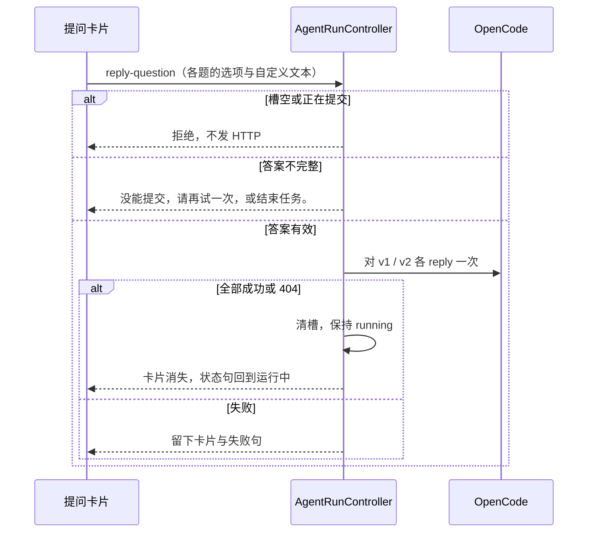

# US-AQ-02 点选提交并继续任务

> **用户故事**：[../31-需求-探索等待用户回复.md](../31-需求-探索等待用户回复.md) · US-AQ-02 · Issue [#69](https://github.com/Pedro-MAFS/ftcs/issues/69)  
> **状态**：**待评审**（本文件只定设计；业务代码尚未按本文改动）  
> **范围**：用户点选（及自定义文本）后提交 `reply`，任务继续；失败可重试；同一题不能重复提交  
> **依赖**：[US-AQ-01](US-AQ-01-识别等待态并展示问题.md) 的待答槽与卡片；[US-AQ-00](US-AQ-00-OpenCode交互工具清单.md) 的两侧 API  
> **不做**：结束任务与超时（[US-AQ-03](US-AQ-03-等待中可结束与兜底.md)）；减少提问的约定（[US-AQ-04](US-AQ-04-AGENTS减少交互提示.md)）；替用户解释选项含义  
> **文档位置**：`docs/design/`

提交成功后，等待卡片消失，智能体面板回到「运行中」，这次会话接着跑。客户端不根据选项文字决定下一步业务。

---

## 0. 相对现网

| 现网 | **本期（US-AQ-02）** |
|------|----------------------|
| 没有把用户选择送回 OpenCode 的 IPC | 新增 `agent:reply-question`。渲染进程只送选择结果，requestId 留在主进程槽里 |
| `client.question.reply` 与 `client.v2.session.question.reply` 均未调用 | 槽里有哪一侧就调哪一侧。两侧都在时用同一份 `answers` 各调一次 |
| 提问未答复时 `waitForSessionIdle` 一直等，`run*` 不进入完成分支 | 答复成功后 **不** 调用 `session.abort`，**不** 触发本地 `AbortController`。会话自己离开提问后，仍由现网 `waitForSessionIdle` 等到 `idle` 再读产物 |
| 面板「发送」在 `generating` 时禁用，且自由对话本来就未开放 | 不改用输入区发送。答案只从提问卡片的「提交」走 |

---

## 1. 与相邻故事的分工

| 模块 | 本期 |
|------|------|
| **US-AQ-02** | 组 `answers`、IPC、调用 reply、成功清槽、失败留在卡片上 |
| **US-AQ-01** | 卡片长什么样、状态句、通知 |
| **US-AQ-03** | 「结束任务」和现网「中止」；超时自动 reply 时复用本故事的发送函数，但不经过这颗按钮 |

---

## 2. 已确认选型

| 项 | 决定 |
|----|------|
| **答案形状** | `answers: string[][]`，长度等于题数，下标与 `questions` 对齐。每一项是该题选中的 `label`，或自定义文本。用 `label`，不用 `description` |
| **v1** | `client.question.reply({ requestID, answers })` |
| **v2** | `client.v2.session.question.reply({ sessionID, requestID, questionV2Reply: { answers } })`。禁止把 `answers` 放在与 `requestID` 平级却不包 `questionV2Reply` |
| **单选** | `multiple !== true`。选项互斥。自定义已开启且自定义文本去空白后非空时，本题答案为 `[这段文本]`，忽略已选选项。否则必须恰好选一个选项，答案为 `[label]` |
| **多选** | `multiple === true`。按选项原顺序收集选中的 `label`。自定义已开启且自定义文本非空时追加在末尾。至少要有一项 |
| **自定义开启** | `custom` 缺省或 `true`（AQ2a，等同可自填）。界面有「输入自己的答案」，样式与其它选项一致。文本按上两行进入 `answers` |
| **自定义未开启** | 仅 `custom === false`。界面没有「输入自己的答案」。忽略自定义文本。答案里不得出现选项列表之外的字符串 |
| **不可渲染** | 没有「提交」。用户只能走 AQ-03 的结束 |
| **成功之后** | 清槽、卸通知、取消超时计时（计时的所有权在 AQ-03，成功路径必须取消）。推 `awaiting-reply` 且 `pending: null`。`agentStatus` 保持 `running`，状态句回到「运行中」 |
| **不 abort** | 用户提交是为了继续。禁止在 reply 成功后调用 `abortCurrent` 或 `session.abort` |
| **重复提交** | 槽已空、request 已结算、或 `inFlight === 'reply'` 时，主进程不再发第二次 HTTP。按钮在请求返回前禁用 |
| **失败** | 槽保留，卡片保留，计时继续。卡片内显示「没能提交，请再试一次，或结束任务。」可以再点提交，也可以结束（结束归 AQ-03） |
| **404** | `QuestionNotFoundError` 或 HTTP 404：这一侧视为已经不在。若槽内每一侧都已成功或 404，按成功清槽，时间线写「这次等待已经结束。」不再报「没能提交」 |

Issue #69 里选「立即收尾并评分」：客户端提交的就是该选项的 `label` 字符串。后续收尾、评分是模型按技能继续做，不在桌面端写分支。

---

## 3. 流程



1. 卡片在本地先做同样的完整性检查，不完整时「提交」禁用。主进程再查一次，防止绕过界面。
2. 通过后把 `inFlight` 设为 `reply`，取消按钮连点。
3. 按 US-AQ-00 §5 对每个非空 requestId 调用对应 API，`answers` 相同。
4. 全部成功，或失败侧都是 404：清槽。时间线追加一条系统记录「已提交，任务继续。」若是 404 路径，改为「这次等待已经结束。」不出现协议名。
5. 任一其它失败：`inFlight` 清空，槽还在。若此时 AQ-03 的超时已经到期但被 `inFlight` 挡住，失败返回后立刻按超时规则处理，避免用户看到失败句之后又干等满剩余时间。超时与按钮的交接见 US-AQ-03。
6. 清槽之后再来的 IPC 直接返回，不打 HTTP。界面应已无卡片；若因竞态仍点到，不再次提交。

纯函数放在新建的 `desktop/electron/opencode/awaiting-reply.ts`，便于单测，不依赖 Electron：

```ts
export function buildQuestionAnswers(
  questions: Array<{
    multiple?: boolean
    custom?: boolean
    options: Array<{ label: string }>
  }>,
  selections: Array<{ optionLabels: string[]; customText: string }>,
): { ok: true; answers: string[][] } | { ok: false }
```

规则与 §2 相同。`custom` 缺省按开启（`!== false`），仅显式 `false` 丢弃自定义文本。选中的 label 必须与该题某个选项去空白后的 `label` 一致，否则 `ok: false`。

---

## 4. IPC

| 项 | 值 |
|----|-----|
| 通道 | `AGENT_REPLY_QUESTION: 'agent:reply-question'` |
| 方向 | 渲染进程 → 主进程 `ipcMain.handle` |
| 入参 | `{ selections: Array<{ optionLabels: string[]; customText: string }> }` |
| 出参 | `{ ok: boolean; message: string }` |
| 成功 `message` | 空字符串。界面靠 `awaiting-reply` 清卡片，不靠这句做状态 |
| 失败 `message` | 「没能提交，请再试一次，或结束任务。」 |
| 没有待答或正在提交 | `{ ok: false, message: '' }`。不弹新错误，避免和「已经提交过」打架。卡片若还在且并非 inFlight，失败句仍用上一行 |

preload 方法名 `replyQuestion`。不把 OpenCode 客户端暴露给渲染进程。

主进程实现放在 `AgentRunController.replyToPendingQuestion`。`main.ts` 的 handler 只转调，与 `PROFILE_ABORT` 相同。

SDK 结果：没有 `error` 且 HTTP 2xx 为成功。v1 的 200 且 body 为 `false` 视为失败。v2 的 204 无 body 视为成功。

---

## 5. 界面

- 按钮文案「提交」。
- `inFlight` 期间按钮禁用，防止双击打出两次 reply。
- 失败句放在卡片内，角色为 `alert`，用 §2 那句。不出现 OpenCode、`question`。
- 成功：卡片卸载，输入区状态从「任务在等你回复」回到「运行中」，脉冲恢复 `.on`。
- 现网「发送」仍禁用，不承担提交。

---

## 6. 文件清单

预期开发会动。**本 PR 不改这些文件。**

| 路径 | 改动 |
|------|------|
| `desktop/electron/opencode/awaiting-reply.ts`（新） | `buildQuestionAnswers` |
| `desktop/electron/opencode/awaiting-reply.test.ts`（新） | 单选、多选、自定义优先、非法 label、题数不对 |
| `desktop/electron/opencode/agent-runner.ts` | `replyToPendingQuestion`；成功清槽且不 abort |
| `desktop/electron/ipc/types.ts` | 通道名与入参出参 |
| `desktop/electron/preload.ts` | `replyQuestion` |
| `desktop/electron/main.ts` | `ipcMain.handle` |
| `desktop/src/types/electron.d.ts` | 类型 |
| `desktop/src/components/layout/AgentAwaitingReplyCard.vue` | 接上提交 |
| `desktop/src/components/layout/AgentPanel.vue` | 成功后状态句回到运行中（随槽清空自然发生，需对一下绑定） |

---

## 7. 验收对照

待开发核对。

- [ ] 单选点一项并提交：对应 API 收到 `answers: [[该 label]]`。v2 时 body 含 `questionV2Reply`。任务不中止，面板回到「运行中」，卡片消失。
- [ ] 样例三选一里选择第三个选项的 label 并提交：客户端只回传该 label，不额外调用评分或收尾。
- [ ] 多选两项：该题 `string[]` 含两个 label，顺序与选项原序一致。
- [ ] `custom` 缺省或 `true`，且只填了「输入自己的答案」、没选选项：该题答案是这段去空白文本。单选里既选了选项又填了文字：以文字为准。`custom === false` 时不接受选项列表之外的字符串。
- [ ] 少选一题时按钮不可用；绕过界面时主进程不发 HTTP。
- [ ] 提交过程中连点只产生一次 reply。成功后再调用 IPC 不再打 HTTP。
- [ ] 断网或 500：卡片还在，文案为「没能提交，请再试一次，或结束任务。」可以再提交。
- [ ] 404：卡片去掉，不显示上一句失败文案。
- [ ] 两侧 id 都在时，两次 reply 的 `answers` 相同，且各走各的 URL。
- [ ] 用户可见文案没有 OpenCode、`question`。

---

## 8. 不做什么

- 不在提交成功时 `session.abort`。
- 不把 `description` 当作答案。
- 不根据「立即收尾并评分」等字样改探索或评分流程。
- 不开放面板自由输入作为答题通道。
- 不在本故事写 10 分钟自动选择（AQ-03 复用 `buildQuestionAnswers` 不适用处，超时有自己的决策函数）。

---

## 9. 风险

| 风险 | 处理 |
|------|------|
| reply 成功却把本地 AbortSignal 置位，`waitForSessionIdle` 当成用户中止 | §2 禁止 |
| v2 漏包 `questionV2Reply`，类型能编译的假调用打到错误字段 | 单测与代码评审按 US-AQ-00 的签名 |
| 一侧成功、另一侧失败却清槽 | 非 404 失败保留槽；随后由超时或用户结束把未完成的一侧 reject 掉（AQ-03） |
| 失败文案写成协议错误原文 | 用户只看定稿那一句；细节进主进程日志，前缀 `[ftcs:await-reply]`，不进面板 |

---

## 10. 修订记录

| 日期 | 说明 |
|------|------|
| 2026-10-18 | 初稿。提交只 reply、不 abort；404 视为该侧已结束；失败保留卡片 |
| 2026-10-19 | 对齐 AQ2a：自定义开启含 `custom` 缺省（等同 `true`）；仅显式 `false` 视为未开启。单选以自填文本为准、多选追加、提交不 abort 不改 |
