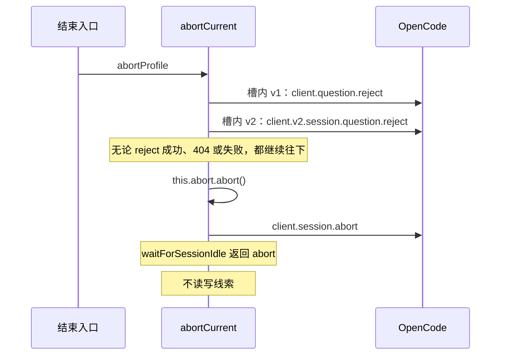
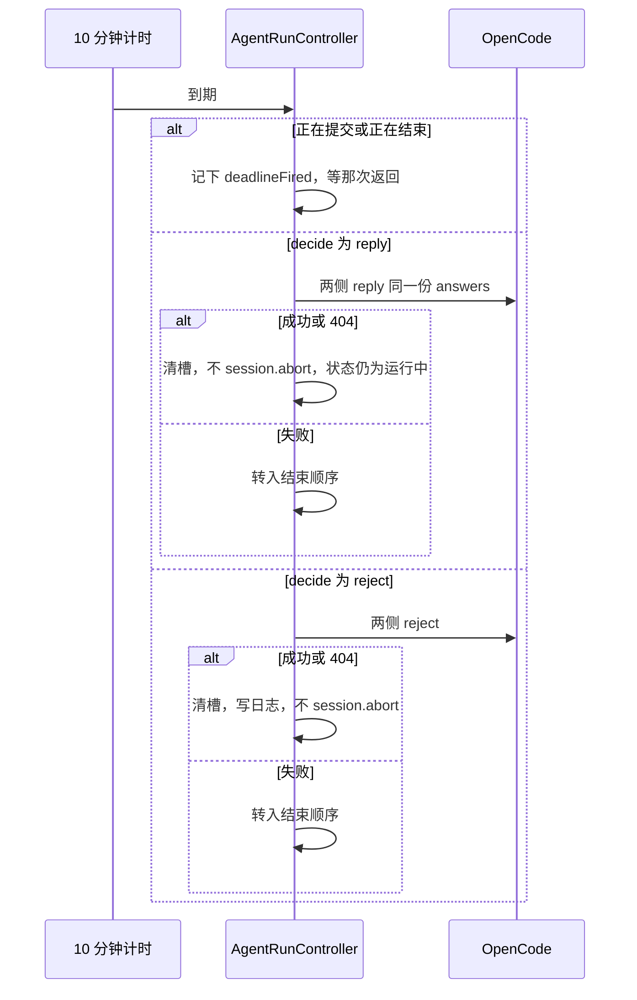

# US-AQ-03 等待中可结束与兜底

> **用户故事**：[../31-需求-探索等待用户回复.md](../31-需求-探索等待用户回复.md) · US-AQ-03 · Issue [#69](https://github.com/Pedro-MAFS/ftcs/issues/69)  
> **状态**：**待评审**（本文件只定设计；业务代码尚未按本文改动）  
> **范围**：等待中可以结束任务；无法渲染的提问有明确出口；10 分钟不答按 AQ6a 处理；编排和定时任务用同一条规则  
> **依赖**：[US-AQ-01](US-AQ-01-识别等待态并展示问题.md) 的待答槽；[US-AQ-02](US-AQ-02-点选提交并继续任务.md) 的 reply 调用方式；现网 `abortCurrent`  
> **不做**：权限改成弹窗确认（AQ10）；待答落盘（AQ11）；提交成功后的继续跑（AQ-02，超时自动 reply 只复用发送）  
> **文档位置**：`docs/design/`

结束等待和「等太久」是两条路。用户要停，就先拒绝提问再中止会话。只是太久没人答，能选默认项就继续跑，不能选才拒绝提问，而且默认不把整次任务杀掉。

---

## 0. 相对现网

| 现网 | **本期（US-AQ-03）** |
|------|----------------------|
| `abortCurrent` 先 `this.abort.abort()`，再 `client.session.abort({ sessionID })`。不调用 `question.reject` | 有待答槽时，**先**对槽内每一侧 reject，**再**执行这两句。没有待答槽时，这两句的顺序和今天一样 |
| 各 `run*` 在 `idleResult === 'abort'` 时只改面板状态、写「已中止」、发 `done ok: false`。不删 raw、不改 `scored.json` | 结束等待走同一条 abort 分支。不在 reject 前后增加线索读写 |
| 提问会一直挂到 `waitForSessionIdle` 超时（探索等任务的等待上限是几十分钟量级），界面没有结束以外的自动出口 | 进入待答槽即启动 **10 分钟** 计时。到期按 §4，不得继续停在卡片上 |
| `useWorkflowExecute.cancel` 已经是 `workflowAbortController.abort()` 再 `abortProfile()` | 不另写编排专用结束。`abortProfile` 进更新后的 `abortCurrent`，自然带上 reject |
| 编排 `executePlan` 用 `waitForAgentDone` 等这次 `done`。步骤进行中完成通知被抑制 | 提问先等，到期仍走 §4。不缩短编排的时限，也不因为抑制闸门就跳过等待通知（通知归 AQ-01） |
| 未知事件在 `default` 被忽略 | 只有「问答事件到了但 §US-AQ-01 判为不可渲染」走兜底卡片。其它事件仍忽略 |

现网 `abortCurrent`（本期在函数开头插入 reject，其余保留）：

```ts
async abortCurrent(): Promise<void> {
  this.abort?.abort()
  const client = this.getClient()
  if (client && this.sessionId) {
    try {
      await client.session.abort({ sessionID: this.sessionId })
    } catch {
      // ignore
    }
  }
}
```

先 abort 信号的问题：`waitForSessionIdle` 看到信号会立刻返回 `'abort'`，对应 `run*` 的 `finally` 会 `stopEvents()` 并把 `this.running` 置 false。若 reject 排在这之后，请求打在会话已经开始收尾的窗口里。OpenCode 在提问还没拒绝时，`session.abort` 也不能代替 reject，工具调用仍可能占着会话。所以 reject 必须发生在 `this.abort.abort()` 之前，并且要 await 完成。

---

## 1. 与相邻故事的分工

| 模块 | 本期 |
|------|------|
| **US-AQ-03** | 结束顺序、未知卡片、常量 `AWAITING_REPLY_TIMEOUT_MS`、AQ6a、编排共用 |
| **US-AQ-02** | 用户按「提交」的 reply。超时若决定 reply，调用同一套「按协议 reply、成功不 abort」 |
| **US-AQ-01** | 槽、可渲染判定、通知。未知卡片的外壳用它的等待状态句 |
| **线索** | 不清理、不补评分（O7） |

---

## 2. 已确认选型

| 项 | 决定 |
|----|------|
| **结束入口** | 提问卡片按钮「结束任务」。现网面板「中止」、探索页停止、编排 `cancel` 都走 `abortProfile` → `abortCurrent`。有槽时同一套顺序，不另做第二套中止 |
| **结束顺序** | 见 §3。定死为：先 reject 每一侧，再本地 `AbortController.abort()`，再 `client.session.abort` |
| **结束后果** | 界面回到非运行态（现网 abort 把状态推到 `error` 并发 `done`）。已写入线索不动。不提示「已保存 N 条」，不引导先评分 |
| **未知交互** | 状态句仍是「任务在等你回复」。正文「这项操作需要你处理，当前无法代为回答。」只有「结束任务」，没有「提交」。禁止只留转圈 |
| **长时间** | 常量 `AWAITING_REPLY_TIMEOUT_MS = 600_000`（10 分钟）。从槽**第一次**建立起算。并入另一侧回声不重置。换了内容不同的新提问才重新计时 |
| **调参** | 改常量即改默认。另允许环境变量 `FTCS_AWAITING_REPLY_TIMEOUT_MS`：正整数毫秒则覆盖，缺省、空、非整数、小于等于 0 用常量。不进设置页，不出现在用户界面 |
| **超时能默认** | 见 §4。只 reply，不 `session.abort` |
| **超时不能默认** | 只 reject + 日志，不 `session.abort`。槽必须清掉 |
| **reject 失败** | 非 404：打日志，再走 §3 的 abort（整次任务结束），避免界面和会话继续挂着。404 视为这一侧已经不在 |
| **编排 / 定时** | 与前台同一常量、同一决策。先等满 10 分钟，再 AQ6a（AQ13）。不因为无人值守就立刻选默认或立刻结束 |

---

## 3. 结束顺序

适用于：卡片「结束任务」、面板「中止」、探索页停止、编排取消，以及 §4 里「reject 或 reply 失败后的兜底」。



1. 把槽里的 `v1RequestId`、`v2RequestId`、`sessionId` 先抄到局部变量，然后取消计时器，避免 reject 进行中超时回调再打一次。
2. `inFlight` 设为 `reject`。
3. v1 有 id：`client.question.reject({ requestID })`。v2 有 id：`client.v2.session.question.reject({ sessionID, requestID })`。某一侧没有 id 就跳过。两侧都没有（不应出现在结束路径）则直接进入第 5 步。
4. 404 / `QuestionNotFoundError` 不算失败。其它错误只 `console.warn`，不抛到界面。
5. 清槽，推 `pending: null`，卸通知。
6. `this.abort.abort()`。
7. `client.session.abort({ sessionID })`，失败吞掉，与现网一致。
8. `waitForSessionIdle` 返回 `'abort'` 后，各 `run*` 现有分支写「已中止」（若已有 `autoAbortReason` 则仍写失败，本故事不新造理由）。`done.ok === false`。

没有待答槽时，跳过 1～5 中的 HTTP，从第 6 步执行，行为与今天的 `abortCurrent` 相同。

禁止的顺序：先 `this.abort.abort()` 或先 `session.abort`，再 reject。

`session.abort` 使用现网 `client.session.abort`。不改成 `client.v2.session.interrupt`。

线索：abort 分支不调用 lead-store，不改 jsonl / `scored.json`。本期不在这条路径上加删除或回滚。

---

## 4. 十分钟计时与 AQ6a

常量与决策都放在 `desktop/electron/opencode/awaiting-reply.ts`：

```ts
export const AWAITING_REPLY_TIMEOUT_MS = 600_000

export function resolveAwaitingReplyTimeoutMs(
  envValue: string | undefined,
  fallback = AWAITING_REPLY_TIMEOUT_MS,
): number

export function decideAwaitingReplyTimeout(input: {
  renderable: boolean
  questions: Array<{ multiple?: boolean; options?: Array<{ label?: string }> }>
}):
  | { action: 'reply'; answers: string[][] }
  | { action: 'reject'; reason: 'multiple' | 'no-options' | 'unrenderable' }
```

`resolveAwaitingReplyTimeoutMs`：`envValue` 去空白后，全体为十进制数字且数值大于 0，则采用该毫秒数；否则 `fallback`。主进程读 `process.env.FTCS_AWAITING_REPLY_TIMEOUT_MS`。

`decideAwaitingReplyTimeout` 按这个顺序，命中即停：

1. `renderable !== true`，或 `questions` 为空 → `{ action: 'reject', reason: 'unrenderable' }`。
2. 任一题 `multiple === true` → `{ action: 'reject', reason: 'multiple' }`。
3. 任一题没有 `options`，或没有任何一个去空白后非空的首项可用（看的是 `options[0].label`）→ `{ action: 'reject', reason: 'no-options' }`。
4. 否则 `{ action: 'reply', answers }`，`answers[i] = [questions[i].options[0].label]`。每题只取首项的 `label`，不取 `description`，不填自定义文本。可自填（`custom` 缺省或 `true`）但首项 label 有效时，仍然走 reply，不因为有自定义输入就 reject。

计时器在主进程，用 `setTimeout`。不要放在渲染进程。建槽时启动；并槽不重置；换题、清槽、用户提交成功、进入 §3 时都 `clearTimeout`。

到期回调：



「转入结束顺序」时槽还留着。`abortCurrent` 会再 reject 一次，然后才 `session.abort`。不要在失败分支里先清槽，否则结束顺序会漏掉拒绝。

和用户点击的交接：

- 到期时 `inFlight === 'reply'` 或 `'reject'`：不并行再打一套 HTTP。置 `deadlineFired`。
- 用户 reply 成功：忽略 `deadlineFired`，按 AQ-02 清槽。
- 用户 reply 失败且 `deadlineFired`：返回后立刻执行上面的到期逻辑。
- 用户已经走进 §3：计时器已取消，到期回调若仍触发则直接返回。

超时 reply 成功后的时间线：

- 只有一题：「长时间没有回复，已按「{label}」继续。」`label` 即 `options[0].label`。
- 多题：「长时间没有回复，每题已按第一项继续。」

超时 reject 成功后的时间线：「长时间没有回复，本次等待已结束。」然后面板回到「运行中」（槽没了，任务仍 `running`）。模型收到拒绝后是否自己收尾，由会话决定，桌面不 abort。

日志（仅主进程，不进界面）：

```text
console.warn('[ftcs:await-reply] reject', {
  requestIds, sessionId, reason
})
```

`reason` 用决策函数的三个值。reply / reject 的非 404 失败再记一条 `reason: 'send-failed'`。不把题干打进日志。

未知卡片（`renderable === false`）在到期时必然走到 `unrenderable` → reject。等待期间用户可以按「结束任务」走 §3，不必干等。

---

## 5. 编排与定时

| 场景 | 行为 |
|------|------|
| 方案步骤跑到一半出现提问 | 该步的 `waitForAgentDone` 继续等。槽上的 10 分钟照走。自动 reply 后步骤最终正常 `done`，方案进入下一步 |
| 超时 reject 成功且不 abort | 会话继续，步骤仍等到真正的 `done`。不把「拒绝了提问」当成方案失败 |
| 用户取消方案，或超时发送失败转入 §3 | `abortProfile` 使该步 `done ok: false`。现网 `executePlan` 按失败停链。不额外删线索 |
| 定时触发的方案 | 同一个 `AgentRunController`，同一常量。窗口不在前台时的通知仍按 AQ-01，不因为是定时任务就改成 0 等待 |

不在 `useWorkflowExecute` 里再装一个计时器。

---

## 6. 界面文案（本故事定稿）

都从用户视角写，不含 OpenCode、`question`。

| 位置 | 文案 |
|------|------|
| 卡片按钮 | 结束任务 |
| 未知卡片正文 | 这项操作需要你处理，当前无法代为回答。 |
| 未知卡片 | 无「提交」 |
| 超时自动继续（单题 / 多题） | §4 两句 |
| 超时拒绝成功 | 长时间没有回复，本次等待已结束。 |
| 用户结束 | 沿用各任务现网的「已中止」 |

面板上的「中止」保留，和「结束任务」调用同一 IPC。

---

## 7. 文件清单

预期开发会动。**本 PR 不改这些文件。**

| 路径 | 改动 |
|------|------|
| `desktop/electron/opencode/awaiting-reply.ts` | `AWAITING_REPLY_TIMEOUT_MS`、`resolveAwaitingReplyTimeoutMs`、`decideAwaitingReplyTimeout` |
| `desktop/electron/opencode/awaiting-reply.test.ts` | 10 分钟默认值、非法环境变量、AQ6a 四条决策 |
| `desktop/electron/opencode/agent-runner.ts` | 建槽启动计时；`abortCurrent` 先 reject；到期回调 |
| `desktop/src/components/layout/AgentAwaitingReplyCard.vue` | 「结束任务」；不可渲染时的正文与隐藏提交 |
| `desktop/src/components/layout/AgentPanel.vue` | 「中止」仍调 `abortProfile`，不另写一套 |
| `desktop/src/views/ExploreView.vue` | **不改逻辑。** 现有 `abortProfile` 自动获得新顺序。仅当按钮文案被改坏时才动，本期预期不动 |
| `desktop/src/composables/useWorkflowExecute.ts` | **不改。** `cancel` 已调用 `abortProfile` |

不改 `workspace/skills/`，不改线索写入。

---

## 8. 验收对照

待开发核对。数值必须可测，不能写成「等一会儿」。

- [ ] 等待中按「结束任务」：先看到 question reject（v1 或 v2，以实际到达的事件为准），然后才是 `session.abort`。界面离开运行中，出现现网「已中止」。
- [ ] 只到达 `question.v2.asked` 时，结束调用的是 `client.v2.session.question.reject`，不是 v1 的 URL。
- [ ] 等待中按面板「中止」或编排取消：顺序与上一行相同。
- [ ] 结束之后，结束前已经写入的线索文件字节级保持原样（不删行、不改分）。
- [ ] 没有 `header` / 题干，或选项无法回答且没有自定义输入：面板状态句仍是「任务在等你回复」，正文为「这项操作需要你处理，当前无法代为回答。」有「结束任务」，没有无限转圈，也没有「提交」。
- [ ] 常量名为 `AWAITING_REPLY_TIMEOUT_MS`，默认值为 `600_000`。不设环境变量时，进入等待后 10 分钟触发，9 分钟时仍停在卡片上。
- [ ] `FTCS_AWAITING_REPLY_TIMEOUT_MS=1000` 时约 1 秒触发；设为 `0`、负数或 `abc` 时仍用 600_000。设置页没有这一项。
- [ ] 非 multiple、至少一题、每题 `options[0].label` 非空：到期只 reply、不调用 `session.abort`，面板回到「运行中」。单题 `answers` 为 `[[options[0].label]]`；多题为 `[[第一题首项 label], [第二题首项 label], …]`。
- [ ] 任一题 `multiple === true`：到期 reject，日志 `reason` 为 `multiple`，不 `session.abort`，卡片消失，时间线为「长时间没有回复，本次等待已结束。」
- [ ] 没有可选 label（仅自定义，或选项为空）：到期 reject，日志 `reason` 为 `no-options`，不挂起。
- [ ] 不可渲染：到期 reject，日志 `reason` 为 `unrenderable`。
- [ ] reject 或自动 reply 返回非 404 失败：转入结束顺序，任务最终「已中止」，不继续转圈。
- [ ] 编排或定时任务中的提问：先等待，超时规则与前台相同，没有单独的更短时限。
- [ ] 用户可见句子没有 OpenCode、`question`。

---

## 9. 不做什么

- 不把超时不能默认的情况直接 `session.abort`（那是发送失败的兜底，不是 AQ6a 的本意）。
- 不把 10 分钟做成设置项。
- 不在结束时清理线索，不弹出「已保存 N 条」。
- 不为人机权限加确认框。
- 不在重启后恢复待答。
- 不把 `tui.*`、`pty.*`、`session.status` 做成未知卡片。

---

## 10. 风险

| 风险 | 处理 |
|------|------|
| 先 abort 再 reject，桌面以为结束了，服务端提问仍挂着，下一任务抢会话 | §3 把顺序定死 |
| 超时 reject 后模型又继续跑很久 | 这是 AQ6a：解除挂起，不结束整次任务。用户仍可用「中止」 |
| 编排被超时 reject 误判为步骤失败 | reject 成功不发 `done`；只有 abort 才失败停链 |
| 环境变量被当成用户功能写进界面 | 只在主进程读取，验收检查设置页没有入口 |
| 多题里只有一题是 multiple，却自动选了其它题的首项 | 决策函数任一一题 multiple 就整单 reject |

---

## 11. 修订记录

| 日期 | 说明 |
|------|------|
| 2026-10-18 | 初稿。结束顺序定为先 reject 再 `abortCurrent` 原有两步。超时常量 `AWAITING_REPLY_TIMEOUT_MS = 600_000`。AQ6a 不能默认时只 reject，发送失败才 abort |
| 2026-10-19 | 超时决策不改。仅把「有自定义输入仍 reply」的条件从 `custom === true` 扩到缺省或 `true`（AQ2a）。10 分钟、先 reject 再 abort、权限 always 不改 |
