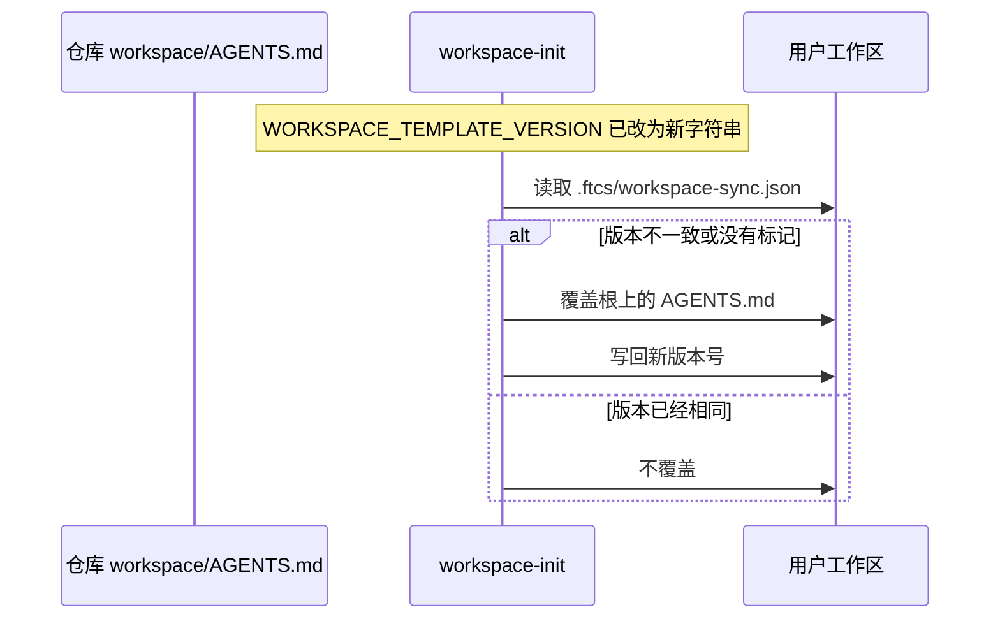

# US-AQ-04 AGENTS 减少交互提示

> **用户故事**：[../31-需求-探索等待用户回复.md](../31-需求-探索等待用户回复.md) · US-AQ-04 · Issue [#69](https://github.com/Pedro-MAFS/ftcs/issues/69)  
> **状态**：**待评审**（本文件只定设计；业务代码与工作区约定尚未按本文改动）  
> **范围**：在 OpenCode 实际加载的 `workspace/AGENTS.md` 增加「少问、可不问就不问、必要时仍可提问」；同一次改动升高 `WORKSPACE_TEMPLATE_VERSION`  
> **依赖**：`docs/31` AQ9；仓库根 `AGENTS.md` 里「改了 Skill 或 MCP，必须升工作区同步版本」；现网 `desktop/electron/config/workspace-init.ts`  
> **不做**：提问卡片与文案（[US-AQ-01](US-AQ-01-识别等待态并展示问题.md)～[US-AQ-03](US-AQ-03-等待中可结束与兜底.md)）；各 Skill 正文；用户可见界面  
> **文档位置**：`docs/design/`

这条约定写给模型看。用户界面仍然只说「任务在等你回复」，不展示本节句子。

---

## 0. 相对现网

| 现网 | **本期（US-AQ-04）** |
|------|----------------------|
| 仓库 `workspace/AGENTS.md` 只有浏览器、登录墙、社媒发现等红线，没有「少提问」 | 在文件末尾增加 §2 的「向用户提问」一节 |
| 桌面跑的是用户工作区里的 `AGENTS.md`，不是仓库这份。`npm run dev` 不会每次覆盖 | 同一次改动把 `WORKSPACE_TEMPLATE_VERSION` 换成新字符串。下次启动发现与 `.ftcs/workspace-sync.json` 不一致时，才会把仓库这份复制到用户工作区 |
| 当前常量是 `2026.10.13-places-official-key`（`workspace-init.ts`） | 改为 `2026.10.18-agents-less-questions`。不要复用旧值 |
| `MANAGED_WORKSPACE_FILES` 已含 `AGENTS.md` | 不改这个列表。版本号一变，现有同步会覆盖工作区根上的 `AGENTS.md` |
| 根目录 `AGENTS.md` 是仓库开发约定（编码、升版本），OpenCode 会话不靠它代替工作区文件 | **不改**根目录 `AGENTS.md` 的正文。只遵守它「同一次改动里升版本」的要求 |

只改桌面 TypeScript、不改 `workspace/AGENTS.md` 时本来不必升版本。本期因为改了工作区根上的 `AGENTS.md`，必须升。

---

## 1. 与相邻故事的分工

| 模块 | 本期 |
|------|------|
| **US-AQ-04** | 约定文本 + 版本号。不减少用户已经遇到提问时的界面能力 |
| **US-AQ-00～03** | 提问真的发生时仍要识别、展示、提交、结束。本故事不削弱那些路径 |
| **各 Skill** | 不改。若某个 Skill 写死了逐步追问，另开需求 |

可以和 AQ-01 并行开发。没有界面依赖。

---

## 2. 已确认选型

| 项 | 决定 |
|----|------|
| **写在哪** | 仓库 `workspace/AGENTS.md` 末尾新开一节。不写进根 `AGENTS.md`，不写进某个 `SKILL.md` |
| **语气** | 与该文件现有短句一致：告诉模型何时不要问、何时可以问 |
| **工具名** | 允许出现 `question`。这是给模型的约定，AQ9 要求写明必要时仍可使用它 |
| **绝对禁令** | 不得出现「禁止提问」「不得提问」「不要提问」「禁止调用 question」「不得调用 question」「不允许使用 question」 |
| **用户界面** | 本节原文不进桌面文案、通知、设置页 |
| **版本字符串** | `2026.10.18-agents-less-questions` |

定稿正文（原文落入 `workspace/AGENTS.md`，标题层级与下面一致）：

```markdown
## 向用户提问

长任务里尽量少停下来问用户。当前 Skill、已经拿到的上下文、已经写入的结果足够判断时，自己决定并继续，不要为了确认而提问。

只有现有信息不够、必须由用户拍板时，才使用 `question`。一次把问题和选项说清楚。不要逐步追问，也不要为了同一件事反复问。
```

不增删浏览器红线那几节。

---

## 3. 版本号怎么生效



1. `desktop/electron/config/workspace-init.ts` 的 `WORKSPACE_TEMPLATE_VERSION` 与 `workspace/AGENTS.md` 在同一次提交里改。
2. 开发态模板根是仓库 `workspace/`（`getWorkspaceTemplateRoot`）。打包态是 `resources/workspace-template`，随现有 `prepare:template` 带走，本故事不改打包脚本。
3. 用户需要重启桌面端，同步才会发生。验收时看用户工作区根上的 `AGENTS.md` 是否含「向用户提问」，以及 `.ftcs/workspace-sync.json` 的 `version` 是否为 `2026.10.18-agents-less-questions`。
4. 不手改用户机器上的文件当作交付。交付是仓库模板 + 版本号。

---

## 4. 文件清单

预期开发会动。**本 PR 不改这些文件。**

| 路径 | 改动 |
|------|------|
| `workspace/AGENTS.md` | 末尾增加 §2 定稿 |
| `desktop/electron/config/workspace-init.ts` | `WORKSPACE_TEMPLATE_VERSION = '2026.10.18-agents-less-questions'` |

不改：

- 根目录 `AGENTS.md`
- `workspace/skills/**`
- `workspace/mcp-servers/**`
- `desktop/src/**` 界面

---

## 5. 验收对照

待开发核对。

- [ ] `workspace/AGENTS.md` 含 §2 两段，语义是：能自己决定就不问；必须拍板时仍可使用 `question`；不要逐步追问。
- [ ] 全文没有「禁止提问」「不得提问」「不要提问」「禁止调用 question」「不得调用 question」「不允许使用 question」。
- [ ] 同一次改动里 `WORKSPACE_TEMPLATE_VERSION` 为 `2026.10.18-agents-less-questions`，不是 `2026.10.13-places-official-key`。
- [ ] 根目录 `AGENTS.md` 没有被加进这段提问约定。
- [ ] 重启应用后，用户工作区的 `AGENTS.md` 出现这一节，`.ftcs/workspace-sync.json` 的 `version` 与新常量一致。只改文件、不升版本的实现判失败。
- [ ] 桌面界面、系统通知里看不到这一节的句子。用户等待时仍只看到「任务在等你回复」（那是 AQ-01 / AQ-12，不在本故事实现）。
- [ ] 没有改动任何 Skill 的步骤正文。

---

## 6. 不做什么

- 不写「禁止使用 question」。
- 不把这段约定显示在智能体面板。
- 不升版本以外的同步逻辑，不改 `MANAGED_WORKSPACE_DIRS`。
- 不因为少提问就删掉 AQ-01～03 的识别与渲染。
- 不改各 Skill 里已经写死的追问步骤。

---

## 7. 风险

| 风险 | 处理 |
|------|------|
| 只改了 `workspace/AGENTS.md`，忘记升版本 | 用户工作区仍是旧约定，会话看不到新小节。验收第 3、5 条一起看 |
| 句子写成绝对禁令，模型不再问必须拍板的范围问题 | 定稿保留「才使用 `question`」，并用 §5 的禁用词表检查 |
| 改到根 `AGENTS.md` | OpenCode 不加载那份开发约定，等于没做；同时容易把编码规范写乱 |
| 升版本导致用户工作区 `skills/` 整目录按模板重刷 | 这是现网同步的既定行为：版本不一致会重刷托管目录。本期不改技能文件，重刷结果应与模板一致。不要在这次版本里夹带无关技能修改 |

---

## 8. 修订记录

| 日期 | 说明 |
|------|------|
| 2026-10-18 | 初稿。定稿「向用户提问」两段；版本号 `2026.10.18-agents-less-questions` |
