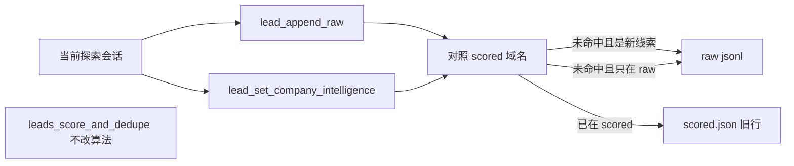
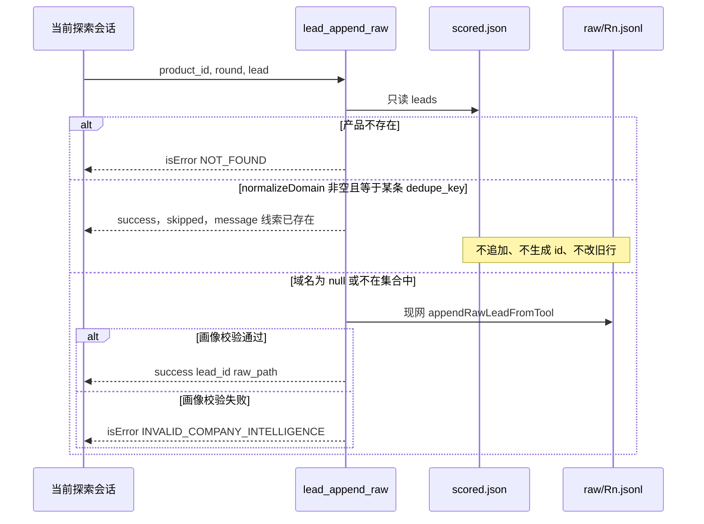

# US-DD-01 探索保存前按域名去重（跳过）

> **用户故事**：[../33-需求-探索线索按域名去重.md](../33-需求-探索线索按域名去重.md) · US-DD-01 · Issue #68  
> **状态**：**待评审**（本文件只定设计；业务代码尚未按本文改动）  
> **范围**：探索保存线索之前，用现网 `normalizeDomain` 对照同一 `product_id` 的 `scored.json`；域名已在库中则跳过，不追加、不新建 id、不改旧线索  
> **依赖**：现网 `lead_append_raw` → `appendRawLeadFromTool` / `appendRawLead`；`lead_set_company_intelligence` → `setLeadCompanyIntelligence`；`normalizeDomain`；`loadScoredLeads`  
> **不做**：改 `leads_score_and_dedupe` 算法；跨 `product_id`；线索页手改与 `saveLeadIcebreak`；覆盖、询问、字段合并  
> **文档位置**：`docs/design/`

需求依据只有已合入的 `docs/33-需求-探索线索按域名去重.md`（DD1～DD6、§3.1、§4、US-DD-01 验收、§7 已锁 O1～O5）。本文不改该需求正文。O1～O5 已锁，本文不重开，也没有新的未决产品项。

硬拦截在 MCP 工具里。只改 `discover-leads*` 或 `agent-runner.ts` 的提示词、工具仍能把已在库中的域名写进去，不算完成。

---

## 0. 相对现网

对照 `dev-0.5.8`（`8ed139f`，2026-10-19 读码）。

| 现网 | **本期（US-DD-01）** |
|------|----------------------|
| `lead_append_raw`（`workspace/mcp-servers/lead-store/src/index.ts`）确认产品存在后调用 `appendRawLeadFromTool`。该函数只做画像校验，通过后 `appendRawLead` 追加一行到 `data/leads/{product_id}/raw/{round}.jsonl`，并用 `generateLeadId` 生成新 id。写入前不读 `scored.json` | 同一工具在调用 `appendRawLeadFromTool` **之前**做域名拦截。命中则返回跳过，不追加、不生成 id、不改旧行 |
| `lead_set_company_intelligence` 入参是 `product_id`、`lead_id` 和七个字符串，**没有** `website`。`setLeadCompanyIntelligence` 用 `listRawLeads` 按 `lead_id` 找 raw；找不到返回「未找到线索」且不新建。找到后即使用 `getDedupeKey` 覆盖该 raw，并覆盖 `scored.json` 里同 id 或同 `dedupe_key` 的行。校验失败也会先把 `status=failed` 写回去 | 写入前用这条已有线索的域名，以及它是否已在 scored，决定拒绝。命中则一次都不写（raw 与 scored 都不动）。未命中且只在 raw 的覆盖保持 |
| 技能 `discover-leads` / `discover-leads-r2` / `discover-leads-r3`，以及 `agent-runner.ts` 的 `DISCOVER_COMPANY_INTELLIGENCE_RULES` 和三份 `buildDiscoverLeads*`：同域名已在 `lead_list_raw` 就不要 `lead_append_raw`，改为 `lead_set_company_intelligence` 覆盖画像和破冰 | 提示词改为直接调用这两个保存工具，不要求模型先查线索库再决定是否保存。域名已在 scored 时，工具返回跳过，模型继续下一家，不把探索标 failed。只在 raw、尚未进 scored 的同域，仍可直接调覆盖 |
| `normalizeDomain`（`lead-id.ts`）取 `new URL(url).hostname`，小写，只剥一个前缀 `www.`，失败返回 `null`。`getDedupeKey`（`lead-scorer.ts`）是 `normalizeDomain(company.website ?? source.url) ?? 公司名 trim 小写 ?? lead.id`。`rawLeadToScoredLead` 把这个键写成 `dedupe_key` | 跳过只使用 `normalizeDomain` 的结果去对 `leads[].dedupe_key`。公司名和 `lead.id` 回退不作为跳过条件 |
| `loadScoredLeads` 读 `getScoredLeadsPath` → `data/leads/{product_id}/scored.json`。文件不存在返回 `null`。`leads_get_scored` 在文件不存在时返回 `isError` + `NOT_FOUND` | 对照只在两个保存工具内部用 `loadScoredLeads` 完成。不存在或 `leads` 为空 = 空集，保存不因此失败。提示词不调用 `leads_get_scored` |
| `exploration_finish` 的 `status` 由调用方传入。桌面在 `agent-runner.ts` 里看到 `run.status === 'failed'`，或会话结束时 run 仍是 `running`，才把整次探索当成失败。单次工具 `isError` 本身不会由桌面改 run 状态 | 跳过必须是工具成功结果里的 `skipped: true`。禁止用 `isError` / `INVALID_COMPANY_INTELLIGENCE` 表示跳过，避免模型按「校验失败」重试，或调用 `exploration_finish({ status: "failed" })` |
| `scoreAndDedupeLeads` / `dedupeRawLeadsDetailed` 在 raw 内按 `getDedupeKey` 留一条进 scored，其余进 `discarded.json`（`reason: "duplicate_domain"`） | 不改这个算法，不读 `discarded.json` 当「已存在」 |
| 桌面 `lead-writer.ts` 另有一份不导出的 `normalizeDomain`（会 `trim`，空串再用 `source.url`），供 `saveLeadIcebreak` 用 | 本期拦截不用这份。不改 `saveLeadIcebreak` / `saveRawLead` |

现网接缝（实现时按本节）：

1. **拦截点**是 `index.ts` 里 `lead_append_raw`、`lead_set_company_intelligence` 两个 `server.tool` 回调，在它们调用写入函数之前。`appendRawLead` 保持「调用就追加」：测试和 `appendRawLeadFromTool` 仍靠它落行，不要把跳过塞进 `appendRawLead`。
2. **`setLeadCompanyIntelligence` 今天先写后返回。** 校验失败也会 `replaceRawLeadCompanyIntelligence`，并可能 `saveScoredLeads`。跳过判断必须放在这两次写之前。判断写在函数开头，这样直接调用该函数的路径也不会先改盘；`index.ts` 把跳过映射成下面的成功 JSON，**不要**映射成现在的 `isError`。
3. **取域与 `getDedupeKey` 的域名分支相同，回退不同。** 只用 `company.website ?? source.url` 再交给 `normalizeDomain`。`null` 时不看公司名。`countUniqueLeadDomains` 会在域名为空时改用公司名，不能拿来做跳过。
4. **比较的是已经写在 scored 上的 `dedupe_key` 原文字。** 它由 `rawLeadToScoredLead` 调用 `getDedupeKey` 生成，域名情况下已经是 `normalizeDomain` 的结果。拦截时不要再对 `dedupe_key` 剥 `www.`、不要再跑一遍 `new URL`。
5. **空串 website 不会落到 `source.url`。** `??` 只在 `null` / `undefined` 时取值。`company.website === ""` 时 `normalizeDomain("")` 为 `null`，本条不跳过。这与 `getDedupeKey` 一致。桌面那份 `normalizeDomain` 的空串回退不要抄过来。
6. **提示词和工具描述挡不住写入。** `server.tool` 的 description 今天仍写「Overwrite companyIntelligence…」。技能和 `buildDiscoverLeads*` 仍要求同域名去覆盖。文字改为：直接调用保存工具；收到 `skipped: true`（「线索已存在」）就继续下一家，不要把探索标 failed。校验只在两个保存工具写入前完成。只改文字、回调仍能写入，不算完成。
7. **时间线会展示工具输出和整段任务提示词。** `toolPartToTimelineItem` 把工具 JSON 放进「输出」。`buildDiscoverLeads*` 的全文会作为用户气泡。新增的用户能读到的句子不要出现 `MCP`、`scored.json`。

---

## 1. 与 US-CI-01 的覆盖关系

[US-CI-01](US-CI-01-探索落库随写画像与破冰.md) 的 CI6 / §3.3 要求：同域名再次命中且仍是目标客户时，调用 `lead_set_company_intelligence`，整份覆盖六段和破冰，包含用户改过的破冰。

本故事（需求 2026-10-19 晚于该详设）把其中一种情况废止：

| 再探索时这家公司在哪 | 行为 |
|----------------------|------|
| 规范化域名已在该产品 `scored.json` 的 `leads[].dedupe_key`，或 `lead_set_company_intelligence` 的目标 `lead_id` 已在该文件的 `leads` 里 | **跳过**。不调用覆盖写入。旧线索的画像、破冰、公司字段、联系人、`people`、分数、tier、生命周期 `status`、`dedupe_key` 都保持调用前的字节级内容。US-CI-01 的 CI6、§3.3 第 4 步、验收 M4，以及 [US-CI-02](US-CI-02-线索页画像展示与破冰改稿.md) 里「再探索成功则手改破冰被换掉」的 M3，**对这种已在线索库中的公司不再成立** |
| 同域名只在 `raw/*.jsonl`，对应 `dedupe_key` 不在 scored，且目标 `lead_id` 也不在 scored | **保持现网覆盖**（O4）。仍可不 `lead_append_raw`，仍可 `lead_set_company_intelligence`。这不作为 US-DD-01 的失败 |
| 新域名，或 `normalizeDomain` 为 `null` | 新线索仍走 US-CI-01：`lead_append_raw` 校验通过才整行落库，`status=ready`；校验失败不写行 |

本文不修改 US-CI-01、US-CI-02 的文件，也不改它们其余验收（新线索七段、校验失败不落库、线索页破冰保存）。线索页手改破冰仍只走 `saveLeadIcebreak`。



命中分支在图里指向旧行，表示「认下这条旧记录然后停下」，不是去改它。

---

## 2. 已确认选型

DD1～DD6 与 O1～O5 按需求锁定，实现按下表，不再选择策略。

| 项 | 决定 |
|----|------|
| **DD1 触发点** | R1 / R2 / R3 同一规则。拦在 `lead_append_raw` 与 `lead_set_company_intelligence`。发生在 `appendRawLead` / `replaceRawLeadCompanyIntelligence` / `saveScoredLeads` 之前 |
| **DD2 对照源** | 只读同一 `product_id` 的 `data/leads/{product_id}/scored.json` 的 `leads[].dedupe_key` 与 `leads[].id`。文件不存在或 `leads` 为空 = 空集。不读其它产品目录，不读 `discarded.json` |
| **DD3 策略** | 命中 = 跳过：不追加 raw、不调用 `generateLeadId`、不修改旧线索任何字段。不覆盖、不询问、不合并 |
| **DD4 放行** | 规范化域名不在集合中，`lead_append_raw` 仍走现网（含画像校验失败则整行不写）。`normalizeDomain` 为 `null` 时不按公司名跳过 |
| **DD5** | 不做覆盖旧线索、保存前确认框、字段级合并。已在 scored 时废止 CI6 的再次覆盖 |
| **O1** | 沿用 `lead-id.ts` 的 `normalizeDomain`，只剥一个 `www.`。`https://www.Example.com/path` 与 `http://example.com` 都得到 `example.com` |
| **O2** | `shop.example.com` 与 `example.com` 不是同一键。不引入公共后缀表 |
| **O3** | 对用户可静默。无逐条弹窗，无保存前确认框。允许 stderr 一行日志。工具成功结果里的 `message` 写「线索已存在」，给模型看。结束说明可以不提 |
| **O4** | 只在 raw 的同域不作为本故事失败。现网覆盖可保持。已在 scored 必须拒绝 |
| **O5** | 同一次探索里两条都不在 scored 的同域，保存前不互斥。每次调用只读当时的 `scored.json`，不在进程内记「本 run 已追加的域名」去挡第二笔。事后仍由 `leads_score_and_dedupe` 处理。实现若顺手互斥，也不得改写已在 scored 的旧行 |
| **跳过结果** | 工具成功，`skipped: true`，`message` 为「线索已存在」。禁止用 `isError` 表示跳过。不把整次探索标成 failed |
| **版本** | 实现落在 `dev-0.5.8` 系分支。不关 Issue #68 |

---

## 3. 流程

### 3.1 读已有域名

每次保存调用单独读盘，读完即用，不缓存到下一次工具调用。

1. `loadScoredLeads(root, product_id)`。
2. 返回 `null`，或 `leads` 不是非空数组：集合为空。继续现网写入路径。这不是工具失败。
3. 集合为这些字符串：每条 `leads[].dedupe_key`，以及每条 `leads[].id`（后者只给 `lead_set_company_intelligence` 用）。
4. JSON 无法被现网 `ScoredLeadsFileSchema.parse` 接受时，`loadScoredLeads` 会抛错。抛错前不得写入，也不得把坏文件当成「域名已存在」而跳过，更不要把文件改写成空库。这与今天其它读取方的失败方式相同。

### 3.2 `lead_append_raw`



处理顺序固定为：

1. 现网产品检查保持在最前。`loadProfile` 失败仍返回 `isError`、`code: "NOT_FOUND"`。不写文件。
2. 取域：`lead.company.website ?? lead.source.url`，把这个字符串原样交给 `normalizeDomain`（调用前不要自己 `trim`、不要补 `https://`）。
3. 结果为 `null`：不查公司名，进入第 5 步。
4. 结果非 `null`，且与某条 `leads[].dedupe_key` 全等：返回 §4.4 的跳过 JSON。**不要**调用 `validateCompanyIntelligenceInput`、`appendRawLeadFromTool`、`appendRawLead`、`generateLeadId`。画像字段缺不缺都不影响这次跳过。`scored.json` 与全部 `raw/*.jsonl` 的内容保持调用前一致。
5. 未命中：现网 `appendRawLeadFromTool`。校验失败仍是 `isError` + `INVALID_COMPANY_INTELLIGENCE`，不追加。校验通过仍返回 `{ success: true, lead_id, raw_path }`，且该行 `companyIntelligence.status` 为 `ready`（US-CI-01，本故事不改这条）。

同一次进程里连续两次追加、域名相同、两次当时都不在 scored：两次都走第 5 步，raw 里可以有两行、两个 id。不要用内存集合把第二笔变成跳过或覆盖。

### 3.3 `lead_set_company_intelligence`

入参以现网为准，没有待保存网址。域名来自**目标线索已经落盘的** `company.website ?? source.url`。

1. `listRawLeads(root, product_id)` 找 `id === lead_id`。没有这条 raw：保持现网 `{ ok: false, message: "未找到线索" }`，工具 `isError` + `NOT_FOUND`。不新建线索，也不写 scored。
2. `domain = normalizeDomain(existing.company.website ?? existing.source.url)`。
3. 读 scored（空集规则同 §3.1）。下面任一成立则跳过，返回 §4.5，且**不得**执行函数里现有的校验、`replaceRawLeadCompanyIntelligence`、`saveScoredLeads`：
   - 某条 `leads[].id === lead_id`（这时即使 `domain` 为 `null`、`dedupe_key` 是公司名回退，也跳过，因为这条已经在线索库里）；
   - `domain !== null` 且某条 `leads[].dedupe_key === domain`（可以是另一条 `lead_id`）。
4. 两条都命中时，`matched_lead_id` 用本次 `lead_id`（它自己就在库里）。只有域名命中时，用那条 scored 的 `id`。同一键有多条时取 `leads` 数组里第一条，只影响返回字段，不改变「一行都不改」。
5. 未命中：
   - `domain !== null`：调用现网覆盖。入口已保证 scored 里没有这个域名，现网按 `getDedupeKey` 去改 scored 的循环不会碰到旧的同域行。raw 上这条的画像覆盖保持（O4）。
   - `domain === null`：仍允许按现网规则改**这条** raw 的画像（不按公司名拒绝调用）。写 scored 时禁止再用 `getDedupeKey` 的公司名回退去匹配其它行。本 `lead_id` 已在第 3 步排除「人在 scored 里」，因此这次对 scored 零写入。公司名相同不是跳过条件，也不是改写已评分线索的理由。

`domain !== null` 且未命中时，不要改现网「校验失败则 `status=failed` 并恢复旧正文」的行为。那只发生在未跳过的覆盖上。

### 3.4 跳过和失败怎么区分

| 结果 | `isError` | 磁盘 | 探索运行 |
|------|-----------|------|----------|
| 域名已在线索库 | 不设置 | 无新 raw 行、无新 id；目标旧行各字段不变 | 模型应继续下一家，并 `exploration_finish({ status: "completed" })`。`leads_found` 不加这家里。桌面完成条仍按 run 上的词数和线索数，不新增弹窗 |
| 新域名，画像合法 | 不设置 | 追加一行，`status=ready` | 与今天成功相同 |
| 新域名或未入 scored 的覆盖，画像不合法 | `true`，`INVALID_COMPANY_INTELLIGENCE` | 追加路径不写行；覆盖路径仍按 US-CI-01 标 `failed` 并恢复旧正文 | 现网提示词：只重试这一家的字段，不把整次标 failed |
| 产品不存在，或覆盖工具的 `lead_id` 不在 raw | `true`，`NOT_FOUND` | 不新建 | 与今天相同 |
| `scored.json` 不存在 | 不因此失败 | 按空集走写入 | 空集由保存工具内部判断。模型不必预查，也不因此把探索标 failed |

`exploration_finish` 仍用现网逻辑：按 `run_id` 统计 raw 条数写回 `leads_found`。跳过的公司不在 raw 里，不会被算进去。不要把跳过写进 `exploration_update` 的 `error`，那个数组是运行错误，不是条数说明。

### 3.5 提示词（必要，但单独改不算完成）

模型侧不增加保存前预查。R1 / R2 / R3 相同。域名是否已在 scored，只在 `lead_append_raw` 与 `lead_set_company_intelligence` 写入前由工具对照该产品的 `scored.json` 完成。

- 判为目标客户后直接调用保存工具。不要调用 `leads_get_scored`，也不要先对照线索库再决定是否保存。
- 新域名，或解析不出域名：直接 `lead_append_raw`。七段规则、`暂无公开信息`、不要传 `status`，保持 US-CI-01。解析不出域名时不按公司名跳过，这一判断在工具内完成。
- 只在 raw、尚未进 scored 的同域：可以直接 `lead_set_company_intelligence`（O4）。这不是对 scored 的预查。模型若改为直接 `lead_append_raw`，域名不在 scored 时工具按现网追加，不作为本故事失败。
- 工具返回 `skipped === true`，`message` 为「线索已存在」：跳过已成功。继续下一家。不要改字段重试，不要 `exploration_finish` 传 `failed`，`exploration_update` 的 `leads_found` 不要加 1。
- 工具 `isError` 且 `code` 为 `INVALID_COMPANY_INTELLIGENCE`：仍是画像校验失败，只重试这一家，不把整次探索标 failed。
- 不是目标客户：两个工具都不调用。
- 对用户可静默：无逐条弹窗，无保存前确认框。工具输出里的「线索已存在」给模型看即可。结束说明可以不提；若带一句，用「线索已存在」，不要写 `MCP`、`scored.json`、`dedupe_key`。

同一次运行里两家新公司域名相同：两家都可以直接 `lead_append_raw`。不要在提示词里要求模型先查出第二家再丢掉，也不要改已在 scored 的旧记录。

---

## 4. 模块与接口

### 4.1 `normalizeDomain`（沿用，不改函数）

位置：`workspace/mcp-servers/lead-store/src/lead-id.ts`，现网实现如下，本期不改它的函数体。

```ts
export function normalizeDomain(url: string): string | null {
  try {
    const hostname = new URL(url).hostname.toLowerCase();
    return hostname.startsWith("www.") ? hostname.slice(4) : hostname;
  } catch {
    return null;
  }
}
```

2026-10-19 用这段函数核对的结果：

| 输入 | 输出 | 含义 |
|------|------|------|
| `https://www.Example.com/path` | `example.com` | O1。与下一行相同 |
| `http://example.com` | `example.com` | O1 |
| `http://WWW.Example.com` | `example.com` | 先小写再剥一个 `www.` |
| `https://example.com:8443/a` | `example.com` | `URL.hostname` 不含端口 |
| `http://example.com/path?q=1#h` | `example.com` | 路径、查询、片段不参与 |
| `https://shop.example.com/x` | `shop.example.com` | O2。不等于 `example.com` |
| `https://www.shop.example.com/` | `shop.example.com` | 只剥主机名最前面一个 `www.` |
| `https://www.www.example.com/` | `www.example.com` | 只剥一个，不等于 `example.com`。这是现网函数，不是未决项 |
| `example.com`（无 scheme） | `null` | DD4，不跳过 |
| `""` | `null` | 不跳过 |

不另做公共后缀、注册域、IDN 转换或去掉末尾点。`https://example.com.` 现网得到 `example.com.`（带点），与 `example.com` 不是同一键。要合并另开需求。

待保存或目标线索的取域：

```ts
normalizeDomain(website ?? sourceUrl)
```

`website` 缺省（`null` / `undefined`）才用 `source.url`。`lead_append_raw` 的 `source.url` 在 `LeadSourceSchema` 里是必填字符串；`company.website` 在 `LeadCompanySchema` 里可选。

### 4.2 只读查找

放在 `lead-storage.ts`，两个工具共用。只调用 `loadScoredLeads`，不写盘。

```ts
export type ScoredDomainHit = {
  leadId: string;
  dedupeKey: string;
};

export function findScoredLeadById(
  root: string,
  productId: string,
  leadId: string,
): ScoredDomainHit | null;

export function findScoredLeadForDomain(
  root: string,
  productId: string,
  domain: string,
): ScoredDomainHit | null;
```

- 文件不存在或 `leads` 为空：返回 `null`。
- `findScoredLeadForDomain` 使用 `lead.dedupe_key === domain` 的全等比较。`domain` 必须已经是 `normalizeDomain` 的非空返回值。
- 命中多条时返回数组中的第一条。
- 不扫描 `data/leads` 下其它 `product_id`，不打开 `discarded.json`。

### 4.3 数据与状态

不新增线索字段，不改 `RawLeadSchema` / `ScoredLeadSchema`，不改 `dedupe_key` 的生成。

| 状态 | 保存前 | 命中跳过后 | 未命中并成功写入后 |
|------|--------|------------|--------------------|
| `scored.json` 该产品 | 旧线索含画像、破冰、`dedupe_key` | 文件内容不变（含 `updated_at`） | `lead_append_raw` 不改 scored。只在 raw 的覆盖只改那条 raw 的 `companyIntelligence`；`domain === null` 时也不改 scored |
| `raw/{round}.jsonl` | 可能已有同域未评分行 | 不追加、不改已有行 | 新域名追加一行新 id；或 O4 覆盖更新已有 raw 行的画像 |
| `discarded.json` | 不参与判断 | 不变 | 不变 |
| 探索 run | `running` | 仍 `running`，直到模型按完成结束 | 与今天相同 |
| 其它 `product_id` | 同域名可以已在它自己的 scored | 不影响本产品判断 | 不写其它产品 |

跳过不是画像 `status=failed`，不写 `errorMessage`，不把旧破冰换成空字符串。

### 4.4 `lead_append_raw` 返回

未跳过的成功与失败保持今天的 JSON：成功是 `success`、`lead_id`、`raw_path`；失败是 `isError: true` 且 `error/code/message`。

跳过时与成功一样走 `content` 文本 JSON，**不**带 `isError`：

```json
{
  "success": true,
  "skipped": true,
  "reason": "domain_already_in_library",
  "domain": "example.com",
  "matched_lead_id": "lead_20261007_0001",
  "wrote": false,
  "message": "线索已存在"
}
```

| 字段 | 值 |
|------|----|
| `success` | `true`。表示工具正常结束，不是校验失败 |
| `skipped` | `true`。Agent 用这个字段继续下一家，而不是读 `lead_id` 去当新线索 |
| `reason` | 固定 `domain_already_in_library` |
| `domain` | 本次 `normalizeDomain` 的结果。追加路径上跳过时一定是非空字符串 |
| `matched_lead_id` | 命中的那条 scored `id` |
| `wrote` | `false` |
| `message` | 固定「线索已存在」。不要写 `MCP`、`scored.json`、`dedupe_key`、工具名 |

跳过响应里不要出现新的 `lead_id`，也不要 `raw_path`，避免调用方把它当成已经追加。

工具 description 从「校验失败不写行」扩展一句：命中已有线索时返回 `skipped: true`，`message` 为「线索已存在」，不写行、不报校验失败。描述里不要出现 `scored.json`（模型看 description，时间线也可能展开工具名；文件名留给本详设）。不要写成「请先查询再调用本工具」。

### 4.5 `lead_set_company_intelligence` 返回

未跳过时保持今天：成功 `{ success: true, lead_id }`；失败 `isError`，`NOT_FOUND` 或 `INVALID_COMPANY_INTELLIGENCE`。

跳过时不设置 `isError`：

```json
{
  "success": true,
  "skipped": true,
  "reason": "domain_already_in_library",
  "domain": "example.com",
  "lead_id": "lead_requested",
  "matched_lead_id": "lead_scored",
  "wrote": false,
  "message": "线索已存在"
}
```

`lead_id` 是调用方传入的目标。`matched_lead_id` 见 §3.3。仅因 `lead_id` 已在库中而跳过、且 `normalizeDomain` 为 `null` 时，`domain` 为 `null`。

工具 description 里「Overwrite companyIntelligence on an existing lead…」改为：命中已有线索则跳过（`skipped: true`，`message` 为「线索已存在」，不改任何字段）；只在原始线索、尚未进入线索库时才覆盖画像。不要写成「请先查询再调用本工具」。

### 4.6 日志与用户可见文案

- 允许在跳过时 `console.error` 一行到 stderr（stdio MCP 的日志在 stderr）。这行可以含 `product_id`、域名、`matched_lead_id`，供排查。不要往 stdout 打，以免打断 MCP 帧。
- 给模型看的说明就是跳过 JSON 的 `message`：「线索已存在」。对用户无逐条弹窗、无保存前确认框。结束说明可以不提。
- 桌面完成条保持现网：`` `${roundName}完成：${run.id} · ${run.queries_executed} 词 · 线索 ${run.leads_found}` ``。不新增确认框、不新增逐条 toast、不改 `AgentPanel.vue`。
- 时间线工具卡片仍会显示工具名和 JSON。这是现网行为。本期不去改时间线组件。`message` 只用「线索已存在」。

### 4.7 提示词落点

只改下列句子的含义，不重写探索步骤的其余部分（Places、Tavily、`include_domains`、七段字段名）。

| 位置 | 现网句子（核对原文） | 改成 |
|------|----------------------|------|
| `workspace/skills/discover-leads/SKILL.md` 约第 94、118–119、156–169 行 | `lead_list_raw` 已有同域名则 `lead_set_company_intelligence` | 直接调用 `lead_append_raw` 或 `lead_set_company_intelligence`。不要先 `leads_get_scored`。收到 `skipped: true`（「线索已存在」）继续下一家，不把探索标 failed。只在 raw 的同域仍可直接调覆盖。校验失败与跳过要分开 |
| `workspace/skills/discover-leads-r2/SKILL.md` 文首「同域名不再追加，改为覆盖画像」，以及约第 53、80、187、221、257–262、279 行 | 同上，并写「同域名覆盖不加这一条」 | 同上。`skipped` 时 `leads_found` 不加；只在 raw 的覆盖仍不加 `leads_found` |
| `workspace/skills/discover-leads-r3/SKILL.md` 文首与约第 24、99、238、249、285–290、307 行 | 「新域名 lead_append_raw / 同域名 lead_set_company_intelligence」 | 同 R2 这一列 |
| `desktop/electron/opencode/agent-runner.ts` 的 `DISCOVER_COMPANY_INTELLIGENCE_RULES` | 「同域名已在 lead_list_raw 且本次仍是目标客户：不要 lead_append_raw，调用 lead_set_company_intelligence」 | 直接调用两个保存工具。删除「先查再决定是否保存」。`skipped: true` 不是校验失败，继续下一家，`exploration_finish` 用 `completed` |
| 同文件 `buildDiscoverLeadsPrompt` 第 5 步、`buildDiscoverLeadsR2Prompt` 第 6 步、`buildDiscoverLeadsR3Prompt` 第 5 步 | 「同域名已有且本次仍通过则 lead_set_company_intelligence，不要再追加」 | 直接调用保存工具，校验在工具内。收到「线索已存在」继续下一家。只在 raw 的同域仍可直接调覆盖 |

`agent-runner.ts` 除此三份提示词和上面的常量外，不改 `startEventBridge`、不新增 `run*`、不改桌面如何根据 `run.status` 判失败。

---

## 5. 文件清单

下表是**开发时预期会动**的现网文件。**本详设不改这些文件，交开发。**

| 文件 | 预期动作 |
|------|----------|
| `workspace/mcp-servers/lead-store/src/lead-storage.ts` | 新增 §4.2 两个只读函数。`setLeadCompanyIntelligence` 在任何写盘之前按 §3.3 返回跳过；`domain === null` 时不再按公司名改 scored |
| `workspace/mcp-servers/lead-store/src/index.ts` | `lead_append_raw` 在 `appendRawLeadFromTool` 之前拦截并返回 §4.4。`lead_set_company_intelligence` 把跳过映射为 §4.5，不设 `isError`。两段工具 description 改为跳过语义 |
| `workspace/skills/discover-leads/SKILL.md` | §4.7 |
| `workspace/skills/discover-leads-r2/SKILL.md` | §4.7 |
| `workspace/skills/discover-leads-r3/SKILL.md` | §4.7 |
| `desktop/electron/opencode/agent-runner.ts` | 只改 `DISCOVER_COMPANY_INTELLIGENCE_RULES` 与三份 `buildDiscoverLeads*` 里列明的那几句 |

建议单测加在现有 `lead-storage.test.ts`（及必要时对工具返回做一层薄测试）。测试文件不在本详设里修改。

**明确不改**：

- `docs/33-需求-探索线索按域名去重.md`
- `docs/design/US-CI-01-探索落库随写画像与破冰.md`、`US-CI-02-线索页画像展示与破冰改稿.md`
- `lead-id.ts` 的 `normalizeDomain`、`lead-scorer.ts` 的 `getDedupeKey` / `dedupeRawLeadsDetailed` / `rawLeadToScoredLead`、`scoreAndDedupeLeads`
- `desktop/electron/leads/lead-writer.ts` 的 `saveRawLead`、`saveLeadIcebreak` 及其私有 `normalizeDomain`
- 线索页 Vue、探索页按钮、`AgentPanel.vue`

---

## 6. 验收对照

对照 `docs/33` 的 US-DD-01 验收句与 §6 清单。下列步骤是实现之后的单测或手工验收。**本 PR 不写代码，这里不声称已通过。**

### 6.1 建议单测

| # | 用例 | 期望 | 需求 |
|---|------|------|------|
| T1 | scored 中有 `dedupe_key=example.com`。`lead_append_raw` 的 `company.website` 为 `https://www.Example.com/path` | `skipped: true`，`domain` 为 `example.com`，`isError` 不存在。raw 行数不变，无新 id。该 scored 行的画像、破冰、`dedupe_key` 与调用前一致 | O1、DD3 |
| T2 | 同上，website 改为 `http://example.com` | 与 T1 相同的跳过 | O1 |
| T3 | scored 仅有 `example.com`。追加 `https://shop.example.com/x`，画像合法 | 成功追加，新 `lead_id`。不跳过 | O2 |
| T4 | `https://example.com:8443/a`，库中键为 `example.com` | 跳过 | §3.1 端口 |
| T5 | 无 `scored.json`，或 `leads: []`，画像合法 | 现网成功返回，raw 多一行。不是工具失败 | DD2、DD4 |
| T6 | website 省略，`source.url` 为 `https://www.Example.com/path`，库中已有 `example.com` | 跳过 | 取域缺省 |
| T7 | `company.website` 为 `example.com`（无 scheme），或整个取域结果为 `null`，公司名与某条 `dedupe_key` 相同 | 不跳过。画像合法则追加。不因公司名拒绝 | DD4 |
| T8 | `company.website` 为 `""`，`source.url` 为 `https://example.com`，库中已有 `example.com` | 不跳过（`??` 不会越过空串）。与 `getDedupeKey` 一致 | 核对现网 |
| T9 | 域名已在库中，同时七段缺字段 | 仍是跳过，`code` 不是 `INVALID_COMPANY_INTELLIGENCE`，不写行 | DD1 |
| T10 | 另一 `product_id` 的 scored 有同一域名，本产品没有 | 本产品照常追加 | DD2 |
| T11 | 域名只在本产品 `discarded.json`，scored 没有该键 | 不跳过 | DD2 |
| T12 | 同进程连续两次 `lead_append_raw`，域名相同，调用前 scored 都没有该键 | 两行都在，两个 id。scored 旧行不变 | O5 |
| T13 | scored 与 raw 都有同一 id，破冰是一句已知文本。`lead_set_company_intelligence` 传入另一句合法破冰 | 跳过。raw 与 scored 上这句破冰及六段都不变，无新 id | DD3、废止 CI6 |
| T14 | 该 `lead_id` 只在 raw，其域名不在 scored。合法七段 | 现网覆盖成功：raw 画像更新；不新增 id；scored 不因此多出同域旧行被改写（库中本来没有该域） | O4 |
| T15 | raw 线索 A 的域名等于 scored 线索 B 的 `dedupe_key`，A 的 id 不是 B。对 A 调用覆盖工具 | 跳过。A 的 raw 与 B 的 scored 都不变 | DD3 |
| T16 | 目标 `lead_id` 不在 raw | `NOT_FOUND`，不新建，scored 不变 | 现网 |
| T17 | 域名在库中时跳过追加，然后再跑现网 `scoreAndDedupeLeads` | 保留 / 淘汰规则与改代码前一致；跳过没有制造第二条同域 scored | 不改算法 |
| T18 | T12 的两行再跑 `scoreAndDedupeLeads` | 仍按现网 `duplicate_domain` 留一条、淘汰一条。函数实现无改动 | O5 |

T17、T18 用来证明「没改算法」：断言结果形状与现网 `dedupeRawLeadsDetailed` 一致即可，不要为了本故事去改打分或完整度比较。

### 6.2 手工

| # | 需求句 | 步骤 | 期望 |
|---|--------|------|------|
| M1 | 保存前能读到已有域名；无文件或空库不导致保存失败 | 产品甲没有 `scored.json`，跑一轮探索让一家新公司保存成功。再把 `scored.json` 换成 `"leads": []` 重试一家新公司 | 两次都落入对应 raw。探索可以 `completed` |
| M2 | 域名相同则不出现新 raw、不出现新 id，旧字段不变 | 先评分，使 `example.com` 在 scored，并记下破冰原文。再探索一家官网为 `https://www.Example.com/path` 的目标客户。模型直接调用 `lead_append_raw` 或 `lead_set_company_intelligence`，中间不查线索库 | 工具结果 `skipped: true`，`message` 为「线索已存在」，且不是 `isError`。raw 无新 id。破冰原文仍在 |
| M3 | 新域名仍可落库 | 库中没有 `shop.example.com`，探索保存 `https://shop.example.com` | raw 多这一条，`lead_append_raw` 成功返回含 `lead_id` |
| M4 | 无合法域名不按公司名跳过 | 构造无 scheme 的网址或无法解析的 `source.url`，公司名与某条 `dedupe_key` 相同 | 仍尝试现网落库；不会只因为公司名被跳过 |
| M5 | 子域名不算同域 | 库中已有 `example.com`，再保存 `shop.example.com` | 可以落库 |
| M6 | 可静默；无选择、无逐条弹窗、无保存前确认框 | 跑一轮会命中旧域名的探索 | 不出现「跳过还是覆盖」，不出现保存前确认，无逐条弹窗。工具输出里有「线索已存在」即可，结束说明可以不出现。界面文案无 `MCP`、`scored.json` |
| M7 | 只在 raw 的同域不是本故事失败 | 有 raw、尚未评分（没有 scored 或 scored 无该域）。再探索该域名并仍判为目标客户 | 允许仍走 `lead_set_company_intelligence` 并覆盖这条 raw。若开发没有改这条路径，也算通过。不得出现「因为没进 scored 就把已在 scored 的别的公司改掉」 |
| M8 | 同一次两条都不在 scored 的同域，保存前不互斥 | 一次探索里两家新公司最终域名相同，且探索开始时库中没有 | 保存阶段两笔都可以写下。评分去重之后仍是现网的一留一淘汰，且没有覆盖探索开始前就在 scored 里的其它公司 |
| M9 | 不跨产品 | 产品乙已有该域名，产品甲没有 | 只在甲里探索时可以保存 |
| M10 | 评分去重无回归 | 对一组含重复域名的 raw 执行 `leads_score_and_dedupe` | `duplicate_domain`、保留条数与改拦截之前一致 |
| M11 | 线索页手改不在范围 | 在线索页改破冰并保存 | 仍只更新该 id 的破冰（`saveLeadIcebreak`）。随后再探索这家已在库中的公司，手改破冰不被探索换掉 |
| M12 | 只改提示词不算完成 | 代码审查 | `index.ts` 两个回调在写入前对照 `scored.json` 并返回 §4.4 / §4.5。技能和 `buildDiscoverLeads*` 改为直接调用保存工具，收到「线索已存在」继续下一家；其中没有保存前 `leads_get_scored`。缺工具内拦截则本故事不通过 |

---

## 7. 不做什么

| 项 | 说明 |
|----|------|
| 覆盖已在线索库的旧线索、保存前询问、按字段合并 | DD5 |
| 改 `leads_score_and_dedupe`、`getDedupeKey`、`dedupeRawLeadsDetailed` | 评分阶段的同域淘汰保持 |
| 同一次探索里用内存集合互斥两条新线索 | O5。若有人加了，也不得写回已在 scored 的旧记录 |
| 把 `discarded.json` 算进已存在集合 | DD2 |
| 跨 `product_id` | DD2 |
| 按公司名或 `lead.id` 跳过 | DD4 |
| 改 `normalizeDomain`、引入公共后缀表、把 `shop.example.com` 收成 `example.com`、剥掉第二个 `www.` | O1、O2 |
| 改 `saveRawLead` / `saveLeadIcebreak` / 线索页 | 手改不是探索保存 |
| 改 US-CI-01 对新线索「校验通过才落库、失败不留半条」的规则 | 只废止「已在 scored 仍覆盖画像」 |
| 桌面弹窗、确认框、为跳过改时间线组件 | O3 |
| 把跳过写入 `exploration_update.error` 或 `companyIntelligence.status=failed` | §3.4 |
| 关闭 #68、合 `main`、打 tag | DD6 |
| 提示词要求保存前调用 `leads_get_scored` 或先查后存 | 校验只在两个保存工具写入前完成。§3.5 |
| 在本详设 PR 里改业务代码、技能正文或 `docs/33` | 文件清单交开发 |

---

## 8. 风险

| 风险 | 缓解 |
|------|------|
| 只改了技能，模型仍调用工具并把已在库的公司写进去 | 拦截在两个 MCP 回调里，且在 `appendRawLeadFromTool` / `setLeadCompanyIntelligence` 写盘之前。M12 |
| 跳过被做成 `INVALID_COMPANY_INTELLIGENCE` | 模型会按校验失败重试，或 `exploration_finish` 传 `failed`，桌面把整次显示为失败（`agent-runner.ts` 在 `run.status === 'failed'` 或会话结束仍 `running` 时失败）。返回 `success + skipped`，提示词写明不要当校验失败。T9、M2 |
| `setLeadCompanyIntelligence` 先写后返回，跳过判断放晚了 | 判断放在 `replaceRawLeadCompanyIntelligence` 之前。T13 对比破冰原文字符串 |
| 用公司名回退去改一条没有域名的 scored | `domain === null` 时不按公司名跳过追加，但覆盖路径禁止用公司名匹配去 `saveScoredLeads`。T7 |
| 空串 website 与桌面 `lead-writer.ts` 的取域不一致 | 拦截只用 `lead-id.ts` 与 `??`。T8。不改桌面那份函数 |
| 提示词仍写成先查再决定是否保存 | 模型可能少调工具，硬闸却不在提示词里。§3.5 要求直接调用；拒绝发生在两个保存工具写入前。M12 |
| 模型把「线索已存在」当成整次失败 | 返回不设 `isError`。提示词写明 `skipped` 后继续下一家，`exploration_finish` 用 `completed`。T9、M2 |
| 同一次运行第二笔被误写成覆盖旧 scored | 每次只读 scored；O5 要求两笔新域名都追加。T12、M8 |
| 时间线展开后看到工具 JSON | `message` 固定「线索已存在」，不含 `MCP` / `scored.json`。无逐条弹窗 |
| 坏的 `scored.json` 使 `parse` 抛错 | 抛错前不写。不把坏文件修成空库，也不当成命中跳过 |
| 只剥一个 `www.`，`www.www.example.com` 对不上 `example.com` | 与现网函数一致，验收不要求它们相同 |

---

## 9. 修订记录

| 日期 | 说明 |
|------|------|
| 2026-10-19 | 初稿。对齐 docs/33 的 DD1～DD6 与已锁 O1～O5。基线 `dev-0.5.8`（`8ed139f`）。核对 `normalizeDomain`、`lead_append_raw`、`appendRawLeadFromTool`、`lead_set_company_intelligence`、`setLeadCompanyIntelligence`。已在 scored 时废止 US-CI-01 的 CI6 覆盖；只在 raw 的覆盖保持。状态：待评审。 |
| 2026-10-19 | 马丰顺拍板：去掉提示词里保存前 `leads_get_scored` 预查。模型直接调用两个保存工具；`skipped: true` 且 `message` 为「线索已存在」则继续下一家，不把探索标 failed。对照 `scored.json` 仍只在工具写入前。 |
