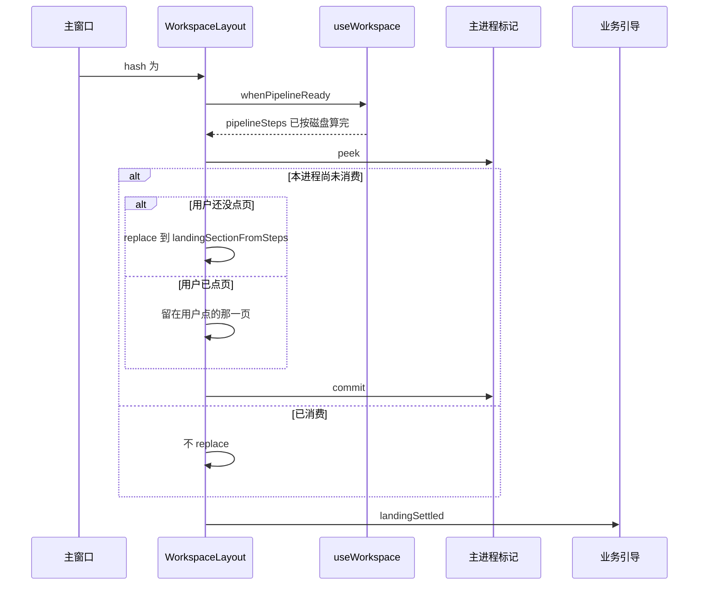

# US-DL-01 详细设计：按流水线阶段打开默认界面

> **用户故事**：[../36-需求-按流水线阶段打开默认界面.md](../36-需求-按流水线阶段打开默认界面.md) · **US-DL-01** · Related #104  
> **状态**：待开发（本文只定默认页判定、出现时机和与聚光灯的交接；不改 `desktop/` 业务实现）  
> **范围**：本次进程里主界面第一次出现时，按当前产品左侧流水线完成态打开录入、画像、探索或线索  
> **依赖**：现网 `derivePipelineSteps` / `pendingPipelineSteps`（`desktop/src/composables/pipeline-steps.ts`）；`useWorkspace().refreshProducts()`；路由 `/` 现固定重定向到 `leads`  
> **不做**：绘制业务流程聚光灯（[US-OG](US-OG-业务流程引导聚光灯蒙层.md)）；记住上次打开的页面；改手动导航目标；有更后进度时打开邮件页；关 Issue #104  
> **文档位置**：`docs/design/`

需求依据是已合入的 `docs/36-需求-按流水线阶段打开默认界面.md`（DL1～DL10、US-DL-01、§6、§7）。本文不改该需求正文。docs/36 §7 的 O1～O3 在 §2 拍板，带验收样例。实现按本文做，不再另选落地策略。

聚光灯是否出现不在本故事里。本故事只把默认页打开，并交出「落地已经结束」这一信号，供 US-OG-02 在其后叠蒙层。

---

## 0. 相对现网

对照 `dev-0.6.0`（`2cd8049`）。

| 现网 | **本期（US-DL-01）** |
|------|----------------------|
| `desktop/src/router/index.ts` 父路由 `/` 写死 `redirect: { name: 'leads' }`。主窗口 `loadFile` 加载 `index.html` 后，hash 路由立刻进入线索。流水线此时往往还没刷新完 | 去掉这条 redirect。`/` 的空路径先进入占位路由 `boot`，主区只显示「正在打开…」。当前产品的流水线完成态就绪后，再 `replace` 到 §3 算出的那一页。等待期间不挂载 `LeadsView` |
| `useWorkspace()` 第一次被调用时 `ensureWorkspaceBindings()` 异步 `refreshProducts()`。没画像时 `pipelineSteps` 先是 `pendingPipelineSteps()`（五步都是待执行）。有产品后 `derivePipelineSteps` 把「1 产品录入」标成完成（生成画像进行中除外） | 沿用这两份函数，不改完成态公式。默认页只读它们已经算好的 `status` |
| 侧栏点产品只改 `activeProductId`，不改路由。左侧流水线、模块条、顶栏用 `PIPELINE_TO_SECTION` / 固定路由名 `push` | 这些点击保持原目标。落地函数不监听产品切换，也不在点击之后再 `replace` |
| 关闭进托盘是隐藏主窗（`showMainWindow` 只 `restore` + `show`），渲染进程和 hash 都还在 | 同一次主进程里落地标记只提交一次。再次显示窗口不重新套表 |
| 没有「上次停留页面」的配置 | 仍不新增。标记只放在主进程内存，不写 `ftcs-prefs.json`，不写 `localStorage` |

现网接缝（实现时按本节）：

1. **`WorkspaceLayout` 是 `/` 的父组件。** 它一挂载就会 `useWorkspace()`，从而踢出第一次 `refreshProducts()`。占位页和业务页都在这个父级下面，所以产品列表的加载不必等用户先看到线索。
2. **`refreshProducts()` 会在没有选中项时选中列表第一项，并 `await` 画像和流水线产物。** 落地必须等这一次 Promise 结束再读 `pipelineSteps`，不能在 `pendingPipelineSteps()` 的初始值上抢跑。那份初始值只代表「还没读完」，不代表「用户没有产品」。
3. **完成态的「执行中」只看当前 Agent 任务。** 冷启动时 Agent 不在跑，磁盘结果就是完成态。判定函数仍把 `running` 当成未完成，避免热重载或任务中途重建路由时把默认页升到下一步。
4. **邮件草稿对应的流水线 id 是 `email`，页面目标在 `PIPELINE_TO_SECTION` 里也是线索。** 默认页与这个事实一致：草稿完成打开线索，不打开 `email`。

---

## 1. 目标与非目标

### 1.1 目标

1. 每个主进程只自动选一次默认页，且发生在用户手动点页之前。
2. 选择与左侧流水线完成态是同一套信号，规则是 docs/36 §3.1 的从后往前四行。
3. 等待产品列表期间，用户看不到线索表，也看不到录入页的资料树。
4. 托盘唤起、主窗还原、同进程里渲染进程再次挂载，都不再套用这张表。
5. 落地结束后发出信号。US-OG-02 只在这个信号之后才允许显示第一步聚光灯。

### 1.2 非目标

| 不做 | 说明 |
|------|------|
| 记住或恢复上次 Tab | DL8。不新增设置项 |
| 改流水线、模块条、顶栏、页内跳转、切换产品后的目标 | DL8 |
| 改 `derivePipelineSteps` 的状态公式 | 只读 `status` |
| 更后阶段改去开发信页 | DL6 锁定线索 |
| 绘制聚光灯，或因为聚光灯要从录入讲起而把默认页改成录入 | DL9 |
| 关闭 #104 | DL10 |

---

## 2. 已拍板（docs/36 §7）

| 项 | 决定 |
|----|------|
| **O1 第一次出现的时机** | 见 §4。占位路由先占住 `#/`。`whenPipelineReady()` 解析后，若用户还没点过页，才 `router.replace` 到 §3 的结果，并立刻 `commit`。每个主进程只 `commit` 一次 |
| **O2 产品列表未返回时的闪屏** | 用占位，不延后整个窗口，也不先进入线索再跳走。占位组件不引用 `LeadsView` / `InputView` |
| **O3 再次显示窗口** | 落地标记在主进程内存，键不落盘。`showMainWindow` 不重新加载页面，也不调用落地。渲染进程若在同一主进程里再次挂载，先 `peek`；已消费则停在当前 hash，不再 `replace` |
| **与 #8 的顺序** | 本故事先 `replace`（或确认用户已手动接管）并把 `landingSettled` 置真，然后才通知引导层。本故事不 `import` 聚光灯组件 |

---

## 3. 判定

新增纯函数 `landingSectionFromSteps`，放在 `desktop/src/composables/landing-section.ts`。入参是 `PipelineStep[]`，只看 `id` 与 `status === 'done'`。`running`、`pending` 以及「可执行 / 待就绪」都不算完成。

从后往前：

| 条件 | 路由名 |
|------|--------|
| `explore`、`score`、`email` 至少一项为 `done` | `leads` |
| 否则 `keywords` 为 `done` | `explore` |
| 否则 `input` 为 `done` | `profile` |
| 否则 | `input` |

```ts
export function landingSectionFromSteps(
  steps: PipelineStep[],
): 'input' | 'profile' | 'explore' | 'leads' {
  const done = (id: string) => steps.some((step) => step.id === id && step.status === 'done')
  if (done('explore') || done('score') || done('email')) return 'leads'
  if (done('keywords')) return 'explore'
  if (done('input')) return 'profile'
  return 'input'
}
```

调用点只有落地这一次：`landingSectionFromSteps(pipelineSteps.value)`。步骤数组来自刚结束的那次 `refreshProducts()` → `updatePipelineFromProfile()`。没有产品时 `currentProfile` 为空，`updatePipelineFromProfile()` 写入 `pendingPipelineSteps()`，函数得到 `input`。

有产品、且此刻不在生成画像时，现网把「1 产品录入」标成 `done`。函数因此得到 `profile`。这里不读 `profile.status === 'ready'`。

### 3.1 样例（单测就用这些断言）

| 输入（各步 `status`） | 结果 |
|----------------------|------|
| 五步都是 `pending`（无产品） | `input` |
| `input` 为 `done`，其余不是 `done`（有产品、关键词未扩展完；画像可以还不是 `ready`） | `profile` |
| `input` 为 `running`，其余不是 `done` | `input` |
| `keywords` 为 `done`，`explore` / `score` / `email` 都不是 `done` | `explore` |
| 仅 `explore` 为 `done` | `leads` |
| 仅 `score` 为 `done` | `leads` |
| 仅 `email` 为 `done` | `leads` |
| 这三步都是 `done` | `leads` |

「执行中」不把默认页升到下一步：`keywords` 为 `running` 且更后都未完成时，若 `input` 已是 `done`，结果仍是 `profile`。

---

## 4. 时机、占位、只执行一次

### 4.1 路由

`desktop/src/router/index.ts` 删除 `redirect: { name: 'leads' }`。子路由增加空路径：

| 路径 | 名称 | 组件 |
|------|------|------|
| `''` | `boot` | 新建 `desktop/src/views/BootLanding.vue` |
| 其余五页和 `settings` | 现网名称 | 现网组件，不改 |

`BootLanding.vue` 放在现有 `main-pane` 里，标题文字只有「正在打开…」。没有按钮，没有 `data-guide`，不请求线索，不渲染资料树。

冷启动 hash 是 `#/`，匹配 `boot`。用户在 `commit` 之前看不到 `#/leads`。

### 4.2 主进程标记

新建 `desktop/electron/default-landing.ts`：

```ts
let consumed = false

export function peekDefaultLanding(): boolean {
  return consumed
}

export function commitDefaultLanding(): boolean {
  consumed = true
  return true
}
```

IPC：

| 通道 | 返回 |
|------|------|
| `default-landing:peek` | `{ consumed: boolean }` |
| `default-landing:commit` | `{ consumed: true }` |

不写入 `ftcs-prefs.json`。进程退出后标记消失，下次启动重新选。`showMainWindow`（`desktop/electron/tray/app-tray.ts`）不调用这两个函数，也不 `reload`。

### 4.3 渲染进程

`useWorkspace` 把第一次 `refreshProducts()` 的 Promise 露出来：

```ts
export function whenPipelineReady(): Promise<void>
```

`ensureWorkspaceBindings()` 里已经会启动这一次刷新。`whenPipelineReady()` 返回同一个 Promise，不另起一次 `listProfiles`。

`desktop/src/composables/useDefaultLanding.ts` 由 `WorkspaceLayout` 在 `onMounted` 调用 `settle()` 一次：

1. `peek`。已消费：把模块级 `landingSettled` 置真，**不** `replace`。当前 hash 是什么就留什么。然后结束。
2. 未消费：`await whenPipelineReady()`。
3. 等待期间若发生用户导航（见 §4.4），置 `userTookOver`。此时 `commit`，`landingSettled = true`，不 `replace`。
4. 否则 `router.replace({ name: landingSectionFromSteps(pipelineSteps.value) })`，`await nextTick()`，然后 `commit`，`landingSettled = true`。
5. `landingSettled` 变为真时，模块发出一次回调（`onLandingSettled`）。US-OG-02 订阅它。本文件不引用引导组件。

`landingSettled` 是渲染进程模块级 `ref`。同一渲染进程里后来的聚焦、切页、切产品都不把它清掉，也不再调用 `settle` 的导航分支。

### 4.4 占位期间的点击

`settle()` 进行中，路由守卫只做记录：目标名是 `input`、`profile`、`explore`、`leads`、`email`、`settings` 之一，且这次导航不是落地自己发起的 `replace`，则 `userTookOver = true`。

落地自己的 `replace` 用一个模块内标志避开，避免把自己记成用户接管。

守卫在 `landingSettled` 之后卸掉，不再拦截。左侧流水线、模块条、顶栏此后仍是现网 `router.push`。

### 4.5 再次显示与渲染进程重建

| 场景 | 行为 |
|------|------|
| 关到托盘后再点托盘打开 | 主窗 `show`，hash 仍是用户离开时的页面。`peek` 已是 true。不导航 |
| 最小化后还原 | 同上 |
| 同一主进程里渲染进程重新挂载（例如开发时热重载），hash 已是 `#/explore` | `peek` 为 true，停在探索 |
| 同一主进程里重新挂载，hash 仍是 `#/`（`commit` 之前进程就重建了） | `peek` 为 false，再走一遍 §4.3。用户还没得到稳定业务页，这次仍算第一次 |
| 退出进程再启动 | 内存标记消失，按当时磁盘上的流水线重选 |

已消费却停在 `boot` 时，不猜一页、也不回到线索。正常托盘路径不会停在 `boot`，因为成功的 `replace` 已经把 hash 写成业务页。

---

## 5. 与聚光灯的交接

本故事把 `landingSettled` 置真的时刻，就是 docs/35 OG6 里「默认页已经落下」。两种置真都算落下：

- `replace` 到了 `input` / `profile` / `explore` / `leads`；
- 占位期间用户点了别的页，落地放弃 `replace`。

聚光灯的自动出现必须排在这个时刻之后。默认页是画像、探索或线索时，本故事仍打开那一页，不改成录入。随后由 US-OG-02 再 `push` 到录入并高亮第一步。两段导航的顺序在 US-OG 的验收里核对：先记下落地路由，再记下蒙层出现时的路由。

本故事不渲染遮罩。

---

## 6. 流程



---

## 7. 实现时要碰的文件

| 文件 | 改动 |
|------|------|
| `desktop/src/composables/landing-section.ts` | 新增 §3 函数 |
| `desktop/src/composables/landing-section.test.ts` | §3.1 的断言 |
| `desktop/src/composables/useDefaultLanding.ts` | `settle` / `landingSettled` / `onLandingSettled` |
| `desktop/src/composables/useWorkspace.ts` | 导出 `whenPipelineReady`，复用已启动的那次刷新 |
| `desktop/src/router/index.ts` | 去掉 `/` → `leads`；增加 `boot` |
| `desktop/src/views/BootLanding.vue` | 占位文案 |
| `desktop/src/components/layout/WorkspaceLayout.vue` | `onMounted` 调用 `settle()` |
| `desktop/electron/default-landing.ts` | 内存标记 |
| `desktop/electron/ipc` 与 `preload.ts` | 两个通道 |
| `desktop/electron/main.ts` | `ipcMain.handle` 接到上述函数 |
| `desktop/electron/tray/app-tray.ts` | 不改行为；评审时确认没有调用落地 |

不改 `pipeline-steps.ts` 的公式，不改 `Sidebar.vue` / `ActivityRail.vue` / `TitleBar.vue` 的点击目标，不改 `ftcs-prefs.json` 的字段。

---

## 8. 验收清单

- [ ] **无产品**：进入后路由是 `input`。左侧五步为待执行。过程中没有出现线索表。
- [ ] **仅产品录入完成**：已有产品，关键词扩展不是完成，探索 / 评分 / 草稿都未完成。进入后路由是 `profile`。不要求画像 `status === 'ready'`。
- [ ] **关键词扩展完成且更后都未完成**：进入后路由是 `explore`。
- [ ] **探索完成，或已有评分，或已有邮件草稿**：进入后路由是 `leads`，不是 `email`。三者同时存在仍是 `leads`。
- [ ] **执行中不升级**：`input` 为 `running` 且更后未完成时，函数结果是 `input`。`keywords` 为 `running`、`input` 已完成、更后未完成时，结果是 `profile`。
- [ ] **不闪线索**：冷启动第一帧主区是「正在打开…」或已经是 §3 的目标页。网络和磁盘再慢，也不先挂载线索页再跳走。
- [ ] **同一次运行不拉回**：落地后点录入、画像、探索、线索、邮件、设置，以及侧栏另一个产品，页面只跟那次点击走。
- [ ] **占位期间点击**：在「正在打开…」时点模块条「探索」，最终停在探索；流水线稍后算完也不再 `replace`。
- [ ] **托盘**：落地在画像后，关到托盘再打开，仍是画像。主进程未退出。
- [ ] **再次启动**：退出后把关键词扩展结果写进磁盘再启动，默认页改为探索。不沿用上次停留的邮件页或设置页。
- [ ] **没有恢复项**：设置里不出现「恢复上次打开的页面」。`ftcs-prefs.json` 不新增路由字段。
- [ ] **先于蒙层**：`landingSettled` 变为真之前，业务聚光灯的 `visible` 为假。本故事的界面上没有挖空。
- [ ] 变更落在 `dev-0.6.0` 系分支。不关 #104。

---

## 9. 修订记录

| 日期 | 说明 |
|------|------|
| 2026-10-29 | 初稿。拍板 docs/36 O1～O3：占位路由等流水线就绪后再 `replace`；标记放主进程内存；托盘与同进程重建不重选。判定函数 `landingSectionFromSteps`。为 US-OG-02 提供 `landingSettled`。 |
