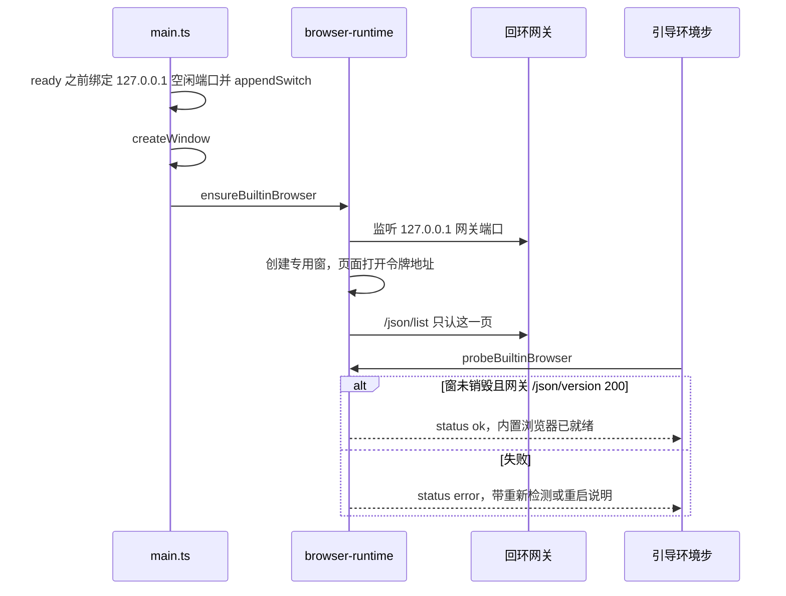

# US-EC-01 探测与引导去掉系统 Chrome 依赖

> **用户故事**：[../34-需求-Electron自带Chromium替代系统Chrome.md](../34-需求-Electron自带Chromium替代系统Chrome.md) · US-EC-01 · Related #78  
> **状态**：**待评审**（浏览窗三态按 docs/34 **EC9** 改口。2026-10-24 控件定稿：缩略蒙层与放大标题栏只留收起和放大／还原，无「关闭」。探测、网关与 O2～O3 已锁部分不在本次改口内。跟进实现另开 PR；本文件不改 `desktop/`、不改 `docs/34`、不关 #78）  
> **范围**：环境探测与首次引导 / 设置里的同一引导，改为「内置浏览器就绪」；并落地专用浏览窗与回环调试地址，供探测和 [US-EC-02](US-EC-02-画像与探索浏览器改走内置Chromium.md) 使用  
> **依赖**：现网 `probeChrome` / `probeEnvironment`；`OnboardingOverlay.vue` 环境步；设置页「打开环境与配置引导」  
> **不做**：本故事不验收画像抓站和 R1 / R2 / R3 已经能打开网页（那是 US-EC-02）；不安装系统 Chrome；不关 #78  
> **文档位置**：`docs/design/`

需求依据只有已合入的 `docs/34-需求-Electron自带Chromium替代系统Chrome.md`（EC1～EC9、US-EC-01 验收、§6、§7）。本文不改该需求正文。EC9 锁定的可见结果不改写。docs/34 仍把蒙层上的关闭、拖动和标题栏上的关闭留给详设；2026-10-24 项目组已定稿，本文按定稿写，不等需求侧再改 docs/34。定稿是：缩略蒙层与放大标题栏只留「收起」和「放大／还原」（缩略可保留拖动区），去掉一切「关闭」按钮和文案。收起仍是隐藏浮动窗、保留标题栏入口、不断开 CDP、不销毁 page view。非退出 `close` 仍进 `hidden`，界面不提供关闭入口。蒙层控件、放大标题栏按钮、mode 枚举在 §2 写死。O1 的进程选型与 O2、O3 仍按本文已锁决定，不回退，也没有新的未决产品项。

探测必须看内置浏览器是否真的活着。只改引导文案、回调仍去找 `chrome.exe`，不算完成。只删下载按钮、失败仍被标成 `ok`，也不算完成。

自动化改接这个浏览窗、预检和技能文案归 [US-EC-02](US-EC-02-画像与探索浏览器改走内置Chromium.md)。两条可以分头验收。本故事把窗口和调试地址做出来，并导出 US-EC-02 要调用的函数。

---

## 0. 相对现网

对照 `dev-0.5.9`（`3b49463`，2026-10-21 读码）。

| 现网 | **本期（US-EC-01）** |
|------|----------------------|
| `probeChrome()`（`desktop/electron/onboarding/env-probe.ts`）依次查 Windows 的 `Program Files`、`Program Files (x86)`、`%LOCALAPPDATA%\Google\Chrome\Application\chrome.exe`、注册表 `HKLM\...\App Paths\chrome.exe`、PATH 上的 `chrome`。命中则 `id: 'chrome'`、`label: 'Google Chrome'`、`status: 'ok'`，`detail` 是 exe 路径。未命中则 `missing`，`detail` 为「未检测到 Google Chrome。画像抓站与探索打开网页需要本机 Chrome。」，`installUrl` 为 `https://www.google.com/chrome/`。该项不是 `optional` | 删除这条查找。新函数 `probeBuiltinBrowser()`：`id: 'builtin-browser'`，`label: '内置浏览器'`。就绪与否只看 §4.2 的两条。不读 `chrome.exe`、注册表、PATH。不设置 `installUrl`。失败是 `error`，主说明要求重新检测或重启应用 |
| `CHROME_INSTALL_URL` 常量；`OnboardingOverlay.vue` 在 `item.id === 'chrome'` 时把外链按钮写成「打开 Chrome 下载」 | 去掉该常量和这个分支。没有 `installUrl` 时，现网 `v-if="item.installUrl"` 本来就不会画出下载按钮。类型里的 id 从 `'chrome'` 改成 `'builtin-browser'`，避免旧分支还能配上 |
| `probeEnvironment()` 用 `Promise.all` 跑 Node、OpenCode、Chrome、OfficeCLI。`ok` 为所有非 `optional` 项都是 `ok` | 第三项改为 `probeBuiltinBrowser()`。`ok` 的算法不变：内置浏览器不是 `optional`，失败则整次 `ok === false`。Node、OpenCode、OfficeCLI 的函数体不改 |
| 引导环境步可以「继续（仍有缺失）」离开；变绿看 `probe.ok`。设置页没有第二套依赖清单，`打开环境与配置引导` 调用 `reopenOnboarding('env')`，回到同一 `OnboardingOverlay` | 仍是同一步、同一 `probeEnvironment()`。设置页不新做一套浏览器清单 |
| `statusLabel`：`ok` → 就绪，`outdated` → 过旧，`error` → 异常，其余 → 缺失 | 内置浏览器失败必须走 `error`，徽章是「异常」。禁止用 `missing`，否则徽章会变成「缺失」，读起来像还要去安装 |
| 业务引导 `TOUR_STEPS` 探索详情：「在「探索」页开始找客户。需要可用的搜索和 Chrome。」（`desktop/src/types/onboarding.ts`） | 改为「在「探索」页开始找客户。需要可用的搜索。打开网页使用内置浏览器。」 |
| 主进程没有专用浏览窗。`extraResources` 只有工作区模板和图标。自动化不附着主窗。仓库无 Playwright | 新增 `desktop/electron/browser-runtime/`。一个 `BrowserWindow`，`parent` 挂主窗，三态为 `hidden` / `thumbnail` / `expanded`，回环 CDP 网关。冷启动不展示浮动窗。不往 `extraResources` 加浏览器可执行文件，不引入 Playwright |
| `desktop/src/config/links.ts` 的 `PRODUCT_LINKS.chrome` 指向 `https://www.google.com/chrome/`。引导按钮实际走的是探测结果里的 `installUrl`，这个常量目前没有第二处调用 | 删除 `PRODUCT_LINKS.chrome`。不保留一条还能接回下载页的产品链接 |
| `desktop/README.md`、官网安装页 / FAQ / 快速开始 / 下载页仍写必须安装 Google Chrome，且写明 Electron 内置不能替代 | 这些句子改成内置浏览器随应用提供。口径与 EC1 一致。docs/34 §4 没有把它们列进验收草案；本文既然改到这些句子，就按 EC1 改完 |

现网接缝（实现时按本节）：

1. **探测会创建窗和网关，但不展示浮动窗。** 现网 `probeChrome()` 只做文件和注册表检查，不启动进程。本期 `probeBuiltinBrowser()` 调用 `ensureBuiltinBrowser()`。引导里的「重新检测」因此可以再试一次创建窗口和网关。这是有意的副作用。创建成功后 mode 为 `hidden`，不调用 `showInactive()`。Node / OpenCode / OfficeCLI 仍是只读探测，不在这次检测里下载或安装。
2. **调试开关来不及在 `app.whenReady` 之后再开。** Electron 34 的 `remote-debugging-port`、`remote-debugging-address`、`remote-allow-origins` 必须在 `app.whenReady()` 之前 `appendSwitch`。写在 `desktop/electron/main.ts` 顶层，由 `browser-runtime/cdp-gateway.ts` 导出函数。写在 `whenReady` 回调里等于没开。
3. **给 MCP 的地址和 Electron 自己的调试端口不是同一个。** Electron 的 `--remote-debugging-port` 会列出进程里全部 webContents，包括主界面。US-EC-02 的 `chrome-devtools` 只准连接网关地址。探测的 HTTP 检查也打网关，不打内部端口。
4. **主界面那扇窗的 webContents 不是浏览页。** 浏览页是专用窗里的 `WebContentsView`。网关的 `/json/list` 只返回这一页。
5. **设置和首次引导共用 `useOnboarding().runProbe` → `probeEnvironment`。** 不要在 `SettingsView.vue` 再写一套 Chrome 文案。
6. **时间线和引导主说明会给用户看。** 探测 `detail`、引导按钮、业务引导详情、标题栏入口、官网这几处，不写 MCP、`scored`、`chrome-devtools`、Google Chrome 下载链。诊断信息（`diagnostic`，现网 `DiagnosticDetails`）可以写端口、HTTP 状态和异常原文，供排障。

---

## 1. 与 US-EC-02 的分工

| 内容 | 归谁 |
|------|------|
| 专用窗、三态（`hidden` / `thumbnail` / `expanded`）、跟主窗显隐、回环网关、`getBrowserUrl()`、探测与引导文案、标题栏入口、安装说明里的 Chrome 句子 | **本故事** |
| `opencode.json` 去掉 `--isolated`、运行时把启动参数改成 `--browserUrl`、`runAgentPreflight`、技能和 `agent-runner` 提示、未装系统 Chrome 时画像与 R1 / R2 / R3 仍能开网页 | **US-EC-02** |

本故事不要求 `chrome-devtools` 已经连上，也不要求画像或探索已经打开过网页。窗口和网关按 §4 导出，US-EC-02 只调用，不另做一扇窗。

---

## 2. 已确认选型

EC1～EC9 与 O1～O3 按需求锁定，实现按下表，不再选择策略。O1～O3 与 US-EC-02 是同一组决定。EC9 只改窗口三态和操作界面，不改探测口径、网关和 O2～O3。

| 项 | 决定 |
|----|------|
| **EC1** | 未安装系统 Google Chrome，不得再让本故事的探测失败。不查 `chrome.exe`、注册表 App Paths、PATH 上的 `chrome` |
| **EC2** | 浏览器是 Electron 自带 Chromium 上的专用窗。用户不必另装系统 Chrome |
| **EC3** | 标签、说明、就绪判定是内置浏览器。失败有明确错误，并写明可以「重新检测」或重启应用。失败不得是 `ok` |
| **EC5** | 不做一键安装系统 Chrome。不新增下载、静默安装或引导安装 |
| **EC6** | 不读写、不迁移系统 Chrome 的扩展、多 Profile、书签。不改系统默认浏览器。登录、充值、帮助外链仍走现网 `shell.openExternal` / `openProductLink` |
| **EC7** | 不改 Node、OpenCode、OfficeCLI 的探测、一键安装、`userData` 私有目录和 prefs |
| **EC8** | 实现落在 `dev-0.5.9` 系分支。平台验收以 Windows 为准。不关 Issue #78 |
| **O1 形态** | 专用 `BrowserWindow`。不附着主界面业务窗的 webContents，不嵌进 Vue DOM，不做主界面内嵌 WebView 侧栏。`parent` 挂主窗。开 remote debugging / CDP。仓库不引入 Playwright |
| **O1 窗口** | 三态同一扇 `BrowserWindow`，枚举 `hidden \| thumbnail \| expanded`。**收起 / `hidden`**：不展示浮动窗，只留主窗标题栏、主题（日间/黑夜）切换旁的「打开浏览窗」。不断开 CDP，不销毁 page view。**缩略 `thumbnail`**：约 360×240，主内容区右上，业务要用浏览器或用户点「打开浏览窗」时以 `showInactive` 弹出。**放大 `expanded`**：工作区各边内收 48、居中，只有用户点「放大」。禁止默认落在右下角，不压执行记录。主窗最小化、隐藏、恢复时，仅浮动窗当时可见才同步显隐；`hidden` 不因主窗恢复而弹出。真正销毁只在主窗销毁或应用退出。用户隐藏浮动窗的入口只有「收起」，没有「关闭」 |
| **O1 操作界面** | 不新建 Vue 组件。缩略用盖在页面之上的 PiP 蒙层（`overlay.html`）：收起、放大、拖动（拖动是手势区，不是按钮文案）。放大不用蒙层，按钮在窗标题条 `caption.html`：还原、收起。两处都不提供「关闭」。视觉见 §2.1.1。界面稿 `docs/design/US-EC-内置浏览器.pen` 里「状态卡片 · 360×40」帧作废，以本节和 EC9 为准；本详设不改 `.pen` |
| **O2** | 模块目录写死为 `desktop/electron/browser-runtime/`。本故事负责把网关 URL 从 `getBrowserUrl()` 交出去。MCP 名仍是 `chrome-devtools`，启动参数改接由 US-EC-02 完成。探测本身不调用 MCP |
| **O3** | 不把独立 Chromium 打进 `extraResources`。复用 Electron 自带 Chromium（现网 `desktop/package.json` 的 `electron` ^34）。更新跟着现有应用更新通道，不新开浏览器更新清单，不改 `latest.json` 的结构。本故事不单独升级 Electron |
| **探测 id** | `builtin-browser`。废弃 `chrome` |
| **版本** | 不关 #78。本文 PR 只加详设 |

### 2.1 三态（同一扇窗）

EC9 的可见结果不变。本节把 EC9 留给详设的部分写死。`BuiltinBrowserMode` 改为 `'hidden' | 'thumbnail' | 'expanded'`。删除 `'card'`。不保留 `card` 这个内部名字。删除 `CARD`（宽 360、高 40）和状态卡布局。

| 态 | 何时 | 用户看见的 | 页面与 CDP |
|----|------|------------|------------|
| **收起** `hidden` | 冷启动和 `ensureBuiltinBrowser()` 成功后的第一态。用户点「收起」，或非退出路径上的 `close` | **没有浮动窗**。主窗标题栏、主题（日间/黑夜）切换旁为「打开浏览窗」。不是仍浮在桌面上的条 | `BrowserWindow` 与 page view 保持创建。`hide()`，不 `destroy`、不导航到空白、不拆调试会话、不停网关。设备度量保持缩略视口 360×240，`setBackgroundThrottling(false)`，避免收起后快照变成一条缝或空白。不在这一态里展示页面 |
| **缩略** `thumbnail` | 标题栏「打开浏览窗」，或 mode 为 `hidden` 时发生业务导航（离开令牌页的 http(s)） | 约 360×240 的浮动窗。`showInactive()`，不抢焦点。锚点见下文 | 页面 view 铺满 360×240。其上盖透明 PiP 蒙层。连接保持。度量 360×240 |
| **放大** `expanded` | 只有用户在缩略蒙层上点「放大」 | 当前显示器工作区各边内收 48，居中。不是 `setFullScreen(true)`，也不走系统最大化。无蒙层 | 可见。标题条高 40，页面视口为外框减去这 40。连接保持。度量改成这一视口 |

`thumbnail` 与 `expanded` 都 `resizable: false`。拖的是位置，不拖出第三种尺寸。`hidden` 不设一套可见尺寸。从放大回到缩略只用标题条上的「还原」。不把双击标题条、右键标题菜单当作切态入口。

已经是 `thumbnail` 或 `expanded` 时，后续导航不改 mode，也不自动放大。只有 `hidden` 遇到业务导航才切到缩略。令牌地址 `http://127.0.0.1:<网关端口>/__ftcs_builtin_page__` 以及 `about:` 不是业务导航，不得因此弹出。

**收起是唯一的隐藏入口。** 蒙层上的「收起」和放大标题条上的「收起」都调用 `setBuiltinBrowserMode('hidden')`：隐藏浮动窗，保留标题栏入口，不断开 CDP，不销毁 page view。缩略蒙层和放大标题条都不提供「关闭」按钮，也不出现「关闭」文案。非退出路径上的浏览窗 `close` 事件（例如 Alt+F4）仍 `preventDefault`，并走同一条 `hidden`，但不因此在界面上放「关闭」。真正销毁只走现有退出路径：主窗 `closed` 或应用退出时的 `noteBuiltinBrowserQuitting`（`follow-main-window.ts` 的 `onMainClosed`，以及 quitting）。那两条允许 `destroy` 并停网关。不要再做一种会结束浏览会话的模式。

**缩略蒙层**（`overlay.html`，无 Vue）盖在页面 view 之上。Electron 里子 `WebContentsView` 在窗体文档上面，蒙层必须是后加入的顶层 view，不能只画在被页面挡住的 `caption.html` 里，也不能把按钮注入页面 DOM（快照会把按钮读进画像）。

- 悬停，或在窗内主键轻点（`pointerdown` / `click`，不是右键）后出现控件。
- 指针离开蒙层 400ms 后收起控件；400ms 内移回则保持。收起的是控件，不是这扇窗。
- 控件：收起（→ `hidden`）、放大（→ `expanded`）。不提供「关闭」。视觉、热区和「点击必须进主进程」见 §2.1.1。
- 拖动：按钮以外的区域是拖动手势区（`-webkit-app-region: drag`），不是一枚写着「拖动」的按钮，也不出现「拖动」文案。按钮 `-webkit-app-region: no-drag`。拖的是窗位置，尺寸仍是 360×240。松手后若偏离锚点，记 `detached = true`（现有 `moved` 判断可沿用）。
- 接受缩略态页面难以滚动、难以点击。滚动交给自动化。

**放大标题条**（`caption.html`，高 40，无 Vue）只在 `expanded` 出现。这一态不盖蒙层。按钮：还原（→ `thumbnail` 并按锚点显示）、收起（→ `hidden`）。不提供「关闭」按钮，也不出现「关闭」文案。还原和收起的点击必须调用 `builtin-browser:set-mode`，由主进程切态，不得只改标题条 UI。页面区不被蒙层挡住。放大态不把拖动列为操作；位置用下面的 `anchorExpanded`。进入放大时清掉 `detached` 并居中。

缩略锚点沿用现网 `desktop/electron/browser-runtime/anchor.ts`。跟进实现删除该文件中的 `CARD`，不要改 `anchorTopRight` / `anchorExpanded` 的公式。

```ts
const THUMB = { width: 360, height: 240 }
const MARGIN = 12
const EXPANDED_INSET = 48
const TITLE_BAR_HEIGHT = 44
const CAPTION_HEIGHT = 40
const TIP_RIGHT = 16
const TIP_MAX_WIDTH = 360

function anchorTopRight(main, size, workArea) {
  const reserved = TIP_RIGHT + Math.min(TIP_MAX_WIDTH, Math.max(0, main.width - TIP_RIGHT * 2)) + MARGIN
  let x = main.x + main.width - reserved - size.width
  let y = main.y + TITLE_BAR_HEIGHT + MARGIN
  x = Math.max(workArea.x, Math.min(x, workArea.x + workArea.width - size.width))
  y = Math.max(workArea.y, Math.min(y, workArea.y + workArea.height - size.height))
  return { x, y, width: size.width, height: size.height }
}
```

上缘在主窗标题栏下 12（`y = main.y + 44 + 12`）。右缘停在右上角提示条左侧（提示条 right 16、宽 `min(360, 主窗宽 - 32)`，再留 12）。主窗 1280×800 放在工作区原点时，缩略框为 `{ x: 532, y: 56, width: 360, height: 240 }`。禁止把默认 `y` 写成 `main.y + main.height - size.height`（那是右下角，会压执行记录）。主窗贴着屏幕右缘时，夹紧到工作区内，只为了整扇窗还看得见；夹紧之后仍然从右上角往左让，不改到主窗下沿。

`anchorExpanded`：工作区各边内收 48，宽高分别不小于缩略的 360 和 240，再在工作区内居中。

用户拖动缩略过后 `detached = true`，主窗再移动或改变大小时不再抢回右上角。进入 `hidden` 不清 `detached`：再次打开缩略时，已拖过则用上次位置，否则 `anchorTopRight`。进入放大清掉 `detached` 并居中；从放大点「还原」时按 `anchorTopRight` 重新锚住。显隐跟主窗的规则见 §2.2，跟 `detached` 无关。

界面稿 `docs/design/US-EC-内置浏览器.pen` 中「状态卡片 · 360×40」帧作废。验收和实现以本节与 docs/34 EC9 为准。本详设不改该 `.pen` 文件。

### 2.1.1 缩略蒙层视觉规范

给开发跟稿。蒙层是盖在缩略页上的操作条，不是第二张卡片。样式按本节；点击必须进主进程，不得只改蒙层自己的外观。放大态不用这层蒙层，见上文标题条。

| 项 | 定稿 |
|----|------|
| 形态 | 半透明简洁条，或一行图标。底为黑色，不透明度约 40%–50%（例如 `rgba(0, 0, 0, 0.45)`），图标为白或浅色。不要重卡片（厚阴影、大圆角实心底），不要大色块上下堆叠 |
| 出现 | 悬停，或在窗内主键轻点（`pointerdown` / `click`，不是右键）后出现 |
| 离开 | 指针离开蒙层 400ms 后收起蒙层控件；400ms 内移回则保持。收起的是控件，不是这扇浏览窗 |
| 控件 | 只有收起、放大。图标优先，文案可以只做 tooltip。不出现「关闭」。拖动是手势区，不是按钮，不写「拖动」文案 |
| 热区 | 每个可点控件的点击区域至少 32×32 逻辑像素 |
| 点击 | 必须调用 IPC `builtin-browser:set-mode`，由主进程切态。不得只改蒙层 UI。收起 → `'hidden'`；放大 → `'expanded'` |

收起进入 `hidden` 的结果与 §2.1 相同：隐藏浮动窗，标题栏为「打开浏览窗」，不断开 CDP，不销毁 page view。放大进入 `expanded` 后撤掉蒙层，操作改到标题条上的还原和收起。

### 2.2 不抢焦点、跟主窗、标题栏入口

- 创建参数：`show: false`、`parent: mainWindow`、`modal: false`、`skipTaskbar: true`、`frame: false`、`focusable: true`（用户要点蒙层或放大标题条上的按钮）、`backgroundColor` 用实色，避免显隐时闪白。
- `ensureBuiltinBrowser()` 创建窗和网关之后停在 `hidden`，调用 `hide()`。这条路径不调用 `showInactive()`、`focus()`、`show()`。
- 进入 `thumbnail` 或 `expanded` 且主窗可见、未最小化时，才 `showInactive()`。程序路径上不调用 `focus()`、`show()`。
- 用户自己点到这扇窗时，系统可以把它变成焦点。那是用户动作。
- 跟主窗仍用 `follow-main-window.ts` 里的 `visibleBefore`。冷启动是 `hidden`，这个初始值改为 `false`（现网初始为 `true` 会在主窗一恢复时把窗弹出）。进入 `hidden` 时把它置回 `false` 再 `hide()`。
- 主窗 `minimize` 或 `hide`（关闭进托盘）：若浮动窗当前可见，`visibleBefore = true`，再 `hide()`。当时已经不可见时，不要把它改成 `true`。
- 主窗 `restore` 或 `show`：主窗未最小化且可见，mode 是 `thumbnail` 或 `expanded`，且 `visibleBefore` 为真，才 `showInactive()`。mode 为 `hidden` 时不弹出。业务导航把 `hidden` 改成 `thumbnail` 时若主窗当时不能显示，把 `visibleBefore` 置为 `true`，等这次恢复再显示。
- 主窗 `move` / `resize`：未 `detached` 且 mode 为 `thumbnail` 时，重新 `anchorTopRight`。放大态不跟。`hidden` 不因此 `show`；未 `detached` 时可以更新下次缩略要用的锚点。
- 主窗 `closed` 或应用退出：走现有 `noteBuiltinBrowserQuitting`，允许浏览窗真正 `destroy`，停网关。`parent` 会随主窗销毁而关子窗；退出路径上仍显式销毁并停网关，避免托盘隐藏和真正退出搞混。
- 非退出时用户触发浏览窗 `close`（例如 Alt+F4）：`preventDefault`，切到 `hidden`，不销毁 webContents，不停网关。与点「收起」相同。界面上没有「关闭」按钮。
- 标题栏入口写死在 `desktop/src/components/layout/TitleBar.vue`，放在主题（日间/黑夜）切换按钮左侧（现网 `RuntimePopover` 在主题按钮右侧）。引导层和探索页都不是常驻入口。不新建状态卡 Vue 组件，也不按已删除的 `card` 换一套图标。

| 浏览窗 | 按钮文字 | 点击 |
|--------|----------|------|
| `hidden`，或浮动窗不可见 | 打开浏览窗 | 切到缩略并 `showInactive()` |
| `thumbnail` 或 `expanded`，且可见 | 浏览中 | `moveTop()` 后 `showInactive()`，不改尺寸 |

按钮不写 MCP、不写 Google Chrome。`hidden` 的文案是「打开浏览窗」，不是「浏览中」。

---

## 3. 流程

### 3.1 启动与探测



顺序固定：

1. `main.ts` 在 `app.whenReady()` 之前：`reserveLoopbackPort()` 得到内部端口，然后 `installRemoteDebuggingSwitch(port)`。三个开关：`remote-debugging-port`、`remote-debugging-address=127.0.0.1`、`remote-allow-origins=http://127.0.0.1:<内部端口>`。端口只绑 `127.0.0.1`。
2. `await createWindow()` 之后、`bootstrapOpenCode()` 之前：`await ensureBuiltinBrowser()`。探测若发生在这一步之前（渲染进程已经能调 IPC），`probeBuiltinBrowser()` 自己会再调 `ensureBuiltinBrowser()`。
3. 网关先听 `127.0.0.1:0`，记下实际端口。这就是 `getBrowserUrl()`，形如 `http://127.0.0.1:43123`，无末尾斜杠。主机写 `127.0.0.1`，不写 `localhost`。
4. 创建专用窗。页面 `WebContentsView` 的 partition 为内存分区 `ftcs-builtin-browser`（不要 `persist:` 前缀，退出即丢）。不要指向系统 Chrome 的 User Data。
5. 页面首先打开 `http://127.0.0.1:<网关端口>/__ftcs_builtin_page__`。网关返回一份空 HTML。在内部调试端口的目标列表里用这个 URL 认走目标 id，然后 `/json/list` 只留它。3 秒内认不到，本次不就绪。
6. 窗和网关创建成功后 mode 为 `hidden`，调用 `hide()`，不调用 `showInactive()`。冷启动、首次进入不展示浮动窗。标题栏文案为「打开浏览窗」。页面先打开令牌地址；这次导航不是业务开页，不得因此弹出缩略。
7. 下面两件事才进入缩略并 `showInactive()`：用户点标题栏「打开浏览窗」；或 mode 为 `hidden` 时页面离开令牌地址、导航到业务 http(s)。主窗当时不可见或已最小化时，只把 mode 改为 `thumbnail` 并把 `visibleBefore` 置为 `true`，不立刻 `showInactive()`，等 §2.2 的恢复再显示。不自动进入放大。

内部端口在 `ready` 之后不能改。内部 `/json/version` 起不来时，重新检测再试一次（间隔 200ms）。仍失败则 `detail` 要求重启应用。窗口创建失败或网关没听上，重新检测再走一遍 `ensureBuiltinBrowser()`。

### 3.2 跟窗

实现放在 `follow-main-window.ts`，监听 §2.2 的主窗事件。托盘「显示主窗口」走现网 `showMainWindow`（`restore` + `show` + `focus` 主窗）。浏览窗只在对应的 `show` / `restore` 里 `showInactive()`，不把焦点从主窗再抢走。

### 3.3 探测项

`EnvProbeItem.id` 的联合类型在这三处一起改：`desktop/electron/onboarding/env-probe.ts`、`desktop/electron/ipc/types.ts`、`desktop/src/types/onboarding.ts`。删掉 `'chrome'`，加上 `'builtin-browser'`。

| 字段 | 就绪 | 窗不在 | 窗在但网关不通 |
|------|------|--------|----------------|
| `id` | `builtin-browser` | 同左 | 同左 |
| `label` | 内置浏览器 | 同左 | 同左 |
| `status` | `ok` | `error` | `error` |
| `detail` | 内置浏览器已就绪 | 内置浏览器没有打开。请点「重新检测」。 | 内置浏览器暂时连不上。请点「重新检测」。若仍失败，请重启应用。 |
| `installUrl` | 不设置 | 不设置 | 不设置 |
| `optional` | 不设置 | 不设置 | 不设置 |
| `diagnostic` | 可空 | 异常原文 | 网关 URL、HTTP 状态或超时毫秒、异常原文 |

判定函数写死在 `readiness.ts`，探测只把事实喂给它：

```ts
export function judgeBuiltinBrowserReady(input: {
  windowAlive: boolean
  versionHttpStatus: number | null
  webSocketDebuggerUrl: string | null
}): { status: 'ok' | 'error'; detail: string }
```

两条同时成立才是 `ok`：

1. `windowAlive === true`（专用 `BrowserWindow` 已创建且 `isDestroyed() === false`）。看不见也算活着，例如 mode 为 `hidden`，或主窗最小化时被同步隐藏。
2. 对 `getBrowserUrl() + '/json/version'` 的 GET，在 1500ms 内 HTTP 200，且 JSON 里的 `webSocketDebuggerUrl` 是非空字符串。

缺一条就是 `error`。窗还在但端口不通，不得因为「窗存活」而标 `ok`。端口通但窗已销毁，也不得标 `ok`。可见性、三态、系统里有没有 `chrome.exe`，都不参与。

`probeEnvironment().ok` 仍是「每个非 optional 项的 `status === 'ok'`」。本项失败则用户可以点现网已有的「继续（仍有缺失）」，也可以点「重新检测」。不得把按钮改成下载。

### 3.4 失败与重试

| 现象 | 用户看见的 | 再试 |
|------|------------|------|
| 主窗还没有 | `detail` 用「内置浏览器没有打开。请点「重新检测」。」 | 主窗出现后重新检测会创建 |
| 创建窗口抛错 | 同上，徽章「异常」 | 「重新检测」再调用 `ensureBuiltinBrowser()` |
| 网关或内部调试端口不通 | 「内置浏览器暂时连不上。请点「重新检测」。若仍失败，请重启应用。」 | 先再试一次；内部开关已错过 `ready` 的，只能重启应用 |
| 两条都成立 | 「内置浏览器已就绪」，徽章「就绪」 | 不出现下载按钮 |

「重新检测」就是环境步已有的 `runProbe` → `probeEnvironment`。不新增第二个按钮，不打开外部链接。

失败时 `probe.ok` 为 false。环境步主按钮保持现网「继续（仍有缺失）」。不得在失败时把 `status` 写成 `ok` 来放行。

### 3.5 引导和设置上的句子

| 位置 | 现网 | 改成 |
|------|------|------|
| 环境步浏览器行标题 | Google Chrome | 内置浏览器（来自 `label`） |
| 行说明 | 未检测到 Google Chrome。画像抓站与探索打开网页需要本机 Chrome。或 exe 路径 | §3.3 的 `detail` |
| 行按钮 | 打开 Chrome 下载 | 不渲染该按钮 |
| 徽章 | 缺失 | 异常（`error`）或 就绪 |
| `TOUR_STEPS` 探索 `detail` | 在「探索」页开始找客户。需要可用的搜索和 Chrome。 | 在「探索」页开始找客户。需要可用的搜索。打开网页使用内置浏览器。 |
| 步骤 1 副标题 | 安装以下组件后即可使用。 | 保持。Node 与智能体服务仍要安装。浏览器这一行自己说明是内置的 |
| 设置「打开环境与配置引导」 | 打开同一引导 | 不改按钮文字，不另做清单 |

[US-COPY-03](US-COPY-03-首次设置引导文案.md) 写过「Chrome 行保持 Google Chrome。安装逻辑不改。」以及探索详情里的「需要可用的搜索和 Chrome」。那两句被本故事替代。本文不修改 US-COPY-03 文件。

### 3.6 安装说明句子

用户会看到的安装前提改成下面的字。不要留「Electron 内置浏览器不能替代」。

| 文件 | 现网要点 | 改成 |
|------|----------|------|
| `desktop/README.md` 前置条件第 2 条 | Google Chrome（Electron 内置浏览器不能替代） | **内置浏览器**（随应用自带，用于画像抓站与探索打开网页。不需要另装 Google Chrome） |
| 同文件「安装包使用方前置」第 1 条 | Node.js 22+、Google Chrome 已安装 | **Node.js 22+** 已安装。打开网页使用应用内置浏览器 |
| `website/content/docs/install.md` 依赖表 Chrome 行，以及「并从开始菜单能正常打开 Google Chrome」 | 必须安装并可启动；内置不能替代 | 删掉表里的 Google Chrome 行。检查命令那段只保留 `node -v`。另起一节「内置浏览器」：画像抓站和探索打开网页使用应用自带的浏览器，不必另装 Google Chrome。删掉整节「Google Chrome」和 `https://www.google.com/chrome/` |
| `website/content/docs/getting-started.md` 第 2 步 | 并安装 Google Chrome | 按首次引导一键安装 Node.js 与智能体服务。打开网页使用内置浏览器，见安装与前置 |
| `website/content/docs/faq.md` 标题「画像 / 探索时报浏览器或 chrome-devtools 相关错误」及下面三条 | 确认已安装 Google Chrome；内置不能代替；更新 Chrome | 标题改为「画像 / 探索时内置浏览器报错」。三条改为：在环境检测里看「内置浏览器」是否就绪，未就绪则点「重新检测」；仍失败则重启应用；人机验证或登录墙仍停下，不要绕过。社媒发现不打开社媒真页这句保留 |
| `website/src/views/DownloadView.vue` | 使用前请在本机准备 Node.js 22+、Google Chrome 与 OpenCode CLI | 使用前请在本机准备 Node.js 22+ 与 OpenCode CLI。打开网页使用应用内置浏览器，不必另装 Google Chrome |
| `website/src/content/docs-index.ts` 安装页 `seoTitle` / `description` | Node、Chrome 与 OpenCode；列举 Google Chrome | `seoTitle` 改为「外贸获客系统安装 \| Node 与 OpenCode」。`description` 去掉 Google Chrome，改为写内置浏览器随应用提供 |

`docs/09-Node.js一键安装方案.md` 里「不安装 Google Chrome」与 EC1 一致，不改。

---

## 4. 模块与接口

### 4.1 目录

写死为 `desktop/electron/browser-runtime/`。

| 文件 | 职责 |
|------|------|
| `index.ts` | 对外：`ensureBuiltinBrowser`、`getBuiltinBrowserStatus`、`getBrowserUrl`、`setBuiltinBrowserMode`、`showBuiltinBrowserInactive` |
| `cdp-gateway.ts` | `reserveLoopbackPort`、`installRemoteDebuggingSwitch`、网关 HTTP/WebSocket |
| `anchor.ts` | 现网缩略锚点与放大内收。删除 `CARD`。公式见 §2.1，跟进不要改 `anchorTopRight` / `anchorExpanded` |
| `builtin-browser-window.ts` | 创建窗、三态、缩略蒙层、放大标题条、页面 view。`ensure` 之后保持 `hidden` |
| `follow-main-window.ts` | §2.2 的显隐和锚点。退出 / 主窗销毁仍走现有 quitting |
| `readiness.ts` | `judgeBuiltinBrowserReady` |
| `types.ts` | 状态和三态枚举。`hidden \| thumbnail \| expanded` |
| `caption.html` | 只做放大态标题条。无 Vue。不把它缩成一条当收起态 |
| `overlay.html` | 缩略态 PiP 蒙层。无 Vue。盖在页面 view 之上 |
| `caption-preload.ts` | 标题条和蒙层只暴露切态。页面 view 不装这段 preload |

页面 view：`nodeIntegration: false`、`contextIsolation: true`、`sandbox: true`、`webviewTag: false`。`setWindowOpenHandler` 拒绝新窗，把 http(s) 地址交给同一页面 `loadURL`。缩略蒙层 view 与页面 view 一样，在 `allowCreatedWebContentsDuring` 里创建，列入允许名单。`app.on('web-contents-created')` 里，既不是主窗、也不是放大标题条、也不是缩略蒙层、也不是浏览页的 webContents，直接关掉。这是网关漏拦时的第二道。

放大标题条和缩略蒙层通过 preload 调主进程切态。页面里不注入这些 DOM，避免快照把按钮读进画像。

### 4.2 网关

网关是过滤代理，不是另一份浏览器。

- 上游是本进程内部调试端口（只给网关用，不写进配置文件，不出现在引导 `detail` 里）。
- `GET /json/version`：转发上游字段，把 `webSocketDebuggerUrl` 改写成 `ws://127.0.0.1:<网关端口>/devtools/browser/<id>`。
- `GET /json/list` 与 `GET /json`：数组里只有浏览页那一个目标。主窗、标题条、其它目标都不在里面。
- 浏览器级 WebSocket 原样转发，但改写这几类消息：
  - `Target.getTargets`、`Target.targetCreated`、`Target.targetInfoChanged`、`Target.targetDestroyed`：丢掉浏览页以外的页面目标。
  - `Target.createTarget`：不转发成新窗。对已记住的 targetId 发 `Page.navigate`（参数里的 `url`），响应仍返回这个已有 `targetId`。
  - `Target.closeTarget`：不销毁窗，不拆调试会话。导航到空白令牌页，返回 `{ success: true }`。
- 页面级 WebSocket 只在 id 等于浏览页时转发。
- 绑定 `127.0.0.1`。不要绑 `0.0.0.0`。

`new_page` 与 `navigate_page` 都落在这一页上。同时开两页不在本故事里。后一次打开覆盖这一页。

### 4.3 状态

```ts
export type BuiltinBrowserMode = 'hidden' | 'thumbnail' | 'expanded'

export interface BuiltinBrowserStatus {
  ok: boolean
  windowAlive: boolean
  mode: BuiltinBrowserMode
  browserUrl: string | null
  detail: string
  diagnostic?: string
}

export function getBrowserUrl(): string | null
export function ensureBuiltinBrowser(): Promise<BuiltinBrowserStatus>
export function getBuiltinBrowserStatus(): BuiltinBrowserStatus
```

`getBrowserUrl()` 在网关尚未听上时返回 `null`。US-EC-02 用它拼 `--browserUrl`。本故事的探测不读 MCP 状态。

### 4.4 渲染进程入口

IPC（名字写进 `desktop/electron/ipc/types.ts`）：

| 通道 | 方向 | 作用 |
|------|------|------|
| `builtin-browser:get-state` | 渲染进程拉取 | `{ alive, visible, mode, title, url }` |
| `builtin-browser:show` | 渲染进程调用 | §2.2 表格的点击 |
| `builtin-browser:set-mode` | 蒙层或放大标题条调用 | `'hidden' \| 'thumbnail' \| 'expanded'`。`hidden` 只由「收起」或非退出 `close` 进入。没有单独的关闭入口 |
| `builtin-browser:state` | 主进程推送 | 态或可见性变化时刷新标题栏按钮 |

`url` 给标题栏按钮不必展示。放大标题条上的标题和 URL 来自页面 `did-navigate` / `page-title-updated`，经主进程推到 `caption.html`。尚无业务导航时，标题为「内置浏览器」，URL 位置写「尚未打开页面」。缩略蒙层不展示这条长 URL。`hidden` 时这些字符串留在内存里，不画成浮动条。

### 4.5 用户可见文案集中表

下面这些字符串是定稿。实现时原样使用。

| 场景 | 字符串 |
|------|--------|
| 探测就绪 | 内置浏览器已就绪 |
| 窗不在 | 内置浏览器没有打开。请点「重新检测」。 |
| 连不上 | 内置浏览器暂时连不上。请点「重新检测」。若仍失败，请重启应用。 |
| 行标题 | 内置浏览器 |
| 标题栏，`hidden` 或浮动窗不可见 | 打开浏览窗 |
| 标题栏，`thumbnail` 或 `expanded` 且可见 | 浏览中 |
| 缩略蒙层按钮 | 收起、放大 |
| 放大标题条按钮 | 还原、收起 |
| 业务引导探索详情 | 在「探索」页开始找客户。需要可用的搜索。打开网页使用内置浏览器。 |

这些字符串里不出现：MCP、scored、chrome-devtools、Google Chrome、`https://www.google.com/chrome/`。缩略蒙层和放大标题条也不出现「关闭」。拖动不是按钮文案。

---

## 5. 文件清单

下表是**开发时预期会动**的现网文件。**本详设不改这些文件，交开发。**

| 文件 | 预期动作 |
|------|----------|
| `desktop/electron/browser-runtime/*` | 按 §4 新建 |
| `desktop/electron/main.ts` | `ready` 前安装调试开关；`createWindow` 之后、`bootstrapOpenCode` 之前 `ensureBuiltinBrowser`；注册 §4.4 的 IPC；退出时关浏览窗 |
| `desktop/electron/onboarding/env-probe.ts` | `probeChrome` 换成 `probeBuiltinBrowser`。删除 `chromeCandidates`、`CHROME_INSTALL_URL` 及注册表 / PATH 查找 |
| `desktop/electron/ipc/types.ts` | id 联合类型；新 IPC 名 |
| `desktop/src/types/onboarding.ts` | 同上 id；`TOUR_STEPS` 探索详情 |
| `desktop/src/components/onboarding/OnboardingOverlay.vue` | 删除 `item.id === 'chrome'` 的「打开 Chrome 下载」分支 |
| `desktop/src/components/layout/TitleBar.vue` | §2.2 的文字按钮。`hidden` 为「打开浏览窗」，可见的缩略或放大为「浏览中」。去掉按 `card` 换图标 |
| `desktop/src/config/links.ts` | 删除 `PRODUCT_LINKS.chrome` |
| `desktop/README.md` | §3.6 |
| `website/content/docs/install.md` | §3.6 |
| `website/content/docs/getting-started.md` | §3.6 |
| `website/content/docs/faq.md` | §3.6 |
| `website/src/views/DownloadView.vue` | §3.6 |
| `website/src/content/docs-index.ts` | §3.6 |

建议单测放在 `desktop/electron/browser-runtime/readiness.test.ts`（及网关过滤的纯函数测试）。测试文件不在本详设里修改。

EC9 的跟进改动落在已经存在的 `desktop/electron/browser-runtime/`，不是再起一个模块。预期再动：`types.ts`（mode 去掉 `card`）、`index.ts`（`set-mode` 接受 `hidden`，不再接受 `card`）、`anchor.ts`（删除 `CARD`，锚点公式不动）、`builtin-browser-window.ts`（`ensure` 后保持 `hidden`；非退出 `close` 切 `hidden`；业务导航或标题栏才缩略 + `showInactive`；缩略蒙层；放大标题条）、`caption.html`（只留还原、收起；无「关闭」）、新建 `overlay.html`（收起、放大、拖动区；无「关闭」）、`follow-main-window.ts`（`visibleBefore` 初始为 `false`；`hidden` 不随主窗恢复弹出；quitting 路径保留）、`anchor.test.ts`（去掉 360×40 外框断言）、`TitleBar.vue`（见上表）。本详设 PR 不改这些文件。

**明确不改**：

- `docs/34-需求-Electron自带Chromium替代系统Chrome.md`
- `docs/design/US-EC-内置浏览器.pen`（其中状态卡帧作废，以本文为准，不改文件）
- `docs/design/US-COPY-03-首次设置引导文案.md`（被替代的两句以本文为准，不回头改那份文案稿）
- `docs/19` 正文、`docs/09`
- Node / OpenCode / OfficeCLI 的探测函数和一键安装
- `runAgentPreflight`、技能、`opencode.json`、`agent-runner.ts`（US-EC-02）
- `desktop/package.json` 的 `extraResources` 与 `electron` 版本
- 登录、充值、帮助的系统浏览器打开方式

开发若同时改了 `workspace/config` 或 `workspace/skills`，那是 US-EC-02 的文件清单，并要按仓库约定升 `WORKSPACE_TEMPLATE_VERSION`。本故事单独落地时不碰那些目录，不必为了本故事升版本。

---

## 6. 验收对照

对照 `docs/34` 的 US-EC-01 验收句。下列步骤是实现之后的单测或手工验收。**本 PR 不写代码，这里不声称已通过。**

### 6.1 建议单测

| # | 用例 | 期望 | 需求 |
|---|------|------|------|
| T1 | `windowAlive true`，HTTP 200，`webSocketDebuggerUrl` 非空 | `status ok`，`detail` 为「内置浏览器已就绪」 | §3.3 |
| T2 | `windowAlive false`，HTTP 200 | `error`，「内置浏览器没有打开。请点「重新检测」。」 | 两条同时成立 |
| T3 | 窗活着，HTTP 500 或超时（`versionHttpStatus null`） | `error`，连不上那句 | EC3 |
| T4 | 窗活着，HTTP 200，`webSocketDebuggerUrl` 空串 | `error` | §3.3 |
| T5 | 源码审查 `env-probe.ts` | 无 `chrome.exe`、无 `App Paths`、无 `CHROME_INSTALL_URL`、无 `findOnPath('chrome')` | EC1 |
| T6 | 过滤函数输入含主窗 URL 与令牌页 URL | 输出只有令牌页那一条 | O1 |
| T7 | `Target.createTarget` 的处理 | 返回已有 targetId，不新增 BrowserWindow 计数 | §4.2 |
| T8 | 锚点：主窗在工作区下方仍有空间 | `y === main.y + 44 + 12`，不是贴主窗底边。主窗 1280×800 放在原点时缩略框 `{ x: 532, y: 56, width: 360, height: 240 }` | EC9，不落右下、不压执行记录 |
| T9 | 源码审查 `types.ts` 与 `anchor.ts` | mode 为 `hidden \| thumbnail \| expanded`。无 `card`，无 `CARD`，无 360×40 的浮动外框 | EC9 |

### 6.2 手工

| # | 需求句 | 步骤 | 期望 |
|---|--------|------|------|
| M1 | 未装系统 Chrome 时，探测不再因找不到 chrome.exe 而 missing | Windows 上卸载或改名系统 Chrome，打开引导环境步 | 浏览器行标题「内置浏览器」。没有「未检测到 Google Chrome」，没有「打开 Chrome 下载」，没有谷歌下载链接。徽章不是「缺失」 |
| M2 | 就绪 | 窗已创建且网关可访问 | 徽章「就绪」，说明「内置浏览器已就绪」。`probe.ok` 在 Node 与智能体服务也就绪时为 true |
| M3 | 失败有明确错误，可重试，不把失败显示成就绪 | 关掉网关或在调试开关失败的构建上打开引导 | 徽章「异常」，说明含「重新检测」或「重启应用」。整次探测不是 ok。点「重新检测」会再跑一遍；能恢复的情况变成就绪 |
| M4 | 设置与首次引导同一结果 | 设置里点「打开环境与配置引导」 | 仍是环境步，同一行文案，没有第二套「请安装 Google Chrome」 |
| M5 | 冷启动 / 首次进入默认收起（EC9） | 冷启动进入主界面，尚未有业务开页，也不点「打开浏览窗」 | 屏幕上没有浮动浏览窗。主窗标题栏、主题（日间/黑夜）切换旁是「打开浏览窗」。主窗标题栏仍是焦点。探测仍可按 M2 就绪：窗已创建，只是没显示 |
| M6 | 跟主窗 | 缩略可见时最小化主窗、从托盘恢复；先收起成 `hidden` 再最小化并恢复；关闭进托盘再打开；退出应用 | 可见的缩略会一起消失，并以缩略回来，焦点在主窗。已经 `hidden` 的，恢复后仍然没有浮动窗。退出后进程里不再留着这扇窗，网关停下 |
| M7 | 标题栏入口（EC9） | 冷启动看标题栏；点「打开浏览窗」；再点蒙层「收起」 | 未展示时为「打开浏览窗」，点后进入缩略且不抢焦点，文案变为「浏览中」。收起后回到「打开浏览窗」。引导里没有另一套状态卡组件 |
| M13 | 收起不断开 CDP；蒙层和标题栏无「关闭」（EC9） | 打开缩略后点蒙层「收起」；再打开并放大，点标题条「收起」；再打开缩略后 Alt+F4。同时看蒙层和标题条文案 | 三种结果相同：浮动窗消失，标题栏为「打开浏览窗」。调试端口仍是同一 target，page view 未销毁，网关仍在。不是一条仍浮在桌面上的状态条。蒙层和标题条上都没有「关闭」字样 |
| M14 | 缩略蒙层与锚点（EC9） | 点「打开浏览窗」，或等一次离开令牌页的业务导航。悬停或轻点出蒙层，再点收起、放大 | 约 360×240。主内容区右上：标题栏下约 12、提示条左侧（1280 宽原点放置时约为 x=532、y=56）。不落右下，不压执行记录。不抢焦点。蒙层是半透明简洁条或图标行（黑底约 40%–50%，白或浅色图标），不是重卡片，也不是大色块堆叠。控件为收起、放大，可拖动窗位置。没有「关闭」字样。拖动不是按钮文案。点收起进入 `hidden`，点放大进入 `expanded`，不是只变样式。不依赖右键标题菜单。缩略页难滚、难点可以接受 |
| M15 | 放大在工作区内，操作在标题栏（EC9） | 在缩略蒙层点「放大」，再点「还原」，再点标题条「收起」 | 工作区各边内收 48、居中，不是盖住整个系统的独占全屏。页面上没有蒙层。标题条有还原、收起，没有「关闭」字样。还原回到缩略。收起结果同 M13。点还原、收起会切态，不是只变标题条样式 |
| M8 | Node / OpenCode / OfficeCLI 不变 | 对照改前的一键安装和探测文案 | 按钮仍是「一键安装 / 重新准备 / 重新安装」。OfficeCLI 仍是 optional。不出现安装系统 Chrome |
| M9 | 外链仍走系统浏览器 | 设置里打开充值或帮助 | 仍是系统默认浏览器，不是这扇专用窗 |
| M10 | 安装说明不再把系统 Chrome 写成硬前置 | 看 README、官网安装、FAQ、快速开始、下载页 | 无「内置不能替代」，无 Chrome 下载按钮。FAQ 标题里没有 chrome-devtools |
| M11 | 本故事不要求画像已经能开网页 | 代码审查 | `opencode.json` 可以仍由 US-EC-02 去改。本故事的验收不跑探索。若 US-EC-02 未合入，MCP 仍可能去拉系统 Chrome，不作为 M1～M10 的失败 |
| M12 | 不关 #78 | 本变更说明 | 关联写法是 Related #78 |

§6 的第 1 条（干净环境走完画像和探索）要等 US-EC-02 一起才算需求级通过。本故事对应第 2 条里的引导与探测，以及失败可重试。

---

## 7. 不做什么

| 项 | 说明 |
|----|------|
| 用本故事验收画像抓站、R1 / R2 / R3 | US-EC-02 |
| 改 `runAgentPreflight`、技能、`agent-runner.ts`、`opencode.json` | US-EC-02 |
| 一键安装、下载、静默安装系统 Google Chrome | EC5 |
| 读写系统 Chrome 的扩展、Profile、书签，或改默认浏览器 | EC6 |
| 把登录、充值、帮助改到专用窗里 | EC6 |
| 把 Node / OpenCode 打进主安装包，或改 OfficeCLI 安装 | EC7 |
| 往 `extraResources` 再放一份 Chromium，或新开浏览器更新通道 | O3 |
| 引入 Playwright，或让 MCP 附着主界面 webContents | O1 |
| 主界面内嵌 WebView 侧栏，或一套 Vue 状态卡，或把收起做成仍浮动的条 | O1、EC9 |
| 默认把窗放在主窗右下角，或压住执行记录 | O1、EC9 |
| 收起或隐藏时拆掉 CDP、销毁页面 view，或在蒙层、标题栏放「关闭」 | O1、EC9。真正销毁只在主窗销毁或应用退出。隐藏入口只有「收起」 |
| 冷启动、重新检测或打开令牌页后自动 `showInactive` | EC9。`ensure` 保持 `hidden` |
| 用右键标题菜单或双击标题条作为切态入口 | EC9。缩略用蒙层，放大用标题条按钮 |
| 把 `docs/design/US-EC-内置浏览器.pen` 里已作废的状态卡帧当作实现依据 | 以本节与 EC9 为准。本详设不改 `.pen` |
| 探测失败仍返回 `ok` 或 `missing` | EC3 |
| 单独升级 Electron | 沿用现网 ^34，除非另有发版故事 |
| 改 R2 不打开社媒真页、R3 不打开地图真页 | 本故事不改技能 |
| 关闭 #78、合 `main`、打 tag | EC8 |
| 在本详设 PR 里改业务代码或 `docs/34` | 文件清单交开发 |

---

## 8. 风险

| 风险 | 缓解 |
|------|------|
| 只改了按钮文案，探测仍查 `chrome.exe` | M1、T5。函数换成 `probeBuiltinBrowser`，判定只走 `judgeBuiltinBrowserReady` |
| 用「窗在」或「端口通」单独一条就标就绪 | T2、T3。两条同时成立 |
| `remote-debugging-port` 写出主界面，MCP 将来连到这个内部端口 | 内部端口不进 `getBrowserUrl()`。网关列表只有浏览页。US-EC-02 只许使用网关 URL |
| `Target.createTarget` 在 Electron 里弹出第二扇窗 | 网关改写成在同一页导航。`web-contents-created` 关掉名单外的 webContents。T7 |
| 收起后快照空白或变成一条缝，自动化抓不到正文 | `hidden` 不销毁 view。设备度量保持缩略 360×240，并保持 `setBackgroundThrottling(false)`。不把窗收成高 40。M13 |
| 冷启动或探测把浮动窗弹出来 | `ensure` 成功后 mode 为 `hidden`，不 `showInactive`。令牌页导航不算业务开页。M5 |
| 子窗 `show()` 抢走引导或主界面焦点 | 程序路径只用 `showInactive()`。M5、M6、M14 |
| 默认锚点被写成右下角，挡住执行记录 | `anchorTopRight` 的 `y` 为主窗顶 + 标题栏 44 + 12，右缘让开提示条。T8、M14 |
| 托盘隐藏主窗后子窗还留在桌面上 | `hide` 上显式隐藏。M6 |
| 主窗恢复时把已经收起的浏览窗又弹出来 | mode 为 `hidden` 时恢复路径不 `showInactive`。M6 |
| Alt+F4 或点「收起」把页毁了，调试会话断开 | 非退出 `close`、蒙层「收起」、放大标题条「收起」都切 `hidden`。浏览窗不提供「关闭」按钮。M13 |
| 缩略仍要右键标题才找得到收起和放大 | 操作在蒙层。M14 |
| 放大用蒙层挡住页面 | 放大无蒙层，按钮在标题条。M15 |
| 蒙层或标题条按钮只改 UI、不调主进程，点了没有收起或放大 | §2.1.1：点击必须 `builtin-browser:set-mode`。收起进 `hidden`，放大进 `expanded`。M14、M15 |
| 蒙层做成重卡片或大色块，收起旁边又放一枚「关闭」 | §2.1.1：半透明图标条；控件只有收起、放大。M14、M15 |
| 引导徽章把 `error` 显示成「缺失」，用户以为要安装 | 失败状态只用 `error`。现网 `statusLabel` 对 `error` 已是「异常」 |
| `PRODUCT_LINKS.chrome` 留着，下次又被接上按钮 | 删除常量。M1 |
| 官网和 README 仍写必须安装 Chrome | §3.6、M10 |
| 内部调试端口被本机其它进程连上，从而看见主界面 | 只绑 `127.0.0.1`，不写进用户主说明。这是本机回环暴露，不在引导里提供该端口 |
| 端口在「先占用再交给 Electron」的空档被抢走 | 探测失败并要求重启应用，不回退去启动系统 Chrome |
| Windows 防火墙因监听端口弹出提示 | 监听地址是回环，不改为 `0.0.0.0` 来“消提示” |
| 内存分区里留下登录态 | 分区名 `ftcs-builtin-browser` 不带 `persist:`，退出进程即丢。不使用系统 Chrome 目录 |

---

## 9. 修订记录

| 日期 | 说明 |
|------|------|
| 2026-10-21 | 初稿。对齐 docs/34 的 EC1～EC8 与已锁 O1～O3。基线 `dev-0.5.9`（`3b49463`）。核对 `probeChrome`、`OnboardingOverlay.vue` 环境步、`PRODUCT_LINKS.chrome`、README 与官网安装说明。专用窗与回环网关目录 `desktop/electron/browser-runtime/`。探测 id `builtin-browser`。状态：待评审。不关 #78。 |
| 2026-10-24 | 对齐 docs/34 EC9（马丰顺 2026-10-24 手测）。收起改为 `hidden`：无浮动窗，标题栏在主题切换旁显示「打开浏览窗／浏览中」。关闭与收起同一动作，不断开 CDP、不销毁 page view。缩略用 PiP 蒙层（收起、放大、关闭、拖动）；放大只用标题条（还原、收起、关闭），无蒙层。`BuiltinBrowserMode` 改为 `hidden \| thumbnail \| expanded`。`ensureBuiltinBrowser` 初始 `hidden`，不自动 `showInactive`。非退出 `close` 切 `hidden`。锚点沿用现网 `anchor.ts`。界面稿「状态卡片 · 360×40」帧作废。探测、网关、O2～O3 不改口。不关 #78。 |
| 2026-10-24 | 项目组定稿控件：缩略蒙层只留收起、放大和拖动区，放大标题条只留还原、收起。去掉「关闭」按钮和文案。收起仍是隐藏浮动窗、保留标题栏入口、不断开 CDP、不销毁 page view。非退出 `close` 仍 `preventDefault` 进 `hidden`，界面不提供关闭入口。补 §2.1.1 缩略蒙层视觉规范（半透明图标条、热区、点击必须进主进程）。不关 #78。 |
