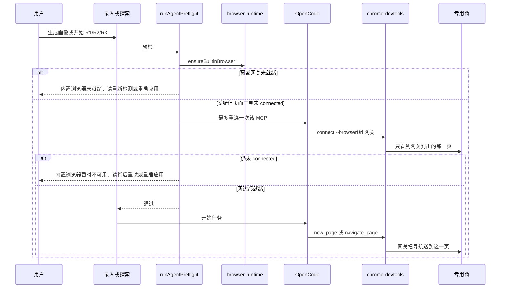

# US-EC-02 画像与探索的浏览器自动化改走内置 Chromium

> **用户故事**：[../34-需求-Electron自带Chromium替代系统Chrome.md](../34-需求-Electron自带Chromium替代系统Chrome.md) · US-EC-02 · Related #78  
> **状态**：**待评审**（浏览窗三态改以 US-EC-01 对齐 docs/34 **EC9** 的 `hidden` / `thumbnail` / `expanded` 为准。自动化路径、mcp-launch、预检不在本次改口内。本文件不改 `desktop/`、不改 `docs/34`、不关 #78）  
> **范围**：有网站的画像抓站，以及 R1 / R2 / R3 打开公司官网，改为驱动 [US-EC-01](US-EC-01-探测与引导去掉系统Chrome依赖.md) 的专用窗；预检改为「内置浏览器就绪，且页面工具已连上」  
> **依赖**：`desktop/electron/browser-runtime/` 的 `getBrowserUrl()` / `ensureBuiltinBrowser()`；现网 MCP `chrome-devtools`；`runAgentPreflight` 的 `needsChrome`；技能 `extract-product-profile`、`discover-leads`、`discover-leads-r2`、`discover-leads-r3`；`agent-runner.ts` 对应提示  
> **不做**：本故事不验收引导文案（那是 US-EC-01）；不改 R2 社媒真页红线、R3 地图真页红线；不安装系统 Chrome；不关 #78  
> **文档位置**：`docs/design/`

需求依据只有已合入的 `docs/34-需求-Electron自带Chromium替代系统Chrome.md`（EC1～EC9、US-EC-02 验收、§6、§7）。本文不改该需求正文。马丰顺已锁定 O1～O3，写入 §2，不再开放。浏览窗可见形态以 EC9 为准，细则在 [US-EC-01](US-EC-01-探测与引导去掉系统Chrome依赖.md) §2，本文只引用，不另定，也没有新的未决产品项。

硬拦截在两处：专用窗的回环地址，以及 OpenCode 拉起 `chrome-devtools` 时的命令行。只改技能措辞、命令行仍是 `--isolated`，进程仍会去拉系统 Chrome，不算完成。只改预检文案、工具仍去连系统 Chrome，也不算完成。

引导上的「内置浏览器」句子、窗口三态和网关实现以 [US-EC-01](US-EC-01-探测与引导去掉系统Chrome依赖.md) 为准，三态对齐 docs/34 EC9。本文引用同一条路径，不另定义一扇窗。

---

## 0. 相对现网

对照 `dev-0.5.9`（`3b49463`，2026-10-21 读码）。`chrome-devtools-mcp@1.6.0` 的参数对照标签 `chrome-devtools-mcp-v1.6.0` 的 `src/bin/chrome-devtools-mcp-cli-options.ts` 与 `src/index.ts`（2026-10-21 核对）。

| 现网 | **本期（US-EC-02）** |
|------|----------------------|
| 工作区模板 `workspace/config/opencode/opencode.json` 的 MCP `chrome-devtools`：`npx -y chrome-devtools-mcp@1.6.0 --isolated`。没有浏览器可执行文件参数，也没有 Electron 地址。`--isolated` 走的是 **launch** 路径，会按 channel 拉起系统 Chrome，并使用临时用户目录 | 命令改为 `npx -y chrome-devtools-mcp@1.6.0 --browserUrl http://127.0.0.1:<网关端口>`。删掉 `--isolated`。不传 `--channel`、`--executablePath`、`--userDataDir`、`--autoConnect`、`--headless`。版本钉死 `1.6.0` |
| `src/index.ts` 的 `createMcpServer`：存在 `browserUrl`（或 `wsEndpoint` / `autoConnect`）时调用 `ensureBrowserConnected`，否则 `ensureBrowserLaunched`。`--isolated` 只在 launch 路径上生效。`closeBrowser` 在 connected 模式下只 `disconnect()`，不关闭浏览器进程 | 始终走 connected。MCP 进程退出不得关掉专用窗。窗的生命周期归 US-EC-01 |
| `executablePath`、`channel` 与 `browserUrl` 冲突；`userDataDir` 与 `browserUrl`、`wsEndpoint`、`isolated` 冲突。`--autoConnect` 去系统 Chrome 用户目录读 `DevToolsActivePort`（说明文字要求 Chrome 144+） | 这些参数都不传。`--autoConnect` 会回到系统 Chrome，禁止作为退路 |
| yargs 选项名是 `browserUrl`，别名 `-u`。该版本示例就是 `--browserUrl http://127.0.0.1:9222`。kebab-case `--browser-url` 能被 yargs 认，本文仍写选项名 `--browserUrl`，与示例一致 | 运行时拼接的就是这个拼写 |
| `rewriteMcpWorkspaceEnv`（`desktop/electron/opencode/runtime.ts`）只改 MCP 的 `environment`，不改 `command` | 在同一处启动序列里增加 `rewriteChromeDevtoolsLaunch`。它改的是 `command` 数组。只改环境变量、命令仍是 `--isolated`，不算完成 |
| `needsChrome()` 对 `extract-profile`、`discover-leads`、`discover-leads-r2`、`discover-leads-r3` 为真。检查 MCP 名 `chrome-devtools` 的 `status === 'connected'`。失败说明是「服务未就绪，请稍后或重启应用」。检查 id 是 `mcp-chrome`，label 是「浏览器」。评分、起草、联系人补全、关键词扩展不查 | 同一批业务才查。通过条件变成：内置浏览器就绪 **并且** `chrome-devtools` 为 `connected`。用户看见的 label 是「内置浏览器」，说明见 §3.4。id 改为 `builtin-browser`。未连接不得写成已连接 |
| 画像：`InputView.runGenerate` 与主进程 `IPC.PROFILE_GENERATE` 都对 `extract-profile` 做预检，不区分有没有网站。探索 R1 / R2 / R3 的 IPC（`EXPLORATION_START_R1` / `R2` / `R3`）各自 `gateAgentStart` | 有网站的画像才查内置浏览器。`websitePaths.length === 0` 的纯文件画像不查。R1 / R2 / R3 始终查。渲染进程预检和主进程 `gateAgentStart` 用同一规则，主进程那次为准 |
| 技能与 `agent-runner.ts` 写「用 chrome-devtools 打开」。失败时让模型「提示启用 MCP」。R2 禁止对社媒 URL 调用打开工具。R3 禁止打开 Google 地图真页 | 打开动作仍用现有工具名（模型要调用 `new_page` / `navigate_page` / `take_snapshot`）。告诉用户的那句改为内置浏览器未就绪。R2、R3 红线原句保留 |
| `desktop/electron/main.ts` 在 `createWindow` 之后 `void bootstrapOpenCode()` | OpenCode 启动前，专用窗的 `ensureBuiltinBrowser()` 已经跑过（US-EC-01）。本故事在 `start()` 里读取 `getBrowserUrl()` 再改命令。网关没有 URL 时，仍然禁止退回 `--isolated` |
| 仓库无 Playwright。`extraResources` 无独立 Chromium | 保持。不新增依赖，不往安装包加第二份浏览器 |

现网接缝（实现时按本节）：

1. **命令行是硬闸。** `chrome-devtools-mcp@1.6.0` 在没有 `browserUrl` 时会 `puppeteer.launch` 系统 Chrome。模板文件和运行时改写都要去掉 `--isolated`。运行时改写是最终保证：即使用户工作区里的 `opencode.json` 还是旧的，`start()` 写出的配置也不能带 `--isolated`。
2. **`rewriteMcpWorkspaceEnv` 的类型今天只看见 `environment`。** 新函数必须改 `command`。不要把浏览器 URL 塞进环境变量指望 MCP 自己读，1.6.0 不认这种环境变量。
3. **预检有两道。** 渲染进程 `ensureAgentReady` 先挡一次，主进程 `gateAgentStart` 在 `PROFILE_GENERATE` 与三个 `EXPLORATION_START_*` 里再挡一次。两道都要换成新条件。只改渲染进程，主进程仍只看 MCP 字符串，不算完成。
4. **画像的网站列表在 `ProfileGenerateInput.websitePaths`。** `IPC.PROFILE_GENERATE` 在 `bootstrapProductFromLibrary` 之前就有这份数组。预检用 `websitePaths.length > 0`，不必等画像落盘。
5. **MCP 名保持 `chrome-devtools`。** `runtime.getMcpServers()` 用这个名字找状态。不要改成新名字，否则现网 `RuntimePopover` 和预检会对不上。
6. **时间线会展示 `buildPrompt` / `buildDiscoverLeads*` 全文。** 这些字符串里去掉 `chrome-devtools` 和 MCP。技能正文可以保留工具名，供模型调用；其中「告诉用户」的句子按 §4.6，不得让模型对用户说出 MCP 或 Google Chrome。
7. **R2 / R3 红线在技能里，不在网关里再写一套黑名单。** 网关负责把打开动作送进专用窗。社媒 URL 和地图 URL 仍由技能禁止。不要为了「统一拦截」去改判断口径。

---

## 1. 与 US-EC-01 的衔接

US-EC-01 已写死：

| 项 | 值 |
|----|----|
| 模块 | `desktop/electron/browser-runtime/` |
| 浏览 URL | `getBrowserUrl(): string \| null`，形如 `http://127.0.0.1:<端口>`，无末尾斜杠 |
| 就绪 | `ensureBuiltinBrowser()` / `judgeBuiltinBrowserReady`：窗未销毁，且网关 `GET /json/version` 在 1500ms 内为 200 且 `webSocketDebuggerUrl` 非空 |
| 窗 | 同一扇 `BrowserWindow`，三态 `hidden` / `thumbnail` / `expanded`（US-EC-01 §2，EC9）。`hidden` 不展示浮动窗，不销毁页面、不拆调试会话。关闭与收起是同一动作。缩略蒙层、放大标题栏、锚点均不在本故事另定 |
| 打开动作 | 网关把 `Target.createTarget` 收成这一页上的 `Page.navigate`。`navigate_page` 也落在这一页 |

本故事不改这张表。预检和 MCP 启动只调用它。

O1～O3 在 §2 再次写明，避免实现 US-EC-02 时另选一种浏览器。

---

## 2. 已确认选型

| 项 | 决定 |
|----|------|
| **EC1** | 未安装系统 Chrome 时，有网站的画像抓站，以及 R1 / R2 / R3 打开公司官网，仍走完现网业务路径。失败原因不得是「没有 chrome.exe」 |
| **EC2** | 这些路径使用 US-EC-01 的专用窗（Electron 自带 Chromium）。不启动、不附着用户安装的系统 Chrome |
| **EC3 / EC4** | 浏览器未就绪或 `chrome-devtools` 未 `connected` 时，预检失败，说明可重试。不得在未就绪时继续抓站，不得把未连接报成已连接 |
| **EC5** | 不新增安装系统 Chrome 的步骤，也不把「去下载 Chrome」写进预检失败说明 |
| **EC6** | 不读取系统 Chrome 的扩展、Profile、书签。页面分区用 US-EC-01 的内存分区 `ftcs-builtin-browser`。登录、充值、帮助外链不改 |
| **EC7** | Node / OpenCode / OfficeCLI 的一键安装和探测不改。`npx` 仍靠现网的合格 Node。这不是系统 Chrome 依赖 |
| **EC8** | 实现落在 `dev-0.5.9` 系分支。Windows 验收。不关 #78 |
| **O1** | 专用 `BrowserWindow`，`parent` 挂主窗。不附着主界面 webContents，不嵌 Vue，不做侧栏 WebView。仓库无 Playwright，本期不添加。三态为 `hidden` / `thumbnail` / `expanded`：收起是无浮动窗，不是浮动状态条；冷启动不展示；业务开页或标题栏「打开浏览窗」才以缩略 `showInactive`；缩略蒙层与放大标题栏、锚点、标题栏「浏览中 / 打开浏览窗」均以 US-EC-01 §2 为准。本故事不另定尺寸，不把关闭做成销毁会话 |
| **O2** | MCP 名保持 `chrome-devtools`。包版本保持 `chrome-devtools-mcp@1.6.0`。启动改为 `--browserUrl` 加上 `getBrowserUrl()`。禁止再依赖系统 `chrome.exe`。模块路径 `desktop/electron/browser-runtime/`。命令改写函数放在该目录的 `mcp-launch.ts` |
| **O3** | 不把独立 Chromium 打进 `extraResources`。Chromium 跟着现网 Electron ^34。不新开更新通道，不改 `latest.json` |
| **预检通过** | 内置浏览器就绪，且 MCP `chrome-devtools` 的状态字符串（小写后）为 `connected`。用户看见的是「内置浏览器」和「已就绪」，不看见 MCP 这个词 |
| **红线** | R2 仍不打开社媒真页。R3 仍不打开 Google 地图真页。只换承载网页的窗口 |

### 2.1 启动参数（写死）

对标签 `chrome-devtools-mcp-v1.6.0`：

- 要连接已有浏览器，参数是 `--browserUrl`（选项 `browserUrl`，示例 `http://127.0.0.1:9222`）。
- 带了 `browserUrl` 就进入 `ensureBrowserConnected`，不会 `puppeteer.launch`。
- `--isolated` 只在 launch 路径创建临时目录并拉起 Chrome。connected 路径不会用到它。命令里仍要删掉，避免某次没拼上 URL 时落回 launch。
- `--autoConnect` 读的是系统 Chrome 的 `DevToolsActivePort`。禁止。
- `--executablePath`、`--channel` 与 `browserUrl` 冲突。禁止。
- `--headless` 默认 false。不要打开，否则和可见的专用窗冲突。

运行时命令数组只有下面五项：

```ts
['npx', '-y', 'chrome-devtools-mcp@1.6.0', '--browserUrl', browserUrl]
```

`browserUrl` 来自 `getBrowserUrl()`。没有 URL 时，不要用 `--isolated` 填空。见 §3.2。

---

## 3. 流程

### 3.1 一次需要开网页的任务



画像在 `websitePaths` 为空时不进入上图的浏览器分支，其余预检（智能体服务、模型、线索服务）保持现网。

### 3.2 OpenCode 启动时改写命令

`OpenCodeRuntime.start()` 在现有 `rewriteMcpWorkspaceEnv` 旁边调用 `rewriteChromeDevtoolsLaunch(config, getBrowserUrl())`，然后再 `applyUserPrefsToOpenCodeConfig`。顺序：先改工作区环境，再改这条命令，再套用户偏好。

`getBrowserUrl()` 为字符串时，`chrome-devtools.command` 换成 §2.1 的五项。模板里若还有 `--isolated`、`--channel`、`--autoConnect`、`--executablePath`，全部丢弃。

`getBrowserUrl()` 为 `null` 时：

1. 先 `await ensureBuiltinBrowser()` 一次。
2. 仍无 URL：`command` 仍是 §2.1 的五项，URL 用字面量 `http://127.0.0.1:0`（与模板占位相同）。`1.6.0` 里只要 `browserUrl` 非空就进入 `ensureBrowserConnected`；连接失败会退出这条 MCP，不会落到 `ensureBrowserLaunched`。预检随后得到未连接。这个分支同样保留 `--browserUrl`，不写 `--isolated`。
3. 日志可以记「内置浏览器调试地址未就绪」。这行在主进程日志，不作为用户主说明。

模板文件 `workspace/config/opencode/opencode.json` 里的默认命令改成：

```json
"command": [
  "npx",
  "-y",
  "chrome-devtools-mcp@1.6.0",
  "--browserUrl",
  "http://127.0.0.1:0"
]
```

占位端口 `0` 不是可用调试端口。它的作用是：磁盘上的模板不再包含 `--isolated`。真正端口只由运行时改写填入。

改 `workspace/config/opencode/opencode.json`、技能或 `workspace/AGENTS.md` 时，同一次改动把 `desktop/electron/config/workspace-init.ts` 的 `WORKSPACE_TEMPLATE_VERSION` 设为 `2026.10.21-builtin-chromium`。不要复用现在的 `2026.10.18-agents-less-questions`。用户需要重启桌面端，工作区才会换上新技能和新配置。运行时改写不依赖这次同步就已经能挡 `--isolated`；升版本是为了磁盘上的模板和技能句子一起更新。

不执行 `npm run build:mcp`。这条 MCP 不是仓库里的 `mcp-servers/*/src`，它是 `npx` 拉的 `chrome-devtools-mcp@1.6.0`。

### 3.3 页面落在哪

模型调用 `new_page` 或 `navigate_page` 时，网关按 US-EC-01 §4.2 在专用窗的那一页上导航。不新建第二扇 `BrowserWindow`，不导航主界面。

冷启动默认 `hidden`。用户点过「收起」或「关闭」之后也是 `hidden`：浮动窗不在屏幕上，CDP 不断，page view 不销毁。此时导航仍然发生。US-EC-01 规定：这次若是离开令牌页的业务导航，mode 从 `hidden` 切到 `thumbnail` 并 `showInactive()`（主窗当时不能显示时，等主窗恢复再显示）。不自动放大，也不在收起态里把页面画出来。标题栏从「打开浏览窗」变为「浏览中」。

已经是缩略或放大时，导航不改 mode。放大态没有蒙层；缩略态的蒙层按 US-EC-01，本故事不另做一套操作界面。

主窗最小化或进托盘时，US-EC-01 会藏起专用窗并保持页面。若收起前本来就是 `hidden`，恢复主窗后仍不弹出。本故事不在预检里把「主窗不可见」或「浏览窗 `hidden`」当成浏览器失败。

### 3.4 预检项

`needsChrome` 改名为 `needsBuiltinBrowser`。为真的 kind 仍是：

- `extract-profile`（还要看下面的开关）
- `discover-leads`
- `discover-leads-r2`
- `discover-leads-r3`

仍不检查的 kind：`expand-keywords`、`score-and-dedupe`、`draft-email`、`enrich-lead-contacts`。

```ts
export async function runAgentPreflight(
  kind: AgentPreflightKind,
  ctx: AgentPreflightContext,
  options?: { requireBuiltinBrowser?: boolean },
): Promise<AgentPreflightResult>
```

`requireBuiltinBrowser === false` 只在 `kind === 'extract-profile'` 时生效，此时不加入浏览器这项。其它 kind 忽略该字段：探索三类永远检查，不需要浏览器的 kind 永远不检查。缺省 `options` 时，`extract-profile` 视为需要检查（调用方没说明有没有网站时，不放行抓站）。

调用点：

| 调用 | 开关 |
|------|------|
| `InputView.runGenerate(websitePaths, fileList)` 的 `ensureAgentReady` | `websitePaths.length > 0` |
| `IPC.PROFILE_GENERATE` 里的 `gateAgentStart` | `(input.websitePaths ?? []).length > 0` |
| `EXPLORATION_START_R1` / `R2` / `R3` | 不传 false，始终检查 |
| 渲染进程上探索按钮已有的 `ensureAgentReady('discover-leads' \| r2 \| r3)` | 始终检查 |

检查步骤写死，只做一轮，不循环：

1. `await ensureBuiltinBrowser()`。`judge` 未通过：本项失败，`detail` 用「内置浏览器未就绪。请到环境检测里点「重新检测」，或重启应用后再试。」不再去重连 MCP。
2. 浏览器已通过，读取 `runtime.getMcpServers()` 里名为 `chrome-devtools` 的项。状态小写后等于 `connected` 则本项通过。
3. 未连接：调用现网 `runtime.reconnectMcp('chrome-devtools')` **一次**，再读一次状态。仍不是 `connected`：失败，`detail` 用「内置浏览器暂时不可用。请稍后重试，或重启应用。」
4. 通过时 `detail` 为「已就绪」。

一项就够，不要拆成两行给用户看（第二行会把内部服务名暴露出去）。

| 字段 | 通过 | 浏览器未就绪 | 浏览器就绪但工具未连上 |
|------|------|--------------|------------------------|
| `id` | `builtin-browser` | 同左 | 同左 |
| `label` | 内置浏览器 | 同左 | 同左 |
| `ok` | `true` | `false` | `false` |
| `detail` | 已就绪 | 内置浏览器未就绪。请到环境检测里点「重新检测」，或重启应用后再试。 | 内置浏览器暂时不可用。请稍后重试，或重启应用。 |

现网失败总句保持：`还有步骤没准备好。请按下面的说明处理后再试。` 后面每行是 `· ${label}：${detail}`。因此 label 和 detail 里不能出现 MCP、scored、chrome-devtools、Google Chrome。

`mcpOk` 对其它服务（线索、搜索、地图、联系人）保持现网，包括「服务未就绪，请稍后或重启应用」。不要顺手改那些句子。

未通过时，现网 `gateAgentStart` 直接把 `message` 返回给渲染进程，**不**调用 `runDiscoverLeads` / `generate`。保持这个提前返回。

纯文件画像（`requireBuiltinBrowser === false`）的 `checks` 里不出现 `builtin-browser`。智能体服务和模型检查仍在。

### 3.5 失败与重试

| 现象 | 用户看见的 | 再试 | 任务 |
|------|------------|------|------|
| 专用窗或网关未就绪 | 预检说明里的「内置浏览器未就绪……重新检测……重启应用」 | 用户到引导点「重新检测」（US-EC-01），或重启应用后再次点生成 / 开始探索 | 不开始 |
| 窗就绪，MCP 第一次未连接，重连后连接 | 预检通过，无额外弹窗 | 这一次重连就是预检内部的一次机会 | 开始 |
| 重连后仍未连接 | 「内置浏览器暂时不可用。请稍后重试，或重启应用。」 | 用户再次点击生成或开始探索，会再跑一整轮预检（其中仍只重连一次） | 不开始 |
| 预检通过后，打开网页中途页面崩溃 | 不把预检改写成已失败。技能按「网站无法打开」跳过该 URL。若调试目标消失，下一次预检的 `ensureBuiltinBrowser` 会重建 | 下一次任务 | 当前 URL 按技能跳过，不把未连接报成已连接 |
| 系统未安装 Chrome | 不出现「请安装 Google Chrome」 | 无 | 预检只看专用窗和连接 |

预检失败不写入探索 `exploration_update.error`。那时候运行记录还没按成功路径创建；现网就是直接返回 message。保持。

### 3.6 业务路径（浏览器换了，步骤不换）

| 路径 | 现网要开的页 | 本期 |
|------|----------------|------|
| 画像，`websitePaths.length > 0` | 技能 Step 2A：打开官网并按需看站内页 | 同一工具序列，页开在专用窗 |
| 画像，只有文件 / 图片 / 侧车 | 不打开网站 | 不查内置浏览器，不要求系统 Chrome |
| R1 | 搜索结果里的候选公司页 | 专用窗。跳过新闻、百科等规则不改 |
| R2 | 只打开解析出来的公司官网 | 专用窗。社媒 URL 仍禁止 `new_page` / `navigate_page` |
| R3 | 只打开公司官网 | 专用窗。仍禁止打开 `google.com/maps`、`maps.google.com`、`goo.gl/maps` |

评分、起草、联系人补全、关键词扩展不打开这个窗，预检也不新增浏览器项。

---

## 4. 模块与接口

### 4.1 `rewriteChromeDevtoolsLaunch`

位置：`desktop/electron/browser-runtime/mcp-launch.ts`。

```ts
export function rewriteChromeDevtoolsLaunch(
  config: Config,
  browserUrl: string | null,
): Config
```

- 找到 MCP 名 `chrome-devtools`。没有这一项就原样返回（不新造一套 MCP）。
- `browserUrl` 非空：`command` 为 §2.1 五项，URL 用传入值。
- `browserUrl` 为空：`command` 为 §2.1 五项，URL 用 `http://127.0.0.1:0`。
- 不修改其它 MCP 的 `command`。
- 不把 `FTCS_WORKSPACE` 写进这条 MCP 的逻辑里；`rewriteMcpWorkspaceEnv` 仍会给它一份环境变量，保持现网循环即可。本函数不依赖那份环境变量。

单测直接喂一份带 `--isolated` 的配置，断言输出命令等于这五项，且数组里没有 `isolated`、`channel`、`autoConnect`、`executablePath`、`headless`、`chrome.exe`。

### 4.2 预检

`desktop/electron/preflight/agent-preflight.ts` 按 §3.4 改。`mcpOk(..., 'chrome-devtools')` 仍可用来判断连接，但通过与失败的 `detail` 不用 `mcpOk` 今天的「已连接 / 服务未就绪」那两句，改用 §3.4 的表。避免用户看见「已连接」这种内部状态词。通过句是「已就绪」。

`desktop/electron/main.ts` 的 `gateAgentStart` 增加可选参数并传给 `runAgentPreflight`。`PROFILE_GENERATE` 传入网站开关。三个探索 IPC 不放行。

渲染进程 `ensureAgentReady` 增加同样的可选参数，经 preload 的 `checkAgentPreflight(kind, options?)` 传到 `IPC.APP_AGENT_PREFLIGHT`。类型在 `desktop/electron/ipc/types.ts`、`desktop/electron/preload.ts`、`desktop/src/types/electron.d.ts`、`desktop/src/composables/useAgentPreflight.ts` 一起加上。不改预检失败时的展示方式：仍是把 `message` 放进录入页或探索页已有的错误位置。

### 4.3 环境探测项（归 US-EC-01，此处不另做一套）

引导上的探测项以 US-EC-01 §3.3 为准，避免两套文案：

| 字段 | 值 |
|------|----|
| `id` | `builtin-browser` |
| `label` | 内置浏览器 |
| 就绪 `detail` | 内置浏览器已就绪 |
| 窗不在 | 内置浏览器没有打开。请点「重新检测」。 |
| 连不上 | 内置浏览器暂时连不上。请点「重新检测」。若仍失败，请重启应用。 |
| `installUrl` | 不设置 |

本故事的预检 `detail` 和引导 `detail` 不是同一句：预检发生在用户已经点了生成或探索之后，所以带「请到环境检测里点重新检测」。不要把预检句抄回引导，也不要把引导句当成预检通过条件。

本故事不改 `probeChrome` 的删除（US-EC-01）。若实现顺序上 US-EC-02 先落地，预检必须调用 `ensureBuiltinBrowser`，不能调用已经删除的 `chrome.exe` 查找，也不能在 US-EC-01 未合入时临时写回 `chrome.exe` 检查。

### 4.4 标题栏服务气泡

`desktop/src/components/layout/RuntimePopover.vue` 的 `MCP_META['chrome-devtools']` 从「浏览器抓取」改为「内置浏览器」。这是用户在标题栏能点开的一行。诊断块里现网会拼服务的原始名字，保持不动，不新增一句含 MCP 的主说明。重连按钮仍走现网 `reconnectMcp`。

### 4.5 提示词落点

只改下列句子。不重写探索步骤的其余部分（Places、Tavily、`include_domains`、七段字段、`skipped` / 「线索已存在」）。`DISCOVER_COMPANY_INTELLIGENCE_RULES` 不提浏览器，不改。

| 位置 | 现网句子 | 改成 |
|------|----------|------|
| `agent-runner.ts` `buildPrompt` 执行要求第 2 条 | 有网站则用 chrome-devtools 按需探索 | 有网站则用内置浏览器按需打开页面；有文件则读取并提取。两类都有则合并进同一份画像 |
| `buildDiscoverLeadsPrompt` 第 5 步 | search-api.search_web → chrome-devtools 打开候选页 | search-api.search_web → 用内置浏览器打开候选页 |
| `buildDiscoverLeadsR2Prompt` 第 6 步 | 不要打开社媒 URL。……chrome 只打开官网 | 不要打开社媒 URL。抽出公司并解析官网后，内置浏览器只打开官网，按全网搜索的口径判断 |
| `buildDiscoverLeadsR3Prompt` 第 5 步 | chrome 只打开公司官网……禁止打开 Google 地图 | 内置浏览器只打开公司官网……禁止打开 Google 地图，禁止自己翻页。其余保持 |

这四段会出现在时间线的用户气泡里，所以不写工具内部名。模型仍从技能里读到 `new_page` / `navigate_page`。

### 4.6 技能

工具名保留，否则模型不知道调用哪一个。改的是「对用户怎么说」以及「页开在哪」。

| 位置 | 现网 | 改成 |
|------|------|------|
| `workspace/skills/extract-product-profile/SKILL.md` 前置条件 | 网站输入时，chrome-devtools MCP 可用 | 有网站时，内置浏览器已就绪。打开页面仍用 chrome-devtools 的 `new_page` 或 `navigate_page`，然后 `take_snapshot` |
| 同文件错误表 | chrome-devtools 不可用 → 提示启用 chrome-devtools MCP（桌面 App / Cursor 均可） | 内置浏览器不可用 → 停止打开网站。告诉用户：内置浏览器未就绪，请重新检测或重启应用。已有文本或图片则继续生成 |
| `workspace/skills/discover-leads/SKILL.md` 前置条件 | MCP `chrome-devtools`（user-chrome-devtools）可用 | 内置浏览器已就绪，并用 chrome-devtools 打开候选页 |
| 同文件错误表 | chrome-devtools 不可用 → 停止，提示启用 MCP | 内置浏览器不可用 → 停止。告诉用户：内置浏览器未就绪，请重新检测或重启应用 |
| `workspace/skills/discover-leads-r2/SKILL.md` | 禁止对社媒 URL 调用 chrome-devtools（`new_page` / `navigate_page`）。社媒只使用 Tavily 的 title / url / content | **保留这句。** 另加：官网只在内置浏览器中打开 |
| 同文件「chrome-devtools 不可用 → 停止本轮，提示启用 MCP」以及错误表同句 | 提示启用 MCP | 告诉用户：内置浏览器未就绪，请重新检测或重启应用 |
| `workspace/skills/discover-leads-r3/SKILL.md` Step 4 | `chrome-devtools: new_page(url) 或 navigate_page → website_url`；chrome 不可用 → 停止并提示启用 MCP | 工具序列保留。句首加「在内置浏览器中」。不可用时改为：告诉用户：内置浏览器未就绪，请重新检测或重启应用 |
| 同文件禁止打开 Google 地图的那条 | 禁止 chrome 打开 Google 地图（列出的那些 URL） | 保留禁止对象和 URL。主语改成「禁止用内置浏览器或任何页面工具打开」 |

`workspace/AGENTS.md` 浏览器一节首句「用 Chrome（`chrome-devtools`）打开页面」改为「用内置浏览器打开页面（页面工具仍是 chrome-devtools）」。该节的人机验证、登录墙、禁止绕过，以及「社媒发现（R2）禁止用浏览器打开社媒真页」保持。不要写成「请用户安装 Chrome」。

不改 Tavily「重启 MCP」、`lead-store` 等与浏览器无关的既有句子。

### 4.7 用户可见文案集中表

| 场景 | 字符串 |
|------|--------|
| 预检通过 | 已就绪 |
| 预检，窗或网关失败 | 内置浏览器未就绪。请到环境检测里点「重新检测」，或重启应用后再试。 |
| 预检，重连后仍失败 | 内置浏览器暂时不可用。请稍后重试，或重启应用。 |
| 预检行标题 | 内置浏览器 |
| 技能让模型转告用户 | 内置浏览器未就绪，请重新检测或重启应用。 |
| 标题栏气泡可见名 | 内置浏览器 |

不出现：MCP、scored、chrome-devtools、Google Chrome、下载链接。技能里留给模型的工具名可以保留，但「告诉用户」的引语用上一行。

---

## 5. 文件清单

下表是**开发时预期会动**的现网文件。**本详设不改这些文件，交开发。**

| 文件 | 预期动作 |
|------|----------|
| `desktop/electron/browser-runtime/mcp-launch.ts` | 新建 §4.1 |
| `desktop/electron/opencode/runtime.ts` | `start()` 在 `rewriteMcpWorkspaceEnv` 之后调用 `rewriteChromeDevtoolsLaunch`。无 URL 时先 `ensureBuiltinBrowser` 一次，仍禁止 `--isolated` |
| `desktop/electron/preflight/agent-preflight.ts` | §3.4 |
| `desktop/electron/main.ts` | `gateAgentStart` 传入网站开关；`PROFILE_GENERATE` 用 `websitePaths` |
| `desktop/electron/preload.ts`、`desktop/electron/ipc/types.ts`、`desktop/src/types/electron.d.ts`、`desktop/src/composables/useAgentPreflight.ts` | 预检可选参数 |
| `desktop/src/views/InputView.vue` | `runGenerate` 按 `websitePaths.length` 传入开关 |
| `desktop/src/components/layout/RuntimePopover.vue` | 可见名改为「内置浏览器」 |
| `desktop/electron/opencode/agent-runner.ts` | 只改 §4.5 的四句 |
| `workspace/config/opencode/opencode.json` | §3.2 的占位命令 |
| `workspace/skills/extract-product-profile/SKILL.md` | §4.6 |
| `workspace/skills/discover-leads/SKILL.md` | §4.6 |
| `workspace/skills/discover-leads-r2/SKILL.md` | §4.6，红线保留 |
| `workspace/skills/discover-leads-r3/SKILL.md` | §4.6，红线保留 |
| `workspace/AGENTS.md` | §4.6 首句 |
| `desktop/electron/config/workspace-init.ts` | `WORKSPACE_TEMPLATE_VERSION = '2026.10.21-builtin-chromium'` |

专用窗、网关、探测、引导、标题栏「浏览中」按钮若尚未存在，按 US-EC-01 的文件清单一起做。本故事不另起模块名。

建议单测：`mcp-launch` 的命令断言，以及 `runAgentPreflight` 在假 runtime 上的通过 / 失败文案。测试文件不在本详设里修改。

**明确不改**：

- `docs/34-需求-Electron自带Chromium替代系统Chrome.md`
- US-EC-01 已经规定的窗口三态、蒙层、锚点和探测句子
- `docs/design/US-EC-内置浏览器.pen`
- `extraResources`、Electron 版本、`latest.json`
- Node / OpenCode / OfficeCLI 安装实现
- R2 `include_domains`、R3 Places 配额和翻页规则
- `DISCOVER_COMPANY_INTELLIGENCE_RULES` 及域名跳过（US-DD-01）
- 登录 / 充值 / 帮助的 `openExternal`

---

## 6. 验收对照

对照 `docs/34` 的 US-EC-02 验收句与 §6。**本 PR 不写代码，这里不声称已通过。** 冷启动不展示、收起等于关闭、缩略蒙层、放大标题栏这四条可见结果的逐步操作在 US-EC-01 的 M5、M7、M13、M14、M15。本故事只验收它们没有把抓站和预检弄断（M1、M8）。mcp-launch、预检文案、技能红线不因 EC9 改口径。

### 6.1 建议单测

| # | 用例 | 期望 | 需求 |
|---|------|------|------|
| T1 | 配置命令含 `--isolated`，`browserUrl` 为 `http://127.0.0.1:43123` | 输出正好五项：`npx`、`-y`、`chrome-devtools-mcp@1.6.0`、`--browserUrl`、该 URL。无 `isolated` / `channel` / `autoConnect` / `executablePath` / `chrome.exe` | O2 |
| T2 | `browserUrl` 为 `null` | 仍有 `--browserUrl http://127.0.0.1:0`，无 `--isolated` | §3.2 |
| T3 | 配置里没有 `chrome-devtools` | 原样返回 | §4.1 |
| T4 | 浏览器 judge 失败 | 预检 `ok false`，`detail` 为未就绪那句，message 不含 MCP、Google Chrome。不调用探索启动 | EC3 |
| T5 | 浏览器就绪，MCP 状态 `connected` | 该项 `ok true`，`detail` 「已就绪」 | O2 |
| T6 | 浏览器就绪，状态 `failed`，重连后仍 `failed` | `ok false`，暂时不可用那句。不得 `detail === '已连接'` 或「已就绪」 | EC4 |
| T7 | 浏览器就绪，第一次未连接，重连后 `connected` | 通过。重连只发生一次 | §3.4 |
| T8 | `extract-profile` 且 `requireBuiltinBrowser false` | `checks` 无 `builtin-browser` | 纯文件画像 |
| T9 | `extract-profile` 且未传 options | 有浏览器项 | 缺省不放行抓站 |
| T10 | `discover-leads-r2` 传入 `requireBuiltinBrowser: false` | 仍检查浏览器 | 探索不可关 |
| T11 | `score-and-dedupe`、`draft-email`、`enrich-lead-contacts`、`expand-keywords` | 无浏览器项 | 现网范围 |
| T12 | 源码审查技能 R2 / R3 | 仍禁止社媒真页、仍禁止地图真页 URL | EC1 红线 |

### 6.2 手工

| # | 需求句 | 步骤 | 期望 |
|---|--------|------|------|
| M1 | 未装系统 Chrome 时，有网站的画像仍能抓站 | Windows 无 `chrome.exe`。冷启动后先看主界面，再录入勾选一个可访问的官网，生成画像 | 点生成之前没有浮动浏览窗。预检通过。业务开页后专用窗以缩略弹出（约 360×240，主内容区右上，不抢焦点）。画像能保存。任务管理器里不出现用户目录下的 `chrome.exe` 被本应用拉起。不读 `%LOCALAPPDATA%\Google\Chrome` |
| M2 | R1 打开公司官网 | 同一台机器跑一轮 R1 | 候选官网开在同一扇专用窗。不弹出系统 Chrome |
| M3 | R2 红线 | 跑 R2 | 社媒结果不在专用窗里打开。只有解析出的官网会打开。技能里的禁止句还在 |
| M4 | R3 红线 | 跑 R3 | 不打开 Google 地图。有官网的候选才打开官网 |
| M5 | 未就绪不继续抓站 | 停掉网关或让调试端口失败后点生成（勾选了网站） | 预检失败，说明含重新检测或重启应用。没有开始抓站。界面不把该项显示为已就绪 |
| M6 | 可重试 | M5 之后到环境检测点「重新检测」恢复，再点生成 | 可以开始。预检不会无限重连，每次点击最多重连一次 |
| M7 | 纯文件画像 | 不勾选网站，只勾选 txt | 不因浏览器项失败。系统无 Chrome 也能开始读文件 |
| M8 | 收起不断开（EC9 `hidden`） | 抓站过程中点缩略蒙层「收起」，或在放大标题条上点「关闭」 | 浮动窗消失。标题栏为「打开浏览窗」。没有仍浮在桌面上的状态条。任务不因为收起或关闭而报「未连接」。同一 target 仍在。业务再次开页，或点「打开浏览窗」，以缩略弹出。蒙层、放大标题栏的逐步点击见 US-EC-01 的 M13～M15 |
| M9 | Node / OpenCode / OfficeCLI | 走一遍一键安装 | 与改前相同，不要求安装 Chrome |
| M10 | 文案 | 看预检失败、标题栏气泡、时间线里的任务提示 | 无 MCP、无 scored、无「请安装 Google Chrome」、无下载链接 |
| M11 | 只改技能不算完成 | 代码审查 | `mcp-launch.ts` 在 `start()` 里改写命令；模板无 `--isolated`；预检同时看 `ensureBuiltinBrowser` 和 `connected` |
| M12 | 引导文案可以尚未改完 | 若 US-EC-01 未合入 | 不作为本故事失败。两条都完成后才同时满足 docs/34 §6 的第 1、2 条 |
| M13 | 不关 #78 | 变更说明 | Related #78 |

---

## 7. 不做什么

| 项 | 说明 |
|----|------|
| 改引导探测文案、标题栏入口布局、窗口三态、蒙层和放大标题条 | US-EC-01。本文只调用 |
| 把收起做成浮动状态条，或让「关闭」销毁 CDP / page view | EC9 与 US-EC-01。关闭等于收起 |
| 另做一扇窗或换一个模块目录 | O1、O2 |
| `--isolated`、`--autoConnect`、`--channel`、`--executablePath`、系统 `chrome.exe` | O2 |
| 升级或替换 `chrome-devtools-mcp@1.6.0` | 钉死现网版本。要升级另开故事 |
| 引入 Playwright，或在仓库依赖里加 puppeteer | 连接库随 npx 的 MCP 包出现，不写入 `desktop/package.json` |
| 把独立 Chromium 放进 `extraResources`，或新开浏览器更新通道 | O3 |
| 改 R2 不打开社媒真页、R3 不打开地图真页 | EC1 |
| 在网关里再做一套社媒 / 地图黑名单 | 红线留在技能，避免两套口径 |
| 评分、起草、补联系人、扩展关键词改为依赖浏览器 | 现网不查 |
| 纯文件画像改为必须打开浏览器 | §3.4 |
| 把登录、充值、帮助放进专用窗 | EC6 |
| 改 Node / OpenCode / OfficeCLI 安装 | EC7 |
| 重写技能里与浏览器无关的「重启 MCP」等旧句 | §4.6 |
| 关闭 #78、合 `main`、打 tag | EC8 |
| 在本详设 PR 里改业务代码或 `docs/34` | 文件清单交开发 |

---

## 8. 风险

| 风险 | 缓解 |
|------|------|
| 模板改了，运行时没改 `command`，旧进程仍 `--isolated` 拉起系统 Chrome | `start()` 必须调用 `rewriteChromeDevtoolsLaunch`。T1、M11。用户工作区未同步时也靠这一步 |
| 没拿到 URL 就省略 `--browserUrl`，1.6.0 走 launch | `null` 时仍带 `--browserUrl http://127.0.0.1:0`。T2 |
| 使用 `--autoConnect` 图省事，又连回系统 Chrome | §2.1 禁止。T1 断言参数列表 |
| 预检只看 MCP `connected`，窗已经死了仍放行 | 先 `ensureBuiltinBrowser`。T4 |
| 预检把 `failed` 显示成已就绪 | `detail` 只有真正 `connected` 才是「已就绪」。T6 |
| 重连死循环拖住点击 | 每次预检最多 `reconnectMcp` 一次。T7 |
| 只改了渲染进程预检，主进程 `PROFILE_GENERATE` 仍放行 | `gateAgentStart` 同步改。M11 |
| 纯文件画像被浏览器故障挡住 | `websitePaths.length === 0` 不检查。T8、M7 |
| 探索被调用方误传 `requireBuiltinBrowser: false` | 只有 `extract-profile` 认这个开关。T10 |
| 模型 `new_page` 在 Electron 里打开主界面或第二扇窗 | US-EC-01 网关收成同一页，并关掉名单外的 webContents。M1 看窗的数量 |
| 用户收起或关闭窗口后快照空白，任务中断并被说成未连接 | US-EC-01 在 `hidden` 保持缩略视口、不断开调试、不销毁 page view。M8 |
| MCP 退出时 `closeBrowser` 把专用窗关掉 | 1.6.0 在 connected 模式只 `disconnect()`。窗由本进程的 browser-runtime 持有，不交给 MCP 关 |
| 时间线气泡出现 chrome-devtools / MCP | §4.5 的四句改口语。技能里「告诉用户」的引语用 §4.7 |
| 技能仍写「提示启用 MCP」，模型照读给用户 | §4.6 的失败行都改掉。T12 同时看红线还在 |
| 升了技能却没升 `WORKSPACE_TEMPLATE_VERSION`，用户工作区仍是旧技能 | 版本字符串写死 `2026.10.21-builtin-chromium`。运行时命令改写不依赖同步 |
| 把浏览器 URL 写进仓库并提交了某个开发机端口 | 模板只放 `http://127.0.0.1:0`。真实端口只在内存里的改写结果中 |
| 无系统 Chrome 时 npx 仍要 Node | Node 仍走 docs/19 的一键安装。预检失败若是 Node 缺失，仍是现网「智能体服务 / Node」项，不要说成需要 Chrome |

---

## 9. 修订记录

| 日期 | 说明 |
|------|------|
| 2026-10-21 | 初稿。对齐 docs/34 的 EC1～EC8 与已锁 O1～O3。基线 `dev-0.5.9`（`3b49463`）。核对 `opencode.json` 的 `--isolated`、`rewriteMcpWorkspaceEnv`、`needsChrome`、`chrome-devtools-mcp@1.6.0` 的 `--browserUrl`（标签 `chrome-devtools-mcp-v1.6.0`）。命令改写放在 `desktop/electron/browser-runtime/mcp-launch.ts`。状态：待评审。不关 #78。 |
| 2026-10-24 | 窗口三态改引 US-EC-01 的 EC9：`hidden` / `thumbnail` / `expanded`。收起与关闭都不展示浮动窗，不断开 CDP。业务导航在 `hidden` 时弹出缩略。M1、M8 与 §3.3 同步。mcp-launch、预检、技能红线不改口径。不关 #78。 |
