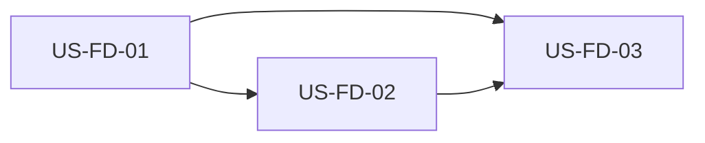

# US-FD 索引：智能体自由对话与权限边界

> **需求**：[../40-需求-智能体自由对话与权限边界.md](../40-需求-智能体自由对话与权限边界.md) · Related [#118](https://github.com/Pedro-MAFS/ftcs/issues/118)  
> **状态**：O3 于 2026-11-04 改为六个步骤技能缺参自问，砍掉 `start-from-chat`。`ftcs-task` 物理删除。O1、O2、O4～O6 仍是各故事里的推荐。待马丰顺确认后再开发。本文只做目录，不关 #118。  
> **基线**：`dev-0.6.1`（需求 #136 已合入 `98c55787`）。不改 `docs/40`，不改 `desktop/`。

| 文件 | 故事 | 选型 |
|------|------|------|
| [US-FD-01-开放自由对话.md](US-FD-01-开放自由对话.md) | 任意话题可发、可答 | O4 |
| [US-FD-02-任务中自动拒与续聊授权.md](US-FD-02-任务中自动拒与续聊授权.md) | 任务段自动拒，续聊才授权 | O1、O2、O6。O5 的主流程能否走完也在这里 |
| [US-FD-03-同会话混用与聊天启任务.md](US-FD-03-同会话混用与聊天启任务.md) | 同一会话闲聊，步骤技能缺参提问后启动 | O3。O5 的复制会话在这里 |

02 先把非 allowlist 收成任务中 `reject`、续聊 `once` 或 `reject`。实现后工具列表与配置里都没有 `ftcs-task`，allowlist 等于现有内置 MCP。03 在闲聊里由对应步骤技能缺参发提问卡；`running === false` 时按题头识别，提交后调 `run*`。不设 `start-from-chat`。按钮路径提示词已齐必填，技能不会走到提问。01 可以先做发送，但没有 02 时不要把权限留在现网的一律 `always`。

## O1～O6 结论

钉住的运行时是 OpenCode **1.18.4**（`desktop/electron/runtime/opencode-binary-install-types.ts`）和 SDK **1.18.1**。权限配置用 v1 的 `permission` 对象。官网 v2 的 `permissions` 数组不用于本期。

| 项 | 推荐 |
|----|------|
| **O1** | 一份配置：`*` 为 `ask`，硬边界 `deny`，内置 MCP 前缀 `allow`。`AgentRunController.running` 为真时，仍弹出来的 `permission.asked` / `permission.v2.asked` 立刻 `reject`。续聊只让用户选 `once` 或 `reject`。删掉一律 `always`。实现后工具列表与配置里都没有 `ftcs-task` |
| **O2** | allowlist 只来自 `workspace/config/opencode/opencode.json` 的 `mcp` 键，等于现有内置 MCP。实现后没有 `ftcs-task`。增删内置 MCP 时改同一文件里的 `"服务名_*": "allow"`，用测试锁住。不按已连接服务自动放行 |
| **O3** | 六个步骤技能缺必填就用现网提问卡，齐了桌面按技能身份调对应 `run*`（`fromChat: true`）。不靠 `start-from-chat` 的三题总卡。实现 PR 删除 `workspace/skills/start-from-chat/SKILL.md`（若已加）。按钮路径的 `run*` 提示词已齐必填，技能不会走到提问。`session.create` 成功后才清空时间线。`ftcs-task` 物理删除。主验收是包不在、登记不在、没有该入口 |
| **O4** | 占位改为「发消息继续聊，或说明要启动的获客步骤」。发送进入当前 OpenCode 会话并得到回复。`generating` 时输入仍禁用 |
| **O5** | 复制仍按 docs/38。主流程要的是工作区内 Read 和内置 MCP；收紧 `edit` / `bash` / `webfetch` 后仍能走完。画像若只因复制文件被拒而整段失败，停下来交产品 |
| **O6** | 续聊可询问：`webfetch`、`websearch`、`task`，以及其它落在 `*` 上的 `ask`。同意只此一次，拒绝则不执行。`edit`、`bash`、`external_directory` 不进询问。实现后没有 `ftcs-task`，询问清单里也没有它 |

各故事里的备选只供确认时对照。开发按推荐，不按备选。

---

## 修订记录

| 日期 | 说明 |
|------|------|
| 2026-11-01 | 按故事拆出索引。O1～O6 写明推荐。Related #118，不关 Issue。 |
| 2026-11-03 | O3 改为技能 + 提问卡。`ftcs-task` 留着不用，从 O6 的询问清单拿掉。对照 #136。不关 #118。 |
| 2026-11-04 | 改口：物理删除 `ftcs-task`。实现后工具列表与配置里都没有它；allowlist 等于现有内置 MCP。主验收是包不在、登记不在、没有该入口。按马丰顺要求去掉残留兼容口径。不关 #118。 |
| 2026-11-04 | 马丰顺拍板：砍掉 `start-from-chat`；步骤技能缺参自问；不区分触发来源。stage 由技能身份决定。不关 #118。 |
