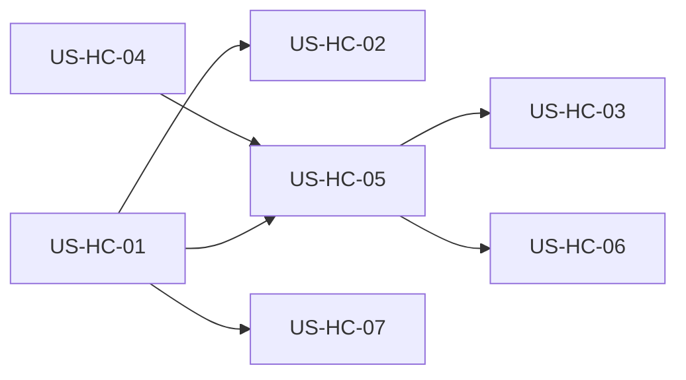

# US-HC 索引：官方通道网关代调 Hunter

> **需求**：[../42-需求-官方通道网关代调Hunter-客户端.md](../42-需求-官方通道网关代调Hunter-客户端.md) · Related [#156](https://github.com/Pedro-MAFS/ftcs/issues/156)  
> **状态**：客户端内部设计已写明。**O1 未锁定，US-HC-01～07 都不可进入联调，也不可按本文开工改 `desktop/` 或 `workspace/`。** O2、O3、O4 是对照现网后的推荐，待马丰顺确认。不关 #156。  
> **基线**：`dev-0.6.3` @ `222472cc1fc07512e66bc9ae2721fb756721658c`（`docs(42): 官方通道网关代调 Hunter（客户端） (#157)`）。本文核对过该提交已在基线上。  
> **范围**：只覆盖 US-HC-01～US-HC-07。网关价目、路径、字段、错误体属于「网关侧 Hunter 代调需求」。本仓没有 `token-gateway/`，本文不建该目录，也不链向本仓不存在的网关文件。  
> **不改**：`docs/42`、`docs/20`、[US-C 决策原文](../research/US-C-决策-Hunter-MVP.md)、`desktop/`、`workspace/`、`website/`。官网同步是发版依赖，不在本详设 PR 实做。

| 文件 | 故事 | 现在能不能做 |
|------|------|----------------|
| [US-HC-01-官方通道免配Key查找联系人.md](US-HC-01-官方通道免配Key查找联系人.md) | 官方免配 Key 查找并写回 | 不可。等查找代调契约 |
| [US-HC-02-官方通道按开关验邮.md](US-HC-02-官方通道按开关验邮.md) | 开关开则代调验邮，关则不验 | 不可。等验邮代调契约，且依赖 01 |
| [US-HC-03-抽屉单条验证跟随通道.md](US-HC-03-抽屉单条验证跟随通道.md) | 抽屉「验证」跟随通道，不另起补全任务 | 不可。等验邮契约，且依赖 05 |
| [US-HC-04-自定义通道仍自备Key直连.md](US-HC-04-自定义通道仍自备Key直连.md) | 自定义 BYOK 直连回归 | 无新接口。不单独立项改代码，随 05 做回归 |
| [US-HC-05-去掉官方通道自备Key直连.md](US-HC-05-去掉官方通道自备Key直连.md) | 删掉官方 BYOK 直连，失败不回退 | 不可。代调分支还不能落地时不能先删 |
| [US-HC-06-设置引导与预检随通道切换.md](US-HC-06-设置引导与预检随通道切换.md) | 设置、空态、预检随通道改口 | 不可。O2 原句未确认，且依赖 05 |
| [US-HC-07-官方通道失败可理解提示.md](US-HC-07-官方通道失败可理解提示.md) | 余额不足 / 凭证不可用 | 不可。等网关给出可区分的两类结果 |

箭头是需求里的依赖，不是开工许可。O1 锁定前不要改实现。

## 已锁定口径

取自 docs/42 §3，此处只列客户端要守住的几条：

- 官方通道复用已开通的官方凭证和网关地址（与官方搜索同一类），由 Token 网关代调。客户端不接收、不保存、不拼装上游 Hunter Key。
- 自定义通道仍是用户 BYOK：多 Key、轮换、测试连接、直连 `https://api.hunter.io`。不扣官方余额。已保存的 Key 切通道不删除；官方当次调用不读这些 Key。
- 只删除官方通道上的旧 BYOK / 直连分支，含失败后改走本机 Key 的回退。自定义直连留下。
- 查找、按开关验邮、抽屉单条验邮都走这套通道规则。`people[]` 语义不改。主路径不依赖补全。法务本期搁置。
- 官方用量走官方通道计费。桌面不写单价、不另做 Hunter 账本。余额仍用现有官方余额。

## 客户端内部分叉

分叉点是本机已有的 `FTCS_CHANNEL_MODE`（`desktop/electron/settings/settings-service.ts` 的 `CHANNEL_MODE_ENV`）。这是客户端开关，不是网关路由。

| 通道 | 注入 `hunter-api` 的环境 | 出站 |
|------|--------------------------|------|
| `official` | 带上与搜索相同的 `FTCS_GATEWAY_API_KEY`、`FTCS_TOKEN_GATEWAY_BASE_URL`，以及 `FTCS_CHANNEL_MODE=official`。不带 `HUNTER_API_KEYS` / `HUNTER_API_KEY` | 只允许走尚未锁定的代调函数。禁止使用 `HunterClient` 里的 `BASE_URL`（`https://api.hunter.io/v2`） |
| `custom` | 保持 `runtime.ts` 里现有 `hunterEnv`：只注入用户 Key | 保持 `requestOnce` / `callEmailVerifier` / `testHunterConnectivity` 直连 Hunter |

官方搜索已经这样分叉：`rewriteMcpWorkspaceEnv` 在官方时写 `SEARCH_PROVIDER=gateway` 并注入网关 sk 与 base，不注入 `TAVILY_API_KEY`；`getSearchProvider` 再交给 `searchViaGateway`。Hunter 对齐的是这条**消费方式**（凭证来源、base 解析函数 `getTokenGatewayBaseUrl`、按通道二选一）。搜索的 `POST {base}/search` 只属于搜索，见 [docs/15](../15-官方搜索通道对接.md) 与 `workspace/mcp-servers/search-api/src/gateway.ts`。**禁止把该路径、请求体或 401/402 抄成 Hunter 代调契约。**

官方代调允许出现的调用点只有两处，且两处都要等同一份网关分册再填 HTTP：

1. `workspace/mcp-servers/hunter-api/src/client.ts` 的 `HunterClient.domainSearch` / `verifyEmail`（补全技能，含批量与编排里的「补全联系人」）。
2. `desktop/electron/leads/verify-person-email.ts` 的 `verifyPersonEmail`（抽屉单条，不经过 OpenCode）。

`account_info` 与设置页「测试连接」在官方通道不发 HTTP。见 US-HC-05、US-HC-06。

## 最小网关依赖

本仓能核验的只有官方搜索与官方凭证，没有 Hunter 代调契约。

| 依赖 | 本仓能核验的来源 | 状态 | 卡住 |
|------|------------------|------|------|
| 官方凭证 `FTCS_GATEWAY_API_KEY`；base `FTCS_TOKEN_GATEWAY_BASE_URL`（默认 `https://token.ai-utills.com/v1`，`getTokenGatewayBaseUrl`） | `desktop/electron/gateway/gateway-config.ts`；`runtime.ts` 搜索注入；`officialProvisioned` = 本机已有 sk | 已有，可复用 | 只说明凭证从哪来。没有 Hunter 路径就不能联调 |
| 查找的方法、路径、请求字段、响应字段 | 无。不在 docs/42，本仓也无对应文件 | **未锁定（O1）** | US-HC-01、02、05 |
| 验邮的方法、路径、字段；处理中时客户端是否轮询 | 无 | **未锁定（O1）** | US-HC-02、03 |
| 能区分「官方余额不足」和「官方凭证不可用」的结果 | 需求 HC12 只要求能区分。搜索 `mapGatewayFailure` 的 401/402 是搜索契约 | **未锁定（O1）** | US-HC-07；01 的失败文案也不能提前绑状态码 |
| 查找缓存命中后要不要再向网关打一次计费请求 | 现网缓存行为见 O3。计费语义不在本仓 | **待马丰顺确认（O3）** | 任何「命中仍出站」的实现 |
| 单价、账本、上游 Key 库 | 网关分册 | 客户端不做 | 无客户端实现项 |

## O2 / O3 / O4 推荐

待马丰顺确认。确认前保持 Draft，不按推荐改界面。

| 项 | 推荐 | 理由 |
|----|------|------|
| **O2** 官方 Hunter 区块 | 官方时不渲染 Key 列表、添加、测试连接、Hunter 注册链接和服务条款链接。留标题、一句说明、验邮勾选。推荐说明：「使用官方通道，无需自备 Hunter API Key。费用从官方通道余额扣除。」自定义区块保持 `SettingsView.vue` 现有整块 | 官方搜索用只读框表达「不用自备 Key」。Hunter 若再留一个禁用输入框，仍像要去申请 Key。条款与「费用由 Hunter 收取」只留给自定义（HC5） |
| **O3** 查找缓存与计费 | **客户端：** `domainSearch` 继续先读 24h 缓存；命中则 `cached: true` 并返回，官方也不出站。键仍不含 Key、不含通道（`cache.ts`）。验邮维持无缓存。**计费：** 本推荐只规定客户端不出站，不规定网关因此免费或收费。若官方命中也要扣余额，由网关分册定义那一次请求；客户端不自补探测 | 现网 `client.test.ts` 已证明同参第二次 `calls.length` 不增加。官方搜索 docs/15 D6 也是命中不打网关，但那是搜索已拍板的计费，不能挪来当 Hunter 价目。自定义写入的缓存，24h 内切到官方同样会命中且不出站 |
| **O4** 官方测试按钮 | 不做「测试代调是否可用」。自定义保留「测试连接」。官方通道下 `settings:test-hunter` 若被调用，直接说明无需测试直连，且不发 HTTP | 官方搜索区块没有测试按钮。另做按钮需要一个未锁定的探测接口。现有测试是 `GET https://api.hunter.io/v2/account` 加用户 Key，官方不能走这条 |

## 发版前官网（本 PR 不改）

按 docs/42 §4.1，发版前同步这些仍写「一律自备 Key / 本机直连 / FTCS 不代调」的页面：

- `website/content/docs/hunter-api-key.md`
- `website/content/docs/faq.md`
- `website/content/docs/workflow.md`
- `website/content/docs/getting-started.md`
- `website/content/docs/install.md`

同步口径：官方通道无需自备 Key，费用计入官方通道；自定义通道仍自备 Key、直连、费用在用户自己的 Hunter 账号。主路径不依赖补全这句保留。

## 契约锁定之后的落地顺序

01 的代调与 05 的删除同一次改 `HunterClient` 和 `rewriteMcpWorkspaceEnv`，避免官方用户先失去补全、又还没有代调。然后 02、03、06。07 再等错误区分落地。04 只做回归，不改自定义直连。

改 `workspace/skills/` 或 `workspace/mcp-servers/hunter-api` 的实现 PR，要在同一次把 `desktop/electron/config/workspace-init.ts` 的 `WORKSPACE_TEMPLATE_VERSION` 换成新字符串，并重新打包 MCP。本详设 PR 不改这些文件，所以不升版本。

---

## 修订记录

| 日期 | 说明 |
|------|------|
| 2026-11-16 | 按故事拆短详设。O1 标未锁定，01～07 不可联调、不可开工。O2/O3/O4 写推荐，待马丰顺确认。Related #156，不关 Issue。 |
