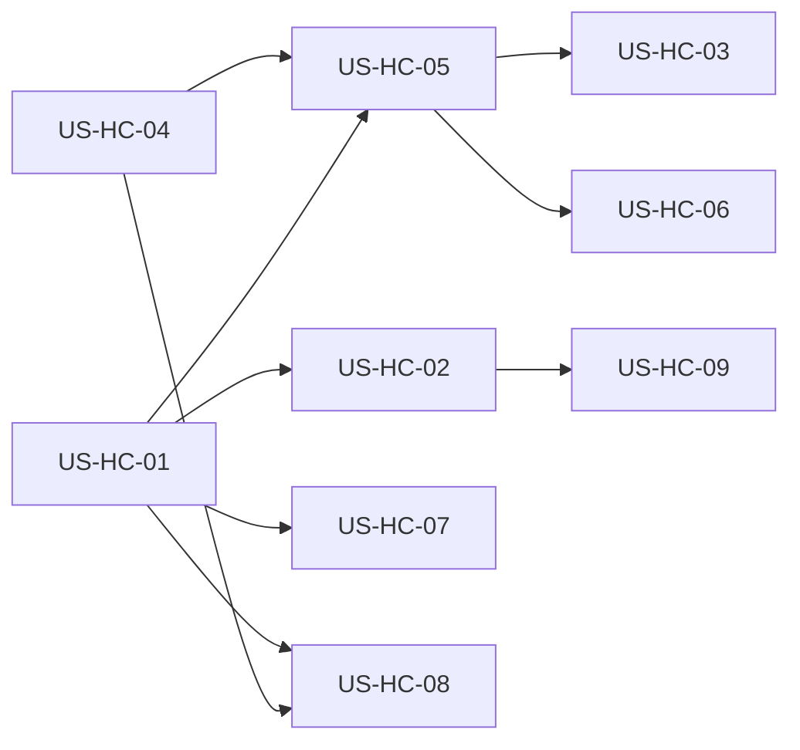

# US-HC 索引：官方通道网关代调 Hunter

> **需求**：[../42-需求-官方通道网关代调Hunter-客户端.md](../42-需求-官方通道网关代调Hunter-客户端.md) · 01～07 Related [#156](https://github.com/Pedro-MAFS/ftcs/issues/156) · 08/09 Related [#165](https://github.com/Pedro-MAFS/ftcs/issues/165)  
> **状态**：O2、O3、O4 已按原推荐确认。O1 改为用户提供的 2026-11-16 联调草案，摘录在 [US-HC-网关代调契约草案.md](US-HC-网关代调契约草案.md)。可以按草案写 01～07 的客户端。08/09 等详设合入后再实现。真实 Hunter、客户端和结算联调未完成，环境与单价未在本仓给出，所以还不是生产签收。本索引不关 #156，也不关 #165。  
> **基线**：`dev-0.6.3`。08/09 写在 #166 合入之后（`d787e2a9`）。01～07 初稿基线仍是 `90e9c043`（#158）。  
> **范围**：只改 `docs/design/` 的 US-HC。不改 `docs/42`、`desktop/`、`workspace/`、`website/`，不改网关仓库。

| 文件 | 故事 | 草案覆盖 | 现在 |
|------|------|----------|------|
| [US-HC-01-官方通道免配Key查找联系人.md](US-HC-01-官方通道免配Key查找联系人.md) | 官方查找并写回 | `POST {base}/hunter/domain-search`。条数、筛选与翻页不在本故事 | 可按草案实现代调传输。旧「单页 limit=10」已被 US-HC-08 超越 |
| [US-HC-02-官方通道按开关验邮.md](US-HC-02-官方通道按开关验邮.md) | 官方实际发起的验邮走代调 | 单次 `POST {base}/hunter/email-verifier` | 可按草案实现代调。验谁见 US-HC-09。旧「开启则对每人验邮」已被 US-HC-09 超越 |
| [US-HC-03-抽屉单条验证跟随通道.md](US-HC-03-抽屉单条验证跟随通道.md) | 抽屉单条 | 与 02 同一验邮契约 | 可按草案实现。与 05 一起去掉官方直连 |
| [US-HC-04-自定义通道仍自备Key直连.md](US-HC-04-自定义通道仍自备Key直连.md) | 自定义回归 | 不使用代调契约 | 直连保持。随通道分叉做回归 |
| [US-HC-05-去掉官方通道自备Key直连.md](US-HC-05-去掉官方通道自备Key直连.md) | 删除官方 BYOK 直连 | 只带官方 sk；失败不回退、不自动重试 | 与 01 同一次改 |
| [US-HC-06-设置引导与预检随通道切换.md](US-HC-06-设置引导与预检随通道切换.md) | 设置、空态、预检 | 无新网关字段 | O2/O4 已确认，可按详设改界面 |
| [US-HC-07-官方通道失败可理解提示.md](US-HC-07-官方通道失败可理解提示.md) | 失败提示 | `error.code` 与 `reason` 两套 | 可按附录 §4 映射。余额是 429，不是搜索 402 |
| [US-HC-08-补全联系人查找参数与翻页.md](US-HC-08-补全联系人查找参数与翻页.md) | 查找参数与翻页 | 工具可传 `limit`（1–100）、`type` / `department` / `seniority`、`offset`。不代翻页。非空页按次 | 现行口径。删除写死的 `limit=10`。实现在本详设合入后，不并入 06 |
| [US-HC-09-验邮开关允许对关键人验证.md](US-HC-09-验邮开关允许对关键人验证.md) | 允许对关键人验邮 | 不改验邮 HTTP。开关含义与设置页原句见该篇 | 推荐标签「允许对关键人验证邮箱」。旧「对全部联系人自动验邮」已被超越。原句等确认 |
| [US-HC-网关代调契约草案.md](US-HC-网关代调契约草案.md) | 契约附录 | 路径、字段、轮询、错误、计费 | 联调草案，示例不是实测。§2 已按 US-HC-08 开放 `offset`，不再固定 10 |

01 与 05 同一次改 `HunterClient` 和 `rewriteMcpWorkspaceEnv`。然后 02、03、06、07。04 只回归。08、09 另开实现，排在上述故事之后，不并入已合的 US-HC-06、US-HC-03、US-HC-07。08 只改查找参数与翻页，09 只改验邮开关含义。01 仍是代调传输，02 仍是官方实际发起的验邮走代调。

## 已确认与仍开放

| 项 | 状态 |
|----|------|
| O2 | **已确认。** 官方 Hunter 区块不渲染 Key、测试连接、注册链接和条款。说明用「使用官方通道，无需自备 Hunter API Key。费用从官方通道余额扣除。」验邮勾选保留。勾选标签原句见 US-HC-09，不回退成对全部联系人自动验邮。自定义区块保持现网 |
| O3 | **已确认，并由草案写明计费。** `domainSearch` 先读 24h 缓存；命中则不出站，网关不收费。键仍不含 Key、不含通道。验邮不加缓存。自定义写入的缓存，24h 内切到官方同样命中且不出站。查询参数还要区分 `offset`，见 US-HC-08。现网键还没有 `offset` |
| O4 | **已确认。** 不做官方「测试代调」按钮。自定义保留「测试连接」。官方下 `settings:test-hunter` 不发 HTTP |
| O1 | **草案已给出方法、路径、字段和错误体。** 仍是联调草案：真实上游与结算未完成；`HUNTER_ENABLED`、服务端 Key、两条价目未在本仓配置；地址和单价不编造 |

可以按草案开工的是 01～07 的客户端代码。08/09 等本详设合入后再实现，不塞进已合的 06/03/07。生产使用还要等网关部署和真实联调。本详设 PR 本身仍只改文档。

## 客户端分叉

`FTCS_CHANNEL_MODE`（`CHANNEL_MODE_ENV`）决定注入。官方带 `FTCS_GATEWAY_API_KEY`、`FTCS_TOKEN_GATEWAY_BASE_URL`、`FTCS_CHANNEL_MODE=official`，不带 `HUNTER_API_KEYS` / `HUNTER_API_KEY`。自定义保持今天的 `hunterEnv`。

调用点仍只有两处：`HunterClient.domainSearch` / `verifyEmail`，以及 `verifyPersonEmail`。路径拼接和错误解析以附录为准，两处各自实现，不要各写一套 URL。`account_info` 与「测试连接」在官方不发 HTTP。

搜索的 `POST {base}/search` 和 402 只属于搜索。Hunter 查找/验邮用附录里的路径；官方余额是 429 `insufficient_quota`。

## 仍存风险

- 草案可能随联调改路径或错误码。实现要集中在代调函数里，方便替换。
- 客户端或代理超时若 ≤ 60 秒，会在网关验邮预算结束前断线。断线后是否已计费未知，禁止自动重放。见附录 §3。
- 一条线索多人验邮都打满 60 秒时，`taskTimeout` 的 15 分钟可能先到。
- 200 且上游 `emails` 非空就已经计费，即使用 `trimDomainSearch` 丢掉了无 `sources` 的条目。
- 异步结算可能延迟；计量落库失败可能漏计。客户端不补账。
- 附件示例不能当联调用例。联调样本要等环境对齐后再采。

## 验收场景（实现后，本 PR 未执行）

| 场景 | 期望 |
|------|------|
| 查找 200 且本页 `emails` 为空 | 空态，按草案不收费，不编造 |
| 查找 200 且本页 `emails` 非空 | 只打一页，按一次查找计费；裁剪 sources 不改变「已计费」 |
| 验证 200 且 `status=unknown` | 写成 `hunter_unknown`，`pending` 为 false，按一次验证计费 |
| 查找缓存命中 | 出站 0 次，网关不收费 |
| 官方任意失败 | 不自动重试，不回退 `api.hunter.io` |
| 非 JSON 错误体 | 通用失败，不提 Hunter Key，不当余额不足 |
| 401/403 的 `reason` | 官方凭证/账户不可用 |
| 429 `insufficient_quota` | 官方余额/充值。不要做成搜索 402 |
| 504 `hunter_verification_pending` | 未完成，不写终态。与 502 文案分开 |
| 451 | 停止该邮箱，同一次任务不自动再打 |
| 自定义通道 | 仍直连 Hunter，不扣官方余额 |
| 技能再传新 `offset` | 另一次查找。客户端与网关都不代翻。见 US-HC-08 |
| 开关开启但只验关键人 | 实际发起的验邮仍走当前通道。见 US-HC-09 |

上表「只打一页」指单次工具调用。技能再传新 `offset` 才翻一页。

## 发版前官网（本 PR 不改）

`website/content/docs/` 的 `hunter-api-key.md`、`faq.md`、`workflow.md`、`getting-started.md`、`install.md`。口径仍按 docs/42 §4.1。

改技能或 `hunter-api` 的实现 PR 要同时升 `WORKSPACE_TEMPLATE_VERSION` 并打包 MCP。本 PR 不升。

---

## 修订记录

| 日期 | 说明 |
|------|------|
| 2026-11-16 | 初稿。O1 未锁定，故事不可开工。O2/O3/O4 为推荐。 |
| 2026-11-16 | #158 合入后的修订。O2/O3/O4 改为已确认。O1 改为联调草案，见契约附录。Related #156。 |
| 2026-11-17 | 增加 US-HC-08、US-HC-09。01 的「单页 limit=10」与 02 的「开关决定是否对每人验邮」改指这两篇。Related #165。 |
