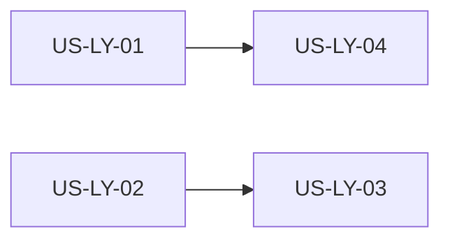

# US-LY 索引：主视图多标签与布局可调

> **需求**：[../39-需求-主视图多标签与布局可调.md](../39-需求-主视图多标签与布局可调.md) · Related [#119](https://github.com/Pedro-MAFS/ftcs/issues/119)  
> **状态**：O1～O10 已于 2026-11-01 确认。实现由马丰顺本人完成。本文只做目录，不关 #119。  
> **界面稿**：[`main-view-tabs.pen`](main-view-tabs.pen) 五屏  
> **说明**：2026-11-01 按马丰顺要求按故事拆文件。原先的长文不再堆验收细节。确认口径不因拆分改写。

| 文件 | 故事 | 已确认项 |
|------|------|----------|
| [US-LY-01-三栏拖拽收起与占满.md](US-LY-01-三栏拖拽收起与占满.md) | 拖宽、收起、占满 | O1、O10 |
| [US-LY-02-主视图标签与首页.md](US-LY-02-主视图标签与首页.md) | 标签条、首页、图标轨 | O2、O3、O8、O9 |
| [US-LY-03-浏览器进主视图标签.md](US-LY-03-浏览器进主视图标签.md) | 浏览器标签、10/5、EC9 | O4、O5、O6、O7。**LY11 选型只写在这里** |
| [US-LY-04-布局持久化.md](US-LY-04-布局持久化.md) | 记住宽度、收起、占满 | 用 01 的状态；不记标签清单 |

箭头是建议的落地顺序。LY11：02 与 03 用同一份 `MainTab`（`kind: 'page' | 'browser'`）。论证和浏览器生命周期只在 03 的「同一次选型」。禁止只含业务页的模型先合入。

建议提交顺序：01（主区可暂为单页）→ 04 → 02 与 03 同一批类型 → 03 的主进程挂载。各文件末尾有自己的落点和手测。

#118 不在这四份里设计。智能体输入框占位和「复制会话」保持现网；01 只要求占满、收起后这些入口还在。

---

## 修订记录

| 日期 | 说明 |
|------|------|
| 2026-11-01 | 长文初稿至 O1～O10 确认，曾合入 #127。 |
| 2026-11-01 | 按马丰顺要求按故事拆文件。本文件改为索引。确认口径不变。不关 #119。 |
