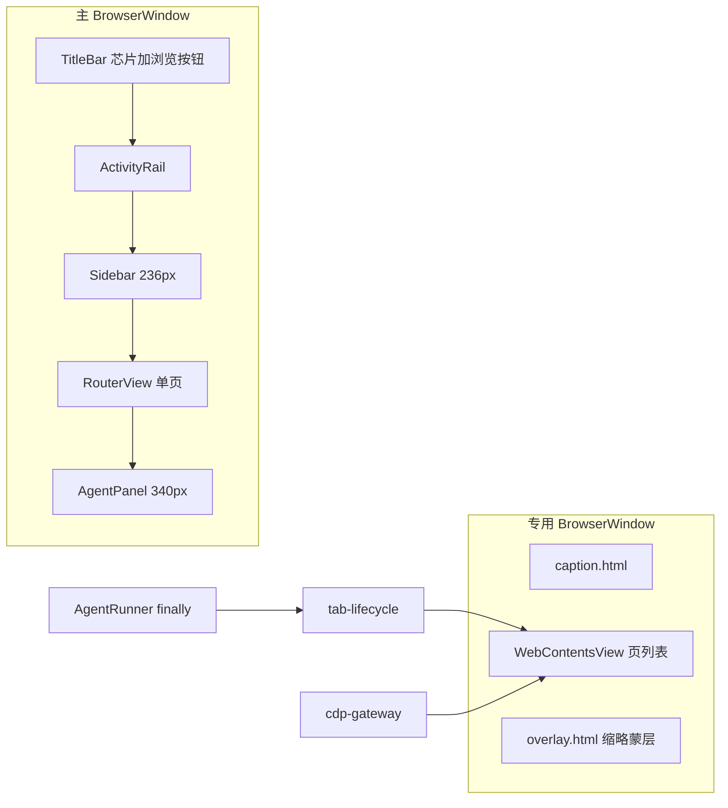
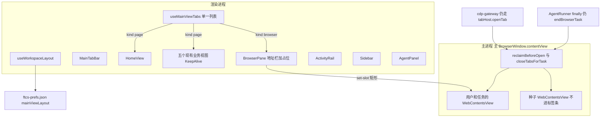

# US-LY 详细设计：主视图多标签与布局可调

> **用户故事**：[../39-需求-主视图多标签与布局可调.md](../39-需求-主视图多标签与布局可调.md) · **US-LY-01**、**US-LY-02**、**US-LY-03**、**US-LY-04** · Related [#119](https://github.com/Pedro-MAFS/ftcs/issues/119)  
> **状态**：**待马丰顺确认后由他本人实现**（本文只定选型、状态、接口形状和验收样例；不改 `desktop/`，不关 #119）  
> **范围**：三栏拖宽、收起、占满并记住；主视图同一套标签条承载首页、五个业务页和多枚浏览器页；内置浏览器的网页仍受上限 10、回收线 5 和任务后清理约束  
> **依赖**：现网 `WorkspaceLayout` 三栏；`useDefaultLanding` / docs/36；`builtin-browser-window.ts` 的 `WebContentsView` 与 CDP；`tab-lifecycle.ts` 的 `BUILTIN_TAB_CAP` / `BUILTIN_TAB_RECLAIM_AT`；docs/38 的「复制会话」在智能体标题行  
> **不做**：改 `docs/39`、`docs/34`、`docs/37`、`docs/36`、`docs/38` 正文；改已有详设正文；实现 `desktop/`；#118 自由对话；关 #119 / #105 / #78；合入 `main`  
> **文档位置**：`docs/design/`  
> **界面稿**：[`main-view-tabs.pen`](main-view-tabs.pen) 五屏（`e058923`）。示例公司与示例线索表不是要写入产品的数据

需求依据只有已合入 `dev-0.6.1` 的 `docs/39`（规则 LY1～LY12、US-LY-01～US-LY-04、§7 O1～O10；基线 `a693b52`）。本文不改该需求正文。LY 规则已锁定。§6 的 O1～O10 是详设推荐，**每一条都待马丰顺确认**；他否决某一条时，只改对应推荐，不改 LY。

docs/39 LY12 / §9 写的是组内先不另开详设。本文是按本次协助请求补的对照稿，实现仍由马丰顺本人完成，不在本文改代码。

US-LY-02 与 US-LY-03 的标签容器在 §3 一次定完。禁止先落地只含业务页的模型，再为浏览器多页另起一套。

---

## 0. 相对现网

对照 `dev-0.6.1`（`a693b52`）。

| 现网 | **本期** |
|------|----------|
| `WorkspaceLayout.vue` 从左到右是 `ActivityRail`（`--rail-width: 48px`）、`Sidebar`（`--sidebar-width: 236px`）、`<main class="workspace__main"><RouterView /></main>`、`AgentPanel`（`--agent-width: 340px`）。三栏 `flex-shrink: 0`，没有分隔条，没有收起，没有占满 | 同一左右顺序。流水线与主视图之间、主视图与智能体之间各一根 6px 分隔条。两栏可点击收起，主视图与智能体可点击占满。宽度按 §5 的比例算，不再写死 236 / 340 |
| 主窗口 `getWindowOptions()`：默认 1180×760，`minWidth: 960`，`minHeight: 640`。`html/#app` 另有 `min-width: 960px` | 最小窗口不改。最小栏宽按这个 960 来配，见 §6.1 |
| `TitleBar.vue` 中间是流水线芯片（录入、画像、探索、线索、邮件），右侧第一个按钮是「打开浏览窗 / 浏览中」（`showBuiltinBrowser` → `builtinBrowserEntryLabel`） | 中间芯片和这个浏览按钮都拿掉。右侧保留运行状态、主题、登录、设置，顺序与五屏一致：运行状态、主题、登录、设置 |
| `ActivityRail.vue` 五个业务图标加底部设置，`router.push({ name: section })`。高亮等于当前路由名 | 图标轨还在，顺序不变。高亮改跟当前标签，不跟「路由碰巧是哪一页」。首页和浏览器标签不高亮业务项 |
| `Sidebar.vue`：非设置时是产品列表 + 五步流水线；`section === 'settings'` 时整栏换成设置分类。点流水线走 `PIPELINE_TO_SECTION`。点「新建」成功后 `router.push({ name: 'profile' })` | 收起后这条栏变成 44px：展开钮 + 产品字头像，五步不铺开。点产品、点流水线、点新建，都改走 §3 的 `openPageTab`。设置仍走这栏的现有分支，不进首页 |
| 路由 `desktop/src/router/index.ts`：`boot` / `input` / `profile` / `explore` / `leads` / `email` / `settings`。同一时刻一条路由 | 增加 `home`、`browse`。业务页和首页仍是这些路由组件。浏览器页的文档在主进程 `WebContentsView` 里，`browse` 只画地址栏和一块占位 |
| `useDefaultLanding` 在流水线就绪后 `router.replace` 到 `landingSectionFromSteps` 的结果。不记上次页面 | 冷启动仍用这个函数决定打开哪一个业务页，并把它放成标签条上的一枚。不额外先摆首页，不恢复上次标签清单 |
| 内置浏览器是主窗旁边的另一扇 `BrowserWindow`（`ensureBuiltinBrowserWindow`）。页是 `WebContentsView`，分区 `ftcs-builtin-browser`。第一枚 `origin: 'seed'`，令牌地址，文案「尚未打开页面」。`openBrowserTabNow` 再追加页。`navigationMode` 在收起态遇到业务 URL 时把 mode 改成 `thumbnail` | 用户看见的浏览器是主视图标签，地址栏在该标签内容区。`WebContentsView` 改挂到主窗口 `contentView`，按占位矩形 `setBounds`。专用悬浮窗、`caption.html`、`overlay.html`、缩略 PiP 不再出现在用户路径上。CDP 网关和 `setBuiltinBrowserTabHost` 仍由这套页提供 |
| `tab-lifecycle.ts`：`BUILTIN_TAB_CAP = 10`，`BUILTIN_TAB_RECLAIM_AT = 5`。`reclaimBeforeOpen` / `closeTaskTabs` 只看主进程里的页数组。`AgentRunner.beginTrackedBrowserTask` / `endTrackedBrowserTask` 包住有网站的画像和探索 R1 / R2 / R3 的 `finally` | 这两个常数、回收和按 `taskId` 清理的函数不改语义。业务标签不进入这个数组。清理只 `dropTab` 匹配的任务页，渲染进程只摘掉对应的 `kind: 'browser'` 标签 |
| `AgentPanel.vue` 标题行：脉冲 +「智能体」，右侧技能名，再 `btn-ghost`「复制会话」。输入框占位仍是自由对话暂未开放 | 标题行在技能名和「复制会话」之后加收起、占满。占满后该处改为「退出占满」，「复制会话」仍在。输入框占位不改 |
| 布局没有落盘。主题是渲染进程 `localStorage` 键 `ftcs-ui-theme-mode`，再经 `settings:set-ui-theme` 写入 `ftcs-prefs.json` | 布局只走一条窄通道，写入现成的 `UserPrefs`，不写进设置页快照，也不做「恢复默认」 |

现网接缝（实现时按本节）：

1. **一枚浏览器页是一枚 `WebContentsView`。** 悬浮窗标题条和缩略蒙层的 view 不算进 10。种子页算进 10。本期把种子页留在主进程数组里，不把它画进主视图标签条。
2. **`closeBrowserTab` 在 `tabs.length <= 1` 时返回 false。** 这保护的是最后一枚页（正常路径就是种子页）。用户关掉标签条上的浏览器标签时，不得把种子页交给这个函数去关。
3. **`openBrowserTabNow` 在 `createBrowserTab` 之前调用 `reclaimBeforeOpen`。** 拒绝时抛 `BUILTIN_TAB_CAP_MESSAGE`，不进 `waitForNewTarget` 的 4 秒循环。这个顺序保持。
4. **`applyPageUrl` 今天会在业务导航时调用 `setBuiltinBrowserMode(navigationMode(...))`，从而把隐藏的悬浮窗变成缩略。** 用户路径改挂主视图之后，这里不能再把窗显示出来。
5. **会开网页的运行已经在主进程 `finally` 里 `endBrowserTask`。** 渲染进程的 `type === 'done'` 不是清理点。本期不把清理搬到 Vue。
6. **线索表 `.leads-table__header` / `__row` 的 `min-width: 1240px`，外包一层 `overflow: auto`。** 主栏窄于 1240 时表横向滚动，这是现网。主栏最小宽度不必抬到 1240。
7. **`PIPELINE_TO_SECTION.email` 是 `leads`。** 流水线第 5 步「邮件草稿」打开线索库。首页上的「邮件」卡片才打开邮件页。两处保持现在的目标，不要合成同一个。
8. **`setAgentContext` 只在 `agentStatus !== 'running'` 时改 `agentSkill`。** 任务进行中切标签，不改技能名。

---

## 1. 范围与规则落点

### 1.1 LY1～LY12

| 规则 | 落点 |
|------|------|
| **LY1** 三栏位置不变，不新增板块 | `WorkspaceLayout.vue` 的身体区顺序保持：图标轨、流水线、主视图、智能体。不提供排序。图标轨仍是流水线左侧那一列 |
| **LY2** 拖到最小即止，拖拽不收起 | §5 两根分隔条。松手只写比例。收起只由点击进入 |
| **LY3** 点击收起流水线和智能体；主区域不能单独收起；收起后字头像；图标轨仍在 | 流水线收起在产品栏标题行。智能体收起在标题行。主视图标签条不放收起。两侧都收起时 `ActivityRail` 仍渲染。字头像见 §6.10 |
| **LY4** 只有主视图和智能体能占满；退出回到进入前 | 主视图占满钮在标签条右侧，占满后同一位置改为「退出占满」。智能体占满在标题行，占满后改为「退出占满」。流水线标题行没有占满。快照见 §5 |
| **LY5** 标签条、加号开首页、顶栏中间让出 | 新组件 `MainTabBar.vue`。首页是新视图 `HomeView.vue`。`TitleBar.vue` 删除 `.title-bar__pipeline` 和 `.browser-entry` |
| **LY6** 图标轨与当前页联动 | `ActivityRail` 的 `is-active` 改读 §3.6，不再读裸路由名 |
| **LY7** 浏览器是主视图标签，再开一页再挂一枚 | §3 的 `kind: 'browser'`。地址栏在 `BrowserPane.vue`，不在顶栏 |
| **LY8** 验收画面是五屏 | 通过条件写在 §9。不把「找到悬浮窗」或顶栏「浏览中」写成通过 |
| **LY9** 兼容 docs/37 的 10 / 5，默认业务标签不占额度 | §4。不改 `BUILTIN_TAB_CAP` 与 `BUILTIN_TAB_RECLAIM_AT` 的数值，不改 `docs/37` 正文 |
| **LY10** 记住比例、收起、占满；没有恢复默认；不记标签清单 | §5。冷启动页仍是 docs/36，见 §6.9 |
| **LY11** 业务页与浏览器多页同一次选型 | §3。模型类型里从第一天就有 `page` 和 `browser` |
| **LY12** v0.6.1，实现归马丰顺，Related #119，不合 main | 本文与后续实现 PR 的基线都是 `dev-0.6.1`。提交说明写 Related #119，不写 Closes / Fixes |

### 1.2 四条故事的验收怎么落到设计

| 故事 | 设计上用什么验收 |
|------|------------------|
| **US-LY-01** | §5 的像素公式、§5.4 的状态转移、§9.1 的拖拽 / 收起 / 占满步骤。最小宽度用 §6.1 的数。控件位置用 §2.3 |
| **US-LY-02** | §3 的 `openPageTab`、§6.2 的关闭、§6.3 的一页一枚、§6.8 的设置、§6.9 的冷启动、§2.3 的首页六卡片文案 |
| **US-LY-03** | §3 的浏览器标签、§6.4 的短标题、§6.5 的迁移、§4 的计数与清理、§7 的任务开页不抢焦点 |
| **US-LY-04** | §5.5 的 `layout:get` / `layout:set`。重启后读回同一份 `MainViewLayout`。界面上没有「恢复默认布局」 |

四条都留。调宽可以用单页理解，交付时主区域已经是标签条。浏览器单独验收，避免只点首页卡片、不测多页和 10 / 5。持久化用完全退出再打开验收，不和当次拖拽绑成同一步。

### 1.3 本期不做

与 docs/39 §4.2 相同：不新增板块，不给流水线占满，不给主区域单独收起，不做恢复默认，不把拖到最小当成收起，不改 10 和 5，不改复制会话的规则，不改输入框「自由对话暂未开放」，不做标签拖拽排序、固定和批量关闭，不设计 #118，不关 Issue。

---

## 2. 现网结构与目标结构

### 2.1 现网



主进程文件：

| 文件 | 现职责 |
|------|--------|
| `desktop/electron/browser-runtime/builtin-browser-window.ts` | 创建专用窗、种子页、`openBrowserTabNow`、`closeBrowserTab`、`closeTabsForTask`、`dropTab`、`setBuiltinBrowserMode` |
| `desktop/electron/browser-runtime/tab-lifecycle.ts` | 常数、`beginBrowserTask`、`endBrowserTask`、`reclaimBeforeOpen`、`closeTaskTabs` |
| `desktop/electron/browser-runtime/index.ts` | `ensureBuiltinBrowser`、`registerBuiltinBrowserIpc`（`builtin-browser:get-state` / `show` / `set-mode`） |
| `desktop/electron/browser-runtime/cdp-gateway.ts` | CDP。`create-tab` 调用 `tabHost.openTab` |
| `desktop/electron/browser-runtime/window-policy.ts` | 三态、`navigationMode`、`builtinBrowserEntryLabel` |
| `desktop/electron/opencode/agent-runner.ts` | `beginTrackedBrowserTask` / `endTrackedBrowserTask` |
| `desktop/electron/config/user-prefs.ts` | `userData/ftcs-prefs.json` 的 `readUserPrefs` / `writeUserPrefs` |

渲染进程文件：`WorkspaceLayout.vue`、`TitleBar.vue`、`ActivityRail.vue`、`Sidebar.vue`、`AgentPanel.vue`、`router/index.ts`、`composables/useDefaultLanding.ts`、`styles/main.css`。

### 2.2 目标



业务页和浏览器页在 `useMainViewTabs` 的同一个数组里。主进程只持有浏览器页的 `WebContents`。渲染进程不创建 `WebContents`。

### 2.3 五屏与控件

稿面窗口宽 1520、身体区以下。顶栏高 44，与现网 `--titlebar-height` 一致。底栏状态条五屏都在，本期不改 `StatusBar.vue`。`UpdateBanner` 仍在顶栏和身体区之间，稿面没有这条约，保持现网位置。

| 控件 | 稿面 | 实现 |
|------|------|------|
| 标签 | 高 26，每一枚都有关闭。01 屏同时有「首页」「线索库」「获客探索」「acme.com」 | `MainTabBar` 左侧横排，超出横向滚动，不换行 |
| 加号 | 标签列末尾 28×28 | 点击调用 `openPageTab('home')` |
| 主视图占满 | 标签条右侧，图标 `maximize-2`。04 屏同一位置是字按钮「退出占满」（`minimize-2` + 文案） | `aria-label` 未占满时为「主视图占满」 |
| 流水线收起 | 产品栏标题行。03 屏收起后栏宽 **44**，上为展开钮（`panel-left-open`），下为 32px 圆头像 | 展开态栏的默认意图宽度仍是 **236** |
| 智能体收起、占满 | 标题行，技能名和「复制会话」之后。收起图标 `panel-right-close`，占满图标 `maximize-2`。03 屏收起后栏宽 **44**，只留展开钮。05 屏该处改为「退出占满」 | 「复制会话」在未收起和占满时都在，`class="btn-ghost"`，`flex-shrink: 0` |
| 分隔条 | 稿面宽 **6**，中间 2×28 的握把。占满时不画 | 组件 `LayoutSplitter.vue`。握把仅是视觉，热区是整根 6px |
| 地址栏 | 浏览器标签内容区顶部：后退、前进、刷新、地址。标签文案 `acme.com`，地址栏是完整 URL | `BrowserPane.vue`。锁图标只在 `https:` 时画出，不另做证书面板 |
| 首页六卡片 | 两列。文案以 docs/39 §2.4 为准 | 见下表。不用 `SECTION_META.subtitle` 替代副文案 |

首页卡片：

| 卡片标题 | 副文案 | 点击 |
|----------|--------|------|
| 录入 | 公司与产品资料 | `openPageTab('input')` |
| 画像 | 确认后再去探索 | `openPageTab('profile')` |
| 探索 | 扩展关键词并找客户 | `openPageTab('explore')` |
| 线索 | 原始与已评分线索 | `openPageTab('leads')` |
| 邮件 | 审阅开发信草稿 | `openPageTab('email')` |
| 浏览器 | 打开客户网站 | `openUserBrowserTab()` |

业务标签的可见标题用现网页标题，与稿面「线索库」「获客探索」一致：

| `page` | 标签标题 | 来源 |
|--------|----------|------|
| `home` | 首页 | docs/39 |
| `input` | 产品录入 | `SECTION_META.input.title` |
| `profile` | 产品画像 | `SECTION_META.profile.title` |
| `explore` | 获客探索 | `SECTION_META.explore.title` |
| `leads` | 线索库 | `SECTION_META.leads.title` |
| `email` | 邮件审核 | `SECTION_META.email.title` |

图标轨顺序与 `ActivityRail.vue` 现网一致：录入、画像、探索、线索、邮件，底部设置（图标仍是 `sliders`）。图标轨上没有浏览器。01 屏停在首页、02 屏停在浏览器标签时，五个业务图标都没有 `is-active`。03 屏停在线索库时，只有线索高亮。

占满与收起时仍可见的部分，按 docs/39 §3.1：

| 状态 | 仍可见 | 隐藏 |
|------|--------|------|
| 两侧收起 | 顶栏、图标轨、44px 产品头像栏、主视图标签与页面、44px 智能体展开条、两根分隔条、状态条 | 流水线步骤、智能体面板正文 |
| 主视图占满 | 顶栏、标签条、当前页、状态条、「退出占满」 | 图标轨、流水线、智能体、分隔条 |
| 智能体占满 | 顶栏、智能体面板全文（含「复制会话」）、状态条、「退出占满」 | 图标轨、流水线、主视图（含标签条）、分隔条 |

智能体占满时，面板内部仍是现网结构：技能名、「复制会话」、三张状态卡、时间线、底部输入。不改 `onSend` 的占位提示。

---

## 3. 同一次选型（LY11 / O7）

本节同时覆盖业务页标签和浏览器多页。推荐方案就是 §6.7。备选放在这里，避免实现时只读到其中一半。

### 3.1 备选

**备选 A，推荐：一条标签列表，每枚带 `kind`。**

```ts
type PageKey = 'home' | 'input' | 'profile' | 'explore' | 'leads' | 'email'

type MainTab =
  | { id: `page:${PageKey}`; kind: 'page'; page: PageKey; title: string }
  | {
      id: string
      kind: 'browser'
      browserKey: string
      title: string
      url: string
      origin: 'user' | 'task'
      taskId: string | null
    }
```

`id` 与顺序在渲染进程。`kind: 'browser'` 的 `id` 直接用主进程已有的 `BrowserTab.key`（`tab-1` 这种），不再另编一套。

**备选 B：业务标签条里嵌一套浏览器多页。**

主视图只有一枚「浏览器」业务标签。点进去之后，内容区顶部再有一条只属于网页的标签。主进程的多 `WebContents` 对上这条内层条。

**备选 C：两套互不引用的列表。**

业务页用 Vue 路由标签，网页继续用专用窗里的 `captionTabs()`。两条条、两套激活态。

### 3.2 取舍

| 标准 | A | B | C |
|------|---|---|---|
| 稿面 01 / 02：`acme.com` 与「线索库」「获客探索」同一条 | 符合 | 不符合。网页会缩进第二层 | 不符合。网页不在主视图条上 |
| LY7：再打开别的页面时再挂一枚主视图标签 | 符合 | 不符合 | 不符合 |
| LY11：禁止先做业务页再平行做一套浏览器模型 | 符合。类型里两种都在 | 主条可以先做，内层容易后补成第二套 | 就是被禁止的平行模型 |
| 10 / 5 只数网页 | 主进程数组不收 `kind: 'page'` | 也能做到，但多一层同步 | 现网就是这样，但过不了五屏 |
| 任务清理误关业务页 | 清理函数的入参类型里没有业务标签 | 内层清掉时要额外保证不关外层 | 悬浮窗本来就关不到业务页，但用户路径仍是悬浮窗 |
| 改动面 | 要改挂载 `WebContentsView` 的父窗口 | 同样要改挂载，再加一层 UI | 最小，但验收画面仍是 EC9 |

推荐 **A**。B 的取舍点是少改标签条的心智，代价是和五屏不一致。C 的取舍点是沿用专用窗，代价是 LY8 的通过画面过不了。

### 3.3 推荐模型怎么工作

渲染进程模块 `desktop/src/composables/useMainViewTabs.ts`（单例，写法对齐 `useDefaultLanding.ts`）：

| 字段 | 含义 |
|------|------|
| `tabs` | 上面的 `MainTab[]`，从左到右 |
| `activeId` | 当前枚。空列表时为 `null` |
| `settingsCover` | 为 true 时主视图内容是设置页，标签条仍在，没有任何一枚画成选中 |

主进程继续用 `builtin-browser-window.ts` 里的 `BrowserTab`（`key`、`view`、`origin`、`taskId`、`targetId`）。种子页 `origin: 'seed'` 留在这个数组里，**不**出现在 `publishMainTabs` 发给渲染进程的列表中。

渲染进程收到的浏览器投影：

```ts
interface BrowserTabProjection {
  browserKey: string
  url: string
  origin: 'user' | 'task'
  taskId: string | null
}
```

标题不由网页的 `page-title-updated` 决定。渲染进程用 §6.4 的函数，从 `url` 和「同一主机还有几枚」算出短标题。现网 `tabLabel()` 优先用文档标题，那是悬浮窗标题条的规则；主视图标签条不用它。

同步：

1. 主进程在 `createBrowserTab`、`dropTab`、导航提交之后调用 `publishMainTabs()`。
2. 新通道 `builtin-browser:tabs` 把投影数组推到主窗口 `webContents`。
3. `useMainViewTabs` 按 `browserKey` 合并：主进程有而列表没有的，追加到末尾；列表有而主进程没有的 `kind: 'browser'` 删掉；`kind: 'page'` 不动。
4. 被删掉的那枚若是 `activeId`，按 §6.2 激活邻居。

### 3.4 状态放哪，谁持有 WebContents

| 状态 | 持有者 | 原因 |
|------|--------|------|
| 标签顺序、哪一枚选中、设置是否盖住内容 | 渲染进程 `useMainViewTabs` | 标签条是 Vue。业务页没有自己的 `WebContents` |
| 布局比例、收起、占满、进入占满前的快照 | 渲染进程 `useWorkspaceLayout`，落盘在主进程 `UserPrefs.mainViewLayout` | 布局是用户偏好，和主题一样进 `ftcs-prefs.json`。主进程不靠它排 `WebContents` |
| `WebContentsView`、CDP `targetId`、`origin`、`taskId`、10 / 5 | 主进程 `builtin-browser-window.ts` + `tab-lifecycle.ts` | 现网已经在这里。渲染进程拿不到 `WebContents` |
| 种子页 | 主进程，不进标签条 | 保住 CDP 就绪和「至少留一枚页」。用户不必看见「尚未打开页面」 |

`WebContents` 只由主进程创建和销毁。挂载点从专用 `BrowserWindow.contentView` 改为**主窗口** `contentView`。`ensureBuiltinBrowserWindow` 不再 `new BrowserWindow` 作为用户可见的浏览窗。函数可以改名为内部的 `ensureBuiltinBrowserViews(main)`，对外仍由 `ensureBuiltinBrowser()` 调用，这样 `env-probe.ts`、`runtime.ts`、`agent-preflight.ts`、`main.ts` 里现有的 `ensureBuiltinBrowser()` 调用点不用改语义：启动时准备好网关、种子页和 `tabHost`。

活动的浏览器标签：渲染进程量占位元素 `getBoundingClientRect()`，用 `builtin-browser:set-slot` 把相对主窗口内容区的 `{ x, y, width, height, visible, browserKey }` 交给主进程。主进程对这一枚 `view.setBounds`，并 `setVisible(true)`。其余网页 view 保持挂在主窗口上，`setVisible(false)`，但 `setBounds` 仍写成最近一次槽位的非零尺寸，避免布局视口变成 0。种子页 `setVisible(false)`。

`settingsCover === true`、当前标签不是这枚浏览器页、智能体占满、主窗口最小化时，`visible: false`。

分区仍是 `ftcs-builtin-browser`。`backgroundThrottling: false` 保持。`startCdpGateway`、`registerBrowserPage`、`setBuiltinBrowserTabHost({ openTab, closeTab, activateTab })` 保持。`openTab` 仍指向回收之后的创建函数。

### 3.5 标识与生命周期

| 对象 | id | 创建 | 销毁 |
|------|-----|------|------|
| 业务页 / 首页 | `page:home`、`page:input`、`page:profile`、`page:explore`、`page:leads`、`page:email`。同一 `page` 至多一枚 | `openPageTab` | 标签上的关闭。只删列表项，并丢掉该页的 `KeepAlive` 缓存 |
| 用户打开的网页 | 主进程 `BrowserTab.key` | 首页「浏览器」、地址栏里提交一个要新开的动作、当前可见页的 `window.open` | 标签关闭 → `builtin-browser:close` → 现有 `closeBrowserTab` → `dropTab`。不把种子页传进去 |
| 任务打开的网页 | 同上，`origin: 'task'`，`taskId` 为 `browser-<skill>-<序号>` | `cdp-gateway` 的 `create-tab`，或页内 `window.open` 且当时有 `getCurrentBrowserTaskId()` | `endBrowserTask` → `closeTabsForTask`。渲染进程跟着投影把这枚从列表去掉 |
| 种子页 | 主进程 key，无标签 id | `ensureBuiltinBrowser` 里 `createBrowserTab('seed', null)`，加载 `tokenPageUrl()` | 应用退出 `noteBuiltinBrowserQuitting`。用户关闭和任务清理都不 drop 它 |

`openPageTab(page)`：

1. 已有 `page:${page}` 则把它设为 `activeId`，`settingsCover = false`，`router.push` 到对应路由名。
2. 没有则追加到末尾，再执行上一步。
3. `home` 的路由名是 `home`。五个业务页用现有路由名。

`openUserBrowserTab()`：

1. 若已有 `origin === 'user'` 且 URL 仍是 `about:blank` 或空的一枚，聚焦它，不再创建。
2. 否则主进程 `openBrowserTabNow('about:blank')`，`taskId` 为空，因而 `origin: 'user'`。创建成功后聚焦这枚（用户自己点的）。
3. 命中 §4 的拒绝时，Toast 主进程返回的那句「内置浏览器标签已达上限，这一页没有打开。」不追加标签。

地址栏回车：把当前这枚浏览器标签 `loadURL` 到规范化后的 URL（无协议时补 `https://`）。这是同一枚的导航，不新开标签。

当前可见网页里的 `window.open`：仍走现有 `setWindowOpenHandler` → `openBrowserTab`。这一枚要聚焦，因为用户正在看的页面发出了打开。

任务 / CDP 的 `openTab`：创建并登记，**不**改渲染进程的 `activeId`。详见 §7。

五个业务视图和 `HomeView` 放在 `<KeepAlive>` 里，`include` 用各自组件名。切走再切回，列表滚动和未提交的表单还在。关掉标签时去掉对应缓存。浏览器页不进 `KeepAlive`，文档活在主进程。

冷启动不读 `tabs`。进程内存里的列表随退出消失。这是 LY10，不是漏做。

### 3.6 路由、图标轨、侧栏

| 当前内容 | 路由 | 图标轨 |
|----------|------|--------|
| 首页 | `home` | 五个业务项都不高亮，设置也不高亮 |
| 五个业务页 | 现有名字 | 对应项 `is-active` |
| 浏览器标签 | `browse`。多枚浏览器标签共用这一条路由，靠 `activeId` 区分 | 五个业务项都不高亮 |
| 设置盖住 | `settings` | 只有底部设置高亮。`activeId` 保留，标签都不画成选中 |
| 一张标签都没有 | 新路由 `empty`，只显示「没有打开的页面」 | 五个业务项都不高亮 |

`WorkspaceLayout` 里现有的 `section` 计算要认这些新名字。`setAgentContext` 只在当前是五个业务页之一、且没有被设置盖住时调用。首页、浏览器、空态不把技能名改成别的；任务进行中本来就不会改。

图标轨、侧栏流水线、侧栏「新建」成功后的跳转，都改为 `openPageTab`，不再直接 `router.push` 到业务页。设置按钮（顶栏与图标轨）调用 `openSettings()`：`settingsCover = true`，`router.push({ name: 'settings' })`，不追加标签。

在设置盖住时再点当前 `activeId` 那枚标签，或点图标轨的业务项：`settingsCover = false`，显示那一页。

侧栏在 `settings` 时仍换成设置分类（现网 `Sidebar.vue` 的分支）。这时产品字头像不画。收起状态位不因为进入设置而被改写成展开。进入设置的这一次显示里，左栏按展开宽度画出设置分类；离开设置后若 `pipelineCollapsed` 仍为 true，回到 44px 字头像。设置分类标题行的收起钮仍然可用：收起后只留展开钮，分类列表隐藏，再展开仍是设置分类。

`useDefaultLanding` 的 `TAKEOVER_ROUTES` 补上 `home`、`browse`、`empty`。占位路由 `boot` 保持。

---

## 4. 10 / 5 护栏落在哪一层（LY9 / O6）

推荐不合并计数。论证在 §6.6。本节只写推荐方案下每一层碰到的对象，方便对照现网函数。

### 4.1 谁被计数

`reclaimBeforeOpen` 的入参仍是主进程 `tabs` 映射出来的 `{ id: tab.key, origin, taskId }`。这个数组含种子页、`user` 页、`task` 页。

`useMainViewTabs` 里 `kind: 'page'` 的枚数不传入 `reclaimBeforeOpen`，也不传入 `closeTaskTabs`。设置页没有 `WebContentsView`，不计数。

因此：

| 动作 | 作用层 | 对象 |
|------|--------|------|
| 计数 | 主进程 `tabs.length` | 种子 + 用户网页 + 任务网页 |
| 回收 | `openBrowserTabNow` 里、`createBrowserTab` 之前的 `reclaimBeforeOpen` | 仅 `origin === 'task'` 且 `taskId` 等于 `getCurrentBrowserTaskId()` 的页，从旧到新，直到 `length < 5` 或没有这种页。不关种子，不关 `user`，不关别的任务，不关任何业务标签 |
| 拒绝再开 | 同一函数，回收之后 `length >= 10` | 不创建 view，抛出已有句子 `BUILTIN_TAB_CAP_MESSAGE`。调用方不进入 `waitForNewTarget` |
| 任务结束 / 失败 / 取消 | `AgentRunner` 已有的 `finally` → `endTrackedBrowserTask` → `endBrowserTask` → `setTabCloseHost` 上的 `closeTabsForTask` | 只 drop 本次 `taskId`。种子和 `user` 留下。渲染进程只删除投影里消失的 `kind: 'browser'` |
| 用户关一枚浏览器标签 | 标签条关闭 → `closeBrowserTab` | 这一枚 `user` 或 `task` 页。种子页不在标签条上 |
| 用户关一枚业务标签 | 渲染进程 | 只删 `kind: 'page'`。不调用 `closeBrowserTab`，不调用 `endBrowserTask` |

种子页一直占着 10 里面的 1。用户从首页连续打开网站时，可见网页最多 **9** 枚，第 10 次打开走拒绝。这是 docs/37「上限含种子页」在新界面上的读法，不是把 10 改成 9。常数仍写 10 和 5。

任务自己连续开页、且当时没有额外 `user` 页时，行为与现网 US-TC 单测一致：到 5 就回收本任务最旧页，开完后总数不超过 5。

### 4.2 和现网函数的衔接

不改这些导出和句子：

| 符号 | 文件 |
|------|------|
| `BUILTIN_TAB_CAP`、`BUILTIN_TAB_RECLAIM_AT`、`BUILTIN_TAB_CAP_MESSAGE` | `desktop/electron/browser-runtime/tab-lifecycle.ts` |
| `beginBrowserTask`、`endBrowserTask`、`reclaimBeforeOpen`、`closeTaskTabs`、`getCurrentBrowserTaskId` | 同上 |
| `closeTabsForTask` | `builtin-browser-window.ts` |
| `beginTrackedBrowserTask`、`endTrackedBrowserTask` | `agent-runner.ts`。有网站的画像看 `bootstrap.websiteUrls.length > 0`。探索在 `runDiscover` 路径上登记。关键词扩展、评分、起草、补全不登记 |

`closeTabsForTask` 在 drop 之后，渲染进程靠 `builtin-browser:tabs` 对齐。禁止在 Vue 里按「标题像网址」去猜哪些标签该关。

业务标签的关闭路径不经过 `dropTab`。任务清理路径不读取 `useMainViewTabs`。两边只在「投影合并」这一处相接。

### 4.3 清理时用户正在看的那一页

被回收或被 `closeTabsForTask` 关掉的若正是 `activeId`，按 §6.2 激活右邻，没有右邻则左邻。邻居是业务页就显示业务页。没有邻居则空态。

清理不调用 `setBuiltinBrowserMode`，不 `show` 专用窗。现网 US-TC 关于 mode 不变的断言，在用户路径上改为：清理前后主视图的布局状态（比例、收起、占满）不变，业务标签的 id 列表不变。

---

## 5. 布局状态与持久化（US-LY-01 / US-LY-04）

### 5.1 字段

```ts
interface LayoutRatios {
  pipeline: number
  main: number
  agent: number
}

interface LayoutSnapshot {
  ratios: LayoutRatios
  pipelineCollapsed: boolean
  agentCollapsed: boolean
}

interface MainViewLayout {
  ratios: LayoutRatios
  pipelineCollapsed: boolean
  agentCollapsed: boolean
  fill: 'none' | 'main' | 'agent'
  beforeFill: LayoutSnapshot | null
}
```

三份比例都大于 0，和为 1。它们表示**用户意图**，不是某一瞬间夹取之后的像素。

首次没有记录时：

| 栏 | 比例 | 对应的意图像素 |
|----|------|----------------|
| 流水线 | `0.2107` | 在默认窗宽下为现网 236 |
| 主视图 | `0.4857` | 其余 |
| 智能体 | `0.3036` | 在默认窗宽下为现网 340 |

三数之和为 `1`。默认窗宽 1180 时，分母 `D = 1180 - 48 - 12 = 1120`，像素约为 236、544、340。余数像素加到主视图上。

`pipelineCollapsed` 与 `agentCollapsed` 默认 false。`fill` 默认 `'none'`。`beforeFill` 默认 null。

### 5.2 分母、固定宽度、最小宽度

数值的理由和备选在 §6.1。这里是公式。

| 名字 | 像素 | 依据 |
|------|------|------|
| 图标轨 | 48 | 现网 `--rail-width`，稿面 Activity Rail 宽 48。占满时不占 |
| 收起的流水线 | 44 | 稿面 03 屏 Pipeline 宽 44 |
| 收起的智能体 | 44 | 稿面 03 屏 Agent 宽 44 |
| 分隔条 | 每根 6 | 稿面 Resize 宽 6。占满时两根都不占 |
| 流水线展开最小 | 200 | §6.1 |
| 智能体展开最小 | 300 | §6.1。现网意图宽度仍是 340 |
| 主视图最小 | 360 | §6.1 |

**分母**是身体区宽度里，交给「当前处于展开态的栏」去分的那一段：

```text
身体区宽度 = workspace__body 的 clientWidth
固定占用 = 图标轨（可见时 48，否则 0）
        + 收起栏（每栏 44）
        + 分隔条（未占满时 12，占满时 0）
D = 身体区宽度 - 固定占用
```

D 按展开栏的比例重新归一化之后再分。收起不改写已保存的比例，只是这栏暂时不参加分配。再展开时用原来的比例把份额要回来。

占满不使用 D。主视图占满时主视图等于身体区宽度，其余为 0。智能体占满时智能体等于身体区宽度，其余为 0。占满不把比例写成 `1, 0, 0`。

夹取只影响当次画出的像素，不在窗口 `resize` 时写回比例。顺序：先按比例分配，再把低于最小宽度的展开栏抬到最小宽度，缺口从仍高于自身最小宽度的栏里扣，先扣主视图，主视图已经到 360 再扣另一栏。窗口 `minWidth: 960` 时，48 + 200 + 6 + 360 + 6 + 300 = 920，小于 960，三栏可以同时停在最小宽度上。

在 960 宽的窗口上，默认比例会先算出流水线约 190、智能体约 273，然后夹成 200 和 300，主视图得到 400。这是最小窗口上的显示，不是把默认意图改成 200 / 300。用户没有拖过的话，拉宽窗口后仍回到 236 和 340 那组比例。

### 5.3 拖拽

只有分隔条两侧都是展开栏、且 `fill === 'none'` 时，这根条才 `cursor: col-resize` 并接收拖拽。贴着收起栏的那根条画出来，但不改变宽度。占满时不画条。

拖拽过程中改的是像素。松手时把当时三栏的展开像素（收起栏不参加）换算回和为 1 的比例，再落盘。拖到最小宽度就不再继续，松手后栏仍是展开。没有「松手变成收起」。

拖拽进行中不写盘。`pointerup`、收起、展开、进入占满、退出占满才写。

### 5.4 状态转移

| 当前 | 动作 | 结果 |
|------|------|------|
| `fill === 'none'` | 拖分隔条到最小以上 | 更新比例。收起位不变 |
| `fill === 'none'` | 拖到最小 | 该栏停在最小像素。收起位不变 |
| `fill === 'none'` | 点击流水线收起 / 展开 | 只翻转 `pipelineCollapsed`。比例不变 |
| `fill === 'none'` | 点击智能体收起 / 展开 | 只翻转 `agentCollapsed`。比例不变 |
| `fill === 'none'` | 点击主视图占满 | `beforeFill` 记下当前比例和两个收起位，`fill = 'main'` |
| `fill === 'none'` | 点击智能体占满 | 同样记下 `beforeFill`，`fill = 'agent'` |
| `fill === 'main'` 或 `'agent'` | 再点同一个占满 | 无操作 |
| 已占满 | 点击「退出占满」 | 比例和收起位改回 `beforeFill`，`fill = 'none'`，`beforeFill = null` |
| 已占满 | 拖拽 | 没有分隔条，不会发生 |
| 任意 | 点「恢复默认」 | 界面上没有这个控件 |

主视图占满时智能体的占满钮不可见，所以不能从一种占满直接进入另一种。必须先退出。退出用的是进入**这一次**占满之前的快照，不是 100% 宽度。

智能体占满期间标签列表仍在内存里。退出后 `activeId` 相同，标签回到原位。主视图占满不卸载标签。

收起智能体时面板正文不渲染，只留 44px 上的展开钮。「复制会话」在收起窄条上不出现；展开或占满时出现。

### 5.5 落盘

复用 `desktop/electron/config/user-prefs.ts` 的 `readUserPrefs` / `writeUserPrefs`。在 `UserPrefs` 上增加可选字段 `mainViewLayout`。不放进 `getSettingsSnapshot()`，设置页不出现布局分类，因此也没有恢复默认的入口。

新通道，形状固定：

| IPC 名 | 通道字符串 | 方向 |
|--------|------------|------|
| `LAYOUT_GET` | `layout:get` | `invoke`，无参数，返回 `MainViewLayout \| null` |
| `LAYOUT_SET` | `layout:set` | `invoke`，参数 `MainViewLayout`，校验后写入并返回落盘结果 |

挂载点和现有设置通道一样：`desktop/electron/ipc/types.ts` 加常量，`desktop/electron/main.ts` 里 `ipcMain.handle`，`desktop/electron/preload.ts` 暴露 `getMainViewLayout` / `setMainViewLayout`，`desktop/src/types/electron.d.ts` 补类型。

校验失败就丢弃这一次写入并返回当前盘上的值：比例不是有限正数、和与 1 相差超过 `0.001`、`fill` 不是三态之一、`fill === 'none'` 时 `beforeFill` 必须为 null、`fill !== 'none'` 时 `beforeFill` 必须是一份合法快照。文件不存在或字段缺失时，`layout:get` 返回 null，渲染进程用 §5.1 的默认值，不立刻把默认值写回去。

`WorkspaceLayout` 在身体区用 `v-if="layoutReady"`。`onMounted` 里先 `await getMainViewLayout()`，再显示三栏，避免先画出 236 / 340 再跳到用户比例。顶栏可以先画。

重启：

| 退出时 | 再打开 |
|--------|--------|
| 拖过的比例 | 同一组比例。窗口尺寸不同则按新的 D 重算像素，最小宽度仍夹取 |
| 流水线或智能体收起 | 对应栏仍收起 |
| `fill === 'main'` 或 `'agent'`，且 `beforeFill` 在 | 仍是该占满。退出占满回到 `beforeFill`，而不是一份 100% |
| 标签开了很多 | 不恢复。按 §6.9 只打开冷启动那一页 |

损坏的 `beforeFill` 配上占满：不当成占满打开，改用默认比例、两栏展开、`fill: 'none'`。这条只覆盖读坏的文件。正常退出再打开必须能停在占满上。

---

## 6. 开放项 O1～O10

> **待马丰顺确认。** 本节十条都是详设推荐。LY1～LY12 不在待确认之列。否决某一条时，改本节和它指向的实现节，不改 `docs/39`。

### 6.1 O1　最小宽度与百分比分母

> **待马丰顺确认**

| | |
|--|--|
| **推荐** | 分母是身体区里「展开栏所分的那一段」，见 §5.2。图标轨 48，收起栏 44，分隔条 6。展开最小宽度：流水线 **200**，智能体 **300**，主视图 **360**。意图宽度默认仍对应现网 236 与 340 |
| **备选** | 分母用整窗客户区宽度，三栏连同图标轨一起按百分比。最小宽度改成流水线 236、智能体 340、主视图 480，与现网固定值相同，到不了头就停 |
| **理由** | 整窗含顶栏的横向并不参与分栏，图标轨在稿里是固定 48，收起栏在稿里是固定 44。把它们放进百分比，收起一次比例就会跳。备选的最小宽度在 `minWidth: 960` 时是 48+236+6+480+6+340 = 1116，已经大于 960，最小窗口上拖不动，也放不下现网三栏。推荐值在 960 上是 920，放得下。智能体最小 300 而不是 340：标题行要同时留下技能名省略号、「复制会话」（`flex-shrink: 0`）和两枚 28px 图标，约 280px，300 留一点余量。流水线最小 200：产品标题行要放下「产品」、新建和收起，现网 236 是默认而不是下限。主视图最小 360：高于现网在 960 窗口上大约 336 的剩余，标签条和地址栏仍能排开；线索表本身 `min-width: 1240px` 且已有横向滚动，不必把主栏抬到 1240 |
| **样例** | 窗口客户区宽 1180，两栏展开。首次打开，流水线 236、智能体 340，其余给主视图。拖到流水线不再变窄时，流水线是 200，松手后仍是展开的流水线，五步还在。窗口改成 960 再量：三栏都不低于 200 / 360 / 300。拉回 1180 且用户没在 960 上拖过：又是 236 和 340。收起流水线：该栏 44，已保存比例不变；再展开，宽回到收起前按同一比例算出的像素 |

### 6.2 O2　关闭标签后的激活与空态

> **待马丰顺确认**

| | |
|--|--|
| **推荐** | 关掉的是当前枚：有右邻则激活右邻，否则激活左邻。关掉的不是当前枚：当前枚不变。关掉最后一枚：`activeId = null`，主区只显示「没有打开的页面」，加号仍在，不自动再开首页 |
| **备选** | 关掉当前枚总是激活左邻。关掉最后一枚时自动再开一枚首页 |
| **理由** | 右邻优先时，从左往右关掉当前枚，激活的是用户还没关掉的下一枚，和稿面上多枚并排的阅读顺序一致。备选的自动首页会让「关掉最后一枚」和「点加号」变成同一结果，空态就不可验收。LY5 把新开首页放在加号上 |
| **样例** | 从左到右是首页、线索库、获客探索，当前是线索库。关线索库，当前变为获客探索，图标轨变为探索。再关获客探索，当前变为首页，图标轨没有业务项高亮。关首页，主区文字是「没有打开的页面」，标签条只剩加号。点加号，出现一枚「首页」。关线索库时若当前本就是首页，首页仍选中 |

### 6.3 O3　同一业务页能否两枚

> **待马丰顺确认**

| | |
|--|--|
| **推荐** | 每个 `PageKey` 至多一枚。首页、图标轨、流水线、首页卡片再次进入已打开的页时，聚焦已有的那枚，不追加。浏览器标签可以多枚。首页「浏览器」在已经有一枚空白 `user` 页时聚焦它，否则新开一枚 |
| **备选** | 每次从首页进入都再开一枚，允许两枚「线索库」 |
| **理由** | 五屏里首页、线索库、获客探索、某一个网站各一枚。docs/39 写明未说明前自测不要出现两枚「线索库」。网页需要多枚，因为 LY7 要求再开一个页面再挂一枚，同一站点的两条路径也要能同时留下 |
| **样例** | 打开线索库后再点图标轨「线索」或首页「线索」，标签条仍只有一枚「线索库」，且它被选中。再点首页「浏览器」两次，中间不导航：只有一枚标题为「浏览器」的空白页。在地址栏打开 `https://acme-industrial.com/products/valves` 之后再点首页「浏览器」：新增一枚空白页，原来的 acme 页还在 |

### 6.4 O4　同一站点多条路径的短标题

> **待马丰顺确认**

| | |
|--|--|
| **推荐** | 地址栏永远是完整 URL。标签短标题：尚无 http(s) 时为「浏览器」。有主机名时取主机名并去掉前缀 `www.`。该主机名在标签条上只有一枚时，标题就是主机名。有两枚及以上时，每枚改成「主机名/第一段路径」；第一段也相同则按从左到右的顺序在后者上加 ` ·2`、` ·3` |
| **备选** | 标签用网页文档标题；重名时加 `(2)` |
| **理由** | 稿面标签是 `acme.com` 量级，地址栏才是 `https://acme-industrial.com/products/valves`。文档标题常常是营销句，两条路径会重名。短标题仍在主视图标签上，不回到悬浮窗 |
| **样例** | 只有 `https://acme-industrial.com/products/valves`：标签 `acme-industrial.com`，地址栏是这整条 URL。再开 `https://acme-industrial.com/about`：两枚分别是 `acme-industrial.com/products` 与 `acme-industrial.com/about`。两条都是 `/products/valves` 与 `/products/seals`：`acme-industrial.com/products` 与 `acme-industrial.com/products ·2`。`https://www.acme.com/` 单独一枚时标题是 `acme.com` |

### 6.5 O5　EC9 悬浮三态怎么迁移

> **待马丰顺确认**

| | |
|--|--|
| **推荐** | 用户路径只留主视图标签。顶栏不再渲染「打开浏览窗 / 浏览中」。专用 `BrowserWindow`、`caption.html`、`overlay.html`、缩略 PiP、放大标题条不再显示。`WebContentsView` 挂到主窗口。CDP 网关、分区、`tabHost.openTab` 保留。标签上的关闭是 `dropTab` 这一枚网页，不是把悬浮窗收起。种子页和 CDP 会话留在主进程。`applyPageUrl` 不再调用 `setBuiltinBrowserMode` |
| **备选** | 主视图标签只是入口，点击后仍 `showBuiltinBrowserFromTitleBar()` 弹出 EC9 缩略窗。或保留顶栏按钮作为第二入口 |
| **理由** | docs/39 LY8：五屏没有缩略窗、PiP 和顶栏浏览按钮，并且不得把「找到悬浮窗」当成打开浏览器的通过条件。备选会让测试者继续按 EC9 找窗。docs/34 正文不改；EC9 仍是旧悬浮窗的定义，只是 #119 的用户路径不再走到它。现网「关闭 ≡ 收起」管的是那扇悬浮窗；主视图上的关闭管的是这一枚页。种子页仍关不掉，CDP 不因为关掉可见标签而拆掉 |
| **样例** | 冷启动后顶栏右侧是运行状态、主题、登录、设置，没有「打开浏览窗」。点首页「浏览器」，主视图出现一枚浏览器标签，内容区有后退、前进、刷新和地址栏，屏幕上没有第二扇无框小窗。任务打开一家官网时，不出现缩略窗。关掉这枚网站标签后，种子页仍在主进程（CDP 仍能 `ensureBuiltinBrowser`），标签条上可以已经没有浏览器标签。全程不要求测试者找到悬浮窗 |

迁移时具体碰到的现网符号：

| 现网 | 本期用户路径 |
|------|----------------|
| `TitleBar.vue` 的 `openBrowser()` → `window.ftcs.showBuiltinBrowser` | 删除该按钮。首页卡片走 `openUserBrowserTab` |
| `showBuiltinBrowserFromTitleBar`、`setBuiltinBrowserMode('thumbnail' \| 'expanded')` | 用户操作不调用。`window-policy.ts` 的 `builtinBrowserEntryLabel` 可以留着，供还没删的单测编译；界面不读它 |
| `navigationMode` 在 `applyPageUrl` 里把 `hidden` 变成 `thumbnail` | 删除这条调用。导航只更新该页的 `url` 并 `publishMainTabs` |
| 专用窗 `close` 事件里 `preventDefault` 再收起 | 不再创建这扇用户可见的窗，因此没有「关掉窗口 ≡ 收起」 |
| `follow-main-window.ts` 跟着主窗移动缩略窗 | 用户路径不附着。网页 view 的位置只跟占位矩形 |
| `caption.html` / `overlay.html` 上的收起、放大、还原 | 不加载 |

通过条件里没有「mode 仍是 hidden / thumbnail / expanded」这一句。和 US-TC 手测清单里仍写着三态的那几条，见 §12。

### 6.6 O6　10 / 5 作用在哪一层

> **待马丰顺确认**

| | |
|--|--|
| **推荐** | 不合并计数。网页页数仍是主进程 `tabs.length`，含种子页，上限 10，回收线 5。业务标签不进入这个数组。任务清理只 drop 本次 `taskId`。详见 §4 |
| **备选** | 把首页、五个业务页和网页合成一个长度，一起去比 10 和 5 |
| **理由** | LY9 的默认就是分开。合并会计数会让「首页 + 五个业务页 + 种子页」在还没开网站时就已经是 7，探索再开几家就会顶到 10，US-TC-02「当前任务页到 5 仍能再开、开完后总数不超过 5」在用户同时还开着业务页时会先被拒绝。那是改语义，不是兼容。分开之后，现有 `tab-lifecycle.test.ts` 仍只喂页数组，不必把 Vue 标签算进去 |
| **样例** | 标签条上有首页、线索库、获客探索，主进程同时有 1 枚种子。此时 `tabs.length === 1`，不是 4。任务再连续打开公司站：开到第 5 枚页（含种子）时回收本任务最旧的站，线索库和首页仍在。事先由用户打开 9 枚网站（加种子共 10）后，任务再开一页：立即 Toast 或工具结果为「内置浏览器标签已达上限，这一页没有打开。」，业务标签一枚都不少。任务 `finally` 之后，这次的任务页为 0，用户自己打开的网站还在，线索库还在 |

### 6.7 O7　标签容器与状态模型

> **待马丰顺确认**

| | |
|--|--|
| **推荐** | 备选 A：一条列表，`kind: 'page' \| 'browser'`。状态位置、`WebContents` 持有者、id 和生命周期按 §3 |
| **备选** | 备选 B（业务条内再嵌浏览器条）或备选 C（业务条与专用窗各做各的） |
| **理由** | §3.2。稿面把网站和线索库放在同一条上。LY11 要求这一节同时写完两种页，不能先合入只声明 `page` 的类型 |
| **样例** | 标签条从左到右可以是 `page:home`、`page:leads`、`page:explore`、`tab-3`（浏览器）。切到 `tab-3` 时主区是地址栏加网页，切回 `page:leads` 时图标轨高亮线索，`tab-3` 的 `WebContents` 仍在主进程，只是 `setVisible(false)`。不存在第二套只在悬浮窗里的页列表 |

### 6.8 O8　设置页占不占一枚标签

> **待马丰顺确认**

| | |
|--|--|
| **推荐** | 不占标签。顶栏和图标轨底部的设置仍 `router.push({ name: 'settings' })`，`settingsCover = true`。侧栏仍换成现网设置分类。首页六张卡片里没有设置 |
| **备选** | 设置独占一枚标签，标题「设置」，关闭后回到上一枚 |
| **理由** | 稿面和 LY5 都把设置留在顶栏，首页明确不含设置。五屏没有「设置」标签。沿用现网路由时，`Sidebar.vue` 里 `section === 'settings'` 的分类列表不用搬进标签内容区重做一遍 |
| **样例** | 当前是线索库，点顶栏设置。标签条上仍是原来的那些枚，没有一枚标题为「设置」，也没有一枚画成选中；图标轨底部设置高亮；左栏是「账号与授权」等分类。点「线索库」那枚标签，设置盖住消失，线索库恢复选中，左栏回到产品与流水线。首页上看不到设置卡片 |

### 6.9 O9　冷启动标签与 docs/36

> **待马丰顺确认**

| | |
|--|--|
| **推荐** | `landingSectionFromSteps` 的返回值原样作为唯一自动打开的业务标签。不额外插入首页。不恢复退出前的标签。用户在占位期间已经点过页面，则沿用现网 `userTookOver`，不再 `replace` |
| **备选** | 每次冷启动先开一枚首页，再在旁边打开阶段页。或把上次 `tabs` 写入 `mainViewLayout` 一起恢复 |
| **理由** | docs/39 O9：阶段对应不改，也不要求每次都先看见首页。LY10 明确不记标签清单。docs/36 / US-DL 的「每个主进程只自动选一次」保持。`useDefaultLanding.ts` 里把 `router.replace({ name })` 换成 `openPageTab(name)`，`commitDefaultLanding` / `peekDefaultLanding` 仍在主进程内存里，不进 `ftcs-prefs.json` |
| **样例** | 无产品：占位「正在打开…」之后，标签条只有一枚「产品录入」。只有录入完成：只有「产品画像」。关键词扩展完成且更后阶段未完成：只有「获客探索」。探索、评分或邮件草稿任一完成：只有「线索库」。以上都没有「首页」，除非用户再点加号。上次退出时停在主视图占满：再打开仍是占满，占满下面的那一枚是按上表算出的页，不是上次的「首页 + 三条网站」 |

阶段表（与 `desktop/src/composables/landing-section.ts` 一致，本文不改公式）：

| 条件 | 打开的标签 |
|------|------------|
| `explore`、`score`、`email` 至少一步 `done` | `page:leads` |
| 否则 `keywords` 为 `done` | `page:explore` |
| 否则 `input` 为 `done` | `page:profile` |
| 否则 | `page:input` |

流水线第 5 步点下去仍是线索库（现网 `PIPELINE_TO_SECTION.email`）。这和冷启动「邮件草稿完成 → 线索」是同一件事。首页卡片「邮件」才是 `page:email`。

### 6.10 O10　头像字

> **待马丰顺确认**

| | |
|--|--|
| **推荐** | 用产品显示名（现网侧栏那条 `name`，公司名优先）。`trim` 后按字素取第一个。拉丁字母显示为大写。汉字、假名、数字原样。开头是标点或符号则跳过，直到字母、数字或汉字；跳完仍空则用「产」。当前产品：32px 圆，描边 `#3B82F6` 1px，底 `#1F2B3D`，字 `#3B82F6`。其他产品：无描边，底 `#262626`，字 `#E4E4E4`。点击仍是 `selectProduct`。悬停标题用完整产品名 |
| **备选** | 只取 UTF-16 第一码元；空名不画圆；拉丁名也取小写原样 |
| **理由** | 03 屏已经锁定「华」「北」和当前产品蓝圈。字素可以避开把 emoji 切成半个。空名仍要占一格，否则当前产品蓝圈没有落点。数字保留，是为了 `3M` 这类名字仍能认出 |
| **样例** | `华茂精密` 当前产品 → 圆内「华」，蓝色描边。`北辰机电` 非当前 → 「北」，无描边。`Acme Valves` → `A`。`  acme` → `A`。`3M` → `3`。`—华茂` → 「华」。空字符串或 `***` → 「产」。收起栏里看不到「液压阀 · 密封件」，也看不到五步流水线 |

---

## 7. 任务自动开页挂到哪一枚标签

画像（有网站）和探索 R1 / R2 / R3 仍在主进程里 `beginTrackedBrowserTask`。真正新建 `WebContents` 的仍是 `cdp-gateway.ts` 里 `decision.kind === 'create-tab'` 调用的 `tabHost.openTab`，以及页内 `window.open`。

推荐：**任务路径新开的页追加到标签条末尾，不把 `activeId` 改过去。** 用户停在线索库就继续停在线索库，停在某一枚浏览器标签也继续停在那一枚。网页在不可见的 view 里加载，CDP 仍打到该 `targetId`。

| 来源 | 是否新枚 | 是否抢走当前页 |
|------|----------|----------------|
| CDP `create-tab` / 任务内 `openBrowserTab` | 是，受 10 / 5 约束 | 否 |
| 用户正在看的那一页里 `window.open` | 是 | 是，聚焦新枚 |
| 首页「浏览器」、地址栏回车 | 见 §3.5 | 是，这是用户自己的操作 |
| 回收或任务结束丢掉用户正在看的那枚 | 不新开 | 按 §6.2 落到邻居。这是那枚已经不在了，不是去抢另一页 |

理由：现网缩略窗用 `showInactive`，就是为了自动化弹出时不把键盘焦点抢进浏览窗。搬进主视图之后如果每次开站都 `activeId` 切走，用户看线索或看时间线会被连续打断。页要留在条上，是为了用户想看时能点开，也是为了 LY7 的「再挂一枚」。

任务结束：`closeTabsForTask` 去掉这些 `task` 页之后，投影同步删标签。用户当时如果正停在线索库，线索库保持选中。用户如果正停在被清掉的那一枚上，才按邻居规则离开。

不在渲染进程监听 Agent 的 `done` 事件去关标签。清理点仍是主进程 `finally`，避免事件没送到界面时漏清。

---

## 8. 风险与备选

| 风险 | 表现 | 本期怎么接 |
|------|------|------------|
| 不可见的 `WebContentsView` 不排版，CDP 截图是空的 | 用户停在线索库时，探索抓到的页面是白的 | 默认仍不抢焦点。隐藏的 view 保持非零 `setBounds`，`backgroundThrottling: false`。实现时在 Windows 上用一轮真实探索验收：人停在线索库，任务仍能读到页面。若失败，再改为「仅当本次 CDP 读不到文档时才把该枚设为当前」——这不是现在的推荐 |
| `WebContentsView` 合成在主窗口页面之上，挡点击 | 切回线索库后仍点到网页 | `visible: false` 与槽位 IPC 必须在路由切换的同一轮更新里完成。智能体占满时同样隐藏 |
| 种子页占着 1 个名额 | 用户最多看见 9 个网站标签，第 10 次被拒绝 | 这是「上限含种子」的结果。不改常数。验收文案按 §6.6 的样例，不按「可见 10 枚」 |
| 现网单测锁着悬浮窗文案 | `window-policy.test.ts`、`anchor.test.ts`、`browser-background.test.ts` 仍断言三态和标题 | 用户路径不再显示这些窗。实现者改挂载方式时要同步这些测试的断言。`tab-lifecycle.test.ts` 不应为了界面而改 10 和 5 |
| 只合入业务标签、浏览器仍走专用窗 | 下一轮再改模型 | 禁止。第一份含 `MainTab` 的提交里就要有 `kind: 'browser'`。见 §11 |
| 比例在 `resize` 时被夹取值覆盖 | 拉宽窗口后回不到 236 / 340 | 只有拖拽松手和收起 / 占满写盘。`resize` 只重算像素 |
| 设置与收起叠在一起 | 收起后找不到设置分类 | §3.6：进入设置的显示按展开画分类，离开后再回到已保存的收起位 |
| 邮箱流水线与邮件页 | 点第 5 步却打开了邮件审核 | 保持 `PIPELINE_TO_SECTION.email === 'leads'`。邮件审核只从首页卡片、图标轨、已有的邮件标签进入 |

备选模型 B、C 不作为实现路径。若马丰顺否决不抢焦点，只改 §7 的那一列，不必改标签数据结构。

---

## 9. 测试与验收

平台以 **Windows** 为主，窗口先用默认 1180×760，再缩到最小 960。下面每条都能在界面上做完。不把「找到悬浮小窗」或顶栏出现「浏览中」当成通过。

### 9.1 US-LY-01　对照五屏里的布局

| 步骤 | 通过 |
|------|------|
| 看默认窗口 | 左图标轨、流水线、主区、右智能体。两根分隔条在。流水线约 236，智能体约 340 |
| 拖左分隔条直到不动，松手 | 流水线宽 200，仍是展开的产品列表和五步，不是 44px 头像栏 |
| 点产品栏标题上的收起 | 栏宽 44。看见「华」和「北」这类字，当前产品有蓝圈，五步不在。图标轨还在 |
| 点智能体标题上的收起 | 只剩 44px 展开钮。时间线和输入框不在画面上 |
| 两侧都收起 | 与 03 屏一致：图标轨、窄头像栏、标签、窄智能体条、两根分隔条都在 |
| 点标签条右侧占满 | 与 04 屏一致：图标轨、流水线、智能体、分隔条都没有。顶栏、标签条、当前页、状态条、「退出占满」在 |
| 点「退出占满」 | 宽度和收起回到进入前，不是主区独占整行 |
| 点智能体标题上的占满 | 与 05 屏一致：顶栏在，流水线和主视图（含标签条）不在。技能名、「复制会话」、三张状态卡、时间线、底部输入都在 |
| 点智能体上的「退出占满」 | 标签条回到原位，选中的仍是进入前那一枚 |
| 找流水线占满、找主区单独收起、找「恢复默认布局」 | 都没有 |

### 9.2 US-LY-02　首页、标签、图标轨

| 步骤 | 通过 |
|------|------|
| 点加号 | 新的一枚，标题「首页」。六张卡片的标题和副文案与 §2.3 的表一致。没有设置卡片 |
| 看顶栏 | 中间没有录入 / 画像 / 探索 / 线索 / 邮件，也没有「打开浏览窗」。右侧能进设置 |
| 从首页打开线索，再打开探索 | 各一枚。标题「线索库」「获客探索」。再点一次首页的线索，仍是一枚 |
| 停在首页 | 图标轨五个业务项都没有高亮 |
| 停在线索库 | 只有线索高亮。从浏览器标签点回线索库，同样只有线索高亮 |
| 流水线收起后点图标轨「邮件」 | 打开或聚焦「邮件审核」。图标轨仍可点 |
| 关掉当前枚、关掉最后一枚 | 与 §6.2 的样例一致 |
| 点顶栏设置 | 与 §6.8 的样例一致 |

### 9.3 US-LY-03　浏览器标签与护栏

| 步骤 | 通过 |
|------|------|
| 首页点「浏览器」 | 主视图多一枚标签，地址栏在内容区，含后退、前进、刷新、地址。没有第二扇小窗 |
| 地址栏打开两个不同 URL | 两条浏览器标签都在。短标题按 §6.4 |
| 切回线索库 | 图标轨高亮线索。网页标签还在条上 |
| 连续让任务打开多家公司站，人一直停在线索库 | 条上增加浏览器标签，当前页仍是线索库。到回收线后旧的任务页消失，任务不中断 |
| 用户页已经把主进程数组堆到 10 | 再开一页立刻失败，句子是「内置浏览器标签已达上限，这一页没有打开。」没有约 4 秒的无响应 |
| 任务成功、失败、点停止 | 这一次的任务页从标签条消失。首页、线索库和用户自己打开的网站还在 |
| 纯文件画像、关键词扩展、评分、起草 | 标签条上的浏览器标签 id 与运行前一致 |

单测继续用现有 `tab-lifecycle.test.ts` 的表（内存里的页数组，不拉起 10 个渲染进程）。不把业务标签塞进这些用例来「凑 10」。

### 9.4 US-LY-04　重启

完全退出进程再打开（不是只关到托盘再点开；托盘还原本来就不重跑落地，布局也应还在）。

| 退出前 | 再打开 |
|--------|--------|
| 把流水线拖离默认后退出 | 比例还在 |
| 收起智能体后退出 | 仍是 44px 展开条 |
| 展开后再退出 | 智能体是展开的 |
| 停在主视图占满或智能体占满 | 仍是该占满。点退出后回到进入占满前的宽度，而不是整窗 100% |
| 打开了首页和多枚网站后退出 | 这些枚不要求还在。出现的是 §6.9 的那一枚阶段页 |

界面上搜不到「恢复默认布局」。

### 9.5 五屏对照

| 屏 | 手测时看的句子 |
|----|----------------|
| 01 点加号打开首页 | 标题含义：导航在首页，顶栏中间没有入口 |
| 02 浏览器标签 | 地址栏在标签内容区；切回线索库时图标轨回到线索 |
| 03 两侧收起 | 图标轨还在；字头像；当前产品蓝圈 |
| 04 主视图占满 | 只藏三栏；退出后宽度回来 |
| 05 智能体占满 | 顶栏还在；面板结构还在；退出后标签回原位 |

允许与稿差几个像素。不允许把浏览器做回悬浮窗来「对齐旧稿」。

---

## 10. 对 #118 的预留

本文不设计自由对话。只留这些接缝，等 #119 完成后再动：

| 接缝 | 现在 |
|------|------|
| `AgentPanel.vue` 底部输入框和「发送」 | 保持现网。占位句仍是自由对话暂未开放。占满、收起都不删这行 |
| 标题行「复制会话」 | 按 docs/38。占满时仍在技能名旁边 |
| 标签模型 | 不给「对话」预留一种 `kind`。#118 若要新页，届时再提需求 |
| 布局比例 | 智能体栏已经能占满和拖宽，#118 直接用，不必再改三栏结构 |

---

## 11. 实现拆分

实现由马丰顺本人做。建议在同一条他的分支上按下面的顺序提交，基线 `dev-0.6.1`。本文不代做这些改动。

| 顺序 | 故事 | 落点 | 依赖 |
|------|------|------|------|
| 1 | US-LY-01 与 US-LY-04 一起 | `useWorkspaceLayout.ts`；`user-prefs.ts` 的 `mainViewLayout`；`layout:get` / `layout:set`；`WorkspaceLayout.vue` 的分隔条与 `v-if`；`Sidebar.vue` 收起头像；`AgentPanel.vue` 收起和占满；`main.css` 去掉身体区三栏的写死宽度。此时主区仍可以暂时是单页 `RouterView`，但占满钮先放在主区右上，下一步挪到标签条 | 无。不要在这一步引入只含 `page` 的标签类型 |
| 2 | US-LY-02 与 US-LY-03 同一批类型 | `useMainViewTabs.ts` 的 `MainTab` 从第一次出现就含 `page` 和 `browser`。`MainTabBar.vue`、`HomeView.vue`、`BrowserPane.vue`、路由 `home` / `browse` / `empty`。`ActivityRail.vue`、`Sidebar.vue`、`TitleBar.vue` 改走 `openPageTab` / `openSettings`。`useDefaultLanding.ts` 改为 `openPageTab` | 顺序 1 的栏宽。**禁止**把只有业务页的标签模型先合进 `dev-0.6.1` |
| 3 | US-LY-03 的主进程挂载 | `builtin-browser-window.ts`：view 挂到主窗口；`publishMainTabs`；`set-slot`；`applyPageUrl` 不再 `setBuiltinBrowserMode`。`index.ts` 增加打开、关闭、导航、槽位通道。`preload.ts` 与 `electron.d.ts` | 顺序 2 的列表。`tab-lifecycle.ts` 的常数和 `agent-runner.ts` 的 `begin` / `end` 调用点保持 |
| 4 | 手测 | §9。Windows。含一轮不停在浏览器标签上的探索，用来看 §8 的隐藏 view | 顺序 3 |

未决项是 §6 全部，以及 §12。在马丰顺确认之前，实现按本节推荐做；他改了某一条 O，只改那一条的落点。

不改：`docs/39`、`docs/34`、`docs/37`、`docs/36`、`docs/38`、已有 `docs/design/US-*.md` 的正文、`main-view-tabs.pen`。

---

## 12. 未决问题

1. **US-TC 手测清单与五屏互相打架的部分。** `docs/design/US-TC-任务后清理内置浏览器标签.md` §10 仍把「清理前后 `getBuiltinBrowserMode()` 相同」「标题栏仍是打开浏览窗」「放大态最后一页关不掉」「防护不改 EC9 三态」写成验收项。docs/39 LY8 把五屏写成 #119 的通过画面，并写明不得要求测试者找到悬浮窗。本文不能改这两份正文。推荐：#119 的通过用 §9.3（任务页被清、业务标签还在、10 / 5 的句子还在、没有悬浮窗）。US-TC 里专指三态和标题栏按钮的那些句子，不再作为 #119 的通过条件。若马丰顺要求那些句子逐字仍成立，悬浮窗就不能拿掉，五屏就过不了。这是需求之间的冲突，本文不替任何一边改字。
2. **可见网页是 9 还是 10。** 常数保持 10，且现网含种子页，所以标签条上最多 9 枚网站。若产品要的是「眼睛能看见 10 枚」，就必须让种子页不计数，那会改 US-TC 的「含种子页」。本文不改这个数。
3. **隐藏 view 是否足够让现有技能读完页面。** §8 列为实现时要在 Windows 上验证的风险，不是已经证明的失败。验证失败之前，不把「任务开页就切走当前标签」写成默认。
4. **docs/39 LY12 与本文同时存在。** LY12 写组内先不另开详设。本文是协助请求下的对照稿，不改变「代码由马丰顺本人提交」这一点，也不关闭 #119。

---

## 13. 修订记录

| 日期 | 说明 |
|------|------|
| 2026-11-01 | 初稿。对照 docs/39（`a693b52`）与 `main-view-tabs.pen` 五屏。LY1～LY12 落点；US-LY-01～04 的验收落到 §5、§3、§4、§9。标签模型推荐单列表 `kind: 'page' \| 'browser'`，`WebContents` 留在主进程并改挂主窗口。10 / 5 不合并计数，衔接 `reclaimBeforeOpen`、`closeTabsForTask`、`endTrackedBrowserTask`。布局写入 `UserPrefs.mainViewLayout`。O1～O10 给出推荐、备选、理由和样例，待马丰顺确认。不关 #119。 |
