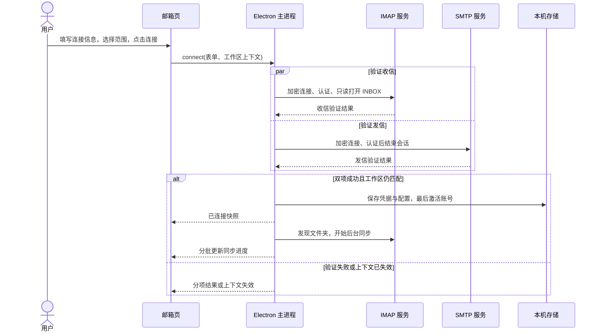

# US-MAIL-01 · 连接工作区邮箱与首次同步

0.6.4 详细设计稿，2026-11-19。适用范围为桌面端的邮箱连接、首次导入、取消托管及重连。字段名、目录及写入顺序沿用[邮箱数据模型](工作区邮箱数据模型设计.md)。产品交互基线见[工作区邮箱需求](../43-需求-工作区邮箱与即时通讯式会话.md)。

## 用户从哪里进入

工作区顶级标签「邮箱」与「独立站」并列。建议启动时挂载标签、不抢占当前页，关闭后可从导航重新打开。现有 `email` 页面服务于「邮件审核」，新增 `mailbox` 页面承载工作区邮箱。两者同时打开时可分别关闭；切换产品不影响邮箱。集成位置见[路由](../../desktop/src/router/index.ts)和[主区域标签管理](../../desktop/src/composables/useMainViewTabs.ts)。

| 进入时的情况 | 首屏与主要操作 |
| --- | --- |
| 从未连接 | 主区域显示「连接邮箱」表单，焦点在邮箱地址。未创建产品也可连接。 |
| 已取消托管 | 表单旁列出本工作区留有数据的邮箱地址，可选「重新连接」或输入新地址。重连显示「将从上次进度继续同步」。 |
| 已连接且导入中 | 直接显示邮箱，在联系人区显示「正在同步历史邮件」和已导入数量；从已提交的批次开始呈现内容。关闭标签后任务继续。 |
| 已连接且同步完成 | 显示已同步的会话。没有邮件时显示空态，邮箱功能交付后可从「新会话」写第一封信。 |
| 已连接但同步异常 | 保留已有会话；临时网络错误显示重试入口，认证失效提示重新验证。重新验证同一账号保留原同步起点。 |

### 首次连接表单

| 字段 | 默认与校验 |
| --- | --- |
| 邮箱地址、邮箱授权码 | 必填。授权码掩码显示，只在本次连接请求中传入主进程。用户修正服务器配置后可以就地重试；离开表单或成功连接时清除授权码输入。 |
| 服务器设置 | 地址域名精确匹配内置、有出处的服务商配置时，预填 IMAP 和 SMTP 并默认折叠；未知域名自动展开。收、发两组均可编辑主机、端口、TLS/STARTTLS、登录名（默认完整邮箱）。主机必填、端口为 1–65535 的整数。手工修改后重试不覆盖。切换邮箱域名时撤销旧域名预填值，提交前展示自定义主机，让用户知道授权码的使用目标。 |
| 首次同步范围 | 默认「同步最近 30 天的邮件往来」，另可选「仅同步今后的邮件」。两项均适用于收件和已发送。识别到本工作区已有该邮箱的历史后，显示续同步说明并隐藏范围选项。 |
| 连接邮箱 | 一次提交执行收发验证。验证中分别展示「验证收信」和「验证发信」的结果，屏蔽重复提交；失败后保留表单并展开出错的配置组。 |

## 连接事务

主进程从应用配置解析当前工作区，每个工作区只允许一次进行中的连接。客户端传回打开表单时的工作区标识和批次供比对。首次还没有邮箱元数据时，可用主进程签发的临时上下文标识；打开空表单无需在工作区建目录。所有网络连接校验证书，选择 STARTTLS 时必须成功升级再认证。整个验证过程不提交邮件，也不改变收件箱已读状态。

以双项验证成功的 UTC 时刻 T 计算首次起点，分别为 T 减 30 天或 T。凭据加密和本地写入成功后才向页面报告「已连接」。账号元数据、文件夹初始状态和加密凭据先准备好，最后原子替换工作区的活动账号引用。失败时清理本次新增的暂存数据；重连保留旧历史和原起点。启动恢复以已提交的活动引用为准，清理未完成的首次连接暂存文件和孤立凭据。日志及 IPC 状态事件只包含脱敏诊断信息。

## 文件夹与同步交接

1. 收件箱绑定 INBOX。已发送使用服务端返回的可选文件夹列表，优先选择唯一带已发送用途标识的目录，保存服务器原名。没有可靠匹配或有多个候选时，账号仍为已连接；收件同步正常，页内提示「请选择已发送文件夹」。选择器只列服务器可打开的目录，支持稍后处理。保存前验证目录可打开，再沿用该账号原起点开始补同步。
2. 每个文件夹在开始扫描时固定 UID 有效期和当时的最高 UID，先处理该上界内、时间落在范围中的邮件，再追赶上界之后到达的邮件。仅同步今后也需处理 T 与实际启动扫描之间已经到达的邮件。日期查询放宽边界后再按服务器内部时间比较；用于同步筛选的时间与显示在时间线上的发件时间分别处理。
3. 导入用保留未读状态的读取方式。按批次持久化联系人、邮件、附件描述和副本映射，成功后才推进对应游标。首轮历史导入静默进行，保留服务器已读标记。无法写入时显示「同步暂停」，保留已提交内容及进度，空间或权限恢复后重试。一个文件夹失败不会回退另一个的进度。
4. 关闭标签时只解除页面订阅。退出应用后，下次启动从已提交游标恢复；重复读取同一批次按副本键去重。完成首轮及追赶后进入增量状态。US-MAIL-04 接续旧邮件标记变更、持续监听和桌面通知；US-MAIL-02/03 消费本故事已落盘的数据呈现会话和写信。

## 取消托管、重连与清除

「邮箱设置」展示当前地址，提供「取消托管」。确认文案说明将停止该邮箱的收发、移除授权码，并保留本机的邮件与草稿。先在主进程互斥区撤销活动引用、递增批次，停掉同步和协议连接，再完成凭据删除。凭据删除失败应提示并重试清理；重启后不得凭断开账号的残留凭据恢复托管。切到 B 或另一个工作区时立即清空 A 的页面缓存，任何迟到结果在写盘、发布通知和刷新页面前核验原上下文。

重连同一地址时重新输入授权码并通过双协议验证，复用其账号 ID 和文件夹游标；首次连接 B 使用独立目录。已断开账号旁可选「删除本地数据」，确认对话框明确显示邮箱地址与影响范围；只删除指定账号的本地文件及凭据。删除操作与重连互斥，中断时继续清理，不将部分删除的记录展示为可恢复账号。实现可先将账号目录原子移入工作区邮箱模块的待清理目录，启动时续清。

## 主进程接口与页面状态

建议新增 `desktop/electron/mailbox/` 负责连接、凭据、文件夹发现与同步调度。IPC 在现有[主进程](../../desktop/electron/main.ts)、[共享契约](../../desktop/electron/ipc/types.ts)及 [preload](../../desktop/electron/preload.ts) 接入。协议客户端放在主进程，通过适配器注入，方便用可控的服务器响应测试。

| 操作（拟定名） | 请求与返回 |
| --- | --- |
| `mailbox.snapshot` | 返回当前工作区上下文、活动账号摘要、可重连账号及 inbox/sent 各自的进度、异常和可执行操作。 |
| `mailbox.connect` | 传入上下文、邮箱、授权码、两组协议设置、首连范围。返回已提交快照，或 IMAP/SMTP 分项结果及可展示的错误。重复点击或过期上下文分别返回 busy、stale。 |
| `mailbox.listFolders / bindSent` | 列出当前账号的可选文件夹；以服务端列出的候选值绑定并返回新快照。 |
| `mailbox.retrySync` | 指定失败的角色，继续其已提交进度。已有同角色任务时复用当前任务。 |
| `mailbox.disconnect / deleteLocal` | 传入上下文和目标账号 ID；活动账号需先断开再清除。返回更新后的快照。 |
| `mailbox.changed` | 携带工作区、连接批次和变更类别。页面订阅后拉取快照，重开页也从快照恢复，忽略旧批次事件。 |

连接状态、收信同步状态、已发送同步状态分开呈现。例如「已连接 · 收件箱已同步 · 已发送待选择」是可用状态。错误反馈应能区分认证失败、无法连接主机、TLS 校验失败、凭据无法加密及本地写入失败。SMTP 认证失败时即使 IMAP 已通过也不开始导入；已连接后遇到短暂同步错误则保留账号和已有数据。

## 验收与验证

| 用例 | 可观察结果 |
| --- | --- |
| 已知域名、手工配置企业域名 | 前者可用预填完成连接；后者可编辑全部参数。修正配置重试后保留用户修改。 |
| IMAP 成功、SMTP 失败；反向再测一次 | 明确指出失败组，活动引用未改变，没有历史导入，无测试邮件。 |
| 在 T 前后各放入收件及已发送邮件 | 默认导入最近 30 天；选择「仅同步今后」时仅导入 T 起的邮件，包含验证成功与首次扫描之间到达的邮件。 |
| 服务器未标记已发送，次日才补选 | 收件正常；选择目录后从原起点导入，重启仍记住选择。 |
| 导入途中断网、关闭应用或模拟磁盘写入失败 | 分文件夹恢复；导入数量和未读数正确，同一消息出现一次，历史邮件不触发通知。空箱可正常完成。 |
| A 断开后连接 B，再重连 A | B 看不到 A 的联系人和附件；A 的原游标和带附件草稿恢复。模拟 A 旧请求迟到，B 的磁盘内容和页面均不受影响。 |
| 双击连接、验证时切工作区、激活前写盘失败 | 最多一次有效激活；旧请求不写新工作区。重启后可重新连接，页面不出现凭据缺失的假成功。 |
| 用户取消清除、确认清除、清除中断重启 | 取消后仍可恢复；确认后只清理目标账号，其他账号及服务器邮件保留。 |

开发时以固定时钟、临时工作区、可模拟失败的协议适配器和凭据存储覆盖边界。桌面联测使用启用 IMAP/SMTP 和授权码的实际邮箱，核对 TLS、文件夹发现、历史范围及 Windows 重启后的凭据解密。真实服务商和打包环境的结果在开发联测时记录。
