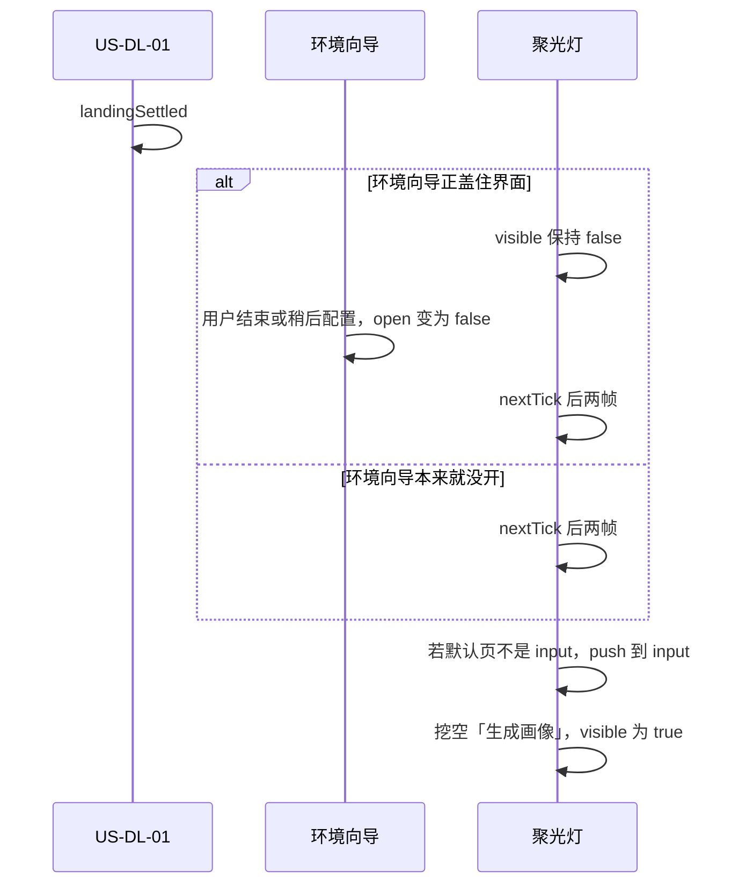

# US-OG 详细设计：业务流程引导聚光灯蒙层

> **用户故事**：[../35-需求-业务流程引导聚光灯蒙层.md](../35-需求-业务流程引导聚光灯蒙层.md) · **US-OG-01**、**US-OG-02** · Related #8  
> **状态**：待开发（本文只定五步锚点、气泡、记忆和与默认页的时序；不改 `desktop/` 业务实现）  
> **范围**：主线五步的分步聚光灯；自动出现、完成记忆、设置重播  
> **依赖**：路由 `input` / `profile` / `explore` / `leads` / `email`；现网页头主按钮；[US-DL-01](US-DL-按流水线阶段默认界面.md) 的 `landingSettled`（只约束自动出现的先后）；设置 → 关于与隐私 →「打开业务引导」  
> **不做**：教程视频；通用 tips；改环境监测、模型通道、安装流程；改各页业务动作；按流水线改默认页；关 Issue #8  
> **文档位置**：`docs/design/`

需求依据是已合入的 `docs/35-需求-业务流程引导聚光灯蒙层.md`（OG1～OG10、US-OG-01、US-OG-02、§6、§7）。本文不改该需求正文。docs/35 §7 的 O1～O4 在 §2 拍板，带验收样例。US-OG-01 与 US-OG-02 分节验收，合在这一份详设里，避免锚点和记忆各写一套。

自动出现的顺序锁死：**先让 US-DL-01 把默认页落地，再显示第一步蒙层。** 默认页不是录入时，仍然从录入第一步高亮：先完成落地，再为第一步打开录入。

---

## 0. 相对现网

对照 `dev-0.6.0`（`2cd8049`）。

| 现网 | **本期** |
|------|----------|
| `useOnboarding`：`completed` 与 `skipped` 都为 false 时打开 `OnboardingOverlay`。这是居中的环境 / 模型 / 业务清单，不是挖在控件上的聚光灯 | 环境与模型向导仍走这层。业务五步改由新的 `BusinessGuideOverlay` 画在真实控件上。两层不同时出现 |
| `TOUR_STEPS` 七步：产品录入、画像生成、关键字扩展、开始找客户、评分与去重、生成邮件、邮件审核。点一行跳路由，再点「打开××页」 | 聚光灯不读 `TOUR_STEPS`。步数是五。关键字扩展写进画像那一步的气泡，评分写进线索那一步。常量可以留在 `desktop/src/types/onboarding.ts`，引导界面不得再渲染这七行 |
| `skipAll()` 把 `onboarding.skipped` 写成 true，环境向导和业务清单下次一起不再自动开。`completeAll()` 把 `onboarding.completed` 写成 true | 环境向导仍只写 `onboarding.completed` / `onboarding.skipped`。业务引导另用 prefs 顶层的 `businessGuide`。点「稍后配置」不写 `businessGuide` |
| 设置里「打开业务引导」调用 `reopenOnboarding('tour')`，并会把 `completed`、`skipped` 都清掉，从而把环境向导的自动出现也重置 | 按钮文字仍是「打开业务引导」。点击只重播五步聚光灯，不调用 `reopenOnboarding('tour')`，不改 `onboarding` 两个标志 |
| `OnboardingOverlay` 全屏，`z-index: 1200`。业务页在它下面 | 聚光灯 `z-index: 1150`，低于环境向导，高于关键词编辑层（`1100`）和确认框（`1000`）。调度器在环境向导 `open === true` 时不把聚光灯设为可见 |
| 冷启动路由由 US-DL-01 改掉。本文不规定默认页本身 | 自动出现订阅 `landingSettled`。在它变为真之前，`visible` 保持 false |

现网接缝（实现时按本节）：

1. **`patchOnboardingState` 只写 prefs 的 `onboarding` 键。** `writeUserPrefs` 是顶层浅合并。`businessGuide` 必须由单独的读写函数写入，避免某次环境向导保存把业务记忆盖掉，或相反。
2. **`onboarding.tourStep` 上限仍是 6，对应旧的七步。** 聚光灯的步号放在组件内存里（0～4），不复用 `tourStep`。
3. **`bootstrapOnboarding` 今天只要未完成且未跳过就 `open = true`。** 其中 `phase === 'tour'` 会打开七步清单。本期改为：只有 `phase` 为 `env` 或 `keys` 时才自动打开环境向导。`phase === 'tour'` 或 `done` 不再打开清单。业务聚光灯用自己的 `businessGuide` 决定出不出。
4. **页头按钮在没有数据时也在 DOM 里，只是 `disabled`。** 锚点就钉在这些按钮上。按钮禁用时仍然挖空，气泡不要求用户先把按钮点亮。
5. **探索页头和任务卡片里各有一枚 `ExploreStartControl`。** 只给页头那一枚开始按钮加 `data-guide`。卡片里的 compact 控件不加，避免 `querySelector` 挖到列表中间。

---

## 1. 两条故事的分工

| 内容 | 归谁 |
|------|------|
| 遮罩、挖空、气泡文案、五步顺序、「下一步 / 完成 / 跳过全部」、挖空不可点 | **US-OG-01** |
| 何时自动出现、与默认页和与环境向导的时序、`businessGuide` 记忆、Esc / 点遮罩、设置重播 | **US-OG-02** |
| 默认页是哪一页 | **US-DL-01**。本文只消费 `landingSettled` 和落地当时的路由名 |

US-OG-01 可以在测试里直接 `replay()`，不走冷启动。US-OG-02 的自动出现用例必须先等落地。

---

## 2. 已拍板（docs/35 §7）

| 项 | 决定 |
|----|------|
| **O1 锚点与气泡** | §3 写死五步的 `data-guide`、按钮和文案。设置入口文字保持「打开业务引导」 |
| **O2 挖空能否点击；Esc / 点遮罩** | 挖空处的点击被遮罩吃掉，不触发底下的业务按钮，也不结束引导。点遮罩暗部和按 Esc 只关掉**这一次**显示，不写 `businessGuide`。能写入记忆的只有「跳过全部」和第五步「完成」 |
| **O3 记忆键** | prefs 顶层 `businessGuide`，与 `onboarding.completed` / `onboarding.skipped` 分开。缺字段等于 `pending`。不按产品拆分。没有把状态写回 `pending` 的接口 |
| **O4 与环境向导的交接** | 环境向导 `open === true` 时不挂上可见的聚光灯。`open` 变为 false 之后，等 `nextTick` 再加两帧 `requestAnimationFrame`，然后才显示第一步。两层不会同时盖住业务页。默认页落地与蒙层之间同样空出这一小段：先看到落地页，再出现挖空 |

第五步推进按钮的文字用「完成」。前四步用「下一步」。记忆效果按 OG4：完成与跳过都会让下次冷启动不再自动出现。

---

## 3. 五步锚点与气泡（O1）

每一步先保证路由是下表的 `route`，再挖空 `[data-guide]`。人在别的页时，`router.push({ name: route })`，等元素出现后再挖。元素缺失时的处理见 §4.3，不得留一块没有洞的遮罩。

气泡是靠在锚点旁边的卡片，不是屏幕中央的清单。宽度 320。优先放在锚点右侧，间隔 12；右侧不够放则改到下方；下方不够则改到上方。

| 步 | 路由 | `data-guide` | 始终存在的控件 | 气泡标题 | 气泡正文 |
|----|------|--------------|----------------|----------|----------|
| 1 | `input` | `og-input-generate` | 录入页头「生成画像」 | 录入资料 | 在这一页放入产品官网或资料。勾选后点右上角「生成画像」，才会进入画像。 |
| 2 | `profile` | `og-profile-new-explore` | 画像页头「新建探索任务」 | 确认画像 | 在这一页查看并保存画像。点「新建探索任务」时会先按画像扩展关键词，再去找客户。 |
| 3 | `explore` | `og-explore-start` | 探索页头开始按钮（文案随轮次变成「开始全网搜索」「开始社媒发现」或「开始地图发现」） | 开始找客户 | 在这一页选择全网搜索、社媒发现或地图发现，再点开始。打开网页使用内置浏览器。 |
| 4 | `leads` | `og-leads-score` | 线索页头「评分去重」 | 查看线索 | 探索结果在这一页。点「评分去重」会分成高、中、低，并去掉重复。 |
| 5 | `email` | `og-email-batch-draft` | 邮件页头「批量起草」 | 起草开发信 | 在这一页为已评分线索起草开发信，再逐封查看。点「通过」只保存，不会真正发信。 |

关键字扩展不单独成步，写在第 2 步正文里。评分不单独成步，写在第 4 步正文里。第 3 步锚的是页头那枚开始按钮元素，不锚下拉框，也不匹配按钮上的可变文字。第 5 步在没有草稿时「批量起草」是禁用的，仍然挖它，因为空列表上没有一封可点的信。

属性只加在现有按钮上，不改 `@click`、不改 `disabled` 条件：

| 文件 | 属性 |
|------|------|
| `desktop/src/views/InputView.vue` 页头生成画像按钮 | `data-guide="og-input-generate"` |
| `desktop/src/views/ProfileView.vue` 页头新建探索任务按钮 | `data-guide="og-profile-new-explore"` |
| `desktop/src/components/explore/ExploreStartControl.vue` 的开始按钮 | 由页头传入才输出 `data-guide="og-explore-start"`。`ExploreView.vue` 页头那一枚传入，列表里的 compact 不传 |
| `desktop/src/views/LeadsView.vue` 页头评分去重按钮 | `data-guide="og-leads-score"` |
| `desktop/src/views/EmailView.vue` 页头批量起草按钮 | `data-guide="og-email-batch-draft"` |

### 3.1 气泡控件

每一步都有：

| 控件 | 第 1～4 步 | 第 5 步 |
|------|------------|---------|
| 眉题 | `第 n 步，共 5 步` | `第 5 步，共 5 步` |
| 主按钮 | 下一步 | 完成 |
| 次按钮 | 跳过全部 | 跳过全部 |

没有「上一步」。点「下一步」不代替用户去点被挖空的业务按钮。

---

## 4. 界面行为（US-OG-01）

### 4.1 挖空

组件 `desktop/src/components/guide/BusinessGuideOverlay.vue`，在 `App.vue` 里与 `OnboardingOverlay` 并列挂载，`Teleport` 到 `body`。

- 全屏层 `position: fixed; inset: 0; z-index: 1150`。
- 暗部不透明度与环境向导一致：`rgb(0 0 0 / 55%)`。
- 洞的矩形来自锚点 `getBoundingClientRect()`，四边外扩 6，宽高至少 32。锚点在视口外时先 `scrollIntoView({ block: 'nearest' })` 再量一次。页头按钮通常已在视口内。
- 暗部用洞的四边四块条带拼出。条带接收点击。
- 洞上盖一层透明挡板，`pointer-events: auto`。点这层：`preventDefault` 并停掉冒泡，**不**调用业务按钮，**不**关闭引导。
- 气泡在挡板之上，按钮可点。

业务页原有点击处理函数不改。蒙层出现时，被挡住的区域到不了那些函数。

### 4.2 样例（挖空与遮罩）

| 操作 | 结果 |
|------|------|
| 第 1 步点挖空里的「生成画像」 | 不开始生成画像。蒙层仍在第 1 步。`businessGuide` 仍是 `pending` |
| 第 1 步点暗部 | 蒙层关闭。`businessGuide` 仍是 `pending`。结束进程再进入，仍从第 1 步自动出现（US-OG-02） |
| 按 Esc | 与点暗部相同 |
| 点「跳过全部」 | 蒙层关闭，`disposition` 写成 `skipped` |
| 第 5 步点「完成」 | 蒙层关闭，`disposition` 写成 `completed` |
| 第 4 步点「下一步」 | 路由变为 `email`，洞在「批量起草」上。即使该按钮 `disabled`，洞仍套住它 |

### 4.3 找不到锚点

`router.push` 之后 `nextTick`，再用最多 30 帧 `requestAnimationFrame` 查找 `[data-guide="…"]`。找到就挖空。30 帧后仍没有：关掉这一次显示，**不**写 `businessGuide`。不允许只剩一整块暗色、没有洞。页头按钮在模板里是常驻的，这条是异常退路，不是空数据时的正常路径。空数据仍走 §3 的禁用按钮。

### 4.4 键盘

蒙层可见时，在 `window` 的捕获阶段监听 Esc：`preventDefault` 并停止传播，然后走 §4.2 的「只关这一次」。这样录入页资料树自己的 Esc（取消新建文件夹）不会同时触发。蒙层不可见时不监听。

出现时把焦点放进气泡的主按钮，使 Enter 触发「下一步」或「完成」。焦点不放进被挖空的业务按钮。

---

## 5. 记忆（O3，US-OG-02）

### 5.1 字段

`ftcs-prefs.json` 顶层，与 `onboarding` 并列：

```ts
interface BusinessGuideState {
  version: 1
  disposition: 'pending' | 'completed' | 'skipped'
  updatedAt: string
}
```

| 读到的值 | 含义 |
|----------|------|
| 没有 `businessGuide` 键 | `pending`。会自动出现 |
| `pending` | 同缺省 |
| `completed` | 走过第五步「完成」。冷启动不自动出现 |
| `skipped` | 点过「跳过全部」。冷启动不自动出现 |

跟随这一份应用 prefs，不按 `activeProductId` 各记一份。

旧数据迁移：**不**把 `onboarding.completed === true` 抄进 `businessGuide`。以前走完七步清单的用户，缺这个新键，会再看一次五步聚光灯。两份记忆从本期起分开。

### 5.2 谁可以写

| 动作 | `businessGuide` | `onboarding.completed` / `skipped` |
|------|-----------------|-------------------------------------|
| 环境向导「稍后配置」（现网 `skipAll`） | 不写 | 仍把 `skipped` 写成 true |
| 环境向导走完（现网 `completeAll`） | 不写 | 仍把 `completed` 写成 true |
| 聚光灯「跳过全部」 | `skipped` | 不写 |
| 第五步「完成」 | `completed` | 不写 |
| Esc、点暗部、点挖空、关闭主窗口 | 不写 | 不写 |
| 设置里重播开始 | 不写 | 不写 |
| 重播途中再点「跳过全部」或「完成」 | 写成对应值（已是该值则再写一次，结果相同） | 不写 |

没有把 `disposition` 改回 `pending` 的 IPC。重播开始时不清掉已完成或已跳过，避免重播看到一半进程退出后，又把自动出现打开。

进程内另有一个不落盘的 `guideDismissedThisProcess`。Esc 和点暗部把它置真，并隐藏蒙层。本进程内不再自动打开。下次冷启动内存标志消失；若磁盘上仍是 `pending`，再次自动出现。

### 5.3 样例（记忆）

prefs 里可以同时是 `onboarding.skipped: true` 与 `businessGuide` 缺省。验收读盘核对这两个键。

| 步骤 | 再次冷启动 |
|------|------------|
| 新装，环境向导点「稍后配置」，聚光灯不操作 | 环境向导不自动开。聚光灯从第 1 步自动开 |
| 聚光灯点「跳过全部」后退出 | 聚光灯不自动开 |
| 五步都点到「完成」后退出 | 聚光灯不自动开 |
| 停在第 3 步，既没跳过也没完成，直接退出 | 从第 1 步自动开，不是从第 3 步续 |
| 已完成后从设置重播，在第 2 步直接退出 | 仍不自动开（磁盘保持 `completed`） |
| 已完成后从设置重播，再点「跳过全部」 | 不自动开（磁盘为 `skipped`） |

---

## 6. 自动出现与环境向导（O4，US-OG-02）

### 6.1 自动出现的条件

全部为真才显示：

1. `businessGuide` 为 `pending`（含缺字段）。
2. 本进程 `guideDismissedThisProcess` 为假。
3. `useOnboarding().open` 为假。
4. US-DL-01 的 `landingSettled` 已为真。
5. 当前没有已经可见的聚光灯。

条件 4 有两种落地：`replace` 到了流水线算出的页，或占位期间用户已经点过页。两种都要等它完成，再进入下面的时序。自动出现不是重播，不把默认页再算一次。

### 6.2 时序



锁住的顺序：

1. 先有一次默认页结果（路由已经是落地页，或用户在占位页上点过）。
2. 环境向导若仍打开，聚光灯不可见。不得画在向导上面。
3. 向导关闭或本来就没有向导时，空出 `nextTick` + 两帧，让向导从 DOM 消失、落地页完成一次绘制。
4. 然后从第 1 步开始。当前路由不是 `input` 时，先 `push` 到 `input`，再挖「生成画像」。不从默认页所在的阶段插步，也不在画像页上先亮一帧第 2 步。

默认页就是录入时，第 4 步不再次 `push`，挖空直接落在已经打开的录入页上。

### 6.3 样例（先后）

| 场景 | 落地瞬间的路由 | 蒙层 `visible` 变为 true 时的路由 | 洞 |
|------|----------------|------------------------------------|----|
| 无产品，环境向导未打开 | `input` | `input` | `og-input-generate` |
| 有产品、关键词未完成，环境向导未打开 | `profile` | `input` | `og-input-generate` |
| 探索已完成，环境向导未打开 | `leads` | `input` | `og-input-generate` |
| 无产品，环境向导正打开 | 向导下面可以已经是 `input` | 向导 `open` 变为 false 之后才变 true，路由是 `input` | 同上 |

验收记录两个时刻的路由名：`landingSettled` 刚变为真时，以及聚光灯 `visible` 刚变为真时。第二个时刻不得早于第一个。环境向导 `open` 为 true 的任何一帧，聚光灯 `visible` 为 false。

占位期间用户点了「探索」：US-DL-01 不再 `replace`。`landingSettled` 之后聚光灯仍从第 1 步把路由 `push` 到 `input`。这是 OG6（总从录入讲起）和 DL1（占位期间的点击不再被默认表拉回）叠在一起的结果。主路径不依赖这次点击。

### 6.4 设置重播

`SettingsView.vue` 关于与隐私里，现有按钮「打开业务引导」改为调用 `replayBusinessGuide()`。

- 不调用 `reopenOnboarding('tour')`。
- 不修改 `onboarding.completed` / `skipped`。
- 不调用 US-DL-01 的 `settle()`，不改当前这次运行已经落定的默认页。
- 若环境向导正打开，先等它 `open === false`，再走 §6.2 的两帧间隔，然后从第 1 步显示。
- 重播把 `guideDismissedThisProcess` 清掉（只清这次内存标志），以便同一次运行里 Esc 关掉之后还能从设置再看。磁盘上的 `completed` / `skipped` 不动。
- 重播从录入开始，五步控件与 §3、§4 相同。
- 重播结束后（完成或跳过），下次冷启动不自动出现。重播看到一半就退出，且开始前已经是 `completed` 或 `skipped` 的，冷启动也不自动出现。

旁边的「打开环境与配置引导」仍调用 `reopenOnboarding('env')`，行为保持现网。

共用的那行说明「检查运行所需组件并引导完成设置」不改。

---

## 7. 接口

### 7.1 主进程

新建 `desktop/electron/onboarding/business-guide-service.ts`。

```ts
export function getBusinessGuideState(): BusinessGuideState
export function markBusinessGuide(disposition: 'completed' | 'skipped'): BusinessGuideState
```

`get` 在缺字段、`version` 不对或 `disposition` 不是三个枚举值时，返回内存中的 `{ version: 1, disposition: 'pending', updatedAt }`，并且**不**把 `pending` 写回磁盘。只有 `mark` 写盘。

IPC：

| 通道 | 作用 |
|------|------|
| `business-guide:get` | 返回 §5.1 |
| `business-guide:mark` | 入参 `'completed'` 或 `'skipped'` |

`preload.ts` 暴露 `getBusinessGuideState` / `markBusinessGuide`。不扩展 `OnboardingState`。

### 7.2 渲染进程

`desktop/src/composables/useBusinessGuide.ts`：

| 成员 | 作用 |
|------|------|
| `visible` | 蒙层是否可见 |
| `step` | `0`～`4` |
| `armAuto()` | 订阅 `onLandingSettled`，按 §6.1 尝试显示 |
| `replay()` | §6.4 |
| `next()` | 第 0～3 步前进；第 4 步 `mark('completed')` 并隐藏 |
| `skipAll()` | `mark('skipped')` 并隐藏 |
| `dismissSession()` | Esc / 点暗部 |

`App.vue` 在启动时调用 `armAuto()` 一次。`WorkspaceLayout` 不负责显示蒙层。

`useOnboarding.ts` 的 `bootstrapOnboarding`：自动 `open = true` 的条件改为「未完成、未跳过，且 `phase` 是 `env` 或 `keys`」。`skipAll` / `completeAll` 的函数体不调用 `markBusinessGuide`。

---

## 8. 验收清单

### 8.1 US-OG-01

- [ ] 蒙层是暗部 + 当前按钮挖空 + 旁边气泡。界面上没有 `TOUR_STEPS` 那七行，也没有把空列表文案改成引导句。
- [ ] 顺序为录入、画像、探索、线索、开发信。路由依次是 `input`、`profile`、`explore`、`leads`、`email`。
- [ ] 五步的洞分别套住 §3 的五个 `data-guide`。从线索页调用第 1 步时，先进入录入再挖「生成画像」。
- [ ] 第 1～4 步「下一步」进入下一步。第 5 步按钮文字是「完成」，点击后蒙层关闭。
- [ ] 每一步都有「跳过全部」，点击后蒙层关闭。
- [ ] §4.2 的挖空、暗部、Esc 样例成立。点挖空不生成画像、不新建探索、不开始搜索、不评分、不批量起草。
- [ ] 录入、画像、探索、线索、邮件各页原有按钮的禁用条件和保存结果，与加上 `data-guide` 之前一致。
- [ ] 本清单不要求冷启动自动弹出。

### 8.2 US-OG-02

- [ ] 无进度新用户：环境向导不挡住时，先落在录入，再出现第 1 步挖空。`visible` 不早于 `landingSettled`。
- [ ] 默认页是画像或线索时：落地路由先是该页，蒙层出现时路由已是 `input`，洞在「生成画像」。不从中间步开始。
- [ ] 环境向导打开的每一帧，聚光灯不可见。向导点「稍后配置」之后才出现聚光灯，且 `onboarding.skipped` 为 true 时 `businessGuide` 仍是缺省或 `pending`。
- [ ] §5.3 的记忆样例成立。关闭主窗口不算跳过。
- [ ] 点暗部或 Esc 之后，本次进程内不再自动弹出；退出再进入，若仍是 `pending`，从第 1 步再出现。
- [ ] 设置「打开业务引导」在已完成或已跳过后仍能从录入走完五步，且不把环境向导的 `skipped` 清掉。重播不改变已经落定的默认页。重播结束或中途退出后，冷启动不自动出现。
- [ ] 没有教程视频、通用 tips，也没有改 Node / OpenCode / OfficeCLI 的安装步骤。
- [ ] 变更落在 `dev-0.6.0` 系分支。不关 #8。

---

## 9. 修订记录

| 日期 | 说明 |
|------|------|
| 2026-10-29 | 初稿。拍板 docs/35 O1～O4：五步锚到页头常驻按钮；挖空不可点；Esc 与点暗部只关本次；`businessGuide` 与环境向导分开；先 `landingSettled` 再蒙层，默认页非录入时仍从录入挖起。覆盖 US-OG-01、US-OG-02。 |
