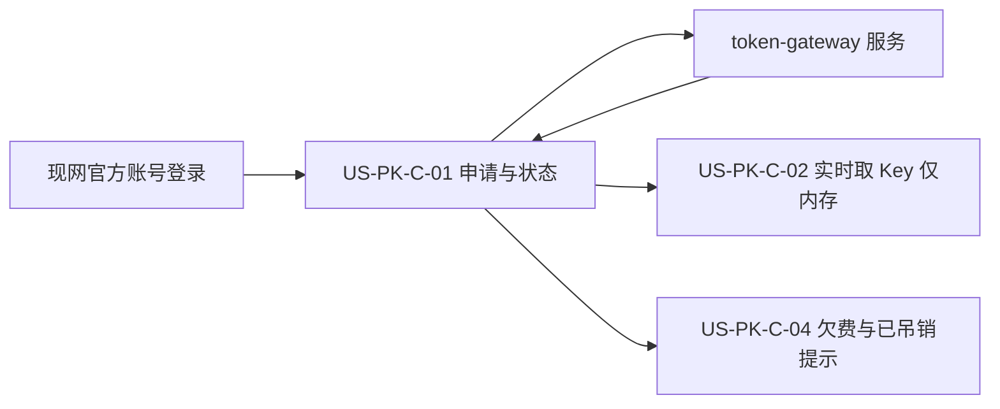
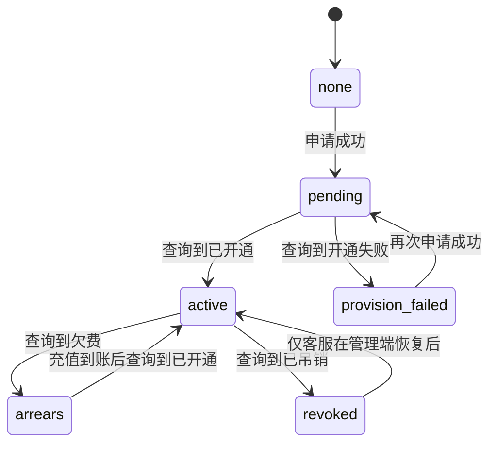
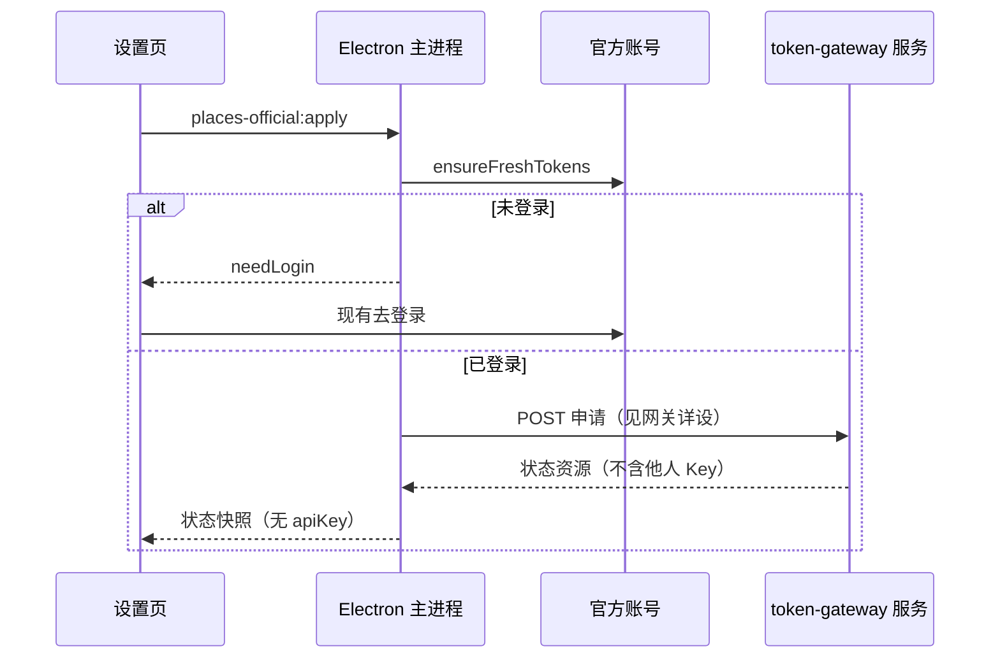

# US-PK-C-01 申请官方 Places Key 与状态展示

> **用户故事**：[../30-需求-Places官方通道按用户下发APIKey.md](../30-需求-Places官方通道按用户下发APIKey.md) · US-PK-C-01 · Issue #21  
> **状态**：**待评审**（本文件只定设计；业务代码尚未按本文改动）  
> **范围**：模型通道为官方时，在设置页与环境设置引导第 2 步申请官方 Places Key；展示未申请 / 申请中 / 已开通 / 开通失败 / 欠费 / 已吊销；未登录只引导登录
> **依赖**：现网官方账号登录（`auth:login`）；[US-PK-token-gateway-接口与管理端.md](US-PK-token-gateway-接口与管理端.md) 的「提交申请」「查询状态」；取 Key 见 [US-PK-C-02](US-PK-C-02-接收并安全保存官方Key.md)；通道与自备 Key 的显隐见 [US-PK-C-04](US-PK-C-04-与BYOK并存及停用提示.md)  
> **不做**：开通、吊销、对账（管理端）；服务端代调 Places；在探索页提交申请；在自定义通道显示官方申请  
> **文档位置**：`docs/design/`  
> **与旧详设**：取代「官方通道没有 Places、只能等 US-E-10 代调或自己填 BYOK」这层产品口径。旧文件保留不改，替换关系见 §0.1。

申请入口与状态文案以本文为准，通道显隐以需求 **PK7** 为准。官方申请只在模型通道为官方时出现。官方 Key 不在申请或刷新时落到本机；用时再取见 C-02，注入见 C-03，通道规则见 C-04。服务端路径、错误码以网关详设为准，本文不另写一套 URL。

---

## 0. 相对现网

对照 `dev-0.5.8` 已落地的设置页与 R3 启动口径（2026-10-10 读码）。

| 现网 | **本期（US-PK-C-01）** |
|------|------------------------|
| 设置 → 探索 →「R3 地图发现（Google Places）」只有自备 Key 输入框，说明费用计入用户自己的 GCP | **仅** `channelMode=official` 时，这一区块改为官方 Places Key 状态与「申请官方 Places Key」，不显示自备 Key 输入框。自定义通道仍只有自备 Key 输入框，归 C-04 |
| 未登录官方账号时，模型通道区有「去登录」（`AUTH_LOGIN`） | 申请官方 Places Key 复用这条登录。未登录不调用申请接口 |
| `officialProvisioned` 表示本机已有模型网关 `sk`（`FTCS_GATEWAY_API_KEY`） | **不**作为能否申请 Places Key 的条件。Places 申请认的是官方账号，不是模型 sk |
| 探索页「开始 R3」仅看 `placesApiKeySet`（自备 Key 是否在 `.env`） | 按钮是否可点改由 C-04 按当前模型通道决定。本故事只要求：官方通道的 Preflight 能区分申请中 / 开通失败 / 欠费 / 已吊销，并给出打开设置的说明。不因为 `.env` 里还有自备 Key 而改口 |
| 文案写明「官方通道不提供 Places 代调」 | **保留**「不代调、本机直连」这一事实。删掉「因此你不能申请官方 Places」的含义。禁止出现「官方代为查询 / 代调 Places」 |

### 0.1 旧 US-E-10 在本故事里哪些作废

完整对照表在[网关详设 §0.1](US-PK-token-gateway-接口与管理端.md)。本故事只替换下面这些**用户可见口径**（旧 md **不删、不改**）：

| 旧陈述 | 本故事 |
|--------|--------|
| [US-E-10](US-E-10-Places官方网关.md)：官方 Places 若重启，也是 token-gateway **代调** | 作废。申请得到的是下发到本机的 Key，Places 仍由本机直连 Google |
| [US-E-09](US-E-09-探索页开始R3与Preflight.md) Q7：官方通道无自备 Key 时禁止 R3，并提示不提供代调 | 「不提供代调」仍然成立。「无自备 Key 就不能用 R3」在模型通道为官方、且官方 Key **已开通并取 Key 成功**时不再成立。未开通时的拦截文案改成状态说明。官方通道也不再要求改填 BYOK |
| 设置页只引导用户去 Google Cloud Console 自己建 Key | 自定义通道仍保留自备 Key 的帮助链接。官方通道改为官方申请，不把两条路径放在同一屏 |

---

## 1. 与相邻故事的分工



| 模块 | 本期 |
|------|------|
| **US-PK-C-01** | 入口、登录闸门、状态枚举、文案、申请 / 刷新 IPC、渲染层不接触 Key 明文 |
| **US-PK-C-02** | 实时获取官方 Key、仅内存使用。申请响应里没有 Key |
| **US-PK-C-03** | 用生效 Key 直连 Google；Places 只发现 |
| **US-PK-C-04** | PK7：按模型通道只显示一种来源。欠费、已吊销时提示充值或联系客服，并引导把模型通道切换为「自定义」；不提供「改用自备 Key」，本机旧自备 Key 仍不使用 |
| **引导第 2 步** | 模型通道为官方时，用本节的状态与申请按钮替换 AIza 输入框。自定义通道保留 AIza 输入框，不放申请 |

---

## 2. 已确认选型

需求 PK1、PK3、PK11 不动。下面这些是详设可以定、且不依赖 O7–O11 的部分。

| 项 | 决定 |
|----|------|
| **入口** | **仅** `channelMode=official`：**设置 → 探索 → R3 地图发现**区块内只放官方状态与申请，不放自备 Key 输入框。探索页、方案执行前的 Preflight **不提交申请**，只展示一句状态，并写明到该设置区块操作。`custom` 时本区块不出现 |
| **引导第 2 步** | `OnboardingOverlay` 阶段 `keys`（「2  模型通道」）在官方通道下，用官方 Key 状态与申请按钮替换 AIza 输入框，保存不写自备 Key。未登录时按钮是「去登录」，不先打申请接口。自定义通道保留 AIza 输入框 |
| **身份** | 只使用现网官方账号 access token（`ensureFreshTokens`，与 `POST /keys/rotate` 相同）。请求体**不**带 `userId`，防止替他人申请 |
| **与模型通道的关系** | PK7：官方申请的**界面**只在 `channelMode=official` 渲染，见 §4.1。不要求 `officialProvisioned`。网关仍只认登录，看不到桌面通道；自定义通道的客户端不要为了隐藏的区块去调用申请或状态接口 |
| **状态** | 与 PK13 对齐的六值：`none` 未申请、`pending` 申请中、`active` 已开通、`provision_failed` 开通失败、`arrears` 欠费、`revoked` 已吊销。不再使用 `suspended` 或「停用」 |
| **T+1 文案** | 优先展示服务返回的 `expectedReadyNote`。该字段为空时，用固定句：「预计在受理后的下一自然日内开通。」客户端不写死时区、不自己算截止时刻（O2 未定） |
| **再次申请** | 按钮只在 `none`、`provision_failed` 可点。其它四态不提交。若仍被 409 拒绝，按错误码显示文案 |
| **代调文案** | 本区块说明为两行：「需要能访问 Google 的网络。」「使用费用计入官方额度。」不写扣费频率，不写 Key 发到本机。不出现「官方代调」 |
| **设置页调哪个接口** | 只调状态接口 `GET {base}/places/official-key`。该响应只有状态和说明，没有 Key。设置页、申请、点「刷新状态」都不调用取 Key `GET .../current` |
| **何时查状态** | 打开设置页先显示「查询中」，再查一次；申请提交成功后再查一次；失败或用户点「重试」「刷新状态」再查一次。不轮询。不把结果写成文件。开始 R3 不查状态 |
| **渲染进程** | 只拿六态和说明。没有 Key，也没有掩码 |

---

## 3. 状态机

状态只随服务响应变化。客户端不在本地把 `pending` 猜成 `active`。



`pending`、`active`、`arrears`、`revoked` 不能靠申请接口把自己变成 `pending`。不认识的 `status` 不当成 `none`，状态行用服务给的说明；没有说明时显示「状态无法识别，请稍后刷新」。

---

## 4. 界面

### 4.1 谁能点申请

```typescript
function canApplyPlacesOfficialKey(input: {
  loggedIn: boolean
  channelMode: 'official' | 'custom'
  status: PlacesOfficialStatus | null
}): boolean {
  return (
    input.channelMode === 'official' &&
    input.loggedIn &&
    (input.status === 'none' || input.status === 'provision_failed' || input.status === null)
  )
}
```

`channelMode !== 'official'`：不渲染本节区块，函数为 false。  
未登录且通道为官方：主按钮「去登录」，不调用申请。  
`none` 或 `provision_failed`：按钮「申请官方 Places Key」。`provision_failed` 的按钮文案是「再次申请」。  
`pending`：按钮禁用，文案「申请中」。  
`active`：不显示申请，显示「刷新状态」。  
`arrears`：不显示申请，显示「已欠费，请充值」和现网「去充值」，补充句引导把模型通道切换为「自定义」。  
`revoked`：不显示申请，显示「请联系客服」，补充句同样引导切换通道。没有充值入口，也没有再次申请。两态都不使用本机已存的自备 Key（PK7）。

### 4.2 文案

区域标题：**官方 Places Key**。

说明（各状态都保留，放在状态行下面，两行）：

> 需要能访问 Google 的网络。
>
> 使用费用计入官方额度。

| 状态 | 状态行 | 补充（`reasonMessage` / `expectedReadyNote` 为空时） |
|------|--------|------------------------------------------------------|
| `none` | 未申请 | 无 |
| `pending` | 申请中 | 预计在受理后的下一自然日内开通。 |
| `active` | 已开通 | 官方 Places Key 已开通。每次使用时重新获取，不保存在这台电脑上。 |
| `provision_failed` | 开通失败 | 开通未成功。可以再次申请。 |
| `arrears` | 欠费 | 已欠费，请充值。如需使用自备 Places Key，请把模型通道切换为「自定义」。 |
| `revoked` | 已吊销 | 请联系客服。如需使用自备 Places Key，请把模型通道切换为「自定义」。 |

开通失败若有 `reasonMessage`，补充行用服务原文。申请中若有 `expectedReadyNote`，用服务原文。

欠费时加「去充值」，复用现网 `GATEWAY_OPEN_OFFICIAL_RECHARGE`。已吊销不加充值，也不加申请。两态的补充句只作提示，不附带切换按钮，也不读取本机自备 Key（PK7）。官方通道这一屏不出现自备 Key 标题或输入框。自备 Key 只在自定义通道显示，标题仍是 **自备 Places Key**，归 C-04。切到官方通道不会清除 `.env` 里已有的自备 Key，但本屏不读取、不展示、不使用它。

### 4.3 探索页与 Preflight 上的一句状态

不在 `ExploreView` 放申请按钮。开始 R3 被拦住时，沿用现网 Preflight 弹层，`detail` 使用 C-04 的句子。其中与本故事相关的四句：

| 情况 | `detail` |
|------|----------|
| `pending` | 官方 Places Key 申请中，预计在受理后的下一自然日内开通。可在设置 → 探索查看。 |
| `provision_failed` | 官方 Places Key 开通失败。可在设置 → 探索再次申请。 |
| `arrears` | 已欠费，请充值。如需使用自备 Places Key，请把模型通道切换为「自定义」。 |
| `revoked` | 请联系客服。如需使用自备 Places Key，请把模型通道切换为「自定义」。 |

这几句只在模型通道为官方、且官方 Key 不可用时使用。欠费与已吊销的后半句是提示，不因为 `.env` 里还有自备 Key 而改用它（PK7）。自定义通道的失败句见 C-04，不使用本表。

---

## 5. IPC

渲染进程不直连 token-gateway。主进程走 C-02 的客户端模块，HTTP 契约见网关详设「客户端接口」。

| IPC | 通道名 | 入参 | 成功结果 |
|-----|--------|------|----------|
| 申请 | `places-official:apply` | 无 | `{ ok: true, needLogin: false, message, settings }` |
| 刷新 | `places-official:refresh` | 无 | 同上 |

`settings` 为扩展后的 `SettingsSnapshot`（字段定义在 C-02 §4，本故事只读其中的状态字段）。

失败：

| 情况 | 结果 |
|------|------|
| 未登录 | `{ ok: false, needLogin: true, message: '请先登录', settings }` |
| 409，见网关详设申请错误码 | `ok: false`。文案按错误码，不把本地状态改成 `pending` |
| 网络失败 | `ok: false`，说明暂时联系不上官方服务。不把已有状态改成 `provision_failed` |

`preload.ts` 增加 `applyPlacesOfficialKey`、`refreshPlacesOfficialKey`。类型放在 `desktop/electron/ipc/types.ts` 与 `desktop/src/types/electron.d.ts`。

申请与刷新的响应里没有 `apiKey`。渲染层只更新当前这一屏。取 Key 不在这两个 IPC 里做。查询失败时状态区显示错误和「重试」，不保留上一次成功的六态。

### 5.1 客户端用到的 gateway 接口一览

桌面只会调用下面三个。路径接在 `FTCS_TOKEN_GATEWAY_BASE_URL` 之后。三者都带现有官方登录的 access token：`Authorization: Bearer`，材料在 `userData/oauth-tokens.bin`，由 `token-store.ts` 用 Electron `safeStorage` 读写，来自现有「去登录」，不是 Places 接口签发的。任一接口返回 401（`need_login` 或 `credential_revoked`）都提示重新登录，不改用 BYOK。自定义通道不调用这三支。

| 接口 | 何时调用 | 对应章节 |
|------|----------|----------|
| `POST {base}/places/official-key/applications` | 模型通道为官方时，设置页或引导第 2 步点申请。仅当前这次查到的状态是 `none` 或 `provision_failed` | 网关详设 §4.1 |
| `GET {base}/places/official-key` | 模型通道为官方时：打开设置页、打开引导第 2 步、申请成功后、点「刷新状态」或「重试」、R3 运行中 Google 拒绝后一次。只返回状态和说明，不返回 Key | 网关详设 §4.2 |
| `GET {base}/places/official-key/current` | 模型通道为官方时，每次 R3 开跑。`apiKey` 只放主进程内存。不看 `FTCS_PLACES_KEY_SOURCE` | 网关详设 §4.3 |

客户端不调用吊销凭证（§4.4）、欠费重置 / 恢复（§5.3）、对账（§5.4、§5.5）。

---

## 6. 流程



模型通道为官方并打开设置页或引导第 2 步时，官方状态区先显示「查询中」，状态接口返回后再换成六态之一。失败则显示错误和「重试」，不沿用上一次的文字。自定义通道不查询。开始 R3 且通道为官方时，只调用取 Key，不读本地状态，也不读自备 Key。取 Key 失败则不启动，不回落 BYOK。

---

## 7. 文件清单

下表是开发时预期会动的文件。**本详设不改这些文件。**

| 文件 | 预期动作 |
|------|----------|
| `desktop/src/views/SettingsView.vue` | 仅官方通道：R3 区块为官方状态（先「查询中」）、申请、刷新、查询失败时的「重试」、去登录；不渲染自备 Key 输入框。自定义通道维持自备 Key 输入框，不渲染本节 |
| `desktop/src/components/onboarding/OnboardingOverlay.vue` | 引导第 2 步：官方通道用状态与申请替换 AIza 输入框，保存不传 `placesApiKey`；自定义通道保留 AIza 输入框 |
| `desktop/electron/ipc/types.ts` | 两个 IPC 名与结果类型 |
| `desktop/electron/preload.ts` | 暴露申请与刷新 |
| `desktop/electron/main.ts` | `ipcMain.handle` 接到 C-02 的服务函数 |
| `desktop/src/types/electron.d.ts` | 与 preload 对齐 |
| `desktop/src/types/settings.ts` | 快照上的状态字段（与 C-02 同一份类型） |

**明确不改**：`docs/30-*.md`、`docs/design/US-E-10-Places官方网关.md`、`docs/design/US-E-09-探索页开始R3与Preflight.md`、探索页上的申请按钮。引导第 2 步的界面由本文规定，本 PR 仍不改 `OnboardingOverlay.vue`。

---

## 8. 验收对照

对照 `docs/30` §6 US-PK-C-01。下列步骤与 gateway 联调，前提见 [网关详设联调手测](US-PK-token-gateway-接口与管理端.md)。**本 PR 不写代码，这里不声称已通过。**

| # | 需求 | 步骤 | 期望 |
|---|------|------|------|
| M1 | 未登录不提交 | 退出账号，打开设置 → 探索 | 先「查询中」，失败或未登录后看到「去登录」。没有申请请求，没有取 Key |
| M2 | 申请入口 | 登录后，状态为未申请，点申请 | 状态变为「申请中」，并看到下一自然日的说明（或服务下发的 `expectedReadyNote`） |
| M3 | 重复申请 | 申请中再点（若按钮仍在）或再次调用 IPC | 仍是申请中，不出现第二套状态 |
| M4 | 六态 | 管理端分别做成已开通、开通失败、欠费、已吊销；未申请和申请中由客户端自己走到 | 状态行与 §4.2 六行一致。需要管理端的是后四态里的已开通、开通失败、欠费、已吊销 |
| M5 | 欠费与已吊销 | 欠费重置，以及另一次把 Key 吊销为 `revoked`。`.env` 里可以仍有自备 Key | 欠费以「已欠费，请充值」开头，已吊销以「请联系客服」开头，两句都含「请把模型通道切换为「自定义」」。欠费有「去充值」，已吊销没有申请、没有充值。没有「改用自备 Key」按钮，也不使用本机自备 Key。需要管理端 |
| M11 | 非法状态申请 | 在申请中、已开通、欠费、已吊销时调用申请 IPC | 按钮不可点。若仍调用，409，文案按错误码，状态不变 |
| M12 | 查询失败 | 打开设置时让状态接口失败 | 先「查询中」，然后错误和「重试」。点「重试」再查一次。磁盘上没有 Places 状态文件 |
| M6 | 无代调承诺 | 通读该区块、Preflight 三句 | 说明为「需要能访问 Google 的网络。」「使用费用计入官方额度。」没有「官方代调」「官方代为查询」，也不写扣费频率或 Key 发到本机 |
| M7 | 探索页 | 申请中时在探索页开始 R3 | 没有申请按钮。Preflight 失败句指向设置 → 探索 |
| M8 | 引导第 2 步 · 官方 | 打开环境设置引导，第 2 步选官方通道 | 没有 AIza 输入框。先「查询中」，随后是官方 Key 状态和申请按钮；未登录则是「去登录」，且没有申请请求。保存不写入 `GOOGLE_PLACES_API_KEY` |
| M8b | 引导第 2 步 · 自定义 | 同一引导第 2 步改选自定义 | 保留 AIza 输入框。没有官方状态，没有申请按钮，没有状态查询 |
| M9 | 渲染层无明文 | 打开设置、提交申请、点刷新 | 抓包只有状态接口，没有 `GET .../current`。渲染进程对象无 `apiKey` |
| M10 | 申请后再查一次 | 未申请时点申请，看随后的请求 | 先 `POST .../applications`，成功后再一次 `GET .../places/official-key`。没有取 Key |

建议单测：`canApplyPlacesOfficialKey` 在未登录、`channelMode=custom`、`pending`、`active`、`arrears`、`revoked` 时为 false；在 `channelMode=official` 且已登录、状态为 `none` 或 `provision_failed` 时为 true。单测不发网络。

---

## 9. 不做什么

| 项 | 说明 |
|----|------|
| 探索页提交申请 | 入口在设置，以及引导第 2 步的官方通道 |
| 自定义通道显示官方申请，或官方通道显示自备 Key 输入框 | 按通道二选一，见 C-04 |
| 官方通道把申请做成可有可无的 BYOK 旁路 | 官方通道只能用官方 Key |
| 客户端轮询直到开通 | 只在打开设置、打开引导第 2 步的官方通道、申请成功、点「刷新状态」时查状态。跑 R3 不先查状态 |
| 客户端调用管理端或 Google Cloud 建 Key | PK11 |
| 在界面展示 Key 全文 | C-02 |
| 改 `docs/30`、改旧 US-E-10 / US-E-09 正文 | 替换关系写在本文件与网关详设 |

---

## 10. 风险

| 风险 | 缓解 |
|------|------|
| 把 `officialProvisioned` 当成申请前提，已登录但未开通模型的用户无法申请 | §4.1 只看登录；验收 M1 的反面用例是「已登录、无 sk」仍可申请 |
| 刷新失败被写成开通失败 | 网络错误不改写本地状态机；见 §5 |
| 文案又写回「等待官方代调」 | M6；`PLACES_GATEWAY_NOT_READY` 的改写在 C-03，避免两处承诺不一致 |
| O2 时区未定，客户端自己加「北京时间」 | 禁止。只用 `expectedReadyNote` 或 §4.2 的不含时区的句子 |

---

## 11. 待确认

未决项**不在本文件展开**，集中在[网关详设「待确认」](US-PK-token-gateway-接口与管理端.md)。影响本故事的只有三条，实现时保持可替换：

- 谁可以申请：客户端已锁定为仅官方通道展示；网关仍只认登录（见网关详设）。`canApplyPlacesOfficialKey` 同时看 `channelMode`
- 再次申请已由 PK13 关闭：只有未申请和开通失败可点申请
- T+1 的时区与半自动 / 全自动 → 客户端只展示 `expectedReadyNote`

---

## 12. 修订记录

| 日期 | 说明 |
|------|------|
| 2026-10-10 | 初稿：按 `docs/30` US-PK-C-01 写申请入口、五态展示与 IPC。不改业务代码，不改 `docs/30`，不删 US-E-10 |
| 2026-10-10 | Key 不落盘，改为实时获取 |
| 2026-10-10 | 取消轮换与重取，只在欠费时重置 |
| 2026-10-10 | 去掉 mock，改为与 gateway 联调验收 |
| 2026-10-11 | 设置页只查状态不取 Key |
| 2026-10-11 | 按 PK13 六态与已吊销对齐 |
| 2026-10-11 | 取消状态本地缓存，增加客户端接口一览 |
| 2026-10-13 | Places Key 来源跟模型通道，官方通道不支持 BYOK。对齐 #63 的 PK7：本机旧自备 Key 在官方通道下不使用；欠费 / 已吊销文案引导把通道切到自定义 |
| 2026-10-15 | §4.2 说明精简为两行：需要能访问 Google 的网络；使用费用计入官方额度。不写扣费频率，不写 Key 发到本机 |
