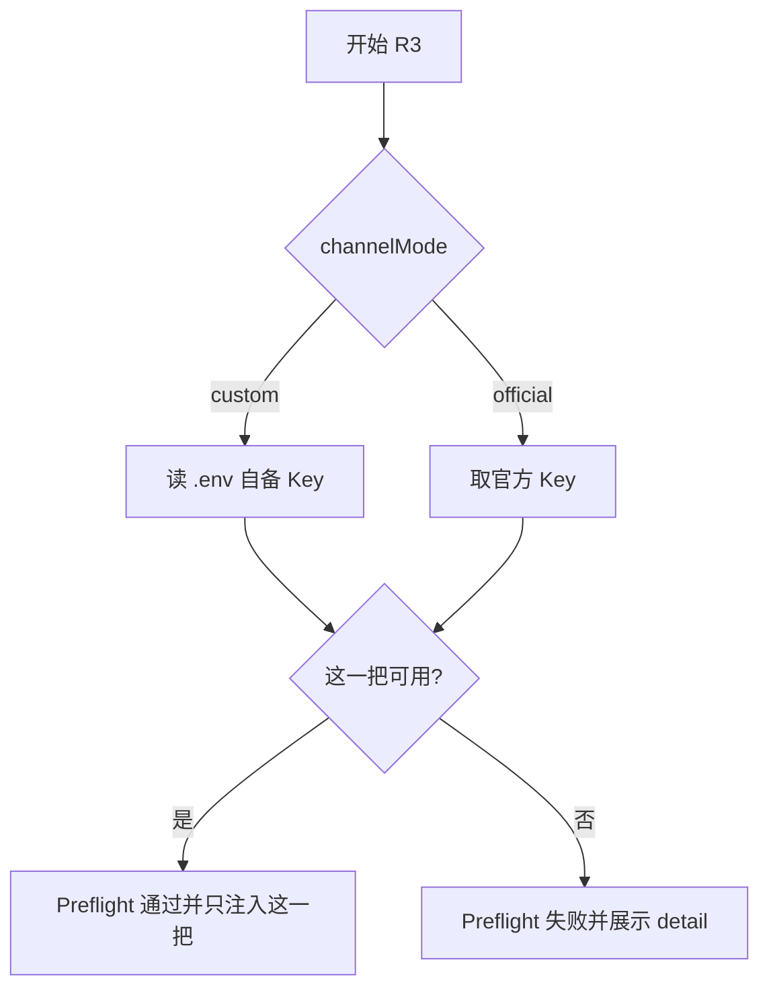

# US-PK-C-04 Places Key 来源跟随模型通道及欠费 / 已吊销提示

> **用户故事**：[../30-需求-Places官方通道按用户下发APIKey.md](../30-需求-Places官方通道按用户下发APIKey.md) · US-PK-C-04 · Issue #21 · **PK7**  
> **状态**：**待评审**（本文件只定设计；业务代码尚未按本文改动）  
> **范围**：Places Key 来源只跟模型通道走（PK7）；欠费 / 已吊销后的提示；Preflight 与「开始 R3」使用同一规则。设置页与环境设置引导第 2 步按通道只显示一种来源  
> **依赖**：[US-PK-C-02](US-PK-C-02-接收并安全保存官方Key.md) 的实时取 Key；现网 `resolvePlacesStart`；探索页 `useExploreStart`；设置页与 `OnboardingOverlay` 的模型通道  
> **不做**：官方通道与 BYOK 并存或让用户另选来源（PK7）；取 Key 失败、欠费或已吊销时回落 BYOK；在官方通道读取或使用本机自备 Key；计费 BYOK；代调  
> **文档位置**：`docs/design/`  
> **文件名**：仍是 `US-PK-C-04-与BYOK并存及停用提示.md`，避免已有链接失效。标题与需求稿 US-PK-C-04 一致。

需求 **O4** 已关闭（2026-10-13，PK7）：按模型通道二选一，不并存，没有优先级，也没有「改用自备 Key」按钮。来源就是当前的 `FTCS_CHANNEL_MODE`。需求稿若仍有「两把同时可用再选优先级」的旧句，以 PK7 与本文为准。

---

## 0. 相对现网

对照 `desktop/electron/preflight/places-start.ts`、`useExploreStart.ts` 与 `settings-service.ts`（2026-10-13）。

| 现网 | **本期（US-PK-C-04）** |
|------|------------------------|
| 只要 `placesApiKeySet`，就 `ok`，provider `custom` | 先看 `channelMode`。`official` 只尝试官方 Key；`custom` 只用自备 Key |
| 官方通道且没有自备 Key：失败，并说明请填 BYOK | 官方通道不看自备 Key。未开通或取 Key 失败时用 C-01 的状态句，不能开始 R3 |
| 官方通道**有**自备 Key：与自定义通道一样走 BYOK | **取消**（PK7）。官方通道下，本机即使曾经存过自备 Key，R3、Preflight、MCP 注入都不用它，也不回落 |
| 设置与引导同时给出官方申请和 AIza 输入，或只用 AIza | 跟通道二选一，见 §4。官方通道没有自备 Key 输入框；自定义通道没有官方申请区 |
| `useExploreStart` 用 `placesApiKeySet` 或 `FTCS_PLACES_KEY_SOURCE` 决定 R3 按钮 | 改为「当前通道下的那一种 Key 是否可用」 |
| 含 R3 的方案 Preflight 走 `resolvePlacesStart` | 继续走这一个函数。探索页按钮与 Preflight 不得各算各的 |

---

## 1. 与相邻故事的分工

| 模块 | 本期 |
|------|------|
| **US-PK-C-04** | 按通道决定来源、欠费与已吊销提示、`resolvePlacesStart`、保存时是否动自备 Key |
| **US-E-07** | 自备 Key 的输入、掩码、清除、直连。**只在** `channelMode === custom` 出现。字段含义不改 |
| **US-PK-C-01** | 官方状态文案与申请按钮。**只在** `channelMode === official` 出现，含引导第 2 步 |
| **US-PK-C-02** | 官方 Key 只在当次运行的内存里。官方通道保存不把自备 Key 写进官方路径 |
| **US-PK-C-03** | 把本节选出的那一把注入 MCP。失败不注入另一把 |

---

## 2. 已确认选型

| 项 | 决定 |
|----|------|
| **来源** | 只有 `FTCS_CHANNEL_MODE`。`official` → 官方下发 Key；`custom` → 自备 Key。没有第三态，也不能在同一通道里再选一次 |
| **不再使用来源键** | 不读、不写 `FTCS_PLACES_KEY_SOURCE`。工作区里若已有这个键，运行时忽略，保存时不更新。不提供 `places-official:set-source` |
| **官方通道** | PK7：Places 只能用官方申请的 Key，不是可选项。设置页与引导第 2 步只显示官方 Key 申请与状态，隐藏「自备 Places Key」输入框。不把 `GOOGLE_PLACES_API_KEY` 读进表单，运行时也不使用本机已存的那一把 |
| **自定义通道** | PK7：只能 BYOK（US-E-07，行为与现网一致）。只显示自备 Key 输入框，隐藏官方申请区，也不为了展示去查状态或取 Key |
| **保存与 `.env`** | 见 §2.1。官方通道的保存不读、不写、不清除自备 Key（PK7：保存不写入自备 Key） |
| **R3** | 见 §3。官方通道只取官方 Key。失败、欠费、已吊销、未登录、限频都停止。本机存过的自备 Key 不参与，也不改 `channelMode`（PK7） |
| **欠费 / 已吊销** | 官方通道提示「已欠费，请充值」或「请联系客服」，并接着引导：如需使用自备 Places Key，请把模型通道切换为「自定义」（PK6、PK7、PK12）。不回落，不提供「改用自备 Key」按钮。本机有没有旧自备 Key，这句都出现；在用户自己改通道之前，旧 Key 仍不使用 |
| **未申请** | 官方通道不能开始 R3，文案指向设置 → 探索去申请。不改去要求填写自备 Key |
| **识别当前 Key** | 看得到的那一块就是来源：官方区块表示官方下发 Key，自备输入框表示自备 Key。Preflight `detail` 用同一通道，句子在 §3.1 |
| **gateway 标志** | `isPlacesGatewayReady` 继续恒为 `false`。官方 Key 的 `provider` 仍是 `custom` |

设置页上的六态只来自刚返回的状态接口，且只在官方通道查询。开始 R3 时官方通道直接取 Key，不读本地状态，也不读自备 Key。

### 2.1 通道切换后，自备 Key 留不留在 `.env`

对齐 `desktop/electron/settings/settings-service.ts` 里切到官方通道时的现网习惯：自定义模型 Key **不改写**（注释写明「官方：不改写自定义 Key」「Key 保留」）。`GOOGLE_PLACES_API_KEY` 同样处理。

| 保存时的通道 | `GOOGLE_PLACES_API_KEY` |
|--------------|-------------------------|
| `official`（设置页或引导第 2 步） | **不读、不写、不清除**。服务端忽略本次的 `placesApiKey`，即使调用方传了空字符串也不当清除。`.env` 里已有的自备 Key 原样留下 |
| `custom` | 与现网 US-E-07 相同：新值覆盖；掩码或未改则保留；用户把输入框清空再保存则清除 |

官方通道的界面没有这只输入框，因此也不会把掩码读上来再存回去。留下的自备 Key 在官方通道的 R3、Preflight、MCP 注入里都不用（PK7）：本机曾经保存过，也不拿来发 Places 请求。用户自己把模型通道改回自定义后，设置页按现网掩码显示这把 Key，R3 才使用它。

---

## 3. 开跑规则

```typescript
type ChannelMode = 'official' | 'custom'

interface PlacesRunPlan {
  ok: boolean
  source: 'official' | 'byok' | 'none'
  detail: string
  /** 失败时界面可以做的下一步。没有则为 null */
  offer: 'open-settings' | 'relogin' | null
}
```

开跑时的顺序（不读 `FTCS_PLACES_KEY_SOURCE`，不读 Places 状态文件，也不先查状态）：

1. `channelMode === 'custom'`：自备 Key 非空则用自备 Key，不调用取 Key。为空则失败，`detail` 见 §3.1，不改去申请官方 Key。
2. `channelMode === 'official'`：调用 C-02 取 Key。成功才开跑。失败用取 Key 返回的状态显示 §3.1。不读取 `GOOGLE_PLACES_API_KEY`，即使该键非空也不注入 MCP（PK7）。

纯函数**不写盘**，也不修改 `channelMode`。

`resolvePlacesStart` 返回上述结果里的 `ok`、`detail`、`provider: 'custom'`（只要 `ok`）。`places-start.test.ts` 里「官方通道无 Key 则要求 BYOK」「来源为空且有 BYOK 则走自备」改为：官方通道不论 `.env` 有没有自备 Key，都只看取 Key 结果；自定义通道只看自备 Key。

### 3.1 `detail`

| 结果 | `detail` |
|------|----------|
| 官方通道，取 Key 成功 | 官方下发 Key（本机直连 Google） |
| 取 Key 网络失败 | 暂时联系不上官方服务，未能获取 Places Key。请稍后重试。 |
| 401 `need_login` | 请先登录后再使用官方 Places Key。 |
| 401 `credential_revoked` | 登录凭证已吊销，不能获取官方 Places Key。请重新登录。 |
| `arrears` | 已欠费，请充值。如需使用自备 Places Key，请把模型通道切换为「自定义」。 |
| `revoked` 或官方 Key 已吊销 | 请联系客服。如需使用自备 Places Key，请把模型通道切换为「自定义」。 |
| 429 限频（O14） | 获取官方 Places Key 过于频繁，请稍后再试。 |
| 官方通道，申请中 / 开通失败 | C-01 §4.3 的对应句 |
| 官方通道，未申请或取不到 Key 且上面没有更具体的句子 | 请在设置 → 探索申请官方 Places Key（仅 R3 需要）。 |
| 自定义通道，自备 Key 可用 | 自备 Google Places API Key（本机直连） |
| 自定义通道，自备 Key 为空 | 请在设置 → 探索填写自备 Places Key（仅 R3 需要）。 |

欠费与已吊销只用上面两句，不另做按钮，也不因为 `.env` 里已有自备 Key 就改用它或改写 `channelMode`。其它官方通道失败句不提自备 Key。自定义通道的失败句不出现「申请官方 Places Key」。

---

## 4. 界面

不提供来源二选一，不提供「改用自备 Key」「改用官方下发 Key」。用户切换的是模型通道（设置里现成的官方 / 自定义），Places 展示跟着变。

### 4.1 设置 → 探索 → R3 地图发现

| `channelMode` | 界面 |
|---------------|------|
| `official` | 只显示 C-01 的官方 Places Key 状态、申请 / 刷新 / 去登录 / 去充值。没有自备 Key 输入框，没有「当前 R3 使用」切换 |
| `custom` | 只显示「自备 Places Key」输入框（US-E-07：掩码、清除、费用计入自己的 GCP、本机直连）。没有官方状态，没有申请按钮 |

从官方切到自定义时，用快照里的掩码填回输入框，避免空串在下次自定义保存时把 §2.1 留下的 Key 清掉。从自定义切到官方时，输入框从界面去掉，本次保存不提交 `placesApiKey`。

### 4.2 环境设置引导第 2 步（模型通道）

`OnboardingOverlay` 的阶段 `keys`（文案「2  模型通道」）与 §4.1 同一规则。

| 引导里选的通道 | 第 2 步里的 Places |
|----------------|-------------------|
| 官方通道 | **去掉** AIza 输入框。同一位置改为官方 Key 状态（先「查询中」）和「申请官方 Places Key」（未登录则「去登录」）。保存**不写入** `GOOGLE_PLACES_API_KEY` |
| 自定义 | **保留** AIza 输入框（现网占位「AIza…（可选）」与帮助链接）。不显示官方申请区。保存按 §2.1 的自定义行写入或清除自备 Key |

用户在这一步先选了自定义并填了 AIza，再改选官方通道后点保存：以最终选中的官方通道为准，不把输入框里尚未提交的 AIza 写入 `.env`。已经写在 `.env` 里的旧自备 Key 按 §2.1 保留。

探索页仍然不放申请按钮，也不放自备 Key 输入框。`startR3DisabledReason` 用 §3.1 的失败 `detail`。R1/R2 的禁用理由不变，两种通道都不因为 Places 拦住 R1/R2。

---

## 5. 流程



官方通道取不到 Key 就停在 `block`。不存在从 `block` 自动改走自备 Key 的边。

---

## 6. 文件清单

**本详设不改这些文件。**

| 文件 | 预期动作 |
|------|----------|
| `desktop/electron/preflight/places-start.ts` | 按 §3，只看 `channelMode` 与对应的那一把 Key。`isPlacesGatewayReady` 保持 `return false` |
| `desktop/electron/preflight/places-start.test.ts` | 去掉「官方通道有 BYOK 则通过」「来源键决定来源」。补上官方通道不回落 |
| `desktop/electron/preflight/agent-preflight.ts` | 继续调用 `resolvePlacesStart` |
| `desktop/src/composables/useExploreStart.ts` | R3 是否可点改为当前通道的 Key，不再读 `placesKeySource` |
| `desktop/src/views/SettingsView.vue` | 按 §4.1 只渲染一段。去掉来源二选一 |
| `desktop/src/components/onboarding/OnboardingOverlay.vue` | 引导第 2 步按 §4.2 |
| `desktop/electron/settings/settings-service.ts` | 官方通道保存忽略 `placesApiKey`。不再读写 `FTCS_PLACES_KEY_SOURCE` |
| `desktop/electron/opencode/runtime.ts` | 注入时使用 §3 的结果（与 C-03 同一处） |
| `desktop/electron/main.ts` | 不增加 `places-official:set-source`。若已有该 IPC，删掉 |

建议单测（纯函数，不启 Electron）：

| # | 输入 | 期望 |
|---|------|------|
| T1 | `official`，取 Key 失败，`.env` 有自备 Key | `ok === false`，`offer` 不是切到 BYOK。不返回自备 Key |
| T2 | `custom`，自备 Key 非空 | `ok`，来源自备，不调用取 Key |
| T3 | `official`，取 Key 成功，`.env` 同时有自备 Key | `ok`，来源官方。注入值不是 `.env` 那一把 |
| T4 | `custom`，自备 Key 为空 | `ok === false`，`detail` 只要求填写自备 Key |
| T5 | `official`，状态 `arrears` 或 `revoked`，`.env` 有自备 Key | `ok === false`。文案分别以「已欠费，请充值」「请联系客服」开头，并含「请把模型通道切换为「自定义」」。不返回自备 Key。`channelMode` 仍是 `official` |
| T6 | `official`，状态 `pending` | `ok === false`，用 C-01 申请中的句子 |
| T7 | `isPlacesGatewayReady` 在官方已开通时 | `false` |
| T8 | 官方通道保存，入参 `placesApiKey` 为空串，`.env` 原本有 Key | 该键原文还在 |

---

## 7. 验收对照

对照 PK6、PK7（2026-10-13：来源跟模型通道）。与 gateway 联调，前提见网关详设。欠费、吊销凭证需要管理端。

| # | 需求 | 步骤 | 期望 |
|---|------|------|------|
| M1 | 自定义通道只有 BYOK | `channelMode=custom`，只填自备 Key，开始 R3 | 通过。`detail` 含自备、本机直连。设置页没有官方申请区。不要求登录 |
| M2 | 官方通道隐藏自备输入 | 先在自定义通道写下自备 Key，再切到官方并保存，打开设置 → 探索 | 只看到官方状态与申请。没有自备 Key 输入框。`.env` 里自备 Key 原文还在 |
| M3 | 官方通道不使用留下的 Key | M2 之后官方 Key 已开通，开始 R3 | Preflight 为官方下发 Key。Places 请求的 Key 不是 `.env` 里那一把 |
| M4 | 切回自定义仍用原 Key | 再把模型通道改回自定义 | 输入框出现掩码。开始 R3 走自备 Key，不调用取 Key |
| M5 | 失败不回落 | 官方通道下，管理端分别做欠费重置、把 Key 吊销为 `revoked`；另断一次到 gateway 的网络。`.env` 里仍有 M2 的自备 Key | 开始 R3 失败。欠费文案是「已欠费，请充值。如需使用自备 Places Key，请把模型通道切换为「自定义」。」已吊销文案把前半换成「请联系客服」，后半相同。没有「改用自备 Key」按钮。本次不用自备 Key 发 Places 请求。`channelMode` 仍是 `official` |
| M6 | 不改通道 | M5 之后不改模型通道，再开始一次 R3 | 仍然失败，仍然不读自备 Key |
| M7 | 要 BYOK 须改通道 | 在 M5 把模型通道改成自定义并保存 | 来源变为自备 Key，R3 可以开始。这是用户改通道，不是失败路径自动切换 |
| M8 | 方案里的 R3 | 含 R3 的方案在 M5 的状态下执行 | Preflight 同样失败，文案与探索页一致 |
| M9 | 引导第 2 步 · 官方 | 打开环境设置引导，第 2 步选官方通道 | AIza 输入框不在。同一位置是官方 Key 状态和申请按钮（未登录为「去登录」）。点保存后，`GOOGLE_PLACES_API_KEY` 与进入这一步之前相同：原来没有就仍然没有，原来有就原文还在 |
| M10 | 引导第 2 步 · 自定义 | 同一引导第 2 步改选自定义 | AIza 输入框在，占位仍是 AIza。没有官方状态，没有申请按钮。填入新 Key 并保存后，`.env` 里是这把自备 Key |
| M11 | 引导里先填再改选官方 | 第 2 步先选自定义并在 AIza 框输入尚未保存的值，再改选官方通道后保存 | 不把这只未提交的 AIza 写入 `.env` |

---

## 8. 不做什么

| 项 | 说明 |
|----|------|
| 欠费或已吊销后自动改用 BYOK，或提供「改用自备 Key」按钮 | 只在文案里引导用户自己把模型通道改为「自定义」（PK7）。本机旧自备 Key 在改通道之前不使用 |
| 官方通道与自备 Key 同时可选 | PK7。同一屏只出现一种 |
| 两把都注入 MCP | C-03 只注入当前通道的一把 |
| 用 `FTCS_PLACES_KEY_SOURCE` 记来源 | 通道即来源 |
| 官方通道保存时清除 `.env` 里的旧自备 Key | §2.1 保留，但官方通道不使用 |
| 给 BYOK 扣官方余额 | 需求明确不做 |
| 用 `placesProvider=gateway` 表示官方 Key | 旧代调标志，保持不启用 |
| 探索页上再做一套申请或填 Key | 申请在设置与引导第 2 步；自备 Key 在设置与引导第 2 步的自定义通道 |

---

## 9. 风险

| 风险 | 缓解 |
|------|------|
| 官方通道保存传了空的 `placesApiKey`，把留下的自备 Key 清掉 | 服务端在 `official` 下忽略该字段；T8、M2、M9 |
| 探索页仍只看 `placesApiKeySet`，官方通道没有自备 Key 时按钮永远不可用 | 都改为 `resolvePlacesStart`；M3、M8 |
| 引导第 2 步仍提交 AIza，官方通道被写成 BYOK | M9、M11。保存以最终通道为准 |
| 旧测试仍期望「请填 BYOK」或二选一 | 更新 `places-start.test.ts`。欠费、已吊销用 §3.1 全文：前半仍是「已欠费，请充值」或「请联系客服」，后半引导把模型通道切换为「自定义」 |

---

## 10. 待确认

O4 已关闭，不进入待确认。其它未决项见[网关详设「待确认」](US-PK-token-gateway-接口与管理端.md)。客户端只认 `arrears` 与 `revoked`，并按 §3 停止。欠费可在充值后恢复；已吊销只能客服在管理端恢复。恢复后仍须模型通道为官方才会用这把 Key。

---

## 11. 修订记录

| 日期 | 说明 |
|------|------|
| 2026-10-10 | 初稿：并存时的默认来源、显式切换、停用后不静默改道 |
| 2026-10-10 | Key 不落盘，改为实时获取 |
| 2026-10-10 | 取消轮换与重取，只在欠费时重置 |
| 2026-10-10 | 去掉 mock，改为与 gateway 联调验收 |
| 2026-10-11 | 设置页只查状态不取 Key |
| 2026-10-11 | 按 PK13 六态与已吊销对齐 |
| 2026-10-11 | 取消状态本地缓存，增加客户端接口一览 |
| 2026-10-13 | Places Key 来源跟模型通道，官方通道不支持 BYOK。对齐 #63 的 PK7：本机旧自备 Key 在官方通道下不使用；欠费 / 已吊销文案引导把通道切到自定义 |
