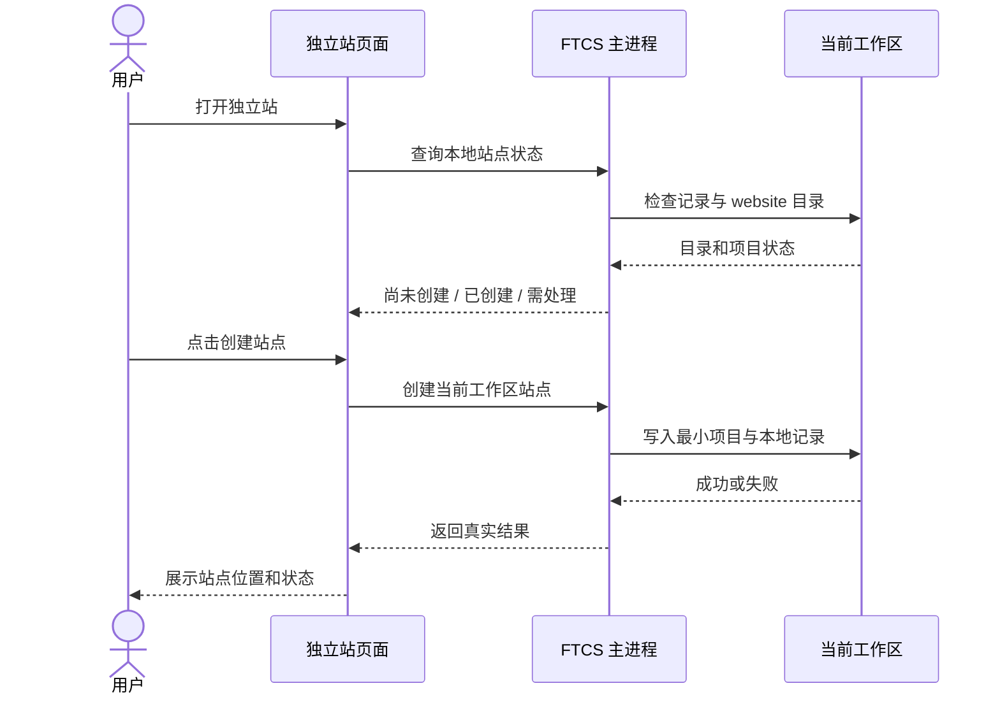

# US-SITE-01：创建和恢复全局站点

状态：设计草案，待核对。对应[用户故事与交付顺序](../独立站-需求拆分与交付顺序.md#us-site-01创建和恢复全局站点)。

## 1. 目标和边界

用户在独立站页面点击创建后，FTCS 在当前工作区创建一个**基于 Vue + Vite + Vue Router + vite-ssg 的最小前端项目**。安装项目依赖后，可使用标准 npm 命令开发和生成静态站点。项目归工作区所有，切换产品不影响；退出并重启后仍可找到。每个工作区只有一个站点，用户可以继续使用固定目录中已经存在的项目。

本次交付包括项目模板、创建与恢复、本地状态展示和异常提示。创建本地项目不要求连接 GitHub 或 Cloudflare，不创建远端仓库或 Pages 项目，也不触发发布。

以下能力保持后续故事的范围：智能体编辑与权限（US-SITE-02）、选择和使用资料（US-SITE-03）、桌面端启动和管理预览/构建进程（US-SITE-04）、发布和域名。虽然本次模板提供可执行的开发和构建脚本，但页面上的完整预览和发布能力不因此视为已交付。

## 2. 目录与初始项目

### 技术选型

默认模板采用 **Vue + Vite + Vue Router + vite-ssg**。Vue 负责页面与组件，Vite 负责开发服务及构建，Vue Router 管理页面路由，vite-ssg 在构建时将指定路由预渲染成静态 HTML，使用 `@unhead/vue` 管理各页面标题和描述。构建产物部署为静态文件，不要求线上运行 Node 服务。参见 [Vue Router 文档](https://router.vuejs.org/guide/)和 [vite-ssg 官方说明](https://github.com/antfu-collective/vite-ssg)。

这套组合符合维护者熟悉的技术栈，能够按需要扩展单页或多页网站。预渲染便于搜索引擎读取页面内容，但页面标题、描述、正文质量、站点地图等仍需要按业务完善，不能保证收录或排名。它只是默认模板，不限制用户以后更换其他符合项目契约的技术栈。

建议将站点固定在 **`<当前工作区>/website/`**。它是用户工作区里的目录，不是 FTCS 源码仓库的 `workspace/` 模板目录；站点源码、依赖、预览工作目录和构建产物均位于其中。工作区切换时使用新工作区的 `website/`，产品切换不改变路径。

创建后目录如下：

```text
<工作区>/
├── .ftcs/
│   └── site.json               # FTCS 本地站点记录，不属于站点源码
├── data/                       # 原有业务资料
└── website/                    # 唯一站点项目根目录
    ├── package.json
    ├── package-lock.json       # 锁定依赖树，保证可复现安装
    ├── index.html              # Vite 入口 HTML
    ├── vite.config.ts
    ├── tsconfig.json
    ├── README.md
    ├── .gitignore
    ├── src/
    │   ├── main.ts             # vite-ssg 入口与 Vue Router 配置
    │   ├── App.vue
    │   └── pages/
    │       └── Home.vue        # 简洁的初始首页
    ├── seo/
    │   └── sitemap.xml.template # 地图模板，不直接作为正式地图发布
    └── public/
        ├── robots.txt           # 爬虫规则
        ├── llms.txt             # 网站简介和页面索引
        └── llms-full.txt        # 网站详细内容模板
```

依赖安装及构建后会产生 `node_modules/` 和 `dist/` 等目录，不预先创建，也不纳入版本管理。`package-lock.json` 在制作模板时随固定的依赖版本生成并一并分发，纳入站点版本管理；首次创建不初始化 Git 仓库。

模板是起点，不是对最终网站的框架或页面数量的限制。用户和智能体以后可替换页面结构、脚本或引入前端框架，只需保持纯前端项目、`npm run dev`、`npm run build` 和可配置的静态产物目录约定。初始页面使用中性占位内容，不虚构企业或产品信息，也不包含询盘提交功能。

### 2.1 运行与构建契约

`package.json` 提供：

```json
{
  "name": "ftcs-website",
  "private": true,
  "version": "0.1.0",
  "type": "module",
  "scripts": {
    "dev": "vite --host 127.0.0.1",
    "build": "vite-ssg build"
  }
}
```

- 上例仅展示项目契约，实际 `package.json` 还需包含与锁文件匹配、经验证的 Vue、Vue Router、Vite、`@vitejs/plugin-vue`、vite-ssg 和 `@unhead/vue` 等依赖版本。模板开发时选择并固定互相兼容、也与 FTCS Node/npm 和 Cloudflare 构建环境兼容的具体版本，不在用户创建时拉取 `latest`。
- 模板依赖目前要求 Node 22.12 及以上的 22.x，或 Node 24 及以上；FTCS 内置的 Node 24 满足要求。手动配置的 Node 版本若不满足要求，后续安装和预览入口应说明原因并提示更新；云端构建也必须使用兼容版本。
- 创建站点时只复制项目文件，不自动联网或执行安装脚本；状态显示“项目已创建，依赖待安装”，不能将其描述为已经可以直接预览。首次运行前需要通过 FTCS Node/npm 执行 `npm ci`，首次通常需要网络；网络失败时保留项目并允许重试。依赖安装的桌面入口、确认方式、安装进度及生命周期脚本处理属于 US-SITE-04 详设，不擅自将其当作可自动放行的 bash。锁文件应保证本地与云端按同一依赖树安装。
- `npm run dev` 使用 Vite 开发服务，仅监听本机，支持开发时更新；端口和实际监听地址由服务输出并由后续预览管理识别，不假设固定端口。
- 项目入口使用 `ViteSSG` 创建应用并提供 Vue Router 路由配置；`npm run build` 执行 `vite-ssg build`，为需要公开的路由生成静态 HTML，默认产物目录为 `dist/`。预渲染会在构建时运行组件，浏览器专用 API 需放在客户端执行，避免构建失败。
- 桌面端后续运行命令时使用现有 FTCS 配置的 Node/npm，不依赖用户全局安装 Node。运行环境缺失时明确报错并指向现有运行环境配置流程。模板本身也可以在其他已安装兼容 Node/npm 的环境中运行。
- 每个需要 SEO 的页面应提供可读取的正文、标题和描述；动态产品路由必须根据构建时可用的数据枚举具体路径，使用 `includedRoutes` 等机制列入预渲染。验收时检查产物 HTML，不能仅验证浏览器通过 JavaScript 渲染后的效果。站点地图、canonical、robots、结构化数据等按站点实际内容和域名配置，不预填虚假域名。
- 默认 `dist` 仅适用于该模板的默认构建配置。用户或智能体更换构建方案后，需同步修改站点的静态产物目录配置；相关编辑界面和运行校验属于后续预览/发布设计。静态发布没有运行时服务端 API，站内表单提交仍属于后续范围。

### 2.2 README 和 .gitignore

`README.md` 面向站点维护者，至少说明：这是当前工作区的 Vue 独立站项目；`src/pages/`、`public/` 和 `dist/` 的用途；依赖安装、`npm run dev` 与 `npm run build` 的运行方式；FTCS 后续使用自身 Node 环境；Vue Router、预渲染及动态路由需要注意的事项；更换框架后保留项目契约并更新构建产物配置；站点源码与图片可能随发布公开，凭据不要写入项目。对于自行在终端运行命令的用户，需自行准备可用的 Node/npm。

初始 `.gitignore` 至少包含：

```gitignore
node_modules/
dist/
.env
.env.*
!.env.example
npm-debug.log*
.DS_Store
Thumbs.db
```

`.env.example` 仅用于不含真实值的示例。忽略规则不是凭据保护或发布内容检查的替代品：前端构建结果和站点源码均可能公开。

### 2.3 搜索引擎和 AI 访问文件

初始项目提供以下四类文件或模板，文件名分别为 `sitemap.xml`、`robots.txt`、`llms.txt` 和 `llms-full.txt`。其中 `sitemap.xml` 和 `robots.txt` 是约定名称。构建或配置后，这些文件从站点根路径访问。

| 文件 | 初始内容和用途 | 后续维护 |
| --- | --- | --- |
| `sitemap.xml` | 提供 XML 源模板；已配置正式站点地址时根据公开页面生成，列出绝对 URL，帮助搜索引擎发现页面。 | 和预渲染使用同一份公开路由及产品路径清单，新增或移除页面后随构建更新；不纳入不存在、未公开或不应收录的页面。 |
| `robots.txt` | 提供默认允许爬取的规则，供遵循该规则的爬虫读取；有正式站点地址时在构建产物中附加地图绝对地址。 | 站点维护者可修改源文件规则；构建处理要保留用户规则，不重复添加地图行。 |
| `llms.txt` | 提供 Markdown 格式的网站简介及重要页面索引模板。初始内容只描述实际的占位网站，不编造企业和产品信息。 | 智能体建站时或用户编辑时，根据已公开的真实内容更新简介和链接。 |
| `llms-full.txt` | 提供较详细的网站内容模板，可放公开的企业介绍、产品及联系方式等正文；初始内容与占位页面一致。 | 随站点内容由智能体或用户维护，只包含明确准备公开的内容，避免与页面信息不一致。 |

`sitemap.xml.template` 是站点源码中的地图模板；不能把带占位域名的内容直接当成正式地图发布。构建优先接入与 vite-ssg 兼容的成熟地图生成工具，由同一份公开路由清单驱动预渲染和地图生成，具体依赖及版本需经过安装、构建和 Windows 兼容验证。地图中的地址需要完整的正式站点 URL；构建配置使用明确的站点基础 URL（首选已确认的 `pages.dev` 地址或自有域名），本地预览时不得把 `localhost`、占位域名或未确认的域名写成正式地图。

未配置站点地址时，创建和本地构建仍然可以成功：保留地图源模板，不在构建产物中生成错误的 `sitemap.xml`，`robots.txt` 也不包含虚假的 `Sitemap` 地址，并提示尚未配置。配置或变更正式地址后重新构建，生成正确的地图及对应的 `robots.txt` 声明；云端构建也需使用同一正式站点地址。发布流程中的地址录入、更新与重新构建交互由后续发布和域名故事设计，不因首次创建就要求连接云账号。地图不伪造 `lastmod`；如填写，应基于真实的内容修改时间。

`robots.txt` 是爬取规则，不是权限控制或防止资料公开的机制。`llms.txt` 是社区提出的约定，`llms-full.txt` 是常见的扩展文件，不保证搜索引擎或 AI 服务读取、收录或引用；它们也不替代网页本身的 SEO。[Google robots.txt 文档](https://developers.google.com/crawling/docs/robots-txt/create-robots-txt)、[llms.txt 提案](https://llmstxt.org/)。

README 应说明这四类文件的用途、站点地址配置、何时会生成正式地图，以及修改产品和页面后如何维护对应内容；生成过程中不得覆盖 `llms.txt` 或 `llms-full.txt` 的用户修改。自动从任意 Vue 页面完整提取正文、自动发现全部动态路由不作为首版承诺。

## 3. 页面与用户流程

复用现有独立站页面的站点卡片；GitHub、Cloudflare 的连接区域保持独立，可以在创建前后操作。

1. 页面打开时读取当前工作区站点状态，尚未创建时在卡片显示“尚未创建”和“创建站点”。仅查看页面或连接账号不会创建目录。
2. 用户点击“创建站点”，页面显示“正在创建”，按钮防重复点击；主进程创建完整模板并写入站点记录。
3. 成功后卡片显示“本地站点已创建”、项目位置和“打开目录”；默认模板尚未安装依赖时显示“依赖待安装”。线上地址仍显示“尚未发布”，预览区域提示预览能力后续提供。
4. 再次进入页面、刷新或重启应用后，重新检查固定目录并展示真实状态。切换产品不重建项目；切换工作区则重新读取该工作区的状态。
5. 创建失败显示原因和“重试”；不展示成功状态。打开目录使用系统文件管理器，失败时提示实际原因。



创建与刷新请求都由主进程以当前工作区为准；若操作期间工作区发生切换，结果仅应用到发起时的工作区，页面重新加载当前工作区状态，不能把旧工作区结果显示到新页面。

## 4. 状态、恢复和数据保护

`.ftcs/site.json` 是工作区内、站点目录外的本地记录。首版记录格式建议：

```json
{
  "version": 1,
  "projectDir": "website",
  "buildOutputDir": "dist",
  "createdAt": "2026-01-01T00:00:00.000Z"
}
```

`projectDir` 首版只能是约定的相对路径 `website`；`createdAt` 使用实际创建时间，接管已有项目时可省略或改为记录接管时间。记录不存 GitHub/Cloudflare 凭据，也不包含产品 ID。它用于记住站点已创建及构建配置；项目是否存在、是否符合基础契约仍以实时检查为准。以后增加远端关联时单独设计凭据和配置存储。

| 检查结果 | 页面状态和处理 |
| --- | --- |
| 无记录、目录不存在 | 尚未创建；用户可创建。 |
| 无记录、已有空 `website/` | 提示目录已存在但为空，提供“在此初始化”；仅在用户点击后写入模板。 |
| 无记录、已有非空目录且基础契约通过 | 显示“发现已有站点”，用户确认“使用此站点”后建立本地记录；不改动项目文件，不推测其构建产物目录，提示后续在设置中配置。 |
| 无记录、已有非空目录但契约不完整 | 显示目录已存在且无法识别为完整站点，提供打开目录和重新检查；不覆盖、删除或自动补模板。 |
| 有记录、目录和契约正常 | 显示本地站点已创建，使用现有文件。 |
| 有记录、目录缺失 | 显示“站点目录不存在”，提供重新检查及打开工作区；用户将原目录恢复后继续使用。需要新建时须明确选择重新创建，保留原记录并提示可能需要重新检查后续发布关联。 |
| 目录不可读、无权限、是普通文件或存在其他路径异常 | 显示可理解的原因与路径，提供打开工作区和重新检查，不自动重建或覆盖。 |
| 有记录但 `package.json` 无法解析或缺少必要脚本 | 显示“项目需要处理”，提供打开目录和重新检查；不自动修复或覆盖用户改动。 |
| 记录缺失或损坏、站点目录仍存在 | 保留项目，按已有项目重新检查和接管；不凭猜测覆盖目录或重置构建配置，产物目录重新确认。 |

基础契约检查只检查目录可读取、`package.json` 可解析，以及 `scripts.dev`、`scripts.build` 为非空字符串；不要求模板中的 `src/`、`public/` 或 `dist/` 存在，不执行项目脚本，也不能据此保证项目实际能启动或构建。依赖、构建产物及实际运行错误由 US-SITE-04 进一步检查。已有项目的产物目录不明时记录为空，后续配置确认前不应假定产物目录或允许依赖该配置的发布流程继续。

创建操作应只写入该次创建的文件，使用排他创建与并发保护；出现同名文件、目录内容变化或另一创建请求抢先完成时停止并重新检查，绝不覆盖已有内容。失败清理仅限能够确认由本次操作创建且未被外部更改的临时文件；无法安全确认时保留并提示用户处理。项目写入完成但记录写入失败时报告未完全完成，保留项目并允许按已有项目接管；重试不得覆盖项目。状态检查拒绝把 `website` 的符号链接或 Windows junction 当作普通站点目录使用，并提示用户处理，避免绕过工作区边界。

## 5. 技术接入建议

- 在 Electron 主进程新增站点项目服务，复用 `getWorkspaceRoot()` 解析当前工作区；封装查询状态、创建模板、接管已有项目、打开目录。主进程负责文件系统操作、校验和错误转换。
- 通过 preload 暴露受限接口供 `SiteView.vue` 调用，渲染进程不直接访问文件系统，也不从页面接受任意站点绝对路径。文件内容使用 UTF-8，路径通过平台路径 API 处理，兼容 Windows 路径及空格。
- 模板源码存放在 `desktop/site-template/`，打包后作为独立的 `site-template` 资源分发，创建时复制到用户工作区；FTCS 升级、工作区模板同步、页面刷新都不能将新模板覆盖已有站点。
- 查询应能区分目录不存在、读写权限不足、路径冲突、项目契约不完整与记录损坏；错误信息可展示但不得暴露凭据。记录写入使用临时文件和安全替换，失败时保留原记录。
- 这是本地文件状态；无需智能体调用 `task_begin` / `task_done`。后续智能体建站任务的状态与页面刷新，仍按已约定的任务生命周期协议设计。
- 后续 US-SITE-02 必须将直接编辑权限限定在真实站点目录，检查 `..`、符号链接和 junction；自由聊天的 bash/shell 走询问，自动任务期间自动拒绝。项目脚本以用户权限运行，不将该规则描述成操作系统级隔离。

## 6. 验收用例

1. 新工作区进入页面和连接账号均不创建项目；点击创建后出现完整模板、README、`.gitignore`，文件均可正常读取。
2. 使用 FTCS 配置的 Node/npm，在无全局 Node 的环境安装锁文件指定依赖，运行 `npm run dev` 和 `npm run build`；开发地址可访问，`dist/index.html` 及资源可用，重复构建成功。创建项目本身不联网或执行依赖安装，安装失败时保留项目并提示重试。
3. 检查 `.gitignore` 包含依赖、构建产物、环境变量和常见日志；锁文件与源码不被忽略。README 中命令和路径与模板实际一致。
4. 产品切换、页面刷新、应用重启后显示同一项目且文件不变；切换工作区显示各自独立的站点状态。
5. 已有空目录须明确初始化；已有合规项目可接管且文件不变；已有非空不合规目录不被覆盖；已有项目未知产物目录不默认为模板产物目录。
6. 目录被删除、权限不足、路径是普通文件、配置损坏及 `package.json` 不完整时显示真实状态，恢复文件后重新检查可继续使用。
7. 模拟创建中断、记录写入失败、重复点击和并发目录创建，确认不覆盖用户文件，不错误报告成功；损坏记录可通过接管恢复。
8. 使用工作区路径含中文、空格的 Windows 环境验收创建、读取与模板命令；测试站点目录符号链接/junction 和端口占用，确保明确报错。
9. 不连接任何云账号仍可创建；创建不会创建远端资源、复制产品资料、触发智能体任务或发布。
10. 构建产物中的首页 HTML 包含实际正文、标题和描述；另用代表性的产品详情路由验证可被预渲染并在静态托管下直接访问，验证动态产品路径需要在构建时枚举并配置。静态构建不依赖部署 Node 服务。
11. 使用锁文件验证模板依赖与 FTCS Node/npm 的实际版本兼容，并在后续 Cloudflare 发布联测确认 `npm run build` 和 `dist`；不能把框架文档作为环境联测通过的证明。
12. 新建项目包含四类文件或模板；未配置站点地址时，本地构建成功且不输出占位或 localhost 地图，也不输出错误的 `Sitemap` 声明。配置正式地址后构建，验证根路径的 `sitemap.xml` 和 `robots.txt` 格式及地址正确，地图与预渲染的公开页面一致；变更产品路由和域名后重新构建可更新，且保留自定义爬虫规则。
13. `llms.txt` 和 `llms-full.txt` 构建后位于站点根路径，内容不虚构企业资料，用户修改在重复构建后保留；不将这两个文件作为搜索引擎或 AI 收录成功的判断依据。

## 7. 本次待核对

1. 固定目录名建议采用 `website/`，是否符合你的命名习惯？
2. 目录缺失时默认让用户恢复原目录；仅在明确选择重新创建后生成新模板，是否符合预期？
3. 默认模板采用 Vue Router + vite-ssg 静态预渲染；首次运行前需要安装依赖，安装入口和交互由 US-SITE-04 详设。
