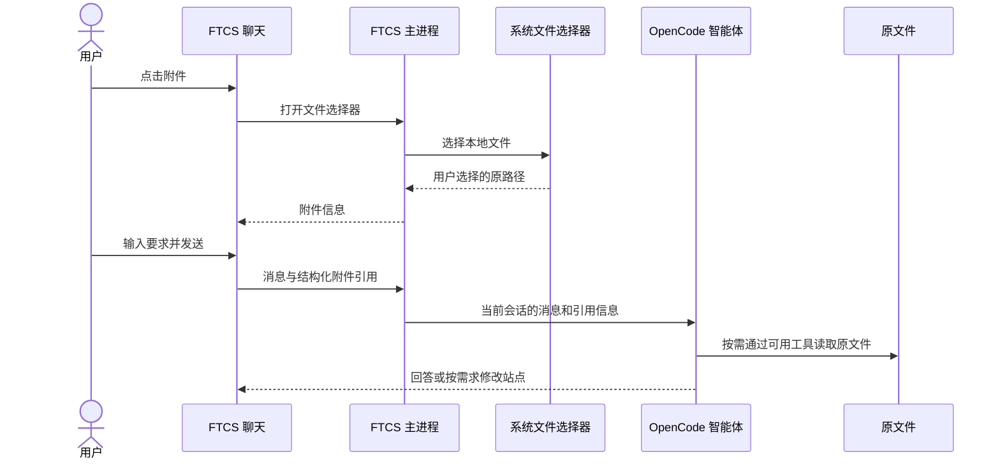

# US-SITE-03：在聊天中引用本地文件和已有资料

状态：已实现，待 Windows/macOS 真实桌面与 OpenCode 联测。基于[独立站需求拆分](../独立站-需求拆分与交付顺序.md)、[智能体编写独立站](./US-SITE-02-智能体编写独立站.md)及现有聊天、资料库和产品画像功能。

## 1. 目标

用户在与智能体聊天时，可以直接选择电脑任意位置的文件作为临时参考，也可以使用 `@` 快速引用资料库文件或已有产品画像。智能体根据用户当前请求决定是否读取和如何使用这些资料。

这个能力不仅限于建站，但本期以独立站为主要使用场景。站点仍是当前工作区的全局 `website/` 项目，不绑定某个产品画像；不新建聊天，不引入固定的业务任务或固定的生成步骤。

本期有意保持简单：**选中本地文件只是把原文件作为聊天参考，不自动导入资料库、不复制快照、不提取文本、不转换格式，也不自动写入站点。**用户可以选择任意扩展名；智能体能否读取、理解和使用，取决于现有工具、文件格式和模型能力。

## 2. 三种引用方式

| 入口 | 用户操作 | 引用内容 |
| --- | --- | --- |
| 本地文件 | 点击聊天输入区的附件按钮，通过系统文件选择器选择一个或多个文件 | 用户选中的原文件，可位于电脑的任意目录。 |
| 资料库 | 在输入区输入 `@`，搜索并选择资料库中的文件、图片或网站书签 | 已有资料库条目，继续保存在原位置。 |
| 产品画像 | 在输入区输入 `@`，搜索并选择已有产品画像 | 所选画像；不默认附带该产品的所有原始资料。 |

`@` 列表区分“资料库”和“产品画像”，支持按名称搜索；重名时显示文件相对路径或产品标识以便区分。用户也可以不选择任何资料，仅输入文字。

系统文件选择器不限制必须从资料库、工作区或网站目录选择，也不按扩展名筛掉用户想选的文件。第一版选择**文件**，支持多选；目录选择和自动展开不属于本期。

## 3. 聊天交互

### 3.1 附加本地文件

1. 用户点击附件按钮，使用操作系统原生文件选择器选取文件；取消选择不会更改输入内容。
2. 选中的文件以附件条目显示在输入区，至少显示文件名，并能查看原路径、逐个移除；同名文件可区分。
3. 用户输入要求，例如“参考这份产品说明书和这张图片，给我的独立站增加产品详情页”，然后点击发送。添加文件本身不发送消息、不启动工具，也不修改文件。
4. 发送成功后，对话中展示本条消息引用了哪些文件。发送失败或未被接受时，保留草稿和待发送附件，避免用户重新选择。
5. 智能体在原会话中按需读取原文件并回答或修改网站；不要求先导入资料库，不把附件自动当成网站素材。

用户可以为附件附上文字，也可以只发送附件；只有附件时交由模型结合当前会话理解，信息不足时可询问用途。选择文件时不按后缀限制，但选择成功不表示文件一定能被模型解析。

### 3.2 `@` 资料库和产品画像

1. 用户在输入区输入 `@` 时打开候选列表，可继续输入名称筛选，选择资料库文件、图片、网站书签或产品画像。
2. 选中后在消息中显示可识别的引用；可继续输入、再次 `@`、删除引用。支持键盘选择、鼠标选择、取消候选和中文输入法。
3. 发送时，主进程收到用户文本和**结构化引用**：例如资料库相对路径或产品 ID，而不只是显示名称。它校验引用对应的条目存在，并把可供智能体使用的实际标识写入当前消息上下文。
4. 被引用的资料库文件使用原文件；网站书签提供其 URL；产品画像使用已有画像内容或读取入口。**引用画像不等于引用该产品的所有文件**，需要其他资料时用户可再 `@` 或选择本地文件。

只有用户实际从候选列表选中的条目才是结构化引用；用户普通文字中出现 `@`、邮箱地址或自行输入的同名文本，不应被误认为已经选择并授权了某个条目。用户编辑、删除引用或发送失败时，显示内容和结构化记录须保持一致。

### 3.3 在当前会话继续使用

附件和 `@` 引用是聊天中的临时参考。模型可依据聊天上下文继续理解用户说的“刚才的文档”或“这张图片”；用户也可在后续消息中增加或移除引用。切换到新会话后，不自动把旧会话附件当作新会话选择。

引用的是原文件，**不是冻结快照**：文件在选择后可能被移动、删除或修改，读取时以当时实际文件为准。不存在、无法访问或读取失败时向用户说明，请其重新选择；不偷偷使用旧缓存或声称已读到内容。引用名称、路径及正常聊天内容可能出现在会话记录中，不承诺删除既有会话或模型服务的日志。

## 4. 智能体如何使用

- 模型根据用户意图自主决定使用哪些文件、是否加载 `build-website` 等 Skill，以及修改哪些页面；不把选文件变成固定的建站工作流。
- 选择附件后，FTCS 不主动打开、解析或读取文件内容。模型真正需要时才使用当前可用的读取、搜索或其他工具；若执行 Bash/shell，仍按已确认的规则由用户逐次授权。
- 图片理解取决于当前模型和读取工具是否支持图片；文档理解取决于工具是否支持该格式。对于无法读取的格式，智能体应说明原因并请求用户提供可用内容或选择其他处理方式，不能把文件名当成文件正文。
- 产品画像或文档可以作为页面文字的依据，但不得虚构其中没有的参数、认证和联系方式。引用本身不代表整份资料应该公开，具体如何使用由用户的聊天需求决定。
- 如果用户希望**把一张图片或文档实际放到网站中**，站点代码不能直接依赖电脑其他目录或资料库中的原路径；相关文件需要放到 `website/` 内并按项目约定引用。这是完成该网站需求时的实际操作，不是选择附件时的自动处理。第一版可通过现有 Bash/shell 执行复制，并按现有规则请求用户授权；智能体应保留原文件、避免覆盖站点中已有文件。
- 仅参考文件不会触发网站源码变化。若实际复制到 `website/` 或编辑代码，沿用既有站点文件监听、预览和构建状态；用户仍通过既有发布确认流程检查将推送的文件。

例如：“参考这份 PDF 写一段公司介绍”不应自动把 PDF 放进网站；“把这张图片用于首页横幅”则需要在获得相应命令授权后，将图片复制到项目合适目录并引用。

## 5. 数据流与权限

`@` 的不同之处只在来源：候选来自 FTCS 的资料库树和产品列表，用户选中后与消息一起提交结构化引用。它不调用文件选择器，也不复制资料库文件。

### 5.1 引用如何传递

当前 `sendAgentMessage(text, productId?)` 只传文本和产品标识，并拒绝空文本；设计上扩展聊天发送接口，使其同时携带待发送的本地附件和 `@` 引用，允许只有引用的消息，并保持纯文本调用兼容。已有或新建会话仍使用现有自由聊天机制；当前会话不存在时按现有逻辑创建，不为附件另开会话。

本地文件由主进程通过系统选择器返回并登记，`@` 候选通过现有资料库/画像接口查询，用户选择后形成结构化引用。主进程在发送前确认引用属于当前待发送消息及工作区，记录到对应会话，并将模型需要的文件名、路径或画像标识交给 OpenCode。不能仅从用户或模型输出的一段文字推断“某个路径是用户选中的文件”。

所选文件路径是数据，不是可执行指令。输入框中显示的引用与结构化记录在编辑、删除、发送成功、发送失败和创建新会话时要同步处理；不能让用户看起来删掉了引用，主进程却继续附带它。

### 5.2 任意位置文件的读取

现有 OpenCode 配置允许 `read`，但对工作区外目录的 `external_directory` 请求，FTCS 当前只有确认属于 Bash/shell 才放行前置检查，其他工具默认拒绝。因此，**仅把本地路径放进聊天消息还不能保证工作区外的文件能被读取**；实现时必须补上对用户选中文件的受控读取支持。

建议复用 OpenCode 工具事件或现有 `tool.execute.before` 钩子，关联实际读取工具、会话、调用 ID 和目标文件：

1. 用户通过系统选择器选中的文件登记到当前会话；发送后才可用于该消息。`@` 引用以实际选中的资料库条目或产品 ID 进行核验。
2. 当已登记的**具体文件**触发工作区外读取权限时，主进程核对当前会话、真实目标路径与用户选择；通过后允许本次读取的前置目录检查。不能仅因为在同一个目录中，就放行该目录下其他文件或目录遍历。
3. 用户未选择的工作区外文件、无关工具、无法关联的请求和过期会话仍按现有权限规则处理；自动业务任务不继承自由聊天的例外。Bash/shell 仍由用户逐次授权，不改成因选过文件而自动执行。
4. 支持 Windows 盘符、中文和空格路径、UNC 以及 macOS 路径；符号链接按用户选择所指向的实际文件核对，路径变化或无法确认时说明失败。文件被替换或读取过程中发生竞争时，不能把路径核验描述成操作系统级沙箱。

需要先用仓库实际 OpenCode 版本验证：工具调用事件是否稳定提供原始文件路径、`external_directory` 请求能否关联到该次读取、图片读取和文件参数在 Windows/macOS 的实际行为。如果这些字段不足，必须调整传递方式或明确提示用户，不能仅凭目录名放宽整个目录的读取。

这里的权限设计是为了让智能体读到用户选中的原文件，不是对文件做格式处理。文件内容在工具或模型读取后，可能进入 OpenCode 对话上下文和用户配置的模型服务；FTCS 不额外创建资料库副本或站点副本。

## 6. 现有能力复用与技术落点

| 部分 | 设计落点 |
| --- | --- |
| 聊天输入 | 扩展 `AgentPanel.vue`：附件按钮、附件列表、`@` 候选和引用编辑；保持现有草稿、发送、停止和新建会话交互。 |
| 原生选择器 | 主进程打开系统文件选择器，不对选中的原文件进行导入、复制或格式转换。 |
| `@` 候选 | 复用资料库树和产品画像列表的现有读取能力；支持搜索已读取的条目，不要求把全部候选写进模型提示词。现有资料库树有数量上限，结果被截断时提示用户可通过附件选择文件。 |
| 消息传递 | 扩展现有 IPC、preload、类型定义和 `sendFreeDialogue`，传递用户实际选择的结构化引用；旧的纯文本消息仍可使用。 |
| 文件权限 | 在现有权限门和 OpenCode 事件/钩子上增加**所选具体文件**的读取关联，不按目录整体放开；保留站点编辑路径校验和自由聊天 Bash 授权。 |
| 建站指导 | 调整 `build-website` Skill，说明可使用聊天附件和 `@` 引用；选择附件不触发处理，确需网站资源时放入项目目录。模型仍自主路由 Skill。 |

本方案不新增“选择资料”MCP 工具，不新增资料快照目录、文档提取任务、来源账本或素材复制工具；也不改现有资料库内容。将来如果需要自动导入、内容提取、素材管理或来源追踪，应作为另外的需求讨论。

修改 `workspace/skills/` 或 `workspace/config/` 时，按仓库约定同步更新 `WORKSPACE_TEMPLATE_VERSION`；若改动 MCP 源码，还需重新构建 MCP。用户工作区在桌面端重启并同步后生效。

## 7. 异常和验收

1. 从电脑任意目录多选图片和文档，附文字发送或只发送附件；对话仍在原会话，原文件未被复制、转换、移动或自动导入资料库。
2. 输入 `@` 搜索并选择多个资料库文件和多个画像；同名条目可区分。普通邮箱或未从列表选中的文字不会产生结构化引用。
3. 删除待发送附件或 `@` 引用、取消选择、发送失败后重试、新建会话，界面和实际发送的引用一致，不串会话或丢失草稿。
4. Windows 其他盘符、中文和空格路径、UNC，以及 macOS 工作区外路径均可选择；实际读取时仅为选中的具体文件提供必要的读取支持，不连带放开整个目录。文件被移动、删除或不可读时如实提示。
5. 可以选择任意文件，但不保证任意格式均可读取；测试文本、图片、PDF、Office 及未知格式时，按实际工具和模型能力呈现结果，不自动转换或伪造内容。非视觉模型遇到图片时说明限制。
6. 用户只要求参考文档时，不自动把文档加入站点；用户明确要求将图片用于网页时，必要的项目内复制走现有 Bash 授权，原件和已有同名站点文件得到保留。
7. 用户允许或拒绝 Bash、停止回复、切换工作区、旧工具请求晚到时，遵守已确认的权限规则；自动业务任务中的 Bash 仍自动拒绝。选中的附件不会让命令自动放行。
8. 选择本身不触发站点变更；实际修改网站后复用预览和构建状态，发布时仍按现有完整源码快照核对。Windows 和 macOS 均需真实桌面/OpenCode 联测。

## 8. 建议实施顺序

1. 先验证真实 OpenCode 对工作区外单文件读取、图片输入和权限事件的关联方式，以及 Windows/macOS 原生文件选择行为。
2. 实现本地文件选择和消息结构化引用，贯通当前会话及所选单文件的读取权限；完成后可独立使用。
3. 增加 `@` 搜索资料库和产品画像、引用编辑与同名区分，复用同一消息引用机制。
4. 更新建站 Skill，联测从选择文件、聊天修改到预览和发布；不引入自动文件处理流程。
