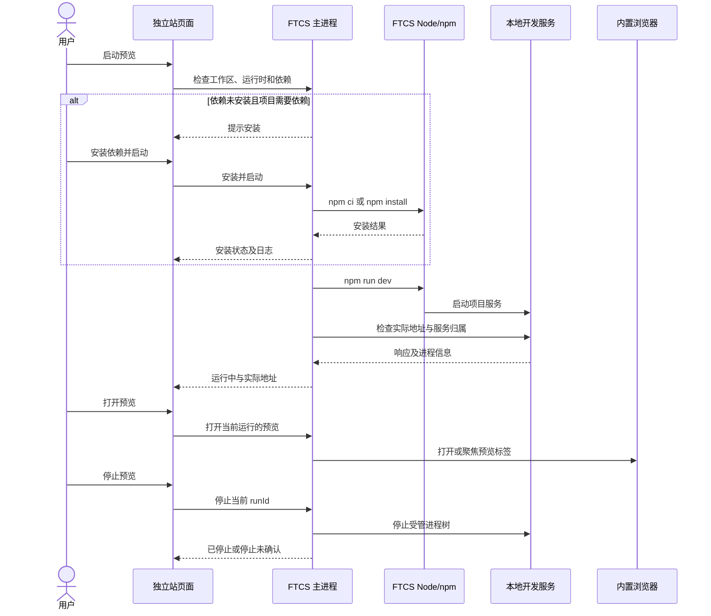
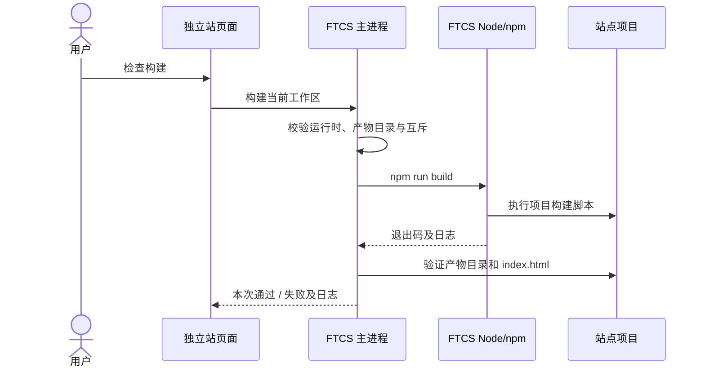

# US-SITE-04：独立站本地预览与构建

状态：设计草案，待核对。对应[用户故事与交付顺序](../独立站-需求拆分与交付顺序.md#us-site-04本地预览和构建)，以前置的 [US-SITE-01 全局站点](./US-SITE-01-创建和恢复全局站点.md)和 [TV-SITE-01 技术验证](../TV-SITE-01-站点开发权限与本地运行技术验证.md)为基础。

## 1. 目标与范围

在当前工作区已经存在站点项目的前提下，用户可以通过独立站页面安装依赖、启动和停止开发服务、在 FTCS 内置浏览器打开网站、执行静态构建并查看结果。无需用户预装全局 Node，也无需先连接 GitHub 或 Cloudflare。

先用 US-SITE-01 的 Vue + Vite + Vue Router + vite-ssg 模板打通流程；已有项目或后续由用户更换技术栈的项目也可以使用，只需满足 `npm run dev`、`npm run build` 和静态产物目录的约定。本故事不要求项目一定使用 Vite，也不负责智能体编辑站点、修改 bash 权限、云端发布或绑定域名。

构建通过表示**本次执行和基础产物检查通过**，不等于已发布、不保证页面 SEO 效果，也不表示其后修改过的源码已被构建。运行项目代码及依赖仍使用用户账户权限，不是操作系统级沙箱。

## 2. 用户操作

在现有独立站页面保留站点卡片，扩展“本地预览”区域，并增加“构建检查”区域。账号连接和发布区域独立，切换当前产品不影响本地站点。

### 2.1 依赖安装

1. 首次进入已创建的默认项目时，提示“尚未检测到已安装的项目依赖”，提供“安装依赖”。该判断只依据可检查的信息，不声称目录存在就代表依赖完整。
2. 用户点击安装后，页面展示使用的项目目录和安装命令，提示安装可能联网并执行项目和依赖的安装脚本；以用户点击“开始安装”作为本次桌面操作的明确授权。
3. 没有 `node_modules/` 且有 npm 锁文件时使用 `npm ci`；没有锁文件时使用 `npm install`，可能生成 `package-lock.json`。安装过程显示状态和日志，支持取消。
4. 目录已经存在时，不能因为检测不出依赖是否完整就自动执行 `npm ci`。用户可主动选择“重新安装依赖”，界面明确告知 `npm ci` 会先删除现有 `node_modules/`，确认后才执行。安装失败或取消后显示原因和重试入口。
5. 没有声明任何依赖的项目，即使没有 `node_modules/` 也允许直接运行脚本；已有项目的依赖状态为“未验证”时不声称已安装完整。实际运行报告缺包时再引导用户安装。

项目存在不匹配或损坏的锁文件时，如 `npm ci` 失败，应展示错误并允许用户修正或按明确选择重新安装；不自动删除锁文件、改用其他包管理器或更改项目依赖。安装时可联网，仅当用户明确启动安装时发生。

### 2.2 启动与打开预览

1. 用户点击“启动预览”。项目、运行时和脚本检查通过后，桌面端启动当前站点的 `npm run dev`。
2. 如果可确定项目声明了依赖且尚未安装，页面提示先安装，并提供“安装依赖并启动”。这次点击授权依次执行安装和启动；任一步失败或用户取消则停止后续步骤。对于已有但状态未知的依赖，允许用户先启动，由实际运行结果判断。
3. 启动期间显示“正在启动”和“取消启动”，不因进程创建成功就显示可预览。确认地址可访问且与本次启动的服务关联后，显示“运行中”、实际地址和“打开预览”“停止预览”。
4. 点击“打开预览”时，在现有主区域的**内置浏览器标签**中打开地址。已有属于本次预览的标签且仍指向该预览地址时优先聚焦；用户已手动将它导航到其他页面或关闭时，新开预览标签，不覆盖用户正在浏览的页面。预览标签关闭不停止服务。
5. “停止预览”停止本次启动的进程树，界面显示停止进度；确认停止后恢复“启动预览”。重复点击打开不会启动第二个服务。

页面修改后的效果由项目开发服务决定：默认 Vite 模板支持热更新；其他项目可能需要浏览器刷新或重启服务。预览使用开发服务，不等同于验证静态构建结果。

### 2.3 构建检查

1. 用户查看或设置静态产物目录，默认模板为 `dist`。接管的已有项目如果产物目录未知，先让用户填写相对路径；不把 `dist` 当作所有项目的默认值。
2. 点击“检查构建”，显示将运行 `npm run build`、项目路径及产物目录；用户点击启动即授权本次构建。无须先连接云账号。
3. 展示“正在构建”、日志和取消入口。命令成功退出后，检查产物目录在站点项目内、可读取且包含 `index.html`；通过后显示“本次构建通过”、产物目录和完成时间。
4. 构建失败、取消、退出码非零或产物缺失时显示失败原因和日志，不复用上次结果冒充本次成功。用户可修正后重试。

不预先清空或删除用户的产物目录，也不直接修改项目构建命令。项目自己的构建脚本可能清理或覆盖它管理的产物，这是执行项目脚本的一部分。产物目录仅做基础可用性检查：即便 `index.html` 存在，也不能证明脚本一定更新了旧文件；若前后没有检测到变化，界面可显示“产物未检测到变化，请检查构建输出”，不能仅凭文件存在断定内容已更新。之后发布故事应对用户确认的实际源码版本和产物进一步校验。

允许开发服务运行时构建；安装或重新安装依赖期间则不能同时启动预览或构建。如果预览正在运行，用户选择安装时先明确提示需要停止预览，确认后停止再安装。构建期间源码可能被外部编辑，结果只描述本次构建，不标记为永远最新。

## 3. 页面状态和交互

### 3.1 区域示意

```text
工作区独立站                                 本地站点已创建
  项目目录：…/website                           [打开站点目录]

本地预览
  依赖：待安装 / 状态待验证 / 最近安装成功       [安装依赖]
  预览：未启动 / 正在启动 / 运行中 / 正在停止 / 启动失败
  地址：http://127.0.0.1:<实际端口>/             [启动预览]
                                               [打开预览] [停止预览]
  [查看运行日志]

构建检查
  静态产物目录：dist                              [修改]
  构建：尚未执行 / 构建中 / 本次通过 / 本次失败    [检查构建]
  最近完成：时间                                  [查看构建日志]
```

“最近安装成功”只表明本应用最近一次安装命令成功；若锁文件、`package.json`、Node/npm 或 `node_modules/` 后来变化，状态回到“待验证”，不对依赖完整性作保证。用户在外部终端手工安装时，可通过重新检查或直接启动验证。

| 操作 | 状态 | 页面行为 |
| --- | --- | --- |
| 安装依赖 | 未验证、安装中、成功、失败、已取消 | 安装中显示日志和取消；结束后允许重试，不以 `node_modules` 存在冒充成功。 |
| 预览 | 未启动、启动中、运行中、停止中、失败、地址待确认 | 启动中可取消；运行中显示实际地址；进程异常退出立即更新；不能确认服务归属时不自动显示运行成功。 |
| 构建 | 未构建、构建中、通过、失败、已取消 | 构建结果包含本次运行时间和检查结果；失败不沿用上一次成功状态。 |

刷新页面或切换主区域标签只重新读取主进程状态，不停止进程、不重复执行命令。切换产品不影响站点。只有一个当前工作区：用户切换工作区前，若旧工作区有运行中的预览、安装或构建，提示先停止或取消；完成清理后再切换。具体对接已有设置保存流程时，不允许新旧工作区的结果串到一起。

## 4. 运行环境与安装规则

### 4.1 Node/npm

- 主进程优先使用 `resolveConfiguredNode()` 的配置来源：`FTCS_NODE_PATH`、用户配置、应用内 Node 运行时。未配置时沿用 FTCS 现有的 `resolveBestNode()` 规则查找合格的已有 Node，与运行环境检测保持一致；已绑定私有运行时但文件缺失时遵守现有规则，不回退系统 Node。用户无需为了建站额外安装全局 Node。
- 解析实际 Node 可执行文件和与其配套的 npm；校验文件存在、版本可运行，并使用绝对路径执行。优先由该 Node 运行相应的 `npm-cli.js`，通过参数数组传递 `ci`、`install`、`run` 等参数；Windows 不把项目目录、用户输入或参数拼成任意 shell 命令。npm 执行用户项目脚本时仍按 npm 自身机制启动子进程。
- 将配置的 Node 目录置于子进程 PATH 前部，确保项目脚本中的 `node` 指向同一运行时。Windows、macOS 的 npm 实际布局不同，按真实安装布局解析并验证；找不到配套 npm 时显示具体原因，引导用户使用现有运行环境配置/安装入口，不静默改用其他全局版本。
- 展示 Node/npm 版本和来源。模板当前声明 Node `^22.12.0 || >=24.0.0`，应用提供的 Node 24 满足要求；如果用户配置其他版本，需按项目声明的 `engines.node` 检查并展示不兼容信息。其他项目没有声明时不套用模板的版本要求。
- 子进程以 `website/` 为工作目录，日志中展示实际命令和目录。环境使用必要变量及运行所需的 PATH、临时目录、代理等设置，不能无条件将 FTCS 的 GitHub/Cloudflare 凭据、令牌或其他内部敏感配置传给项目脚本；项目自己的 `.env` 由项目工具按其机制读取。环境隔离不是对项目代码的操作系统级隔离。

### 4.2 依赖状态与操作互斥

创建项目时不自动安装。安装、构建分别属于用户主动发起的桌面操作，与 OpenCode 的 bash/shell 权限询问不同，不为智能体放开命令执行；自由聊天中 bash 仍需询问，自动智能体任务期间 bash 仍自动拒绝。

同一站点同一时刻最多一个安装进程、一个构建进程和一个预览实例；安装与构建、安装与预览互斥，预览与构建可以并行。主进程负责互斥，不能只依赖按钮禁用。操作期间目录被删除或工作区变更，应取消或终止旧操作并反馈真实结果。

## 5. 预览地址发现与就绪判断

不能假定所有项目使用 5173、都接受 Vite 参数，或只要某个端口返回 HTTP 就是本次项目。首版区分两种情况：

1. **未改动的 FTCS 默认 Vite 模板**：根据模板标识及当前 `dev` 脚本等信息确认仍为支持的启动方式；主进程选取一个可用的回环端口后运行 `npm run dev -- --port <端口> --strictPort`，要求 Vite 不自动切换端口。选端口到进程监听之间仍有竞争；端口被占用时显示失败并允许重试，不结束占用端口的其他程序。若脚本已修改或无法确认仍兼容这些参数，退回通用项目流程，不强行追加 Vite 参数。
2. **其他项目**：原样运行 `npm run dev`，从输出中提取可能的本地 HTTP 地址；若无法识别，显示“地址待确认”，允许用户填写或选择该项目实际的本地地址并重新检查。首版不依赖某一种框架的日志格式，也不向通用脚本强加 `--port` 或 `--strictPort`。

地址自动打开只接受 HTTP(S) 回环地址，例如 `127.0.0.1`、`localhost` 或 `::1`；限制协议、主机和有效端口，拒绝带凭据或远端地址。日志展示的 `0.0.0.0`/`::` 可作为监听信息，但不能当作浏览器访问地址；是否能转换为本地回环地址取决于实际监听情况。只限制 FTCS 自动检查和打开的地址，不能保证任意用户项目自身不会监听外部网络。

**运行中判定：** 本次启动的进程树仍存活、候选地址已通过本地 HTTP 检查，且可通过操作系统支持的方式确认监听进程属于本次进程树，才自动认定为运行中并允许自动打开。HTTP 返回错误页面也可能说明服务已响应，状态及页面加载结果应分开显示。不能因同端口的其他应用返回 200 就判定成功。

在目标系统上若无法可靠确认端口与进程的归属，状态显示“地址待确认”，展示地址和原因；用户可以主动打开本地地址核对后继续，但界面不能把它标记成已经验证属于站点的服务。该兜底不能终止占用端口的其他进程。启动超时默认 60 秒，显示仍在运行、检查日志、继续等待或停止，不以超时本身断言项目已失败；进程退出、脚本报错则显示失败。HTTP 检查使用短超时和间隔退避，停掉轮询后不再接收旧运行的结果。

### 5.1 内置浏览器适配

复用现有 `openUserBuiltinBrowserTab`、导航和主区域浏览器标签流程，必要时先初始化浏览器；不能因为 `navigateBuiltinBrowser` 当前对加载失败也返回 `true` 就认定页面已加载，应结合页面事件或浏览器可见错误展示实际结果。

现有 `cdp-filter.ts` 把 `localhost:5173` 和 `127.0.0.1:5173` 识别为 FTCS 自身页面。预览接入时按**真实主窗口 target ID / 实际开发服务器来源**区分应用页面和用户预览，而不是简单删除防护或永久排除该端口；验证应用主窗口不会暴露为可操作的浏览器标签，真实预览可在浏览器及后续智能体工具中识别。默认模板选择非固定可用端口也不能替代这项修正与验收。

## 6. 进程生命周期

主进程为每次运行生成唯一 `runId`，保存工作区、项目根、操作类型、启动时间、子进程句柄及状态；停止和取消只针对本次启动并仍归属该运行的进程树，不按端口或旧 PID 盲目结束其他程序。终止时先发出正常停止信号，等待有限时间，再对仍存活的受管进程做强制清理；清理失败要展示“停止未确认”和处理建议，不能直接显示已停止。

- **Windows**：设计采用可追踪子孙进程的受管进程组/Job Object 等机制，覆盖 npm、项目脚本和开发服务；具体与 Electron 打包兼容的实现需通过 Windows 原型验证。不能仅调用父进程 `kill()` 就宣称子进程全部退出，也不能仅凭历史 PID 使用 `taskkill`。
- **macOS/Linux**：使用受控进程组及其句柄停止本次进程树，验证子孙进程退出；不扩大到其他用户程序。
- **页面关闭、刷新、切换标签**：不终止正在运行的站点服务；页面重新挂载通过快照恢复真实状态。
- **关闭主窗口到托盘**：应用仍在运行，预览继续；**用户真正退出应用**：先停止受管进程并等待清理，必要时报告清理失败。
- **进程自行退出**：无论退出码为何，结束健康检查并转为已停止或失败；用户手动停止引起的退出显示“已停止”，异常退出显示原因和日志。
- **桌面进程崩溃、系统强制结束或断电**：不能假设退出钩子一定执行。优先利用操作系统机制在宿主消失时清理；实际保障依赖平台实现及验证。重启后不自动重启或接管旧进程，也不依据旧 PID 杀进程；如果检测到可疑残留，仅提示用户检查，不能把未知服务显示为当前预览。

进程树生命周期、Windows Job 机制、异常崩溃以及端口归属识别均需真实桌面环境联测。必要时可先完成受控原型；不能以 TV-SITE-01 的命令行夹具结果代替桌面联测。

实现说明：当前版本在 Windows 对本次仍受管的 npm 进程调用 `taskkill /T /F` 清理进程树，并通过系统进程列表和 `netstat` 尝试核对监听进程；尚未接入 Job Object，因此桌面进程被强制结束时不保证子进程自动清理。若系统工具不可用或拒绝查询，预览保留“地址待确认”，由用户核对；Windows 真实表现和异常退出清理仍需联测。

## 7. 状态、IPC 与配置

### 7.1 主进程服务

建议新增 `desktop/electron/site/` 下的运行环境解析、依赖安装、预览、构建和进程管理模块，复用 US-SITE-01 的 `getSiteSnapshot()` 检查项目与工作区；进程管理与 Electron 页面分离，便于模拟 npm 和端口测试。预览、安装、构建状态由主进程持有，页面只展示快照及后续事件。

| IPC 能力 | 请求 | 返回与行为 |
| --- | --- | --- |
| 查询运行快照 | 当前工作区标识 | 返回依赖、预览、构建状态和当前日志摘要；只读，不启动进程。 |
| 安装依赖 | 当前工作区标识、安装或明确重装 | 主进程检查工作区、互斥和条件，接收后返回 `runId`，异步推送状态和日志；禁止传任意命令或绝对路径。 |
| 启动/停止预览 | 工作区标识、停止时的 `runId` | 启动接收后返回 `runId`；停止只能作用于匹配运行，旧事件不能覆盖新运行。 |
| 打开预览 | 当前 `runId` | 主进程根据实际运行记录与地址打开内置浏览器，不能由页面随意指定目标地址。 |
| 构建/取消 | 工作区标识、取消时的 `runId` | 校验配置与互斥后启动或取消；结果通过状态事件返回。 |
| 修改产物目录 | 工作区标识、相对路径 | 校验路径并更新工作区站点配置；不执行命令。 |

主进程以自己的当前工作区为准，校验页面传来的工作区标识；识别重复请求、页面卸载、旧 `runId` 及切换工作区后的迟到事件。事件至少带操作类型、工作区标识、`runId`、单调递增序号、状态及必要的退出码/错误码。页面重连先订阅事件再取快照，并按序号合并，防止中间状态丢失或回退。它们是桌面本地操作事件，不冒充智能体 `task_begin` / `task_done`。

### 7.2 站点配置

复用工作区 `.ftcs/site.json` 中的 `buildOutputDir`；默认模板为 `dist`，接管项目可能为 `null`。只接受站点目录内的非空相对目录，拒绝绝对路径、`..` 越界、项目根本身、文件路径及通过符号链接或 Windows junction 指向站点外的路径；对尚未创建的路径检查最近存在的父级。配置保存要保留既有未知字段及后续发布关联，采用原子写入；检查和打开产物时再次验证，不能只在保存时校验。

页面保存的是构建产物位置，不修改 `package.json` 和项目构建脚本。预览地址首版只保存用户对**当前运行**手工确认的值，不当作跨运行可靠地址；若未来支持固定端口/自定义配置，另行设计。

### 7.3 结果与日志

安装和构建可保存最近一次结束时间、退出状态及产物目录等简要结果；不持久化运行中的 PID 来恢复预览，不把重启前的运行状态直接显示为当前运行。日志默认只保存在主进程内存，按操作分开限量保留，超出部分显示已截断；页面显示纯文本，去除终端控制序列，禁止作为 HTML 执行。日志可能包含项目脚本输出的敏感信息，复制或反馈前由用户检查；日志不写入站点源码或发布产物。

## 8. 关键时序



安装失败时不执行 `npm run dev`；服务归属无法确认时不进入图中的自动“运行中”，改为显示“地址待确认”。



## 9. 异常与恢复

| 情况 | 用户看到的结果及处理 |
| --- | --- |
| 未创建站点、目录不可读或脚本缺失 | 显示实际原因，回到创建/恢复、打开目录或修复脚本；不启动进程。 |
| Node、npm 不存在或版本不兼容 | 展示当前来源与要求，指向现有环境配置；已绑定私有运行时或明确配置的 Node 不可用时不擅自换用其他版本。 |
| 安装网络失败、锁文件不匹配、用户取消 | 显示安装失败或取消及日志；不自动删除锁文件，不继续预览或构建。 |
| 依赖不完整、命令退出非零 | 展示实际日志和重试入口；已有 `node_modules/` 不自动判为安装成功。 |
| 端口被占用、地址无法识别或归属不确定 | 严格端口失败则可重试；通用项目可手工指定本地地址；不终止其他服务或将其他服务显示为本项目。 |
| 开发服务异常退出 | 关闭健康轮询并显示退出原因；允许重启，旧事件不能影响新运行。 |
| 预览可以运行但内置浏览器打开失败 | 保留实际服务状态，显示打开失败并提供重试，不把浏览器错误当成服务已停止。 |
| 构建脚本失败、目录不存在或缺少 `index.html` | 显示本次失败及日志；不展示历史成功作为当前结果。 |
| 日志包含秘钥或私人信息 | 默认不持久化、不上传；显示与复制前提醒检查，不能假定所有敏感内容都能被自动识别。 |
| 结束进程失败、桌面崩溃 | 显示停止未确认或重启后提示可能残留；不自动杀不属于当前运行的进程。 |

## 10. 验收与测试

### 10.1 自动化

1. Node/npm 解析优先使用配置路径；未绑定私有运行时且没有明确配置时，与 FTCS 环境检测一致地使用已有合格 Node；已绑定私有运行时但丢失时不回退。缺失 npm、版本不兼容和全局 Node 冲突时返回正确状态；子进程 PATH 优先使用所选 Node，项目路径含中文和空格可用。
2. 锁文件存在与否分别选择 `npm ci` / `npm install`；已有 `node_modules/` 不自动运行会清理它的 `npm ci`；取消或失败后不启动预览；零依赖项目可直接执行。
3. 启动、停止、重复点击、超时、日志截断、异常退出和旧事件乱序；被占用端口、错误候选地址、归属未知和进程退出时不能误报运行成功。
4. 默认模板追加端口参数，修改后的非 Vite 项目原样运行；模拟另一种开发服务的地址输出或手工确认流程。
5. 构建退出码非零、产物缺失、非目录、缺少首页、路径越界、符号链接/junction 越界及构建中断时均不报成功；不删除用户产物，结果与当前 `runId` 对应。
6. 同时请求安装、预览和构建时遵守互斥；预览和构建允许并行；切换工作区、重新挂载页面、延迟事件不串项目状态。
7. 校验日志纯文本呈现、控制字符处理和内存上限；应用进程退出路径调用清理，不能杀掉测试启动的无关同端口程序。
8. `site.json` 的产物配置更新保留未知字段；配置为 `null` 时要求用户填写，其他字段和项目文件不被修改。

### 10.2 真实桌面联测

1. Windows 测试工作区使用 FTCS 私有 Node/npm，无全局 Node；再用不同版本的全局 Node 重测，确认脚本实际使用的 Node。覆盖 Node 版本不兼容、npm 丢失及含中文空格路径。
2. 默认模板从无依赖开始，依次安装、启动、打开内置浏览器、修改页面看到更新、停止服务、构建；检查构建首页及 SEO 文件，未配置 `SITE_URL` 时允许构建并按模板提示跳过 sitemap。
3. 占用默认候选端口、启动失败、开发服务自动退出、取消启动及重复启动，确认状态和端口；验证一个非 Vite 项目不被追加 Vite 参数。
4. 分别验证预览标签关闭、页面刷新、切换产品、关闭窗口到托盘、真正退出应用；检查受管 npm 和子孙进程。用专门测试实例验证强制结束桌面及重新打开，记录残留情况。
5. 分别验证 5173 和其他端口的预览页面在主区域及浏览器工具中的识别，同时确认 FTCS 主窗口没有被识别成可操作网页。
6. 已有项目的未知产物目录、无依赖项目、构建错误与缺失产物；停止失败或归属无法确认时的展示；不触碰其他项目和其他用户程序。
7. FTCS 应用未登录 GitHub、Cloudflare 时本地安装、预览与构建仍可使用；不创建远端资源。

## 11. 待核对的产品选择

1. 本设计建议首次点击“启动预览”时，如果明确缺少依赖，提供一次“安装依赖并启动”，同时保留独立“安装依赖”按钮。
2. 预览运行时允许执行构建；重新安装依赖需要先停止预览，避免安装过程中运行服务使用被替换的依赖。
3. 预览地址无法确认属于当前站点时，允许用户主动打开本地地址自行核对，但页面保持“地址待确认”，不自动认定成功。
