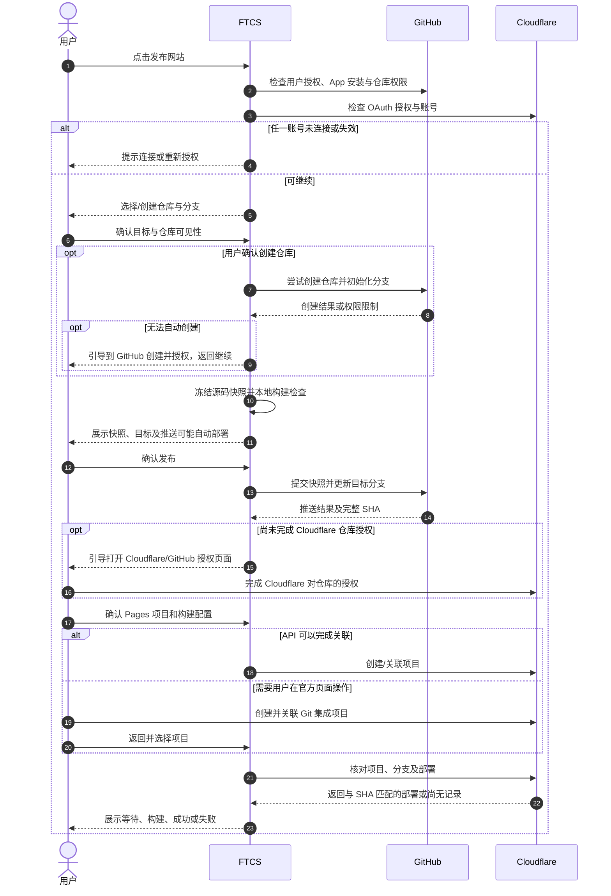

# 独立站发布流程设计

状态：设计草案，待核对。覆盖 [US-SITE-06～08](../独立站-需求拆分与交付顺序.md#us-site-06将站点推送到-github) 的首次发布，并衔接 US-SITE-10 的再次发布及 US-SITE-11 中与发布相关的恢复。以 [TV-SITE-02 技术方案研究](../TV-SITE-02-GitHub与Cloudflare首次发布技术验证.md)、已完成的站点创建/本地构建和两端账号授权为基础。

## 1. 目标与范围

用户在 FTCS 的独立站页面点击“发布网站”，确认自己的 GitHub 仓库、Cloudflare Pages 项目与要公开的内容，FTCS 推送指定版本，并持续展示该版本的云端构建和部署结果。站点属于当前工作区，不绑定产品；GitHub、Cloudflare 资源均属于用户自己的账号。

首期先使用现有站点模板，用户可手工修改再发布；以后智能体修改同一站点时复用这条链路。GitHub 连接和 Cloudflare 连接入口已实现并通过用户联测；**连接账号不代表对目标仓库有写入权限，也不代表 Cloudflare 已获准读取该仓库**。

本次不实现站内询盘接收、自有域名/DNS 绑定、智能体建站、协作式合并或 Git LFS。自有域名仍按后续 US-SITE-09 支持；首期成功后展示 Cloudflare 提供的线上地址。

### 1.1 已确认的产品约定

- 用户可以先连接账号，也可以在点击发布后按提示连接；连接顺序不限。
- 发布时才开始选择或创建仓库、确定 Pages 项目和关联关系；不会因为连接账号就创建这些资源。
- 首期推荐 **Cloudflare Pages 的 GitHub 集成**。FTCS 负责确认和提交站点源码，Cloudflare 从 GitHub 获取源码、执行构建并部署。
- `npm run build` 和用户确认的静态产物目录是项目契约；默认模板目录为 `dist`，已有项目不能一律假定为 `dist`。
- 首次发布和后续更新都须展示目标及内容并由用户确认；推送到已启用自动部署的生产分支可能立即更新线上网站。
- 新建仓库、Cloudflare 授权或新建 Pages 项目等远端操作可能分别需要用户确认；界面必须在操作发生前说明结果。

[Cloudflare 官方文档](https://developers.cloudflare.com/pages/configuration/git-integration/)说明 Git 集成可由分支推送触发部署；Git 集成与 Direct Upload 的切换有产品限制。本方案不静默替换成 Direct Upload。

## 2. 发布前页面

复用现有独立站页面：

```text
独立站                                      [刷新] [发布网站]
GitHub · 已连接 · 用户名                      Cloudflare · 已连接 · 账号

工作区独立站
  本地目录：…/website
  GitHub：尚未设置 / owner/repo · production 分支
  Cloudflare：尚未设置 / 项目名
  线上地址：尚未发布 / https://….pages.dev
  最近发布：状态、时间、版本

本地预览 / 构建检查
发布记录
```

“发布网站”在站点未创建时提示先创建；两项账号任一未连接或授权失效时，显示相应连接入口，用户完成后可从当前步骤继续。账号已连接时仍要检查**目标资源**的真实权限。离线或查询失败显示“无法确认”，不将其误判为授权失效或已连接成功。

发布配置和进度建议使用分步面板；能否继续由当前步骤状态决定。页面中的 GitHub 和 Cloudflare 连接按钮仍可独立使用，发布面板不暴露访问令牌。

## 3. 首次发布：用户流程

### 3.1 选择 GitHub 仓库

1. FTCS 使用用户当前 GitHub App 用户授权，列出用户有权访问、且 **FTCS GitHub App 实际安装并授权**的个人及组织仓库；分页并支持搜索。列表显示仓库归属、名称和公开/私有状态。
2. 用户可选择已有仓库，或选择“创建仓库”，填写归属、名称与可见性。新建建议默认私有，用户自行选择公开；即使源码仓库私有，网站发布后仍可能公开访问。
3. 创建前展示名称、所属账号与可见性并取得用户确认。先尝试在当前 GitHub App 用户授权及对应权限允许的范围内创建；如 API、组织政策或权限不允许，引导用户在 GitHub 创建仓库，再返回选择。新仓库可初始化 README，以便创建首个分支；这个初始化提交也属于远端写入，须在创建前告知用户。**不能假设账号授权成功必然具有创建仓库权限**。
4. GitHub App 如果只获选定仓库授权，新创建的仓库未必自动可访问。FTCS 应检查目标仓库的实际读取和写入权限；缺少权限时引导用户在 GitHub 调整 FTCS App 安装范围，返回后重新检查。
5. 选择生产分支。新建空仓库建议 `main`；已有仓库展示已有分支及默认分支，不擅自修改默认分支或覆盖现有内容。

已有仓库可被选择和检查。首次关联非空仓库时，FTCS 展示远端内容与本地站点的差异：如果存在重名但内容不同、远端有本地没有的文件或分支状态无法安全核对，停止直接发布，引导用户先协调内容、选择空仓库或选择可用的专用分支。不能为了首次发布清空远端、覆盖不相关文件或强推。若远端内容与本次站点快照一致，可记录并继续；已有 FTCS 关联的仓库按第 4 节更新。

### 3.2 检查本地站点并确认发布内容

1. 检查站点仍存在、构建脚本和产物目录有效，以及 GitHub 目标可写。若前面创建了仓库但此处失败，保留已创建仓库，不自动删除。
2. 以 `website/` 为源码根，按站点 `.gitignore` 和明确的安全排除规则收集文件，展示实际将上传的文件、增加/修改/删除及数量；可打开具体内容核对。用户不希望公开的资料应在确认前移出发布范围。
3. 生成本次**不可变发布快照**，在用户确认前展示该快照的内容和摘要；之后用户继续编辑项目，不改变已经确认的快照。本次只发布这个快照，后续修改留到下一次。确认后如果目标或快照发生变化，要求重新核对，不复用旧确认。
4. 检查本次快照的构建条件。首选基于快照在临时目录完成依赖安装和 `npm run build`，与用户确认的源码保持一致；展示安装/构建进度、Node 版本和结果。项目需要的构建环境变量应明确配置，不自动把本地 `.env` 或 FTCS 授权信息复制到快照。失败时不继续推送。
5. 本地构建通过后，展示 GitHub 归属/仓库/可见性、分支、预期 Cloudflare 账号、公开文件清单和“推送后可能自动部署”的提示。用户点击“确认发布”后才上传提交及推进后续部署。

快照构建会运行项目脚本并可能安装依赖，沿用 US-SITE-04 的 FTCS Node/npm、日志与进程管理；构建按用户账户权限执行。开始快照构建前在界面说明会安装依赖及执行脚本。Cloudflare 后续仍会独立构建，**本地构建通过不能代替云端构建结果**。

### 3.3 推送并连接 Cloudflare Pages

1. FTCS 按用户确认的快照创建 Git 提交并更新目标分支，记录完整 commit SHA；页面先显示“正在推送到 GitHub”。
2. 若目标 Pages 项目尚未关联，推送成功后引导用户连接 Cloudflare 对 GitHub 的访问。Cloudflare 的 GitHub App 授权与 FTCS 的 GitHub App 授权是两份独立授权；必要时用户在 Cloudflare/GitHub 官方页面完成安装、选择仓库并返回 FTCS。
3. 用户选择与目标仓库匹配的已有 Pages 项目，或创建新项目。确认 Cloudflare 账号、项目名、仓库、生产分支、构建命令、产物目录及 Node 版本。默认模板建议 `npm run build`、`dist`、Node 24；已有项目沿用用户项目的实际设置。
4. **自动创建和关联的可行性待接口联调**：若当前 OAuth 用户令牌、账号及 Cloudflare API 确实支持完成 Git 关联，则 FTCS 可按用户确认创建；若不支持或要求额外授权，打开 Cloudflare 官方页面引导用户创建/关联，再由 FTCS 查询并核对项目。不能把 Cloudflare 的 GitHub 安装授权当作 FTCS 能自动完成的步骤。
5. 首次关联时 Cloudflare 可能立即根据仓库当前分支启动部署。进入官方页面前明确提示这一行为；返回后先查询真实部署记录，存在匹配部署时直接跟踪，不再额外触发。没有匹配记录时显示“等待 Cloudflare 创建部署”，提供刷新及官方控制台入口；是否需要显式触发由联调结果确定，不无条件重复推送或重复部署。
6. 页面显示等待、云端构建、部署、成功或失败。**只有查询到与目标仓库、分支、生产环境及本次 SHA 对应的成功部署，才能显示该版本部署成功**；生产地址当前是否指向该版本单独确认，不能用旧网站返回 200 证明新版本上线。

如果选择已有 Pages 项目，须核对其账号、仓库、生产分支、构建配置和 Git 集成类型；不符合时明确列出差异，由用户修正或改选项目。已有 Direct Upload 项目不能被假定可直接转换为 Git 集成；不静默覆盖项目设置。Pages 支持的构建环境和 `NODE_VERSION` 可参考[官方构建环境文档](https://developers.cloudflare.com/pages/configuration/build-image/)。

### 3.4 首次发布时序



以上是目标流程。GitHub 资源创建与 Cloudflare Git 关联的实际自动化边界以当前应用权限和真实接口联调为准。GitHub 账号和仓库如果已经连接了自动部署，图中的推送本身可能立即触发 Cloudflare，而不必等待后续项目配置步骤。

## 4. 修改后再次发布

已绑定的仓库与 Pages 项目可复用，但每次都重新确认账号、仓库、分支、项目配置、用户实际权限及远端分支状态。页面展示相对上次发布的新增、修改、删除；本地发生更改时，显示“本地有未发布修改”，不能只凭历史构建结果认定当前内容已经发布。

1. 用户修改页面、预览，点击“发布网站”。
2. FTCS 查询远端分支最新 SHA、检查与上次已知版本的关系，生成新的不可变源码快照和内容差异，执行本次快照构建。
3. 若远端分支不再是本地记录的基线，或者仓库被重命名、迁移、删除、切换账号、权限不足或目标分支受保护，停止直接更新并展示可处理的原因；不自动覆盖远端。用户可以到 GitHub 协调/合并，或选择其他目标，之后重新检查及确认。
4. 用户确认新版本后创建提交并以非强制方式更新分支。更新时必须防止检查之后的并发远端写入造成覆盖；条件不再满足则提示冲突，重新读取并让用户重新确认。不能使用强推或自动丢弃远端修改。
5. GitHub 接受后显示“已推送”，再按本次 SHA 跟踪 Cloudflare。云端失败时保留此前已上线版本、当前源码和新提交；修复后由用户发起重试或新版本发布，不误显示为成功。

没有内容变化时不创建空提交；页面提示没有待发布的源码变化。若同一提交需要重新部署，应提供单独的“重新部署”操作，按 Cloudflare 实际可用能力及用户确认执行，并以新的 deployment ID 跟踪，不能伪装成一次新提交。

## 5. GitHub 源码发布实现建议

### 5.1 凭据与仓库访问

沿用已接入的 GitHub App Device Flow 用户授权，令牌继续由主进程使用 `safeStorage` 管理；不要打包 App 私钥，不要求用户手工填写 PAT。现有 `github-auth.ts` 只检查用户与是否存在安装，后续需提供**仅供主进程使用**的令牌获取/刷新和受控 GitHub API 客户端，不把明文令牌传到渲染进程、日志、Git 配置或远端 URL。

选择仓库时通过用户可访问的 App 安装及授权仓库 API 分页读取，确认目标仓库当前实际权限。用户授权、App 安装范围和用户本人对仓库的权限共同影响结果。个人新建仓库、组织仓库、仓库限制、App 所需权限与用户令牌的具体权限组合需真实账号验证；遇到组织审批或缺失权限时转为可理解的待处理状态。

### 5.2 不依赖系统 Git 的建议方案

用户环境不应被要求另外安装 Git。建议通过 **GitHub API** 提交源码；复用现有 GitHub App 用户令牌，避免把认证信息放在 git remote 或命令行。优先验证 GraphQL `createCommitOnBranch` 的 `expectedHeadOid` 条件更新能力：它可将用户确认的远端基线作为提交条件，避免检查与更新之间的并发覆盖。相关授权、文件大小/请求数量限制、速率限制和 Windows 大文件行为需在开发联测中核对。

1. 在 GitHub 查询目标分支完整 SHA 与 tree。**真正的空仓库没有 HEAD，不能简单假设 Git 引用创建接口可直接完成首个提交。**新建仓库优先经用户确认初始化 README 后获得分支；用户选择已有空仓库时，须先确认可否通过仓库内容接口初始化首个文件，再提交完整快照。初始化会产生单独提交，应告知用户并记录检查点。为避免半成品被自动部署，只允许在确认尚无自动部署关联的目标上执行；无法确认时引导用户选择已初始化的安全目标。新建仓库的初始化 README 作为 FTCS 已知基线处理，不等同于擅自覆盖用户的非空仓库。
2. 本地对选中的快照计算文件内容摘要，得到相对远端基线的增加、修改和删除，供用户确认。以可信的 Git 忽略规则库处理 `.gitignore`，不读取工作区其他目录；不能把“忽略文件”当成完整的敏感内容识别。
3. 确认后以已核对的远端 SHA 作为原子条件提交完整快照；条件不匹配则停止并重新读取，不能覆盖新的提交。**仅先读取 SHA 再用 Git 引用接口进行非强制更新，并不能保证预期旧 SHA 的原子比较**；不能把它当成完整的并发保护。如果 GraphQL 条件提交不满足当前令牌权限、文件模式或规模要求，需先验证具备等价条件更新能力的替代方案，再进入开发，不能退化为强推或无条件覆盖。
4. 上传二进制文件时保留字节内容；需要支持 UTF-8 路径与大小写差异、可执行文件模式及仓库规模。仓库 API 返回截断结果时必须分页/递归完整获取，不能把不完整结果当成远端真实文件清单。
5. Git LFS、子模块和站点内符号链接在首期未实现安全发布语义；发现后提示具体路径并阻止受影响的发布，指导用户处理。不能把 LFS 指针当成已经上传的图片或静默跟随站点外的链接。
6. 不修改用户现有 `.git/`、已有远程地址、暂存区或工作树。GitHub 分支保护、签名要求、权限或接口限制导致写入失败时，展示原因为待处理，不尝试绕过。

该方案使用 GitHub API 构造 Git 版本；提交 SHA 是服务商返回的真实 Git commit SHA。具体能力以 [GitHub GraphQL 提交接口](https://docs.github.com/en/graphql/reference/mutations#createcommitonbranch)、[Git 数据接口](https://docs.github.com/en/rest/git)及用户实际权限为准，不能仅凭现有连接成功宣称写入已验证。

### 5.3 文件范围与快照

- 源码根固定为当前工作区的 `website/`，发布输入不直接引用工作区外的资料库或产品目录。需要公开的图片和内容先由用户放入站点项目；链接或构建脚本仍有可能访问外部资源，需在构建结果中验证，不能仅靠路径约定保证。
- 默认排除 `.git/`、`node_modules/`、构建产物、`.ftcs/` 和 `.env` 等敏感配置；正常遵守站点中的 `.gitignore`，锁文件通常应包含。特殊示例文件如 `.env.example` 只能在用户确认不含真实值后发布。不可识别的秘密、业务数据仍可能出现在普通源码中，因此最终以实际清单和用户确认控制公开范围。
- 路径归一化并检查真实路径，拒绝向站点外跳转的符号链接、junction 和不安全路径；不因无权限读取而静默漏掉文件后继续发布。检查大小、文件数量和 API 限制，超限时明确提示。
- 快照存放在工作区 `.ftcs/` 下由 FTCS 管理的独立临时位置，与源码仓库分离，不放 token；生成清单及文件摘要后再展示给用户确认。快照写入失败或源文件在读取过程中发生变化时中止并提示重试。限制快照保留时间，任务完成或明确取消后只清理该任务创建的临时数据；应用中断后依据任务记录恢复或让用户重新生成，不删除用户项目。
- 首期构建目录不能是源码根或站点外路径；`.gitignore`、构建输出及文件选择需在 Windows（含中文、空格、大小写冲突）真实验证。明确不上传本机依赖及当前配置的构建产物目录；Cloudflare 独立安装依赖并重新构建。默认模板的产物目录为 `dist/`。

## 6. Cloudflare 关联、部署与状态

### 6.1 授权与配置

沿用现有 Cloudflare OAuth + PKCE，以及主进程的 `safeStorage` 加密凭据与刷新机制；扩展一个受控 API 客户端，处理分页、成功和错误结构，并区分重新授权、账号无权限、项目不存在及网络异常。现有连接检查只证明账号授权和 Pages 列表可读，**不能证明项目创建、修改、Git 关联或部署查询的写权限均已验证**。

创建或选择 Pages 项目前确认：

| 项目 | 首期处理 |
| --- | --- |
| Cloudflare 账号 | 使用用户已连接并选择的账号；与之前保存的账号不同时重新确认目标。 |
| 项目名 | 用户填写，检查合法性和重名；不要以重名推断项目属于本次操作。 |
| 仓库和生产分支 | 必须与 GitHub 目标一致；FTCS 与 Cloudflare 的仓库访问授权分别检查。 |
| 构建命令和目录 | 默认读取项目契约：`npm run build`、配置的相对产物目录；用户确认。 |
| Node/npm | 模板建议 Node 24；按项目要求及 Cloudflare 构建环境确认，不能直接沿用本机 Node 路径。 |
| 环境变量 | 首次只处理必要的非敏感项目配置；敏感值通过 Cloudflare 官方安全设置页面完成，不写入 Git、不从本地 `.env` 自动上传。 |
| 自动部署 | 展示当前生产分支推送的部署设置；关闭或跳过时明确提示，不把推送当作上线。 |

当前 Pages 项目创建 API 文档列出 `Pages Write`、生产分支、构建配置和 source 相关字段，但**字段存在并不保证用户 OAuth 令牌能自动完成 GitHub 关联**。先针对已授权账号和测试仓库联调；失败可使用官方控制台关联作为正式兜底。

### 6.2 跟踪精确版本

保存本次 Cloudflare `accountId`、`projectName`、生产分支、完整 Git commit SHA 与 `deploymentId`。通过 [Pages 部署列表接口](https://developers.cloudflare.com/api/resources/pages/subresources/projects/subresources/deployments/methods/list/)查询生产环境的部署记录，按账号、项目、仓库、分支及提交匹配；有多条同 SHA 部署时按各自的 deployment ID 和触发时间区分。API 的 `deployment_trigger.metadata.commit_hash`、环境和阶段状态为匹配依据，但实际返回格式、分页与延迟以联调核对。

| FTCS 展示 | 事实依据 |
| --- | --- |
| 推送中 / 已推送 | GitHub 接收状态与分支引用；不代表 Cloudflare 成功。 |
| 等待 Cloudflare | 推送成功但尚未查到本次提交的生产部署；保持可刷新。 |
| 云端构建/部署中 | 找到匹配 deployment，其实际阶段尚未结束。 |
| 本次部署成功 | 匹配 deployment 的结果为成功；展示其版本地址，另核对生产地址的当前关联。 |
| 已成功但非当前线上版本 | 该版本部署成功，但已确认生产地址指向其他版本。 |
| 已成功，当前线上版本待确认 | 该版本部署成功，但无法确认生产地址目前指向哪个版本；不推断线上版本。 |
| 构建/部署失败、跳过或取消 | 展示服务商返回的真实结果和日志入口；保留此前线上状态。 |
| 查询失败/状态未知 | 区分网络、权限失效或未返回记录；不以超时认定失败或重复部署。 |

FTCS 定时查询并支持手动刷新；开始可以短间隔，长时间仍未完成时退避并允许用户离开页面。查询有超时与速率限制，应用重启后从已保存的 `deploymentId` 或 SHA 恢复追踪。生产部署可能由用户在 GitHub、Cloudflare 或其他设备触发；本地记录不是唯一事实源。

### 6.3 `pages.dev` 地址与 sitemap

首次发布前可能没有可确认的生产地址。模板在未设置 `SITE_URL` 时允许构建，先发布站点且不生成虚假 sitemap；首次部署成功后展示真实 `pages.dev` 地址，并提示 sitemap 尚未配置。用户可在后续操作中确认将该地址或自有域名设为 `SITE_URL`，同时配置 Cloudflare 对应的构建环境并重新构建/部署；本机 `.env` 不会自动推送到云端。

修改构建环境可能改变同一 SHA 的产物，因此必须为重新部署记录新的 deployment ID 及配置版本；不把之前的部署成功当作新配置已生效。Cloudflare API 是否可由当前 OAuth 凭据修改构建变量、能否触发重建都需联测；不能自动完成时引导用户在官方页面设置。域名后续变更时同理更新 sitemap 配置并重新部署。

## 7. 状态持久化、并发与重试

在工作区 `.ftcs/` 下保存版本化的站点发布配置及任务记录；它们不属于 `website/`，不会推送到仓库。结构可与现有 `site.json` 分离，避免覆盖 `buildOutputDir` 和未来字段：

```json
{
  "version": 1,
  "target": {
    "github": { "owner": "owner", "repository": "site", "repositoryId": "…", "branch": "main", "visibility": "private" },
    "cloudflare": { "accountId": "…", "projectName": "site", "productionBranch": "main" },
    "build": { "command": "npm run build", "outputDir": "dist", "nodeVersion": "24" }
  },
  "lastPublished": { "commitSha": "…", "deploymentId": "…", "productionUrl": "…" }
}
```

示例只说明字段关系，具体文件及格式在实现时版本化；不保存任何 access/refresh token、客户端密钥或敏感环境变量。任务记录包含 `releaseId`、已确认快照摘要、目标、执行阶段、已创建资源、原始基线 SHA、提交 SHA、deployment ID、时间、错误类别与状态；写入采用安全替换并保留未知字段。每次启动和查询远端时重新核对账号与仓库身份，不能只凭名称或旧缓存认定关联仍有效。

- 同一工作区同一站点仅允许一个活动发布，主进程做互斥并向所有窗口广播；刷新、切换页面不重新执行，按钮防重复点击。不同工作区的结果不互相覆盖。
- 每个外部动作记录“准备执行 / 结果待核实 / 已确认”检查点；网络超时或进程中断时先查询目标真实状态，再决定重试。仓库或项目创建超时后，根据已保存的归属、名称和服务商 ID 核对，无法确认是本次创建时请求用户选择，不盲目重复创建或删除。
- 更新分支请求超时后先读取远端：若已指向本次 commit，记录推送成功；若未指向且基线不变，可重试同一已保存 commit；若远端出现其他变化，进入冲突处理。已推送成功但没有部署记录时只重新查询，不再制造空提交。
- Cloudflare 创建项目可能触发自动部署；等待和查询不会自动重新创建项目、重新推送或重新部署。用户显式重试云端部署时按 deployment ID 和结果跟踪。
- 用户取消本地快照/构建可停止后续步骤；推送或 Cloudflare 创建请求已发出时先显示“结果待确认”，不能承诺撤回已发生的外部操作。不能自动删除远端仓库、项目、历史提交或已上线站点。
- 重启后检测未完成的发布并展示恢复入口；如果快照或必要凭据不在，保留远端已完成阶段，从可确认的检查点继续或要求重新核对；不把“正在运行”直接当成仍有本地进程。

## 8. 错误处理

| 场景 | 处理 |
| --- | --- |
| GitHub 或 Cloudflare 未连接、失效、权限不足 | 指向对应的连接/授权入口；保留已经完成的配置，重新检查具体仓库或项目。 |
| 连接成功但 GitHub App 未授权目标仓库 | 引导用户在 GitHub 调整 FTCS App 仓库权限，返回重新检查；不要求用户粘贴 Token。 |
| 无法创建仓库或组织要求审批 | 解释返回的权限或审批状态，提供 GitHub 官方页面创建及返回选择已有仓库。 |
| 非空仓库与站点内容不一致、远端已变化 | 展示差异并暂停；由用户先协调或选择其他目标，不强推、不清空仓库。 |
| Cloudflare 未安装/未授权目标仓库 | 引导用户在官方页面授权 Cloudflare 自己的 GitHub App，和 FTCS 的授权分开展示。 |
| Pages 项目类型、仓库、生产分支或构建配置不匹配 | 展示现状与目标，不自动接管或覆盖；用户改选或在 Cloudflare 调整后重新检查。 |
| 本地构建或 GitHub 推送失败 | 展示步骤、可读错误和日志；保留本地项目及已存在的远端资源。 |
| 云端构建失败、部署跳过或生产分支自动部署关闭 | 展示 Cloudflare 状态与官方日志入口，说明本次尚未上线；保留上一版本地址。 |
| 推送/项目创建请求超时 | 显示结果待确认并查询远端，不立即重复写入。 |
| 网络中断、账号切换、工作区切换或应用重启 | 停止发起新写入，记录已完成与未知阶段，恢复后重新核对资源及权限；不串号或误报成功。 |
| 用户文件包含疑似敏感数据 | 明确展示待发布文件；不要将自动规则描述为能发现全部秘密。用户确认公开范围后才能推送。 |

## 9. 故事拆分与开发顺序

| 顺序 | 范围 | 完成后可验收 |
| --- | --- | --- |
| 1 | 发布准备与 GitHub 目标：复用账号连接、列出/选择授权仓库，创建仓库或引导用户创建，读取分支和检查权限。 | 用户可选定自己的仓库和分支，并看到准确权限与可见性；未触发发布。 |
| 2 | 源码快照与 GitHub 推送：文件清单、快照构建、确认、提交及非强制更新、恢复。 | 用户确认的模板可安全提交到目标仓库；能准确显示 SHA，但此时不声称网站已上线。 |
| 3 | Cloudflare Pages Git 关联：确认配置，API 联调及必要的官方页面引导，识别首次部署。 | 用户能完成目标账号、仓库与 Pages 项目的关联并看到真实配置。 |
| 4 | 部署状态与结果：按 SHA/deployment ID 跟踪生产部署及地址，支持刷新和重启恢复。 | 从模板发布到真实 `pages.dev` 网站；区分 GitHub 推送和 Cloudflare 上线。 |
| 5 | 再次发布与异常恢复：差异、远端冲突、重复部署、失败重试。 | 手工修改模板后再次发布，线上版本和用户确认的提交对应。 |

第 1～4 项共同组成首次上线闭环，不能把单独的 GitHub 推送或账号连接当作完整发布。可逐项开发和联测；是否拆成独立 Issue、PR 或版本由后续工作安排决定。

## 10. 验收重点与待联调

### 10.1 功能验收

1. 两项账号未连接、仅连一项、授权失效及断网时均显示对应原因和下一步；账号已连接但仓库未授权时不能开始推送。
2. 个人仓库新建、已有空仓库、已关联仓库；选择公开/私有可见性；仓库创建和初始化须各自经用户确认，源码推送须经最终发布确认。组织仓库与审批按账号实际权限验证。
3. 未安装全局 Git 的 Windows 环境可从默认模板发布；列出实际源码清单，不推送 `.git/`、`node_modules/`、`dist/`、`.env` 或工作区资料；二进制图片字节一致。
4. 用户确认后本地文件发生变更，不改变本次已确认的快照；本地构建和 GitHub 提交对应同一快照；展示完整 SHA。构建失败不推送。
5. 远端更新、分支保护、不同的已有仓库内容、请求超时和重复点击不覆盖用户数据；重启恢复后不重复创建仓库、提交或 Pages 项目。
6. 首次 Cloudflare Git 授权缺失时可经官方页面完成；项目匹配错误、Direct Upload 类型、构建设置不符时不静默接管。确认自动部署是否开启。
7. 只在查询到本次 SHA 的生产部署成功后显示本次部署成功；旧站可访问、新提交推送成功、预览部署成功或查询超时均不能误判为本次生产上线。
8. Cloudflare 构建失败、跳过、重试、多次相同 SHA 部署和生产版本被外部更新时，状态与 deployment ID、线上地址匹配；保留历史上线版本信息。
9. 默认模板 Node 版本、`npm run build`、`dist` 与 Cloudflare 设置一致；首次未设置 `SITE_URL` 能部署，设置正式地址并重新部署后 sitemap 使用正确域名。
10. 站点目录含中文/空格、普通二进制资源、忽略规则、超大文件、LFS、符号链接/junction、文件被修改或读取失败时均得到可理解的结果。

### 10.2 真实账号联调前不能假设的事项

1. 当前 GitHub App 用户令牌、已有安装权限和账号策略能否创建个人/组织仓库，创建后是否需要重新选择授权范围。
2. 当前 Cloudflare OAuth 用户令牌能否以 Pages Write 创建 Git 集成项目、更新必要配置；GitHub source 字段的真实前置要求、权限及首次构建行为。
3. Cloudflare 部署 API 返回的实际提交 SHA、环境、阶段、生产别名和同 SHA 多次部署的区分方式，以及 GitHub/Cloudflare 的查询延迟和限制。
4. 用测试账号验证首次部署可能自动触发的时点，以及需用户在官方页面操作的步骤；记录从哪里继续，不把已连通 OAuth 当作这些步骤已验证。
5. 验证 GraphQL 条件提交与当前 GitHub App 令牌、文件模式和规模是否兼容，及空仓库首个提交的初始化方式；包括初始化后中断恢复和远端并发更新。

## 11. 待用户核对

1. 首次发布建议支持新仓库和已有仓库；非空仓库如与站点内容不一致，先要求用户协调内容或选择其他目标，避免直接覆盖，是否符合预期？
2. 建议用户先确认源码快照和目标；首次推送后如 Cloudflare 必须在官方页面关联，再引导用户完成。期间明确提示：代码已推送，配置 Pages 时可能立即上线，是否符合预期？
3. 建议用 GitHub API 提交源码，用户无需额外安装 Git；大文件、Git LFS 和子模块等先明确提示限制，是否符合预期？
