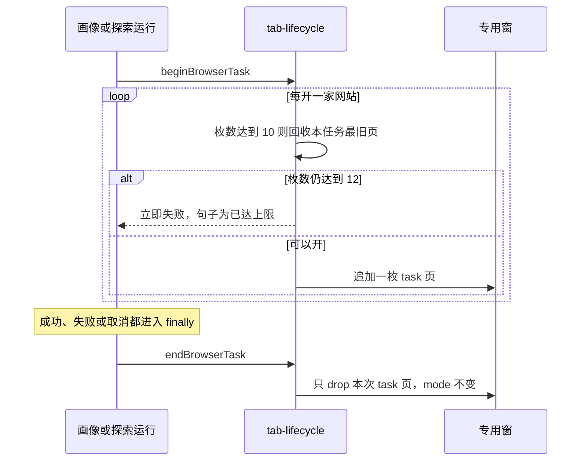

# US-TC 详细设计：任务结束后清理内置浏览器标签

> **用户故事**：[../37-需求-任务后清理内置浏览器标签.md](../37-需求-任务后清理内置浏览器标签.md) · **US-TC-01**、**US-TC-02** · Related #105  
> **状态**：待开发（本文只定清理策略、上限和触发点；不改 `desktop/` 业务实现）  
> **范围**：会打开内置浏览器标签的任务，在结束、失败、取消时把本次任务标签清掉；接近产品上限时先回收再开，避免开页卡住  
> **依赖**：[US-EC-01](US-EC-01-探测与引导去掉系统Chrome依赖.md) / [US-EC-02](US-EC-02-画像与探索浏览器改走内置Chromium.md) 的专用窗与 `openBrowserTab`；画像抓站与探索 R1 / R2 / R3；Agent 运行的 `finally`  
> **不做**：改浏览窗三态和标题栏控件；标签管理器；修复 #103 的透明白；改 R2 社媒真页、R3 地图真页的红线；关 Issue #105 / #78 / #103  
> **文档位置**：`docs/design/`

需求依据是已合入的 `docs/37-需求-任务后清理内置浏览器标签.md`（TC1～TC10、US-TC-01、US-TC-02、§6、§7）。本文不改该需求正文。docs/37 §7 的 O1～O4 在 §2 拍板，带验收样例。浏览窗的显隐、锚点和「关闭 ≡ 收起」仍以 docs/34 EC9 与 US-EC-01 为准，本文只加标签的来源标记和回收。

清标签不是关窗，也不是拆掉 CDP。种子页留着，调试会话留着。

---

## 0. 相对现网

对照 `dev-0.6.0`（`2cd8049`）。

| 现网 | **本期** |
|------|----------|
| `ensureBuiltinBrowser()` 创建一枚页 `WebContentsView`，打开令牌地址 `http://127.0.0.1:<端口>/__ftcs_builtin_page__`。界面上这枚页显示「尚未打开页面」 | 这枚页标成 `seed`。清理不关掉它，也不把窗从缩略或放大收起 |
| `openBrowserTab` 再追加一枚 `WebContentsView`。`closeBrowserTab` 在找不到或只剩最后一页时返回 false。放大标题栏关掉单页走这条 | 手动关掉单页仍走 `closeBrowserTab`，最后一页仍关不掉。任务清理走新函数 `closeTabsForTask`，规则见 §3 |
| 仓库没有标签上限常数。开页失败会在 `waitForNewTarget` 里最多等 4 秒，然后抛错并 `dropTab` | 产品上限 12、回收线 10，写在 `tab-lifecycle.ts`。触到上限时立刻拒绝，不等那 4 秒 |
| 画像（有网站）和探索 R1 / R2 / R3 开页之后，任务成功、失败、中止都不会收掉这些页 | 这些运行在 `finally` 里结束本次任务标签。评分、起草、补全、关键词扩展不调用清理 |
| 编排 `useWorkflowExecute` 按步 `await` 探索 IPC。取消走 `abortProfile` → `abortCurrent` | 不在 Vue 的 `executePlan` 里再写一套清理。探索那一步的主进程 `finally` 在 IPC 返回前完成，下一步开始时上一批任务页已经不在 |
| #103：切出再回可能透明白 | 不改 `follow-main-window.ts` 的显隐。清理函数不调用 `hide` / `show` / `setBuiltinBrowserMode` |

现网接缝（实现时按本节）：

1. **一枚标签是一枚页 `WebContentsView`。** 标题条和缩略蒙层的 view 不算标签，不进入 12 的计数。
2. **业务导航会把 `hidden` 收成 `thumbnail`。** 这是 US-EC-01 已有规则。清理不把这个态改回去，也不在清理时弹出本来收起的窗。
3. **`runExtractProfile` 的入参是 `BootstrapResult`，其中有 `websitePaths`。** 只有 `websitePaths.length > 0` 才 `beginBrowserTask`。纯文件画像不登记任务，结束时也不扫标签。
4. **Agent 各次运行的成功、失败都在各自的 `finally` 里把 `this.running` 置为 false。** 中止由 `abortCurrent` 触发，运行落到失败分支，同样进 `finally`。清理挂在「本次已经 `beginBrowserTask`」的那个 `finally` 上，不挂在渲染进程的 `type === 'done'` 上，避免事件没送到界面时漏清。
5. **页内 `window.open` 已经进 `openBrowserTab`。** 有当前任务 id 时，这枚新页也算该任务的页，结束时一起关。没有任务 id 时标成 `user`，任务清理不动它。

---

## 1. 目标与非目标

### 1.1 目标

1. 有网站的画像，以及探索 R1 / R2 / R3，在成功、失败、用户取消之后，本次打开的业务页都不留在窗里。
2. 清完之后留下的是任务开始前已经存在的页。冷启动后只跑过一轮探索时，窗里回到那一枚种子页。
3. 单次任务连续开页时，到回收线就关掉本任务最旧的页再开新的；非本任务的页已经占满 12 枚时，新开页立即失败，调用不等待。
4. 评分、起草、补全、关键词扩展，以及没有任务时用户自己看着的页，不被清掉。浏览窗三态的控件含义不变。

### 1.2 非目标

| 不做 | 说明 |
|------|------|
| 改收起 / 缩略 / 放大、标题栏「打开浏览窗 / 浏览中」、缩略蒙层、放大标题栏的还原与收起 | TC6、EC9 |
| 标签列表、多选、固定、拖拽、一键清标签按钮 | TC7。本期不另做入口 |
| 把清理做成 `destroy` 专用窗或断开 CDP | 种子页和网关保持 |
| 修复切出再回的透明白 | TC9、#103 |
| 改系统浏览器里的标签 | 只处理内置浏览器 |
| 为了提高上限重写浏览窗 | US-TC-02 明确不做 |
| 关闭 #105、#78、#103 | TC10 |

---

## 2. 已拍板（docs/37 §7）

| 项 | 决定 |
|----|------|
| **O1 清理策略** | 只关本次任务期间打开的标签，留下任务开始前已有的页。至少保留一枚页。冷启动后的基线就是那枚种子页（令牌地址，文案「尚未打开页面」）。不关光所有页，也不在结束时改去一张新的空白页 |
| **O2 编排的清理时刻** | 每一个会开标签的步骤，在该步成功、失败或取消的 `finally` 里立刻清掉**这一步**的任务标签。方案整段结束不再额外扫一轮。中间步骤的页不会留到下一步去叠上限 |
| **O3 上限** | 页标签总数上限 **12**（含种子页）。已有枚数 **≥ 10** 时，下一次开页先回收当前任务最旧的任务页，再开。回收后仍 **≥ 12** 则立即拒绝。12 不是 Chromium 文档里的硬限制，仓库里也没有引擎常数；它是产品护栏：每枚页是一枚 `WebContentsView`，标题条和 CDP 目标列表在这个数量内仍能操作。验收按 12 和 10 执行 |
| **O4 清理时的窗态** | 保持清理前的 `hidden` / `thumbnail` / `expanded`。不调用 `setBuiltinBrowserMode`，不 `hide`，不 `show`。当前激活页若被清掉，改激活剩下的页（优先种子页），窗的 mode 不变 |

拒绝开页时返回给调用方的句子写死：

`内置浏览器标签已达上限，这一页没有打开。`

这句作为工具失败结果回到智能体时间线即可。不另做横幅，不因此把整个任务标成失败。任务随后仍会在自己的结束、失败或取消路径上，把已经打开的本任务页清回基线。

---

## 3. 标签来源与基线

`BrowserTab` 增加两个字段：

```ts
type TabOrigin = 'seed' | 'task' | 'user'

interface BrowserTab {
  origin: TabOrigin
  taskId: string | null
}
```

| 来源 | 何时标上 | 结束任务时 |
|------|----------|------------|
| `seed` | `ensureBuiltinBrowser()` 创建的第一枚页 | 不关 |
| `task` | `openBrowserTab` 时存在当前任务 id | 只关掉 `taskId` 等于这一次的 |
| `user` | `openBrowserTab` 时没有当前任务 id | 不关 |

`closeTabsForTask(taskId)`：

1. 找出 `origin === 'task' && taskId` 匹配的页，从旧到新 `dropTab`。
2. 若某次 `dropTab` 会让 `tabs.length` 变成 0，则停手：把这最后一枚改成 `origin: 'seed'`、`taskId: null`，并 `loadURL` 回令牌地址。正常路径上种子页还在，不会走到这里。
3. 返回 `{ closed, remaining }`。`remaining` 是页标签枚数，至少为 1。
4. 不改 `mode`。被关掉的若是激活页，沿用现有 `dropTab` 选中相邻页；全部任务页都去掉之后，激活页应是种子页或任务前留下的 `user` 页。

手动标题栏关闭仍调用现有 `closeBrowserTab`：最后一页返回 false。不要让清理函数改掉这个返回值。

### 3.1 基线样例

| 任务开始前 | 任务中打开 | 结束后 |
|------------|------------|--------|
| 1 枚种子 | 5 枚公司官网 | 1 枚种子。5 枚官网不在。mode 与清理前相同 |
| 1 枚种子 + 1 枚 `user`（没有任务时打开的页） | 3 枚任务页 | 种子和那枚 `user` 都在。3 枚任务页不在 |
| 只有种子，任务没有开过页 | 0 | 仍是那枚种子。不弹出、不收起浏览窗 |

「没有任务时用户正在看的页」指 `origin === 'user'` 或种子页。验收：不启动任何会开标签的任务，只把浏览窗从收起打开到缩略，记下页 id；再跑一轮评分去重；页 id 相同，mode 仍是打开评分前的那个。

---

## 4. 哪些运行要登记

当前任务 id 放在 `AgentRunner` 的一个字段上，同一时刻只有一个（现网 `this.running` 已经拒绝重叠）。

```ts
function beginBrowserTask(taskId: string): void
function endBrowserTask(taskId: string): Promise<{ closed: number; remaining: number }>
```

| 运行 | 是否 `begin` |
|------|----------------|
| `runExtractProfile`，且 `bootstrap.websitePaths.length > 0` | 是。在 `this.running = true` 之前登记 |
| `runExtractProfile`，网站列表为空 | 否 |
| `discover-leads` / `discover-leads-r2` / `discover-leads-r3` | 是 |
| `expand-keywords`、`score-and-dedupe`、`draft-outreach-email`、联系人补全 | 否 |

任务 id 用 `browser-<skill>-<递增序号>`，同一次运行内不变。

已经 `begin` 的运行，在把 `this.running` 置回 false 的那个 `finally` 里 `await endBrowserTask(id)`，然后把字段清空。成功分支和失败分支都进这个 `finally`。用户取消使 `abort` 信号生效后，运行落入失败分支，同样进 `finally`。没有 `begin` 的运行，`finally` 不调用 `endBrowserTask`。

若 `begin` 时发现上一个 id 还没 `end`（不应出现），先 `end` 上一个，再登记新的。避免两段探索的页混在同一个 id 里。

`openBrowserTab` 创建新页时：有当前 id 则 `origin = 'task'` 且写入该 id；否则 `origin = 'user'`。种子页的创建函数不读当前 id。

---

## 5. 接近上限（US-TC-02）

常数放在 `desktop/electron/browser-runtime/tab-lifecycle.ts`：

```ts
export const BUILTIN_TAB_CAP = 12
export const BUILTIN_TAB_RECLAIM_AT = 10
```

`openBrowserTabNow` 在 `createBrowserTab()` 之前：

1. 若 `tabs.length >= 10`：按创建顺序关掉当前任务 id 下最旧的 `task` 页，直到 `tabs.length < 10`，或已经没有这种页。不关 `seed`，不关 `user`，不关别的 `taskId`。
2. 若此时 `tabs.length >= 12`：抛出 `Error('内置浏览器标签已达上限，这一页没有打开。')`。不 `createBrowserTab`，不进入 `waitForNewTarget`。调用在同一次事件循环里失败返回。
3. 否则照现网创建并加载。若第 1 步真的把枚数降到 10 以下，开完后的枚数 ≤ 10。若没有可回收的当前任务页，而枚数仍小于 12，则允许开到 12，下一枚再按第 2 步拒绝。

回收是为了让探索继续开下一家公司，不把任务判失败，也不弹对话框。用户能看到的是旧的公司页被换掉。拒绝则是工具失败，句子就是上面那一句。

### 5.1 样例

用内存里的标签表做单测，不要求拉起 12 个真实渲染进程。

| 开页前 | 动作 | 结果 |
|--------|------|------|
| 1 种子 + 9 枚当前任务页（共 10） | 再开一页 | 最旧的那枚任务页被关掉，新页打开。结束后共 10。任务仍在跑 |
| 连续从 1 种子开到超过 10 | 每一家新官网 | 总数在开完后 ≤ 10。不抛上限错误 |
| 1 种子 + 11 枚 `user`（共 12） | 任务内再开一页 | 没有可回收的当前任务页。立即抛出 §2 的句子。枚数仍是 12。耗时不包含 4 秒等待 |
| 上表拒绝之后，任务 `finally` | `endBrowserTask` | 若拒绝前没有任务页，枚数不变。若之前已有任务页，那些任务页被清掉，`user` 和种子留下 |

手工或集成再补一条：真实窗口里连续打开公司页，枚数到 10 后仍能再开，任务结束（成功、失败或点停止）后只剩种子页。不把界面停在无响应。

---

## 6. 编排

会开标签的编排节点只有 `discover-r1`、`discover-r2`、`discover-r3`。它们各自走一次探索运行，因此各自有一对 `begin` / `end`。

方案「全网搜索 → 评分去重 → 社媒发现」：

1. 全网搜索的 `finally` 清掉这一步的任务页，IPC 才返回。
2. 评分不调用 `endBrowserTask`。第 1 步留下的种子页和 `user` 页保持原样。
3. 社媒发现另行 `begin`。它开的页用新的 `taskId`。这一步结束时只关这个 id。

方案在社媒发现进行中被取消：`cancel()` 现网会 `abort` 当前运行。该运行的 `finally` 清掉这一步已经打开的任务页。全网搜索的页在第 1 步结束时已经清过。Vue 层不在 `executePlan` 的 `finally` 里再扫一次浏览器。

关键词扩展、评分、补全、起草夹在中间时，不改变浏览窗里当时的页，也不因此 `show` 或 `hide`。

---

## 7. 窗态（O4）

`closeTabsForTask` 和回收路径都不读取之后去改 mode。

| 清理前 | 清理后用户看见的 |
|--------|------------------|
| `hidden` | 仍没有浮动窗。标题栏仍是「打开浏览窗」 |
| `thumbnail` | 仍是缩略。激活页换成剩下的种子页或 `user` 页。缩略蒙层仍是收起、放大、拖动 |
| `expanded` | 仍是放大。标题条仍是还原、收起，单页关闭仍可用 |

任务把 `hidden` 打开成 `thumbnail`，是开页时的现网导航规则，不是清理动作。清理不把缩略再收起。验收时区分这两件事：开第一家官网之后 mode 可以已是 `thumbnail`；`endBrowserTask` 返回前后，`getBuiltinBrowserMode()` 相同。

不改 `follow-main-window.ts`。#103 不在本故事的通过条件里。

---

## 8. 实现时要碰的文件

| 文件 | 改动 |
|------|------|
| `desktop/electron/browser-runtime/tab-lifecycle.ts` | 新建。常数、`begin` / `end`、回收与拒绝 |
| `desktop/electron/browser-runtime/builtin-browser-window.ts` | 标签字段；`openBrowserTabNow` 在创建前走回收；`closeTabsForTask` |
| `desktop/electron/opencode/agent-runner.ts` | §4 的运行在 `finally` 里 `end`。网站为空的画像不 `begin` |
| `desktop/electron/browser-runtime/tab-lifecycle.test.ts` | §3.1、§5.1 的表。用假标签数组，不断开真实窗 |

不改 `useWorkflowExecute.ts` 的步骤顺序，不改 `overlay.html` / `caption.html` 的按钮，不改 `window-policy.ts` 的三态，不增加设置项。

主进程在 `end` 时打一行日志：`browser-tabs end task=<id> closed=<n> remaining=<n>`。这行不写进用户可见的时间线正文。上限那句中文只出现在开页失败的工具结果里。

---

## 9. 流程



---

## 10. 验收清单

### 10.1 US-TC-01

- [ ] 一轮会打开多家官网的探索成功结束后，这些官网页都不在了。冷启动场景下只剩 1 枚种子页（「尚未打开页面」）。
- [ ] 同一类探索失败（预检之后运行报错）时，结果与上一条相同。
- [ ] 运行中点停止 / 中止，结果与上一条相同。
- [ ] 有网站的画像抓站，成功、失败、取消三条同样只清本次任务页。
- [ ] 纯文件画像、关键词扩展、评分去重、起草、联系人补全：开始前记下的页 id 在结束后仍在。浏览窗不因此被打开或收起。
- [ ] 没有任务时打开浏览窗看着种子页或一枚 `user` 页，不因为别的定时器或切页被清掉。
- [ ] 清理前后 `getBuiltinBrowserMode()` 相同。放大态仍能切换和关掉单页（最后一页仍关不掉）。收起、缩略、放大的控件与 EC9 一致。
- [ ] 没有新的标签管理界面，也没有「一键清标签」按钮。
- [ ] 本清单不要求把标签开到 12。那是 US-TC-02。

### 10.2 US-TC-02

- [ ] 代码里的上限是 12，回收线是 10，并有 §5.1 的单测。
- [ ] 当前任务页达到 10 后继续开页，旧任务页被回收，开页成功，任务不因此中断。开完后的枚数 ≤ 10。
- [ ] 非本任务页已经占满 12 时，开页立即失败，句子为「内置浏览器标签已达上限，这一页没有打开。」枚数不变，不出现约 4 秒的无响应等待。
- [ ] 无论中途回收过还是拒绝过，任务最终结束、失败或取消时，本次 `taskId` 的页为 0，基线与 §3.1 一致。
- [ ] 防护不改 EC9 的三态和标题栏控件。
- [ ] 不把 #103 的透明白写成已修复。
- [ ] 变更落在 `dev-0.6.0` 系分支。不关 #105，不关 #78，不关 #103。

---

## 11. 修订记录

| 日期 | 说明 |
|------|------|
| 2026-10-29 | 初稿。拍板 docs/37 O1～O4：只关本次任务页并保留种子页；编排按会开标签的步骤在 `finally` 里清；上限 12、回收线 10；清理不改变浏览窗三态。覆盖 US-TC-01、US-TC-02。 |
