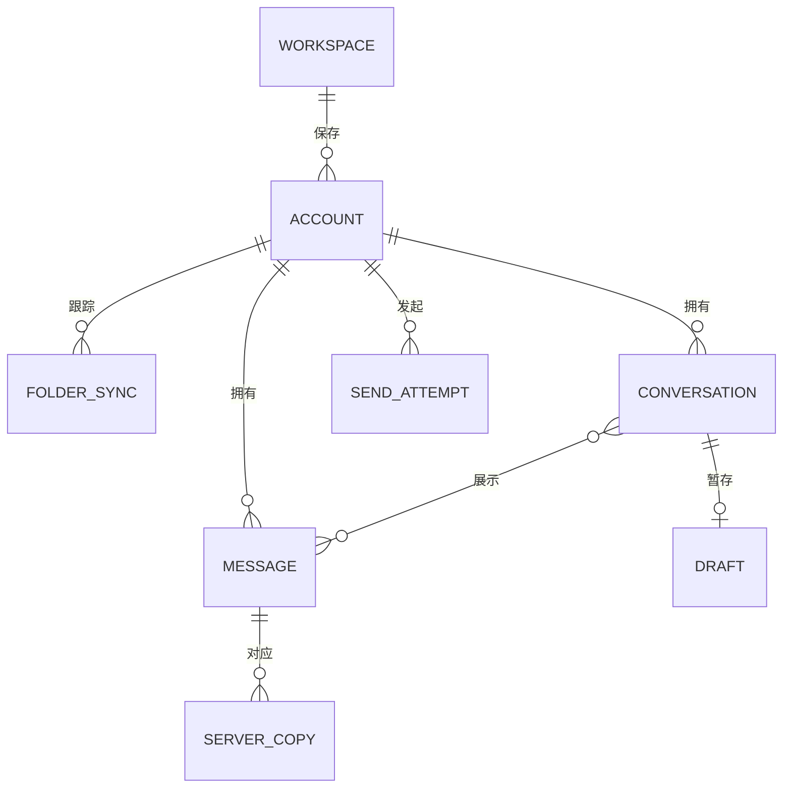

# 工作区邮箱数据模型设计

0.6.4 · 2026-11-19 · 字段与物理存储设计稿，服务于 [US-MAIL-01 至 US-MAIL-05](../43-需求-工作区邮箱与即时通讯式会话.md)。

## 账号归属

一个工作区可以留存多个邮箱账号的数据，同时最多托管其中一个。工作区保存可为空的当前账号引用。账号首次验证成功后分配稳定的本地 `account_id`。重新验证同一邮箱时复用其记录；明确清除该账号的本地数据后再次连接，按首次连接处理。



## 物理存储方案

联系人和邮件正文采用 UTF-8 JSONL。联系人资料有变动时追加一条完整的新版本；一封逻辑邮件的正文保存一份，已读变化、发送结果、服务器副本各自写入独立记录。打开会话时无需为每次已读变化重写整封邮件。配置、同步进度和草稿使用适合整体替换的小 JSON 文件，附件保存为二进制文件。

以下路径均以用户实际选定的工作区为根。邮箱独立于产品目录。目录在连接邮箱时创建，不随工作区模板下发。

```text
data/mail/
  workspace.json                         工作区邮箱标识、当前托管账号
  accounts/<account_id>/
    account.json                         账号身份、服务器配置、首次同步范围
    sync/inbox.json                      收件箱绑定和进度
    sync/sent.json                       已发送文件夹绑定和进度
    contacts.jsonl                       联系人资料版本
    messages/<YYYY-MM>.jsonl             逻辑邮件（含正文），按首次本地入库的 UTC 月份分片
    copies/<folder_id>.jsonl             服务器邮件映射与已读状态
    drafts/<contact_id>.json             当前本地草稿
    sends/<YYYY-MM>.jsonl                发送尝试及结果，按尝试创建月份分片
    attachments/<attachment_id>/content  附件原始字节
```

授权码另存于 Electron 的 `app.getPath('userData')/mail-credentials/<workspace_id>/<account_id>.bin`，使用主进程的 `safeStorage` 加密，与桌面端现有凭据处理方式一致。加密不可用时连接表单提示用户，禁止写明文。普通邮箱内容和附件按工作区本地文件保存，此方案只对授权码做应用层加密。[现有凭据实现](../../desktop/electron/github/github-auth.ts)

### 文件格式约定

下文字段均为必填，后缀 `?` 表示可缺省。ID 使用本地生成的 UUID，目录名使用本地 ID；原始邮箱地址、服务器文件夹名和附件原名只作为数据。时间戳使用带时区的 UTC ISO 8601 字符串；列表无元素时存空数组。每个 JSON 对象和每一行 JSONL 均带整数 `v`，首版为 1。JSONL 每行一个完整对象，以换行结束；正文中的换行按 JSON 字符串转义。账号目录是所有本地 ID、索引和引用的隔离边界。

## 字段字典

### 1. 工作区与账号

| 文件 | 字段和含义 |
| --- | --- |
| `workspace.json` | `workspace_id` 为本工作区邮箱模块首次使用时分配的稳定 ID；`active_account_id` 为当前账号 ID，可为 null；`connection_generation` 为非负整数，每次切换、断开或重新建立托管连接时递增。后台任务持有启动时的三个值。 |
| `account.json` | `account_id`、`email`（用户填写的地址）、`address_key`（匹配键）、`imap`、`smtp`、`first_connected_at`、`last_connected_at`、`initial_sync_mode`（`last_30_days / from_connection`）、`sync_from`（绝对时间）。首次双协议验证成功时一次性确定起点；重连只更新配置和最近连接时间。 |
| `imap`、`smtp` | 每项均含 `host`、`port`（整数）、`security`（`tls / starttls`）、`username`。两者可使用各自的服务器和登录名。工作区不存授权码。 |

归一化时剥离显示名和首尾空白，域名统一转小写，本地部分保留原值；不合并加号地址或供应商别名。同一工作区按已验证的地址键查找旧账号。已存账号可从各目录的 `account.json` 枚举，因此取消托管无需删除账号登记。

### 2. 每个文件夹的同步进度

| 字段 | 类型与含义 |
| --- | --- |
| `role`、`folder_id`、`remote_path` | 角色为 `inbox / sent`；后两项在待选择时为 null。绑定后，分别保存本地文件夹 ID 和服务器返回的精确名称。改绑其他目录时分配新 ID。 |
| `binding` | `standard / detected / manual / pending`。收件箱使用 INBOX，已发送优先使用服务器的用途标识；待选择只影响该角色。 |
| `uid_validity`、`last_scanned_uid` | 当前服务器 UID 有效期和已完整处理的扫描边界，整数；首次同步前分别为 null、0。游标按 UID 扫描顺序提交。 |
| `phase`、`initial_upper_uid` | `pending / backfill / incremental`；开始导入时固定当时的最高 UID（空文件夹为 0，尚未取值为 null）。先处理上界内符合时间范围的邮件，再接续上界之后的新邮件。中断时从已提交边界继续。 |
| `flags_modseq?`、`last_synced_at?` | 支持增量标记时记录服务器版本值（十进制字符串）；否则定期分批核对已知 UID 的标记。由此发现其他设备对旧邮件做的已读或未读修改。 |

补选文件夹时沿用 `account.sync_from`。按日筛选时保留边界日，再按服务器内部时间精确过滤。UID 有效期改变时，废弃旧游标并重建该文件夹当前副本映射，保留已入库的本地邮件。

### 3. 联系人、会话和邮件正文

| 记录 | 结构 |
| --- | --- |
| 联系人 | `contact_id, address_key, email, display_name?, company?, updated_at, rev`。账号内地址键唯一，`rev` 从 1 递增；读取最新完整版本。新地址未发出首封邮件前可先分配 ID 给草稿，联系人列表依据已收邮件或已接受发信决定是否加入。 |
| 会话 | 首版使用 `(account_id, contact_id)` 标识单聊，无独立会话文件。最近一条摘要、排序时间、草稿标识和未读数从消息、草稿与副本派生。取消托管和切换产品不改变会话标识。 |
| 消息身份 | `message_id` 为本地主键；`internet_message_id?` 为邮件头 Message-ID；`in_reply_to?` 和 `references[]` 保存被引用的邮件标识。普通新邮件的引用列表为空。 |
| 地址与归属 | `direction`（`incoming / outgoing`）、`from`、`to[]`、`cc[]`、`reply_to[]`、`bcc[]`（仅记录本账号实际可见的值）、`conversation_contact_ids[]`。每个地址对象含 `email, name?`。Alice 来信抄送 Bob 时，会话归 Alice；回复全部按原信实际地址构建并剔除本账号与重复地址。 |
| 内容与时间 | `subject, text_body?, html_body?, attachments[], occurred_at, ingested_at`。正文保留源邮件提供的文本形式。时间线按邮件日期排序，无可用日期时取服务器内部时间，再以本地 ID 打破平局。渲染 HTML 时需净化。 |
| 可选业务来源 | `source?` 含 `kind: outreach, product_id, lead_id` 和可用的原草稿定位信息。通过审核页发送时保存；普通往来可缺省。 |

发给多个联系人的同一封邮件可以从多个会话引用，正文只保存一次。用户在 Alice 会话里选择「回复全部」后，当前回复仍归入 Alice 的时间线，抄送人保留在收件详情。未读总数按本地消息去重。

以下是 `messages/2026-11.jsonl` 中的一行。ID 缩短仅为展示。

```jsonl
{"v":1,"message_id":"m1","internet_message_id":"<rfq-7@northwind.example>","references":[],"direction":"incoming","from":{"email":"alice@northwind.example","name":"Alice"},"to":[{"email":"sales@atlas.example"}],"cc":[{"email":"bob@northwind.example"}],"reply_to":[],"bcc":[],"conversation_contact_ids":["c1"],"subject":"询价","text_body":"请报 200 件的价格。","attachments":[],"occurred_at":"2026-11-18T02:32:00Z","ingested_at":"2026-11-19T01:00:00Z"}
```

### 4. 服务器邮件映射与已读状态

会话未读数只统计当前账号收到的未读来信。FTCS 发出的邮件在 SMTP 接受后即可显示在时间线上，同步到服务器的已发送副本时才追加映射。该副本的已读标记属于本方邮箱，不能据此判断对方是否已读。

`copies/<folder_id>.jsonl` 每行保存一份副本状态的新版本。字段为 `uid_validity, uid, message_id, seen, present, rev, updated_at, pending_seen?`。其中 `seen` 为最近确认的服务器已读值，`pending_seen` 为用户尚待写回的目标布尔值；写回成功后追加已确认版本并清除待办。UI 优先展示本地待写回值。服务器移除副本时追加 `present=false`。

同一账号内以「文件夹 ID + UID 有效期 + UID」唯一定位服务器副本。先按副本键查重，再结合邮件头 Message-ID、发件信息和内容特征识别逻辑邮件；单靠主题、时间或相同 Message-ID 不足以强行合并有冲突的内容。新副本可以指向已有消息。引用关系在本账号内通过邮件头标识解析，无法唯一定位原信时仍保留原标识。

### 5. 草稿、附件和发送尝试

| 文件或对象 | 字段与行为 |
| --- | --- |
| 单聊草稿 | `draft_id, contact_id, rev, mode, to[], cc[], subject, subject_mode, text_body, quoted_message_id?, attachments[], updated_at`。模式为 `new / reply / reply_all`；主题模式为 `first_line / manual / inherited`。未发送的新会话从草稿本身恢复目标地址。每次保存使用临时文件原子替换。 |
| 附件描述 | `attachment_id, filename, mime_type, size_bytes, availability`；状态为 `remote / local`。尚待下载的收件附件另存 `remote_part`（含 folder_id、uid_validity、uid、part），本地文件可由 ID 定位。选择本机附件时将字节复制进账号目录，成功后才发布引用，确保源文件移动后仍能恢复草稿。 |
| 发送尝试 | 首条记录含 `attempt_id, message_id, draft_id?, draft_rev?, created_at, state, snapshot`。快照使用上文消息的地址、主题、正文、引用、附件及业务来源字段，发送前固定出站 Message-ID。后续事件仅含 `attempt_id, rev, state, updated_at, error_code?, detail?`；首条 `rev=1`。详情只保存供用户诊断的脱敏信息。 |
| 状态 | 发起 SMTP 提交前持久化 `submitting`；结果为 `accepted / failed / unknown`。若进程在提交阶段退出，恢复为 `unknown`。明确接受时从快照生成同一本地 ID 的消息；只有本次提交的草稿版本仍匹配时清除它。失败或未知保留草稿与记录。未知结果不自动重发。 |

已发送副本可核对同一账号的本地尝试。可靠匹配后持久化接受结果并合并逻辑消息。原始附件字节由消息、草稿和发送尝试共享引用；移除草稿附件只解除该引用，确认没有其他引用时才回收文件。

## 读写、查询和崩溃恢复

- **写入者**。桌面主进程统一串行化同一账号的写入。异步读取或网络调用返回时再次校验工作区、账号和连接批次，再提交变化。切换、删除与写入共用同一互斥边界。
- **同步提交顺序**。先确保持久化附件、联系人、消息及副本记录，再原子替换游标文件。跨文件中断后重放尚未提交的范围。为避免“正文已落盘、副本尚未落盘”产生第二条消息，同步首次创建消息时在消息行附带可选的 `origin_copy`（folder_id、uid_validity、uid），重放先按这个键找回本地 ID。
- **读模型**。首次打开账号时逐行扫描各分片，建立地址键、会话时间线、服务器副本键、消息标识和草稿索引；正文索引只保留文件名、字节偏移与长度。打开会话按时间线分页，再按偏移读取对应正文。首版索引在内存中重建，账号切换后丢弃旧索引。大邮箱的冷启动时间和内存占用需在实现阶段用历史样本验证。
- **文件完整性**。追加日志时先完整序列化一行，刷新到磁盘后再确认写入。重启只接受完整行，尾部半行隔离后修复；遇到中间坏行应报告文件和位置并保留原件。小 JSON 使用同目录临时文件写完后原子替换。
- **发送恢复**。重启时重放尝试日志：已接受但尚未生成时间线消息的尝试，按同一 message_id 补记；已生成但尚未清理的原版本草稿，补做清理。恢复操作本身不调用 SMTP。

## 切换与恢复

1. **首次托管**。收发验证均通过后，保存当前账号及同步起点。收件箱和已发送分别从该起点同步。如果用户稍后才选定已发送文件夹，仍从原定起点补齐。
2. **取消托管**。停止该账号的收发与同步，清空当前托管引用、移除凭据。已离开的会话、附件预览、未读数及通知都应退出当前视图。
3. **连接其他账号**。即使 A 和 B 都与 Alice 通信，两份会话也按各自的账号 ID 读取。草稿、报价附件、业务来源和发送尝试不能跨账号引用。
4. **重连旧账号**。重新验证后，恢复该账号的本地数据，从各文件夹的有效进度继续。历史导入中断时续接未完成部分；重复读取同一副本时复用已有消息。
5. **明确删除本地数据**。单独确认具体邮箱地址，清理该账号在本机的记录、附件、凭据和同步进度。服务器上的原邮件及其他账号的数据保留。已删除账号的迟到结果不得重新建立其数据。

## 验收场景

| 场景 | 预期 |
| --- | --- |
| A 给 Alice 留下带报价附件的草稿，断开 A 后连接 B，再重新连接 A | B 看不到该草稿或附件；A 的正文、引用、收件范围和附件全部恢复。 |
| A 同步过程中切换到 B，A 的旧请求稍后返回 | 请求自发起时绑定工作区、账号和连接批次；旧结果不会写入 B、改变 B 的未读数或弹出 A 的通知。 |
| 首次历史导入中断，关闭期间在手机回复，再打开 FTCS | 从各文件夹自己的进度恢复；已提交的消息不重复，服务器上的手机发件副本进入对应会话。消息保存成功后才推进对应进度。 |
| A 的 SMTP 提交结果未知，之后切到 B 或重启 | 待确认记录留在 A，系统不会自动重发。若之后在 A 的已发送文件夹找到可可靠匹配的副本，将它关联到已有消息。 |
| 删除 A 的本地邮箱数据 | B 的会话与附件仍可用；再次连接 A 时重新选择首次同步范围。 |
