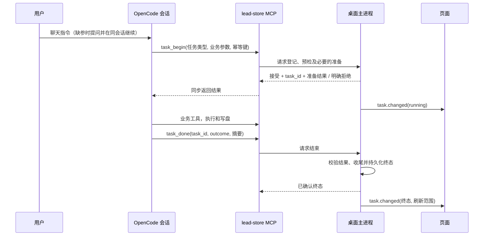

# 智能体任务生命周期与页面同步设计

状态：设计草案，2026-11-05。覆盖仓库全部 9 个业务 Skill，以及其批量、单条、渠道等执行变体。本文不实现代码；实现后取代 #138/#141 依赖提问题头切换任务会话的接线，原有需求中冲突的部分需同步修订。以用户体验为准，不改变既有业务结果和权限边界。

## 1. 目标和现状

- 聊天：在当前会话补参并执行；用户回答后模型继续，不因答案新建会话、清空聊天或中止原会话。取消提问不创建任务。
- 按钮：保持原有输入和环境检查，可以创建新会话。预检和会话创建失败也必须有明确反馈。
- 开始/结束：Skill 调用已有 `lead-store` 中新增的 `task_begin` / `task_done`；主进程统一维护任务状态和页面刷新事件。提问只是补参，页面不解析题头、不通过猜测写盘刷新。
- 状态代表实际任务生命周期，不以加载 Skill、发送消息、观察模型文本或普通提问结束推测开始/成功。终态刷新包括失败、取消和中断，因为部分结果可能已落盘。

现状依据：`AgentRunController` 的各 `run*` 各自发送 `state/done`；聊天在 `onQuestionSubmitted` 按题头解析后执行 `launchChatTask`；`useWorkspace` 的 done 触发 `refreshProducts/refreshPipelineArtifacts`；`LeadsView`、`ExploreView` 还监听 agentStatus；编排的 `waitForAgentDone` 目前只按 productId 匹配；探索另有 `exploration_start/update/finish` 业务记录。以上必须整体迁移，不能只添加两个工具。

## 2. 接线与职责



按钮路径在 begin 前增加「按钮 → 现有预检 → 可选 session.create → 任务指令」，之后与图中一致。按钮、聊天、编排和定时均使用同一个任务协调器，只有来源标识不同。

`lead-store` 当前是独立 stdio 进程，不能直接调用 Electron 内存中的函数。推荐主进程提供**仅本机**的内部请求通道，启动 MCP 时注入随机凭证与端点；MCP 两个工具转发请求并等待主进程响应。主进程是单一状态权威；MCP 本身不直接通过 stdout 发 Electron 事件，也不要求模型理解传输细节。凭证只进进程环境，严禁进入提示词、日志或工具结果；重启轮换。不能建立连接、认证失败或预检未通过时 `task_begin` 明确失败，Skill 停止，不能继续写业务数据。

**技术验证门槛**：当前代码能在 `message.part.updated` 观察工具事件和 sessionID，但这并不证明 stdio MCP handler 收得到可信 sessionID、工具 call ID，或 MCP 事件一定早于业务工具。实现前必须用当前 OpenCode SDK 和实际 MCP 验证关联字段、重连和取消行为。若 MCP 请求无法可信绑定当前会话/调用，不得把模型传入的 session_id 当作可信身份，也不得声称严格串行、幂等或权限隔离已成立；需要增加运行时可验证的会话绑定机制后再进入开发。图中的「监听」是逻辑关系，不假定 SSE 自带同步确认。主进程可订阅工具事件辅助诊断，但不得将未成功调用、重复事件或模型文本当作权威成功信号。

## 3. 协议 v1

调用参数是经过 schema 校验的 JSON；业务身份、任务身份与 OpenCode 会话身份分开。

### task_begin

```json
{
  "protocol_version": 1,
  "request_id": "uuid",
  "task_type": "extract-product-profile",
  "scope": { "product_id": null },
  "parameters": {
    "library_sources": ["绿森/官网.md", "绿森/说明书.pdf"]
  }
}
```

- `protocol_version`：必填，未知版本拒绝，不按默认值猜。
- `request_id`：本次启动请求的 UUID，重试必须保持；协调器按**经验证的会话身份 + request_id**去重；同键不同内容返回冲突。同一会话后续任务使用新键。
- `task_type`：下节登记表中的稳定枚举，**不要使用 UI 文案或模型臆造类型**。R1/R2/R3 使用对应 Skill 名；开发信批量和单槽共用 Skill 名，通过 `mode` 区分。
- `scope`：按类型强校验。`product_id`、`lead_id`、`recipient_key` 等是业务数据，不能代替 task_id。画像新建时 product_id 为 null；由桌面生成。对应文件路径必须是允许目录中的真实相对路径，检查绝对路径、`..`、盘符、链接及实际路径边界。
- `parameters`：按类型的白名单校验，承载来源、渠道选项和配置；不接受模型指定任意文件系统根、刷新事件或权限。客户端只提供来源和合理的业务选项，不可覆盖主进程安全校验及当前配置。
- `session_id`、`origin` 不由模型决定。主进程从可信上下文绑定会话；按钮/编排由桌面启动上下文登记，其他为 chat。request_id 不能充当身份凭证。

成功响应至少包括：

```json
{
  "ok": true,
  "task_id": "task_...",
  "state": "running",
  "scope": { "product_id": "prod_20261105_001" },
  "prepared": { "website_urls": [], "input_files": ["data/products/prod_20261105_001/inputs/说明书.pdf.txt"], "skipped": [] }
}
```

`task_id` 由主进程生成，单次运行唯一；`prepared` 按任务类型定义。响应里的任务参数是接下来执行业务的唯一权威，例如画像消费由桌面复制好的 inputs 路径，翻译消费桌面读取的外文稿。已接受同请求重试返回同一 task_id/结果；已结束时返回已有状态，不重启。未接受则 `ok:false`、稳定错误码、可展示中文说明；禁止伪造 task_id 或调用 done 冒充开始。

### task_done

```json
{
  "protocol_version": 1,
  "request_id": "uuid",
  "task_id": "task_...",
  "outcome": "succeeded",
  "message": "已完成并保存",
  "result": { "completed_count": 12, "skipped_count": 2 }
}
```

- `outcome` 取 `succeeded | partial | failed | cancelled`。`partial` 表示有结果但目标未全部完成；不作为编排成功。`cancelled` 也由用户中止/主进程兜底产生，模型不可覆盖已确认的中止。
- `message` 为简短用户可读描述，限制长度、去除秘密与原文；`result` 仅允许按任务类型白名单传汇总数量、探索业务 run_id 等，不接受任意路径、正文、邮件或敏感数据。刷新范围由主进程按 task_type 推导，不信任模型传来的任意刷新指令。
- 同一 task_id 仅允许一个权威终态；相同请求重试返回已有终态，不重复发通知或重复刷新。不同终态冲突返回当前终态；未知 task_id、跨会话结束、非法字段直接拒绝。`task_done` 的 MCP `ok` 仅表示登记请求成功，业务成败看 outcome。
- `succeeded` 是 Skill 的完成声明，主进程仍复用各 `run*` 现有的产物/业务记录校验后确定终态；校验失败降为 `failed` 或 `partial`，不得只因为调用过 done 就宣称成功。空目标是明确的 no-op 成功，需由任务类型规则确认，不能把缺资料、缺草稿当作 no-op。

建议对前端只暴露版本化 `task.changed`：`event_id`、`task_id`、`session_id`、`task_type`、`origin`、`scope`、`state`（`preparing | running | succeeded | partial | failed | cancelled | interrupted`）、`message`、`started_at`、`finished_at`、`refresh`。协调器递增版本/序列以去重和避免旧事件覆盖新状态；页面打开/重载通过 snapshot IPC 拉当前状态，再增量订阅，处理订阅和快照之间的竞态。页面不消费 MCP 原始事件。`preparing` 用于桌面预检与画像复制，用户可见但不能宣称 Skill 已开始；正式 `running` 在 begin 被接受后发出。按钮的预检/建会话失败可能没有 MCP 调用：由同一协调器登记并产生单一 failed 终态，不额外造一套页面刷新信号。提问取消发生在任务创建前，保留聊天提示，不造假任务。

## 4. 各任务接入与页面刷新

下表的 begin、写盘和 done 均需按对应 Skill 的执行顺序实现。所有条目的成功必须通过现网产物/业务规则核验；所有终态按表中范围重新读取已落盘事实，失败时同样刷新，以展示部分结果。页面只更新事件 product_id 对应的缓存：用户已切到另一产品时不得切换当前产品或将旧产品数据覆盖新产品。页面后续打开时仍从存储读取。

| 任务 / 入口 | begin 必填与桌面准备 | 业务写盘及 done 判断 | 终态刷新 |
| --- | --- | --- | --- |
| `extract-product-profile` | `library_sources[]`（至少一项实际原始文件或网站书签）；桌面分流并执行现有 `bootstrapProductFromLibrary`，原子分配 ID、复制文件、Office/PDF 侧车、`_sources.json`，返回 product_id、网站 URL、inputs 与 skipped。校验全部资料、所需内置浏览器及可选 Office 环境；不允许传用户任意路径。 | `product_save` 后读取对应 `profile.json`；draft 画像也是已生成，保留实际 readiness，不伪称 ready。全部输入不可用或保存失败为 failed；部分来源跳过但画像生成则按业务规则展示说明。 | 产品列表、对应画像/就绪度、流水线；新建产品仅在用户未切走且启动上下文仍有效时按现有交互切换，禁止强制覆盖用户切换。 |
| `expand-keywords` | `product_id`；检查画像 ready、至少一个产品及模型配置，注入各渠道目标和探索强度配置。 | `keywords_save` 后读取对应 `expansion.json`，按现有校验确认；保存失败为 failed。 | 对应产品的关键词、探索任务/配置及流水线。 |
| `discover-leads`（R1） | `product_id`，可选 max_queries；验证 ready 画像、R1 词、搜索通道/配额、内置浏览器和探索强度。 | 继续使用 `exploration_start/update/finish` 和 raw/R1 写盘；done 与**本次** exploration run 关联，完成/失败/部分保存以 run 状态和工具结果核验。 | 探索运行列表、原始线索、统计、流水线；进行中不猜写盘，完成或中断统一刷新。 |
| `discover-leads-r2` | 同 R1，但校验启用的社媒站点、带 site_id 的 R2 词与搜索配置；社媒摘要限制保持不变。 | 使用本次 R2 exploration run 与 raw/R2；站点/配额导致提前停止且有部分结果标 partial，失败按业务记录判定。 | 探索运行列表、原始线索、统计、流水线。 |
| `discover-leads-r3` | 同 R1，但校验合格 R3 词、Places 官方/BYOK、配额与浏览器；复用现有临时 key 获取、拒绝监测和释放/重载逻辑。 | 使用本次 R3 exploration run 与 raw/R3；Places 拒绝、配额耗尽等按已完成量判 failed/partial，始终执行资源释放和 run 收尾。 | 探索运行列表、原始线索、统计、流水线。 |
| `score-and-dedupe` | `product_id`；检查该产品已有可评分原始线索及评分规则，权限与配置沿用现网。 | 保存 scored/discarded；校验属于目标产品且为本次产物。历史产物存在不等于本次成功；无可处理数据按现网规则显式 no-op 或失败。 | 线索列表、分级/统计、流水线及受去重影响的邮件关联展示。 |
| `enrich-lead-contacts`（单条/批量） | `product_id`、`lead_ids[]`、`verify_emails`；验证目标均属于该产品，复用 Hunter 预检、密钥、配额和现有规则。聊天也支持单条及批量。 | `leads_patch_scored` 写 people；有处理成功又遇配额/失败用 partial，全部失败用 failed，真实无结果且正常查完可 no-op 成功。未经验证不填造邮箱。 | 对应产品线索列表、联系人抽屉及统计；不得覆盖当前正在编辑的未保存内容。 |
| `draft-outreach-email`（批量） | `product_id`，`mode=batch`，可选 `lead_ids[]`；未指定时采用现有待起草选择、排序/上限、行文风格和估算；线索均归属产品。 | 沿用 1+N 槽位计划与 `email_draft_save`；逐槽成功数、跳过数/失败数可记录；有产出又有失败用 partial。无待起草线索为 no-op 成功，不能无限等待 begin。 | 邮件列表/槽、线索邮件状态、统计和流水线；不覆盖未保存编辑。 |
| `draft-outreach-email`（单封/重写） | `product_id`、`mode=slot`、`lead_id`、`recipient_key`/必要对象信息；校验槽位归属、原有行文风格；聊天与按钮用同一槽约定。 | 只执行现有 `email_draft_plan_slot` + 单槽 `email_draft_save`；不得误改其他槽，核验目标槽的本次结果。 | 指定线索的邮件槽、线索邮件状态和摘要；如用户有未保存改稿则提示冲突并保留草稿。 |
| `translate-outreach-email` | `product_id`、`lead_id`、`recipient_key`（未指定且明确公司稿才默认 `company`）；只读验证产品归属、外文稿存在且非空，返回外文主题/正文供模型翻译；个人槽不回退。 | `email_draft_save_zh` 后校验目标槽中文及外文来源版本；翻译期间外文改变则标过期或失败，不覆盖外文、status、language。 | 指定邮件槽中文对照、过期状态及列表摘要。 |

`task_type` 是 9 个 Skill 的稳定名称；表中 10 行是因为起草 Skill 有两种业务模式。不得将 `exploration_start/finish` 替换为通用 task_begin/done：前者是探索领域持久记录，后者是统一生命周期；二者的 ID 分开。所有任务的 `parameters` 完整 schema、产物核验条件和可接受 no-op 列表必须作为实现验收的一部分，不得通过模型自由文本映射。

## 5. 画像资料准备及其他前置工作

聊天画像选的是 `data/library/files/` 内的原始文件和网站书签，题头/文案不作为控制协议。用户确认所选资料后，Skill 调 `task_begin`，主进程接收 `library_sources[]`、校验和去重，再调用与按钮共享的 bootstrap。ID 在复制前由桌面分配并创建目录，取消选择前不分配。ID 的现有 MCP `product_generate_id` 只计算不预留，不能拿来当并发安全预留。bootstrap 应提供独占创建和冲突重试；清理只作用于本任务创建的目录。失败、取消或应用退出时按事务阶段处理：尚未成功输出画像的临时目录回收或记录为可恢复中断，不删除其他任务、旧画像或已有用户文件；已经落盘的部分结果不得静默删除。Office/PDF 抽取可能耗时，preparing 显示可中止，不能依靠在复制后才检查一次取消。

桌面按钮和聊天统一调用同一个准备服务；按钮不能重复复制，Skill 不能再自行 generate ID 或复制。输入缺失时提问一次或按实际需要追问，答案本身不是启动信号；取消只结束提问。类似地，翻译外文稿、R3 Places 临时 key、批量目标筛选、环境预检也要抽成主进程可复用的准备服务，不能仅搬动状态事件而丢掉 `run*` 里的业务逻辑。

## 6. 状态、异常、权限与并发

状态机：`preparing → running → succeeded | partial | failed | cancelled | interrupted`；准备期间允许 `preparing → failed | cancelled | interrupted`。一次任务一个终态，终态不可回退；结束后仍可在同一聊天会话发起新任务。用户中止由主进程立即记录取消意图并请求中止 OpenCode，等待安全收尾；迟到的 done 不得改成成功。若中止前已经写盘，终态仍刷新。会话异常、模型停止/idle 却没有 done、MCP 断开、超时、应用退出均**不能推定成功**：按原因进入 interrupted/failed，回收浏览器和 Places 资源，对正在运行的对应 exploration run 执行既有失败收尾；重启读取任务快照并标记未完成任务 interrupted，再按范围刷新。模型正常请求 question 或等待用户授权不是 idle 完成：需区分等待状态，不因为等待而误判中断；超时策略按现有各任务执行上限配置，不以固定短超时杀死合法长探索。

本期保持现有单活动业务任务限制：另一个 begin/按钮/编排任务进入时返回 BUSY，不创建第二次运行；多个聊天会话或子代理发出的 begin 必须受同一协调器约束。明确禁止子会话冒充主会话结束任务；若要允许子代理参与执行，只允许父任务统一 begin/done，子代理不能开启平行顶层任务。重连重复事件、重试、乱序、双击、窗口重载都以 task_id + 单调序列去重。

用户确认必填或直接明确请求构成对应任务授权；执行期间依 FD3～FD7：内置 allowlist 自动放行、其他请求自动拒绝、工作区外硬拒。普通自由对话仍按原权限规则询问；不能因为一个 begin 永久授予整段会话任务权限。关键要求是 begin **接受前不执行任务型副作用**：Skill 遵守先 begin 后写；桌面/内置 MCP 对业务写入口额外实施与活动 task_id/会话绑定的门禁（必要时覆盖其它产生副作用的工具），防止模型遗漏或自行越过 begin。工具事件异步监听本身不能阻止模型继续，更不能保证严格权限切换；若当前运行时无法提供可验证的会话/工具调用关联，必须先解决运行时能力，不能以提示词自觉性作为强保证。退出时恢复普通对话授权。仅观察到 tool event 不构成可信业务成功。

## 7. 页面、编排、通知与兼容

- 状态卡根据 task.changed 的 state、task_type、scope 和统计渲染；不能用全局最近 skill 推断结束通知的任务名称。任务数据缓存以 product_id 区分，刷新时先失效缓存，再仅在对应页面/产品仍可见时拉取；异步结果检查版本，防止旧响应覆盖切换后的产品。保留用户未保存编辑，必要时显示「数据已更新」而非强制覆盖。
- 原有 `done` 和 `agentStatus` watcher 的任务完成刷新统一迁移到同一个 task.changed 终态处理器；登录、产品切换、手工保存、页面初次加载仍可独立读取，不属于任务信号。其他页面如资料库、线索详情和开发信详情逐一核对并接入上表范围；不要双重刷新或切换到别的产品。
- `waitForAgentDone` 改为按 task_id 等待终态，不得只按 product_id，避免同产品连续任务串线；启动 IPC 应返回可靠的 task_id，若实际 begin 尚未发生则先返回 launch_id 并提供映射/等待，确保立即失败和 no-op 均有终态，不能漏事件。编排对 partial/failed/cancelled/interrupted 停止并报告，不误进下一步；定时、通知抑制/恢复和任务完成通知沿用原产品行为，按 task_id 去重。编排整体完成通知仍只发一次。
- 工具变更、主进程状态机、Skill 契约、页面消费者必须作为一套版本交付。过渡期若保留旧 `state/done`，只做由新状态机派生的兼容适配，不允许旧 `run*` 再独立发第二套权威结果；按 task_id 去重，功能开关只允许整体切换和回滚，不让用户处于新 Skill + 旧桌面或相反的混合版本。应用与模板版本握手，不兼容就阻止任务并提示重启/更新。
- 升级 `WORKSPACE_TEMPLATE_VERSION`；修改 `workspace/mcp-servers/lead-store` 后执行该包 `npm run build` 或桌面 `npm run build:mcp`。桌面重启后同步 Skill、MCP 和配置。只写设计文档时不升模板版本、不打包。

## 8. 三个区域的状态联动

同一任务的生命周期事件由主进程统一发出，前端统一的任务状态仓库按 `task_id`、`session_id` 和 `product_id` 消费。三个区域各自投影相关数据，不要求每个区域在每次事件都重载；状态变化与产物读取使用同一个事件来源。聊天时间线仍是会话流，不用状态事件替换或清空。

| 区域 | 开始 / 准备中 | 成功、部分完成、失败、取消或中断 | 范围和切换规则 |
| --- | --- | --- | --- |
| 左侧产品信息与流水线 | 更新该任务所属产品的运行状态及对应流水线步骤；画像预备阶段尚无 ID 时，以任务上下文显示准备中，不将它标给当前其他产品。 | 失效并重读对应产品摘要、画像就绪度、流水线及相关统计；画像新建成功后更新产品列表。部分结果以实际数据展示，失败不能显示为完成。 | 产品列表可更新目标产品，但当前选择由用户控制；仅新建画像且用户未主动切换、启动上下文仍有效时可沿用既有自动选择行为。非目标产品的流水线不得显示正在执行。 |
| 主区域 | 当前页面属于目标产品时，显示该任务对应的运行中状态、进度及按钮可用状态；其他产品不冒用该任务的进度，同时全局单任务限制仍应如实禁用会冲突的启动操作。 | 按第 4 节任务表刷新画像、关键词、探索、线索、联系人、邮件或中文对照等受影响数据；失败和取消也刷新已保存的部分结果。 | 当前展示目标产品时更新页面；不在当前页面时只失效对应产品缓存，稍后打开再读取。不得切走用户当前标签或产品，异步响应按产品及版本校验；保留未保存的表单和邮件编辑。 |
| 右侧智能体卡片与会话 | 在发起任务的会话显示任务类型、关联产品、准备中或执行中状态；尚未生成产品 ID 时显示准备中的目标资料摘要。 | 同一任务卡显示成功、部分完成、失败、取消或中断及摘要，保留原会话时间线和问题卡；不把普通聊天当任务。 | 状态卡按 task_id/session_id 绑定；会话切换后不把 A 会话的卡片写到 B。当前全局单任务状态可用于禁用冲突操作，但不能把其他会话的任务冒充为当前会话任务。再次打开原会话可从快照恢复状态。 |

实际代码中 `Sidebar.vue` 使用 `products`、`activeProductId`、`pipelineSteps`；`useWorkspace.ts` 目前把 `agentSkill`、`agentStatus` 和 `agentMeta` 存成全局单份，并在收到任务状态时直接设置 `activeProductId`。实现时必须调整为按任务及产品关联，再分别派生三个区域；否则切换产品或会话后会发生运行状态串位、强制切回或卡片归属错误。现有产品切换、手工编辑保存等非任务操作仍使用各自的数据读取流程。

补充验收：每一类任务分别在开始和终态核对三栏；任务中切换到另一产品及另一会话，再切回，检查左侧流水线、主区域结果和右侧卡片的归属；同时验证新画像准备时尚无 ID、后台失败有部分结果、未保存编辑及窗口重载恢复。不得只验证主区域列表刷新。

## 9. 实施顺序和验收

1. **运行时尖峰验证**：在当前 SDK 验证 MCP handler 与可信会话/调用的关联、请求响应时序、主进程阻塞确认、权限切换、崩溃/重连与同会话多次执行；产出可复现测试和明确方案。若无法实现绑定，先解决运行时能力，不上线假一致性。
2. 抽任务协调器、参数校验、去重、持久状态恢复、前端订阅与按 task_id 的编排等待；提供各业务预检/准备/收尾服务，不复制业务逻辑。
3. 一次性覆盖全部 9 个 Skill、上表各变体，接入现有探索业务 run、R3 key、通知和浏览器清理；删除 `onQuestionSubmitted` 的题头启动分支及相应技能「回答后停止另开会话」说明，普通提问继续可用。更新需求/设计中与旧链路冲突之处。
4. 端到端验证后切换统一刷新与旧事件适配；构建 MCP、升级模板、重启桌面。暂不分批面向用户发布只覆盖部分技能的混合状态。

验收按上表每一行分别执行「按钮、聊天参数齐全、聊天缺参选择、取消、成功、失败、部分落盘后失败/取消、无目标」；检查同会话 ID 不变、时间线不清空、对应状态卡和页面刷新、准确产品/线索/槽、数据未误改。重点增加：画像网站+文件+Office/PDF/图片混选与目录越界；R1/R2/R3 各自 run 及 R3 key 释放；联系人批量部分失败；批量/单槽邮件与个人中文对照；模型漏 begin/done、MCP 断开、重复/冲突/乱序、用户点击中止、会话异常、应用重启、另一个产品切换、未保存编辑、双击/并发、编排每一步和定时触发。核验非 allowlist 任务中自动拒绝、普通对话询问、工作区外硬拒；确认旧题头逻辑及监听 agentStatus 猜测完成均不再产生页面任务刷新。自动化应涵盖协议/状态机、真实 MCP 通道集成、各任务准备与产物核验、页面竞态及编排；最后做真实桌面+模型手测，不以模拟工具事件代替端到端证据。
